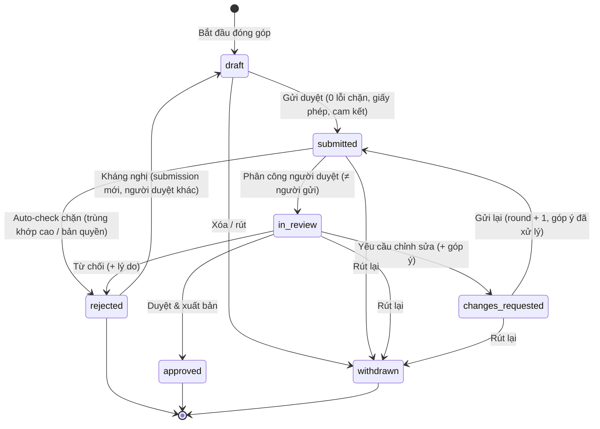
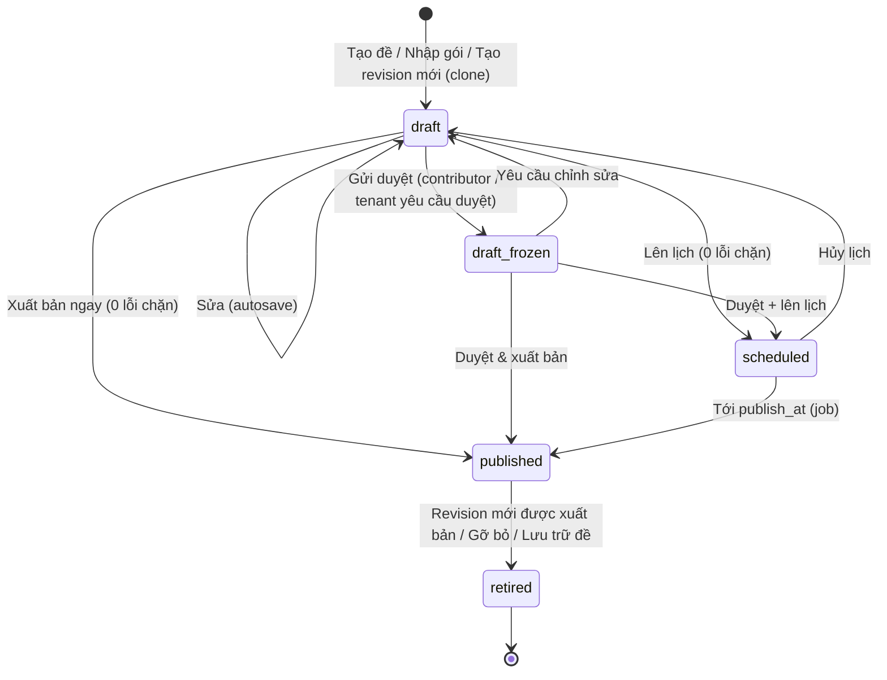

# Engrisk — Hệ sinh thái nội dung: Luyện đề có hình ảnh · Content Studio · Đóng góp cộng đồng · Kiểm duyệt (design spec)

> Thiết kế chi tiết cho việc **tạo, nhập, kiểm tra, duyệt và xuất bản đề** (Engrisk, tổ chức/tenant, cộng đồng) và cách nội dung đó xuất hiện ở trang **Luyện đề**.
> Prototype: `ux-preview.html` — màn `catalog`, `contribute`, `studio`, `studio-editor`, `studio-import`, `moderation`; thanh công cụ prototype có **Vai trò** (Học viên · Giáo viên Sunrise · Content admin Engrisk) để xem mỗi vai trò thấy gì.
> Code tham chiếu: `scripts/screens-studio.js`, `screens-community.js`, `screens-practice.js` (catalog), `ui.js` (`examCover`, `coverSpec`), `data.js` (`ROLES`, `CONTENT_ITEMS`, `PEOPLE`, `CONTRIBUTORS`), `styles/studio.css`, `community.css`.
> Dữ liệu: `backend/docs_design/schema.dbml` — `exams.provenance/cover_style`, `exam_revisions`, `revision_audio_tracks`, `content_import_jobs`, `content_submissions`, `submission_reviews`, `review_comments`, `exam_credits`, `exam_ratings` (mapping đầy đủ ở §20).
> Đi cùng: `product_flow.md` (D13–D14, E, H, J, K) · `ux_spec.md` (§2, §7, F15–F16) · `exam_practice_spec.md` §3.

---

## 1. Mục tiêu & phạm vi

### 1.1 Vấn đề
- Trang **Luyện đề** chủ yếu là chữ: các bộ đề trông giống nhau, khó nhận ra loại đề, kỹ năng, nguồn gốc.
- Đội nội dung Engrisk và trung tâm (tenant) cần **công cụ thật** để tải đề, audio, script; hiện chỉ có “công cụ nội bộ tối giản”.
- Kho đề tăng chậm nếu chỉ đội nội bộ soạn. Người học giỏi và giáo viên muốn đóng góp nhưng không có đường đi an toàn (bản quyền, chất lượng).

### 1.2 Mục tiêu
| # | Mục tiêu | Chỉ số thành công (đề xuất) |
|---|---|---|
| G1 | Catalog **nhận diện được bằng mắt**: loại đề, kỹ năng, nguồn gốc trong < 1 giây | Tỷ lệ bấm vào đề từ catalog +15%; tree test “tìm bộ Part 3” ≥ 90% |
| G2 | Đội nội dung xuất bản 1 đề TOEIC 200 câu **không cần kỹ sư** | Thời gian từ gói nhập → xuất bản ≤ 1 ngày làm việc; ≥ 80% gói qua kiểm tra lần đầu |
| G3 | Giáo viên tenant tạo bài cho lớp trong ≤ 20 phút (P4) | Thời gian tạo practice set 15 câu (trung vị) |
| G4 | Hệ sinh thái đa dạng nhưng **an toàn**: nội dung cộng đồng luôn qua duyệt, gốc, có ghi công | 0 sự cố bản quyền chưa xử lý > 48 giờ; SLA duyệt ≥ 90% đúng hạn; ★ trung bình đề cộng đồng ≥ 4.3 |

### 1.3 Không thuộc phạm vi (non-goals)
- Không có marketplace bán đề, chia doanh thu, xếp hạng/leaderboard người đóng góp, streak.
- Không cho tải lên **đề thi thật** (ETS, IDP, British Council, Cambridge) hoặc “đề nhớ lại” từ kỳ thi thật — kể cả khi người dùng nói đã mua.
- Không soạn đề Writing/Speaking trong Studio đợt này (chỉ objective: TOEIC L&R, IELTS Reading/Listening). Rubric Writing/Speaking giữ trong code.
- Không xuất bản trực tiếp nội dung cộng đồng mà bỏ qua duyệt; không AI tự xuất bản.
- Không có trình chỉnh sửa audio đầy đủ (cắt/ghép/khử ồn) — chỉ QC, chuẩn hóa loudness và căn chỉnh cue. Hậu kỳ làm ngoài hệ thống.
- Không có màn quản trị RBAC; quyền seed từ code (như P1).

---

## 2. Vai trò & quyền

### 2.1 Ma trận năng lực
| Năng lực | Học viên (cộng đồng) | Giáo viên (tenant, P4) | Content admin (platform) |
|---|---|---|---|
| Tạo/sửa bản nháp | Bản nháp cộng đồng của mình (`submission.create`) | Bản nháp của tenant (`content.author`) | Bản nháp platform (`content.author`) |
| Nhập gói (ZIP/Excel) | — | ✓ trong tenant (`content.import`) | ✓ (`content.import`) |
| Audio & script, cue | ✓ (đóng góp Listening Part 1–4) | ✓ | ✓ |
| Xuất bản | **Không bao giờ trực tiếp** → Gửi duyệt | Cho tenant của mình (`content.publish_tenant`, `visibility = tenant`) | Catalog công khai (`content.publish`) |
| Hàng đợi duyệt | — | Bài gửi vào tenant (`content.review_tenant`) | Cộng đồng + nội bộ (`content.review`) |
| Phạm vi hiển thị | Công khai sau khi duyệt | Chỉ thành viên tenant | Công khai / cấp phép tenant (`exam_licenses`) |
| Access tier | Không chọn (mặc định `guest`) | `registered` (thành viên) | `guest` · `registered` · `premium` |
| Ảnh bìa | Ảnh bìa tạo tự động (không tải ảnh) | Tạo tự động hoặc tải ảnh | Tạo tự động hoặc tải ảnh |

Prototype map: `ROLES.learner.perms = [exam.take, submission.create]`, `ROLES.teacher.perms = [exam.take, content.author, content.publish_tenant, content.review_tenant]`, `ROLES.content_admin.perms = [content.author, content.import, content.review, content.publish]`.

### 2.2 Quy tắc bất biến
1. **Không ai tự duyệt bài của mình** — `content_submissions.assigned_reviewer_user_id ≠ submitter_user_id` (CHECK) và `submission_reviews.reviewer_user_id ≠ submitter` (service).
2. **Revision đã xuất bản là bất biến.** Sửa = tạo revision nháp mới (clone); bài đang làm dở tiếp tục trên revision cũ; bài mới dùng revision mới.
3. Nội dung cộng đồng được xuất bản **trong platform tenant** với `provenance = community` + `exam_credits` (≥ 1 tác giả).
4. `provenance` đặt khi tạo, **không đổi sau lần xuất bản đầu** (nhãn tin cậy không thể “rửa”).
5. Quyền kiểm tra theo permission + `active_tenant_id` của phiên; giáo viên Sunrise không thấy bất kỳ gì của tenant khác.
6. Nội dung tài liệu cá nhân (`rights_basis = personal_study_only`) không bao giờ đi vào Studio/submission (CHECK trên `content_import_jobs`, `content_submissions`).

---

## 3. IA & điều hướng

### 3.1 Sơ đồ
```
Engrisk
├── Học tập: Trang chủ · Luyện đề (/practice) · AI Tutor · Tiến độ
├── Thư viện (học viên)
│   ├── Tài liệu của tôi        /library                 [P3]
│   └── Đóng góp đề             /contribute              [P3]  (ẩn với khách)
└── Nội dung (staff: giáo viên, content admin)
    ├── Content Studio          /studio                  [P3 platform · P4 tenant]
    │   ├── Trình soạn đề       /studio/exams/:draftId
    │   └── Nhập gói đề         /studio/import
    └── Kiểm duyệt (badge n)    /studio/review/:submissionId
```

### 3.2 Sidebar theo vai trò (Web)
| Vai trò | Nhóm sidebar | Mục |
|---|---|---|
| Khách | Thư viện | Tài liệu của tôi (P3 chip) — **không** có “Đóng góp đề” |
| Học viên | Thư viện | Tài liệu của tôi · **Đóng góp đề** (icon `square-plus`) |
| Giáo viên / Content admin | **Nội dung** (thay nhóm Thư viện) | **Content Studio** (`layers`) · **Kiểm duyệt** (`shield-check`) + badge = số mục `in_review` trong phạm vi tenant hiện tại |

- Nhóm “Học tập” giữ nguyên cho mọi vai trò (staff vẫn xem catalog như người học để kiểm tra hiển thị).
- Badge Kiểm duyệt là `Chip accent sm` có số; ẩn khi = 0 (không hiển thị “0”).
- Studio, Kiểm duyệt dùng container rộng `page__inner--wide` (1360px); các trang học giữ 1120px.
- Tenant switcher ở đầu sidebar quyết định **phạm vi** Studio: platform tenant → “Thư viện Platform”, Sunrise → “Thư viện Sunrise”.

### 3.3 Mobile
- Tab bar giữ 5 đích; Studio/Kiểm duyệt/Đóng góp mở từ tab **“Tôi”** (hàng ListGroup có icon + badge), tab “Tôi” được highlight khi ở các màn này.
- Mobile là **giám sát · duyệt · trả lời**, không phải soạn thảo (§14).

### 3.4 Điểm vào
| Từ | Đến | Điều kiện |
|---|---|---|
| Catalog section “Từ cộng đồng” → “Đóng góp đề” | `contribute` | Khách → `auth` (chuyển đổi) trước |
| Results → thẻ đánh giá ★ → “Báo lỗi câu hỏi” | Studio todo của chủ sở hữu đề | Đã hoàn thành bài |
| Studio “Tạo đề mới” | `studio-editor` (draft mới) | `content.author` |
| Studio “Nhập gói đề” | `studio-import` | `content.import` |
| Studio todo “Chờ duyệt” / hàng có trạng thái in_review | `moderation` tập trung vào mục (`A.modOpen({id})`) | `content.review*` |
| Contribute “Tiếp tục soạn” / “Sửa theo góp ý” / “Bắt đầu đóng góp” | `studio-editor` chế độ contributor (`A.studioOpen({id, as:'contributor'})`) | `submission.create` |
| Thông báo “Bài đóng góp được duyệt/cần sửa” | `contribute` (cuộn tới mục) | — |

---

## 4. Luyện đề (`catalog`) — hình ảnh, icon, nguồn gốc

> Chi tiết bố cục catalog: `exam_practice_spec.md` §3. Phần này mô tả **ngôn ngữ hình ảnh** dùng chung với Studio/Contribute.

### 4.1 Ảnh bìa đề (cover art)
- Một hàm duy nhất `examCover(idOrSpec, {h, compact})` dựng bìa từ spec `{track, skill, kind, label, origin}`; Studio và Contribute gọi qua `coverSpec(item)` — **một nguồn hình ảnh cho cả hệ sinh thái**.
- **Nền:** gradient từ token tint kỹ năng (`tint-listening` / `tint-reading` / mixed = accent-soft → secondary). Không mã màu cứng → tự đúng ở 5 preset, sáng/tối và accent tenant.
- **Motif theo loại** (SVG vẽ bằng `currentColor` + opacity, decorative `aria-hidden`):

| Loại | Motif |
|---|---|
| TOEIC full mock | Phiếu trả lời xếp chồng + 2 thanh L/R |
| Listening (Part/section) | Thanh sóng âm (waveform bars) |
| Reading (Part/section) | Dòng chữ + khối đoạn văn |
| IELTS | Trang passage có tiêu đề đoạn (headings) — khác hẳn TOEIC |
| Practice set ngắn | Thumbnail `compact` 56–64px, chỉ motif + label |

- **Label lớn trong mờ** (“01”, “P5”) ở góc phải dưới, `tnum`.
- **Badge nguồn gốc** (góc trái trên, luôn có chữ + icon, không chỉ màu): `Engrisk Original` (`shield-check`) · tenant mark (logo/viết tắt tenant + “Thành viên”) · cộng đồng (avatar tác giả + “Cộng đồng”).
- Ảnh tải lên (`exams.cover_asset_id`, chỉ staff) thay motif nhưng **badge nguồn gốc vẫn vẽ đè** bởi hệ thống — không thể giả nhãn Engrisk Original.
- `exams.cover_style` lưu motif/tint/label đã chọn; mặc định suy ra từ `exam_type + kind + skill_focus`.

### 4.2 Icon Part & dạng câu hỏi
Tile icon nằm trong `tile` tô màu theo kỹ năng; số Part vẫn là chữ chính (icon bổ trợ, không thay chữ).

| TOEIC | Icon | IELTS dạng câu | Icon |
|---|---|---|---|
| P1 Photographs | `camera` | True/False/Not Given | `check-double` |
| P2 Question–Response | `comments` | Matching headings | `list-ul` |
| P3 Conversations | `persons` | Summary completion | `text` |
| P4 Talks | `volume` / `microphone` | Matching features | `link` |
| P5 Incomplete Sentences | `font` | Form completion | `square-dashed-text` |
| P6 Text Completion | `file-text` | Map labelling | `map-pin` |
| P7 Reading Comprehension | `files` / `book-open` | Multiple choice | `list-check` |
| | | Note completion | `pencil` |

### 4.3 Section “Từ Sunrise English” (khi `active_tenant` là tổ chức)
- Vị trí: **trên** “Đề thi thử đầy đủ” (bài được giao quan trọng hơn kho chung — L2).
- Thẻ: bìa compact có tenant mark, tên, chip “Chỉ thành viên” (`persons-lock`), “Giao bởi Hạnh Vũ” (avatar giáo viên), chip “Hạn 30/10” (khi có), CTA “Làm bài”.
- Ẩn hoàn toàn khi tenant không có đề đã xuất bản (không empty state ở catalog).

### 4.4 Section “Từ cộng đồng” và tab loại “Cộng đồng”
- Thứ tự khi tab loại = “Tất cả”: [Từ Sunrise English] → Đề thi thử đầy đủ → Luyện theo Part / Dạng câu hỏi → Bài luyện ngắn → **Từ cộng đồng**. Tab loại thêm **“Cộng đồng”** (sau “Bài ngắn”) chỉ hiện section này.
- `sectionTitle` “Từ cộng đồng” + count + hành động phải **“Đóng góp đề”** (`btn tertiary sm`): học viên → `contribute`, khách → tạo tài khoản, staff → ẩn (staff đã có Studio).
- Thẻ đề cộng đồng: bìa compact + avatar tác giả, tên, chip **“Đã kiểm duyệt”** (`shield-check`, success-soft), ★ 4.7 (`star-fill`, kèm số lượt đánh giá trong `aria-label`), lượt làm (“1,2k lượt”), giấy phép (“CC BY 4.0” hoặc “Engrisk license”), CTA “Bắt đầu”.
- Thẻ đề thi thử đầy đủ cũng hiện ★ + lượt làm cạnh badge Engrisk Original.
- Production: ★ chỉ hiện khi ≥ 10 đánh giá (`exam_ratings`), dưới ngưỡng hiện “Mới”. Dữ liệu prototype đều trên ngưỡng nên luôn hiện ★.
- Cột cố định cho ★/lượt làm/CTA để các hàng thẳng cột.

### 4.5 Nhãn tin cậy (trust labels)
| `provenance` | Nhãn | Màu + icon | Ở đâu |
|---|---|---|---|
| `engrisk_original` | Engrisk Original | accent-soft · `shield-check` | bìa, exam-intro |
| `tenant_authored` | Tên tenant · Thành viên | tenant accent · `persons-lock` | bìa, exam-intro |
| `community` | Cộng đồng · Đã kiểm duyệt | success-soft · `shield-check` + avatar | bìa, thẻ, exam-intro, results (credits) |
| `licensed_partner` (P4) | Tên đối tác | default · `briefcase` | bìa, exam-intro |

`exam-intro` thêm dòng **Ghi công** (tác giả, giọng đọc) và giấy phép cho đề cộng đồng; results thêm thẻ đánh giá ★ + “Báo lỗi câu hỏi”.

---

## 5. Content Studio — thư viện (`studio`)

**Mục tiêu:** biết ngay việc cần làm và tình trạng mọi đề trong phạm vi, mở đúng đề trong ≤ 2 thao tác.

| Vùng (trên → dưới) | Component | Hành vi |
|---|---|---|
| Banner phạm vi | Card secondary: icon tile + “Thư viện Platform — xuất bản lên catalog công khai” / “Thư viện Sunrise — chỉ thành viên Sunrise” + tenant mark; phải: **Tạo đề mới** (primary) · **Nhập gói đề** (secondary) | Phạm vi theo `active_tenant_id`; không có công tắc phạm vi trong trang (đổi bằng tenant switcher) |
| KPI (4 `stat`) | Đang soạn · Chờ duyệt · Đã xuất bản · Lượt làm (tổng trên các đề đã xuất bản) | Bấm KPI = áp bộ lọc tương ứng |
| Việc cần làm | 1 card `cardHead` + `list list--divided list--flush`: mỗi hàng icon trạng thái + mô tả + CTA (“Sửa 7 lỗi”, “Duyệt”, “Xem góp ý”) | Ưu tiên: lỗi chặn trên đề sắp lên lịch → bài chờ duyệt quá SLA → gói nhập lỗi → báo lỗi từ người học → nháp lâu chưa sửa (> 14 ngày). Tối đa 5 hàng + “Xem tất cả” |
| Bảng nội dung | Card + `table`; header: bộ lọc trạng thái (`tabs sm`: Tất cả · Bản nháp (gồm Cần sửa) · Chờ duyệt · Đã lên lịch · Đã xuất bản · Lưu trữ), ô tìm kiếm, `Select` kỳ thi, `Select` nguồn (Biên soạn · Nhập gói · Cộng đồng) | Xem cột bên dưới. Nháp cộng đồng (`draft`, riêng tư) **không** hiện trong thư viện staff — chỉ xuất hiện khi đã gửi duyệt |

**Cột bảng** (độ rộng cố định cho cột meter/chip):

| Cột | Nội dung |
|---|---|
| Đề | Bìa `compact` 48px + tên (2 dòng tối đa) + dòng phụ “TOEIC L&R · Practice set” |
| Trạng thái | `chip` có icon: Nháp (`pencil`) · Chờ duyệt (`clock`) · Cần sửa (`comment`) · Đã lên lịch (`calendar` + ngày) · Đã xuất bản (`circle-check`) · Lưu trữ (`box`) |
| Revision | “r3” `tnum` (+ “nháp r4” nếu có nháp mới) |
| Hiển thị | icon + chữ: Công khai (`globe`) · Thành viên (`persons-lock`) · Riêng tư (`lock`) |
| Quyền truy cập | Khách · Đăng ký · Premium |
| Chủ sở hữu | `avatar sm` + tên |
| Cập nhật | `fmtDate` |
| Hoàn thiện | `meter` câu đã soạn/tổng + icon audio (Đủ / Thiếu một phần / Thiếu) + số lỗi |
| ⋯ | Menu: Mở · Xem trước · Tạo revision mới · Nhân bản · Lưu trữ · Xem lịch sử |

- Hàng `tr.is-click` + `tabindex=0` + `data-action` mở `studio-editor`; hàng `in_review` mở `moderation` nếu người xem có quyền duyệt và **không phải** người gửi.
- Sắp xếp mặc định: cập nhật mới nhất. Phân trang 25 hàng.
- **Lưu trữ** đề đã xuất bản: AlertDialog nêu số người đang làm dở (“12 bài đang làm vẫn hoàn thành được; đề ẩn khỏi catalog”).

---

## 6. Trình soạn đề (`studio-editor`) — khung & tab Tổng quan, Cấu trúc

### 6.1 Header (card cố định đầu trang)
- Trái: bìa compact · tên đề (h1) · chip kỳ thi/loại · chip trạng thái + revision (“Nháp r4 · dựa trên r3”).
- Giữa: **trạng thái lưu** (“Đang lưu…” → “Đã lưu 14:32”; mất mạng → “Lưu trên thiết bị”, warning).
- Phải: **Xem trước** (secondary, mở player ở chế độ preview không ghi attempt) · **CTA chính theo vai trò**:

| Vai trò / chế độ | CTA chính | Điều kiện bật |
|---|---|---|
| Content admin | Xuất bản (menu: Xuất bản ngay · Lên lịch) | 0 lỗi chặn |
| Giáo viên (P4) | Xuất bản cho lớp | 0 lỗi chặn |
| Contributor (`as:'contributor'`) | Gửi duyệt | 0 lỗi chặn + chọn giấy phép + tick cam kết |

- CTA disabled kèm lý do 1 dòng (“Còn 3 lỗi chặn — xem tab Kiểm tra”), không tooltip-only.

### 6.2 Tab (badge = số lỗi chặn của tab, `danger` chip có số; cảnh báo không lên badge)
`Tổng quan` · `Cấu trúc` · `Audio & Script` (ẩn nếu đề không có Listening) · `Câu hỏi` · `Kiểm tra & xuất bản` (contributor: `Kiểm tra & gửi duyệt`).
Trạng thái tab lưu trong URL (`?tab=audio&q=32`) để deep-link “Sửa”.

### 6.3 Tab Tổng quan
| Section (card) | Trường | Validation | Ghi chú |
|---|---|---|---|
| Thông tin | Tên đề (≤ 80 ký tự, bắt buộc) · slug (tự sinh, sửa được, unique trong tenant) · mô tả (≤ 280) · kỳ thi (khóa sau khi có câu hỏi) · loại (`full_mock`/`section_test`/`practice_set`) · kỹ năng trọng tâm · độ khó 1–5 | Blur: độ dài; submit: slug trùng → “Đường dẫn đã dùng bởi …” | Tên đề: tiếng Anh hoặc song ngữ VI/EN |
| Ảnh bìa | Preview `examCover` lớn + chọn motif (4 tile) + label (“04”) · “Tải ảnh lên” (staff; JPG/PNG/WebP ≥ 1200×675, ≤ 5 MB) | Ảnh: kích thước tối thiểu, quét an toàn | Badge nguồn gốc luôn do hệ thống vẽ |
| Phát hành | Hiển thị (Công khai/Thành viên/Riêng tư — theo quyền) · Quyền truy cập (Khách/Đăng ký/Premium) · Giấy phép (contributor) | Hiển thị không hợp lệ theo vai trò thì không render (không disabled) | Contributor không thấy Hiển thị/Quyền truy cập |
| Ghi công | Danh sách `exam_credits`: người (tìm thành viên hoặc tên ngoài) + vai trò (Tác giả/Giọng đọc/Biên tập/Dịch) + kéo thả thứ tự | Đề cộng đồng: ≥ 1 tác giả | Người duyệt chỉ hiện nếu opt-in |
| Lịch sử revision | List r1…rn: ngày, người xuất bản, ghi chú phát hành, số lượt làm | — | “Tạo revision mới từ r3” |

### 6.4 Tab Cấu trúc
- **Section** (card mỗi section): key (`L`/`R` hoặc IELTS `P1–P4`/`R1–R3`), tên, kỹ năng, `delivery` (Theo audio / Tính giờ), thời gian, quy tắc (nghe lại, highlight).
- **Part** trong section: tag Part + icon (§4.2), tên chuẩn tiếng Anh, khoảng số câu (“32–70”), số câu đã soạn / yêu cầu (`meter`), directions (English, rich text ngắn).
- **Mẫu cấu trúc** khi tạo đề: TOEIC full (7 Part, 200 câu, 45′ + 75′), TOEIC section, TOEIC practice set theo Part, IELTS Reading (3 passage, 40 câu, 60′), IELTS Listening (4 Part, 40 câu, ~30′ + 2′ kiểm tra), Tùy chỉnh.
- Validation: tổng số câu khớp mẫu chuẩn khi `kind = full_mock` (chặn); khoảng số câu liên tục, không trùng (chặn); practice set 5–40 câu (cảnh báo ngoài khoảng).
- Đổi cấu trúc khi đã có câu hỏi: AlertDialog liệt kê câu bị ảnh hưởng; không xóa câu, chuyển về “Chưa xếp”.

---

## 7. Tab Audio & Script

**Mục tiêu:** một bản ghi section chuẩn kỹ thuật, mỗi câu có mốc thời gian (cue) đúng, script chính xác để làm transcript cho phần xem lại.

### 7.1 Bố cục (Web)
```
┌ Audio file card (QC) ───────────────┐┌ Timeline ──────────────────────────────────────────────┐
│ L_full.wav · 44:52 · 48 kHz · mono  ││ [Part 1][  Part 2  ][      Part 3      ][   Part 4   ]  │ ← band theo Part
│ Loudness −16.2 LUFS  ✓              ││ ▁▃▅▇▅▃▁▂▅▇▆▃▁ … waveform …              ▲playhead     │
│ True peak −1.4 dBTP  ✓              ││  |1 |2 |3 …  |32|33|34 …  cue markers (màu = trạng thái)│
│ Quét an toàn  ✓ Sạch                ││ [⏮][◀5s][▶︎][5s▶][1.0×]  00:12:31 / 00:44:52  [− zoom +]│
│ [Thay file] [Chuẩn hóa loudness]    │└────────────────────────────────────────────────────────┘
└─────────────────────────────────────┘
┌ Script (cardHead + “Tự căn chỉnh”) ──────────────────────────────┐┌ Cue (coverage) ────────┐
│ 12:02–12:09 · Q32 · M1 · US · “Excuse me, is this the …”  0.97  ││ Khớp 92 · Cần kiểm tra 5│
│ 12:09–12:15 · Q32 · W1 · UK · “Yes, but the meeting …”    0.81 ⚠││ · Thiếu 3               │
└──────────────────────────────────────────────────────────────────┘└────────────────────────┘
Alert (info, flat): “Transcript được bảo vệ — chỉ hiện cho người học ở phần Xem lại.”
```

### 7.2 QC file audio (`revision_audio_tracks` + `content_assets`)
| Kiểm tra | Ngưỡng đạt | Cảnh báo | Chặn xuất bản | Sửa nhanh |
|---|---|---|---|---|
| Định dạng | WAV PCM 16/24-bit, FLAC, MP3 ≥ 192 kbps | MP3 128–191 kbps | Khác / < 128 kbps | — |
| Sample rate | 44.1 kHz hoặc 48 kHz | — | Khác (22.05, 32 kHz…) | — |
| Kênh | Mono (khuyến nghị) / Stereo | Stereo lệch pha | > 2 kênh | Downmix |
| Loudness tích hợp (EBU R128) | **−16 LUFS ± 1** | ± 1–3 LU | Lệch > 3 LU | “Chuẩn hóa loudness” (tạo file mới, giữ bản gốc) |
| True peak | **≤ −1.0 dBTP** | — | > −1.0 dBTP | Limiter khi chuẩn hóa |
| Clipping | 0 mẫu | 1–10 mẫu | > 10 mẫu | — |
| Khoảng lặng đầu/cuối | 0.5–2 s | Ngoài khoảng | — | Cắt/thêm lặng |
| Nền nhiễu | ≤ −60 dBFS | −60 đến −50 | > −50 dBFS | — |
| Thời lượng | Khớp mẫu (TOEIC L ≈ 45′ ± 10%; IELTS Part ≈ 6–10′) | Lệch 10–20% | — | — |
| Dung lượng | ≤ 500 MB/file | — | > 500 MB (từ chối upload) | — |
| Quét malware / nội dung | Sạch | — | `quarantined` | — |

- Upload: `content_assets(pending_upload)` → presigned PUT → quét + đo → `available`. Đo đạc lưu ở `revision_audio_tracks.qc` (kể cả khi trượt) để hiển thị lý do.
- Delivery: server transcode bản phát (AAC/Opus) từ master; master không bao giờ gửi cho người học.

### 7.3 Căn chỉnh tự động (forced alignment)
- Nút “Tự căn chỉnh” (cần script đủ) → `ai_runs(purpose = audio_alignment)` → tiến trình inline (không chặn màn) → kết quả là cue + confidence cho từng câu và từng segment script.
- Áp dụng không ghi đè cue `source = manual` trừ khi chọn “Ghi đè cả cue thủ công”.
- Ngưỡng: confidence ≥ 0.90 → **Khớp**; 0.70–0.89 → **Cần kiểm tra**; < 0.70 hoặc không có → **Thiếu**.
- Kết quả căn chỉnh là gợi ý: người soạn bấm “Chấp nhận” cho từng cue cần kiểm tra (kéo marker trên timeline hoặc nhập mm:ss.mmm).

### 7.4 Mô hình cue
`cues[] = {position, start_ms, end_ms, confidence, source: aligned | manual | imported}`
- `position` = số câu thật (`exam_revision_items.position`). Mỗi câu Listening của section có đúng 1 cue (chặn nếu thiếu).
- `start_ms < end_ms`, nằm trong `[0, duration_ms]`; cue tăng dần theo position (chặn nếu đảo thứ tự).
- Câu cùng group (Part 3/4: 3 câu/hội thoại) dùng chung khoảng hội thoại, cue riêng bắt đầu từ lúc đọc câu hỏi; chồng lấn chỉ được phép trong cùng group.
- Dùng cho: mock tự chuyển trang theo audio; practice “nghe lại câu này”, transcript đồng bộ; review nhảy tới đoạn bằng chứng.

### 7.5 Script & transcript được bảo vệ
- `script_segments[] = {start_ms, end_ms, speaker (M1/W1/N…), accent (US/UK/CA/AU), text}` — luôn **tiếng Anh**.
- Mỗi hàng script: thời gian · Q# · người nói/giọng (Select) · text (textarea tự giãn) · confidence (chip). Thêm/tách/gộp hàng bằng phím (Enter tách, ⌫ đầu dòng gộp).
- Nhập script: dán văn bản, `.srt`/`.vtt`, hoặc từ gói nhập. TOEIC: khuyến nghị đa dạng giọng (US/UK/CA/AU) — cảnh báo nếu 1 giọng > 60% section.
- **Bảo vệ:** script/cue không bao giờ có trong API phục vụ bài làm; chỉ trả ở review (sau khi trả lời ở practice / sau nộp ở mock), giống `question_groups.transcript`.

---

## 8. Tab Câu hỏi

### 8.1 Bố cục 3 cột (Web)
| Cột | Rộng | Nội dung |
|---|---|---|
| Điều hướng | 260px | Nhóm theo Part (tag + icon); mỗi câu: số + chấm trạng thái (Hoàn chỉnh `circle-check` · Thiếu `circle-dashed` · Lỗi `triangle-exclamation` · Có góp ý `comment`) — icon + màu. Lọc: Tất cả · Có lỗi · Có góp ý · Cờ AI |
| Biên tập | flex | Form câu hỏi (§8.2) |
| Xem trước người học | 360px | Render đúng player (TOEIC/IELTS), toggle “Hiện đáp án” |

Phím: `J/K` câu sau/trước, `⌘S` lưu ngay (vẫn autosave), `1–4` chọn đáp án đúng khi focus nhóm phương án.

### 8.2 Trường của câu hỏi
| Khối | Trường | Bắt buộc | Validation |
|---|---|---|---|
| Stimulus | Part 1: ảnh + **alt text** (≤ 250 ký tự, mô tả khách quan, không lộ đáp án) · Part 3/4/IELTS Listening: đoạn audio của group (từ cue) · Reading: passage (rich text, đoạn đánh số) | Ảnh P1 + alt; passage cho Part 6/7 | Ảnh ≥ 1200px cạnh dài; alt trống → chặn |
| Câu hỏi | Stem (English) | Trừ TOEIC P1/P2 (không in stem) | ≤ 300 ký tự (cảnh báo) |
| Phương án | A–D (P2: A–C) · radio **đáp án đúng** | Đủ số phương án + đúng 1 key (single choice) | Phương án trùng nhau → chặn; độ dài lệch > 2× → cảnh báo “phương án đúng dễ đoán” |
| Dạng khác | TFNG (key T/F/NG) · completion (danh sách chấp nhận, giới hạn từ) · matching (bảng ghép) · multiple choice chọn 2 | Theo `question_type` | Giới hạn từ khớp directions |
| Giải thích | VI (bắt buộc) · EN (khuyến nghị) | VI | ≥ 40 ký tự |
| Bằng chứng | Chọn vùng trong passage/script → `evidence_span` | Reading/Listening: khuyến nghị | Thiếu → cảnh báo |
| Kỹ năng | Skill tags (≥ 1, 1 primary) từ `skills` | ✓ | — |
| Độ khó | 1–5 | ✓ (mặc định 3) | — |
| Cờ AI | `review_flags` (mơ hồ đáp án, phương án nhiễu yếu, lỗi ngữ pháp) — chip warning + “Bỏ qua kèm lý do” | — | Cờ mở = cảnh báo, không chặn |
| Góp ý người duyệt | Thread `review_comments` neo vào câu/trường (contributor mode) + “Đánh dấu đã xử lý” | — | Góp ý chưa xử lý → chặn Gửi duyệt lại |

- Sửa câu thuộc revision đã xuất bản → tạo version mới (copy-on-write, `supersedes_id`); thông báo nhỏ “Câu này dùng ở 2 đề khác — các đề đó vẫn giữ phiên bản cũ”.

---

## 9. Tab Kiểm tra & xuất bản (validation checklist)

### 9.1 Danh sách kiểm tra
Mỗi hàng: icon trạng thái + mô tả + số lượng + **“Sửa”** (deep-link đúng tab/câu/cue). Lỗi chặn trên, cảnh báo dưới, đạt thu gọn (“18 mục đạt”).

**Chặn (blocking) — phải = 0 để Xuất bản / Gửi duyệt**
| Mã | Kiểm tra |
|---|---|
| B01 | Cấu trúc đủ: số câu theo section/Part khớp mẫu (`full_mock`), không trùng/khuyết số câu |
| B02 | Mỗi câu khách quan có đáp án hợp lệ (single choice đúng 1 key; completion ≥ 1 đáp án chấp nhận) |
| B03 | Đủ phương án theo Part; không phương án trùng |
| B04 | Giải thích tiếng Việt cho mọi câu |
| B05 | Ảnh có alt text (Part 1, bản đồ, biểu đồ) |
| B06 | Mỗi câu Listening có audio + cue; cue hợp lệ (§7.4) |
| B07 | Audio đạt ngưỡng chặn (§7.2): sample rate, true peak, loudness lệch > 3 LU, quét an toàn |
| B08 | Script đủ cho mọi câu Listening (transcript cho review) |
| B09 | Thông tin: tên, slug unique, kỳ thi, loại, bìa |
| B10 | Quyền sử dụng đã xác nhận; nguồn không phải `personal_study_only` |
| B11 | (Contributor) Giấy phép đã chọn; không còn góp ý chưa xử lý; kiểm tra tính nguyên bản không phát hiện trùng khớp cao |
| B12 | Không có câu hỏi `archived` hoặc thuộc tenant khác |

**Cảnh báo (warning) — không chặn, hiển thị trong tóm tắt xuất bản**
| Mã | Kiểm tra |
|---|---|
| W01 | Loudness lệch 1–3 LU; clipping nhẹ; khoảng lặng ngoài 0.5–2 s |
| W02 | Cue “Cần kiểm tra” (confidence 0.70–0.89) |
| W03 | Thiếu giải thích tiếng Anh / thiếu evidence span |
| W04 | Cờ AI chưa xử lý |
| W05 | Phân bố độ khó lệch (> 60% một mức) hoặc đáp án đúng lệch (> 35% cùng một chữ cái) |
| W06 | Giọng đọc một accent > 60% (TOEIC) |
| W07 | Stem/passage dài bất thường so với chuẩn Part |
| W08 | Practice set ngoài 5–40 câu |

### 9.2 Tóm tắt xuất bản
- **Thay đổi so với revision trước** (`based_on_revision_id`): +n câu mới, ~n câu sửa, −n câu bỏ, audio thay/không đổi, cấu trúc đổi/không.
- **Ghi chú phát hành** (`release_notes`, tùy chọn, ≤ 500 ký tự).
- **Thời điểm:** Xuất bản ngay · Lên lịch (DatePicker + giờ, theo múi giờ tenant) → `status = scheduled`.
- **Tác động:** “124 bài đang làm tiếp tục trên r3; bài mới dùng r4. Kết quả cũ không đổi.” (Không bao giờ đổi revision của attempt đang làm.)
- Xác nhận: Modal tóm tắt 1 màn (không AlertDialog đỏ — đây là hành động bình thường). Sau xuất bản: toast + link “Xem trên catalog”.
- Contributor: thay khối Thời điểm bằng **Giấy phép** (Engrisk non-exclusive · CC BY 4.0), tick “Tôi cam kết nội dung do tôi tự soạn, không sao chép đề thi thật” + lời nhắn cho người duyệt → **Gửi duyệt**.

---

## 10. Nhập gói đề (`studio-import`)

### 10.1 Stepper 4 bước
`Chuẩn bị gói` → `Tải lên` → `Kiểm tra` → `Tạo bản nháp`. Mỗi bước 1 primary; quay lại không mất dữ liệu; job lưu ở `content_import_jobs` nên có thể rời trang và quay lại.

| Bước | Nội dung | Primary |
|---|---|---|
| 1. Chuẩn bị gói | 3 mẫu tải về: **Excel manifest** (`.xlsx` có data validation), **JSON schema**, **gói ZIP mẫu** (TOEIC Part 5 + Part 3 có audio); cây thư mục ZIP; bảng cột (§10.3) | Tiếp tục |
| 2. Tải lên | Dropzone ZIP (hoặc chọn file) + Select kỳ thi + **Quyền sử dụng** (Tự soạn / Được cấp phép / Phạm vi công cộng) + tick xác nhận; tiến trình upload (resumable) | Kiểm tra gói (disabled tới khi chọn quyền + tick) |
| 3. Kiểm tra | Tóm tắt (dòng OK / lỗi / cảnh báo, file khớp / thiếu / thừa) → **bảng lỗi** (dòng · cột · mã · thông báo · cách sửa) lọc theo mức độ → ghép audio/ảnh (list file ↔ câu, trạng thái) | **Tạo bản nháp, bỏ qua n dòng lỗi** (lỗi mức gói thì disabled); phụ: Tải báo cáo CSV · Tải gói đã sửa lên lại |
| 4. Tạo bản nháp | Tạo `exams` (nếu mới) hoặc revision nháp mới của đề có sẵn + `exam_revisions(draft)` + `question_groups` + `questions(origin = imported)` + `revision_audio_tracks` trong 1 transaction; dòng lỗi bị bỏ qua thành câu còn thiếu (ví dụ prototype: TOEIC Test 04 = 193/200) | Mở trình soạn ở tab **Kiểm tra & xuất bản** để thấy ngay các câu còn thiếu |

### 10.2 Cấu trúc gói ZIP
```
toeic-practice-test-04.zip
├── manifest.xlsx                 # hoặc manifest.json / manifest.csv (UTF-8)
├── audio/
│   ├── L_full.wav                # (tuỳ chọn) bản ghi liên tục cả section → revision_audio_tracks
│   ├── p1_q001.mp3               # audio theo câu/group (P1, P2) …
│   └── p3_g032.mp3               # … hoặc theo group (P3/P4: 1 hội thoại = 3 câu)
├── images/
│   └── p1_q001.jpg               # ảnh Part 1, biểu đồ P3/P4/P7, bản đồ IELTS
├── passages/
│   └── p7_g147.md                # passage Markdown (đoạn đánh số), P6/P7, IELTS Reading
└── scripts/
    ├── L_full.vtt                # (tuỳ chọn) script có mốc thời gian
    └── p3_g032.txt               # hoặc script thuần, speaker ở đầu dòng: "M1(US): …"
```
Giới hạn: ZIP ≤ 2 GB, ≤ 5.000 file, đường dẫn tương đối ASCII (không `..`, không symlink), tỉ lệ nén ≤ 100:1 (chống zip bomb), text UTF-8.

### 10.3 Manifest — sheet `exam` (1 dòng) và `groups`
| Cột | Kiểu | Bắt buộc | Ghi chú |
|---|---|---|---|
| `manifest_version` | text | ✓ | `engrisk-import/1.2` |
| `exam_type` | enum | ✓ | `toeic_lr` · `ielts_academic` · `ielts_general` |
| `kind` | enum | ✓ | `full_mock` · `section_test` · `practice_set` |
| `title` | text ≤ 80 | ✓ | |
| `slug` | text | — | Tự sinh nếu trống |
| `difficulty` | int 1–5 | — | Mặc định 3 |
| `section_audio` | path | — | Ví dụ `audio/L_full.wav` |
| `group_id` (sheet `groups`) | text | ✓ | Khóa nội bộ gói, ví dụ `g032` |
| `stimulus_type` | enum | ✓ | `passage` · `audio` · `image` · `audio_image` |
| `passage_file` / `audio_file` / `image_file` | path | theo loại | |
| `image_alt` | text ≤ 250 | khi có ảnh | |
| `script_file` | path | Listening | |

### 10.4 Manifest — sheet `questions`
| Cột | Kiểu | Bắt buộc | Ghi chú |
|---|---|---|---|
| `question_no` | int | ✓ | Số câu thật (TOEIC 1–200, IELTS 1–40), unique |
| `part` | text | ✓ | `P1`…`P7` (TOEIC) · `L1`…`L4`, `R1`…`R3` (IELTS) |
| `group_id` | text | P3/P4/P6/P7, IELTS | Tham chiếu sheet `groups` |
| `question_type` | enum | ✓ | `single_choice` · `multiple_choice` · `fill_blank` · `matching` · `short_answer` |
| `stem` | text | trừ P1/P2 | English |
| `option_a` … `option_d` | text | single/multiple choice | P2 chỉ A–C |
| `answer` | text | ✓ | `B` · `A;C` · `TRUE` · `NOT GIVEN` · danh sách chấp nhận `cost|costs` |
| `word_limit` | int | completion | “NO MORE THAN TWO WORDS” → 2 |
| `explanation_vi` | text | ✓ | |
| `explanation_en` | text | — | |
| `evidence` | text | — | Trích nguyên văn từ passage/script; hệ thống tìm vị trí |
| `skill_codes` | list (`;`) | ✓ | Mã trong `skills`, cái đầu = primary |
| `difficulty` | int 1–5 | — | Mặc định theo exam |
| `audio_file` | path | Listening nếu không có `section_audio` | |
| `audio_start_ms` / `audio_end_ms` | int | — | Cue nhập sẵn (`source = imported`) |
| `image_file` / `image_alt` | path / text | P1 | |
| `transcript` | text | Listening nếu không có `script_file` | |

### 10.5 Mã lỗi & cảnh báo
| Mã | Mức | Thông báo (VI) | Cách sửa gợi ý |
|---|---|---|---|
| `E_ZIP_UNREADABLE` | Lỗi gói | Không mở được file ZIP | Nén lại bằng ZIP chuẩn (không RAR/7z) |
| `E_ZIP_UNSAFE` | Lỗi gói | Đường dẫn không an toàn / tỉ lệ nén bất thường | Bỏ `..`, symlink; nén lại |
| `E_MALWARE` | Lỗi gói | File bị cách ly do quét an toàn | Xóa file, tải lại |
| `E_MANIFEST_MISSING` | Lỗi gói | Thiếu manifest ở thư mục gốc | Đặt `manifest.xlsx` cạnh `audio/` |
| `E_MANIFEST_VERSION` | Lỗi gói | Phiên bản mẫu không hỗ trợ | Tải mẫu mới ở bước 1 |
| `E_COLUMN_MISSING` | Lỗi | Thiếu cột bắt buộc `{column}` | Thêm cột theo mẫu |
| `E_TYPE` | Lỗi | Giá trị `{value}` không đúng kiểu `{type}` | Ví dụ `difficulty` phải là số 1–5 |
| `E_QNO_DUPLICATE` | Lỗi | Số câu `{n}` xuất hiện 2 lần | Sửa `question_no` |
| `E_QNO_GAP` | Lỗi (`full_mock`) | Thiếu câu `{from}–{to}` | Bổ sung hoặc đổi `kind` |
| `E_PART_RANGE` | Lỗi | Câu `{n}` không thuộc khoảng của `{part}` | TOEIC P5 = 101–130 |
| `E_OPTIONS_COUNT` | Lỗi | `{part}` cần `{k}` phương án | P2: A–C; P1, P3–P7: A–D |
| `E_KEY_MISSING` | Lỗi | Thiếu đáp án | Điền cột `answer` |
| `E_KEY_INVALID` | Lỗi | Đáp án `{value}` không có trong phương án | |
| `E_EXPLANATION_MISSING` | Lỗi | Thiếu giải thích tiếng Việt | Điền `explanation_vi` |
| `E_GROUP_UNKNOWN` | Lỗi | `group_id` không có trong sheet `groups` | |
| `E_FILE_NOT_FOUND` | Lỗi | Không tìm thấy `{path}` trong gói | Kiểm tra tên file (phân biệt hoa thường) |
| `E_AUDIO_FORMAT` | Lỗi | Audio `{path}` sai định dạng / sample rate | WAV/FLAC/MP3 ≥ 192 kbps, 44.1/48 kHz |
| `E_AUDIO_PEAK` | Lỗi | True peak `{x}` dBTP > −1.0 | Chuẩn hóa sau khi nhập hoặc xử lý lại |
| `E_IMAGE_ALT_MISSING` | Lỗi | Ảnh thiếu mô tả thay thế | Điền `image_alt` |
| `E_SKILL_UNKNOWN` | Lỗi | Mã kỹ năng `{code}` không tồn tại | Xem danh sách ở mẫu Excel |
| `E_TRANSCRIPT_MISSING` | Lỗi | Câu Listening thiếu script | `script_file` hoặc `transcript` |
| `W_EXPLANATION_EN_MISSING` | Cảnh báo | Thiếu giải thích tiếng Anh | |
| `W_EVIDENCE_NOT_FOUND` | Cảnh báo | Không tìm thấy đoạn bằng chứng trong passage | Trích nguyên văn |
| `W_LOUDNESS` | Cảnh báo | Loudness `{x}` LUFS ngoài −16 ± 1 | Chuẩn hóa trong Studio |
| `W_FILE_UNUSED` | Cảnh báo | File `{path}` không được dùng | Xóa khỏi gói |
| `W_DEFAULTED` | Cảnh báo | `{column}` trống, dùng mặc định | |
| `W_SIMILARITY` | Cảnh báo | Câu `{n}` giống câu đã có trong ngân hàng (`{score}`) | Kiểm tra trùng lặp |

Bảng lỗi hiển thị 500 dòng đầu; báo cáo đầy đủ tải CSV. Lỗi mức **gói** dừng ngay (`status = failed`), không kiểm tra từng dòng.

---

## 11. Đóng góp đề (`contribute`) — học viên

**Mục tiêu:** người học giỏi đóng góp bộ luyện gốc chất lượng, biết rõ luật chơi trước khi bỏ công, theo dõi trạng thái minh bạch. Không gamification.

| Vùng (trên → dưới) | Nội dung | Ghi chú |
|---|---|---|
| Hero | Giá trị chương trình (“Bộ đề của bạn giúp người học khác — được kiểm duyệt và ghi công”) + số liệu **thật**: người đã có bộ xuất bản → tác động cá nhân (bộ đã xuất bản · lượt làm · đánh giá TB); lần đầu/chưa có → số liệu cộng đồng (người đóng góp · bộ cộng đồng đã duyệt · lượt làm) + **Pip** (duy nhất trên màn) + CTA “Bắt đầu đóng góp” | Không số liệu phóng đại; không “Top contributor” |
| Đóng góp của tôi | Card list: bìa compact + tên + **pipeline trạng thái** 4 bước `Nháp → Gửi duyệt → Đang duyệt → Xuất bản` (bước hiện tại có icon + chữ) + hành động theo trạng thái; `changes_requested` hiện góp ý người duyệt + thread trả lời | Xem bảng dưới |
| Ghi công người đóng góp | Avatar + tên hiển thị (có thể dùng bút danh) + số bộ đã xuất bản, đang duyệt, tỉ lệ “hữu ích” (★ ≥ 4), “Tham gia từ 08/2026” | Không xếp hạng, không streak |
| Quy trình duyệt | 4 bước có icon: Gửi → Kiểm tra tự động → Người duyệt (3–5 ngày làm việc) → Xuất bản + ghi công | Giải thích trước khi người học bỏ công |
| Bắt đầu đóng góp | Grid tile loại: TOEIC Reading Part 5 · Part 6 · Part 7 · TOEIC Listening Part 1–4 (cần audio + script) · IELTS Academic passage · **Full mock** (khóa tới khi có **3 bộ đã xuất bản** + `lock`) | Mỗi tile: icon Part, số câu gợi ý, thời gian soạn ước tính |
| Hướng dẫn & chính sách | Accordion 8 mục: Nội dung gốc · Đáp án + giải thích bắt buộc · Quy tắc audio (§7.2, giọng đọc đồng ý) · **Audio TTS phải gắn nhãn** · Giấy phép (giữ bản quyền + cấp phép không độc quyền **hoặc** CC BY 4.0) · Thời gian duyệt 3–5 ngày làm việc · Ghi công · Gỡ bỏ trong 48 giờ khi có khiếu nại | Link “Điều khoản đóng góp” đầy đủ |

**Hành động theo trạng thái (`content_submissions.status`)**
| Trạng thái | Hiển thị | Hành động |
|---|---|---|
| `draft` | “Nháp · 3/6 câu · thiếu audio” | Tiếp tục soạn (Web) / “Tiếp tục trên máy tính” (Mobile) · Xóa (có Hoàn tác) |
| `submitted`, `in_review` | “Đang duyệt · dự kiến trước 31/10” (từ `sla_due_at`) | Rút lại (AlertDialog) |
| `changes_requested` | Alert warning + n góp ý (trích 2 góp ý đầu, neo “Câu 3 · Phương án”) | **Sửa theo góp ý** (mở editor contributor mode, thread góp ý ở cột phải) · Trả lời góp ý |
| `approved` | “Đã xuất bản · 1.240 lượt · ★ 4.7” | Xem trên catalog · Tạo revision mới |
| `rejected` | Lý do (mã + lời nhắn) | Kháng nghị (1 lần, trong 14 ngày) |
| `withdrawn` | Mờ, cuối danh sách | Gửi lại |

- Khách: trang hiển thị hero + chính sách + CTA “Tạo tài khoản để đóng góp” (không tile soạn).
- Empty (chưa có đóng góp): khối “Đóng góp của tôi” thay bằng empty state ngắn + chọn loại.

---

## 12. Kiểm duyệt (`moderation`)

### 12.1 Bố cục Web: hàng đợi | chi tiết | quyết định
| Vùng | Nội dung |
|---|---|
| Hàng đợi (trái, 360px) | Tabs: **Chờ duyệt** · **Cần sửa** · **Đã xử lý**. Mỗi hàng: bìa compact, tên, chip nguồn (**Cộng đồng** / **Giáo viên** / **Nội bộ** — suy ra từ `exams.provenance`), người gửi (avatar), vòng (“Vòng 2”), **SLA** (`sla_due_at` = ngày gửi + 5 ngày; “còn 2 ngày” · warning khi < 1 ngày · danger “Quá hạn” + icon), cờ tự động (chip số). Sắp theo `sla_due_at`. |
| Chi tiết (giữa) | Header: tên, người gửi, giấy phép, quyền sử dụng, lời nhắn cho người duyệt. Tabs: **Nội dung** (câu hỏi theo Part ở chế độ review: đáp án, giải thích, audio + transcript, nút “Góp ý” trên mỗi câu/trường) · **Kiểm tra tự động** · **Lịch sử** (vòng trước, quyết định, góp ý đã xử lý, diff giữa các vòng) |
| Quyết định (phải, 320px, sticky) | Checklist người duyệt (§12.3) · danh sách góp ý của vòng này · 3 nút: **Duyệt & xuất bản** (primary, disabled tới khi checklist đủ) · **Yêu cầu chỉnh sửa** (secondary, cần ≥ 1 góp ý) · **Từ chối** (danger-soft, cần lý do) |

Người duyệt thấy phạm vi theo quyền: content admin → platform tenant (cộng đồng + nội bộ); giáo viên có `content.review_tenant` → tenant của mình. Mục do chính mình gửi **hiển thị nhưng khóa** (“Bạn không thể duyệt bài của mình”).

### 12.2 Kiểm tra tự động (`content_submissions.auto_checks`)
| Kiểm tra | Cách làm | Kết quả |
|---|---|---|
| Schema & đầy đủ | Checklist §9 (B01–B12) | Pass / Fail (Fail không thể gửi nên hiếm khi thấy) |
| Tính nguyên bản | `ai_runs(originality_check)`: so khớp văn bản với ngân hàng Engrisk + corpus đề thi đã biết + web | `max_similarity`; ≥ 0.80 **Chặn**, 0.50–0.79 **Cần xem**, kèm đoạn trùng |
| Dấu vân tay bản quyền | Fingerprint audio (so với audio đề thật đã biết) + perceptual hash ảnh | Khớp → chặn + takedown hold |
| Chất lượng audio | QC §7.2 | Pass / Warn / Fail |
| Ngôn ngữ & chính tả | Kiểm tra tiếng Anh của stem/passage/script | Số lỗi gợi ý |
| An toàn nội dung | Phân loại nội dung nhạy cảm, PII (số điện thoại, email thật) | Pass / Flag |
| Đáp án AI đối chiếu | AI giải độc lập, so với key | Câu lệch → cờ “Kiểm tra đáp án” |

Kiểm tra tự động **không bao giờ tự duyệt** — chỉ gợi ý và có thể tự **chặn** (similarity cao, khớp bản quyền).

### 12.3 Checklist người duyệt (`submission_reviews.checklist`, 6 mục)
1. Nội dung gốc, không phải đề thật hay đề nhớ lại.
2. Đáp án đúng và duy nhất (đã tự làm thử ≥ 20% số câu, ưu tiên câu có cờ).
3. Giải thích đúng, dẫn bằng chứng.
4. Audio rõ, script khớp, cue đúng (Listening; audio TTS có nhãn).
5. Độ khó, tag kỹ năng, thông tin & ghi công hợp lý.
6. Ngôn ngữ chuẩn, an toàn, không thiên kiến, không dữ liệu cá nhân.

Góp ý neo vào câu + trường: Chung · Đề bài · Phương án · Giải thích · Audio (`review_comments.field` = `general` · `stem` · `options` · `explanation` · `audio`; schema cho phép thêm `answer_key`, `stimulus`, `image_alt`, `script`, `metadata`).

### 12.4 Quyết định
| Quyết định | Yêu cầu | Hệ quả |
|---|---|---|
| Duyệt & xuất bản | 6/6 checklist, không auto-check chặn; disabled nếu người duyệt là chủ sở hữu | `submission → approved`; revision → `published` (hoặc `scheduled`); cộng đồng: `exams.visibility = public`; tạo `exam_credits`; thông báo người gửi |
| Yêu cầu chỉnh sửa | ≥ 1 góp ý neo câu/trường | `changes_requested`; revision mở lại để sửa; “Gửi duyệt lại” chỉ bật khi mọi góp ý đã xử lý; vòng mới `round + 1` |
| Từ chối | Lý do bắt buộc + lời nhắn | `rejected` (prototype hiển thị như đề lưu trữ, icon `circle-xmark-fill`); lý do `copyright` → khóa nội dung + ghi chú vi phạm vào hồ sơ người gửi (3 lần → tạm khóa quyền đóng góp) |

Lý do từ chối (`submission_reviews.reason_code`): `copyright` (bản quyền / đề thật) · `format` (sai định dạng/cấu trúc) · `quality` (đáp án sai, giải thích yếu, audio kém) · `duplicate` · `unsafe` (nội dung không an toàn / dữ liệu cá nhân).

### 12.5 SLA, phân công, kháng nghị, gỡ bỏ
- **SLA:** cộng đồng 5 ngày làm việc (cam kết hiển thị “3–5 ngày”); tenant 2 ngày làm việc. Nhắc người duyệt ở 80% SLA; quá hạn → lên đầu hàng đợi + thông báo lead.
- **Phân công:** tự động round-robin trong nhóm có quyền, bỏ qua người gửi; người duyệt có thể “Nhận” / “Trả lại hàng đợi”.
- **Kháng nghị:** 1 lần trong 14 ngày sau từ chối → submission mới `appeal_of_submission_id`, bắt buộc người duyệt **khác**.
- **Gỡ bỏ (takedown):** báo cáo vi phạm từ catalog/exam-intro (“Báo cáo vi phạm bản quyền”) hoặc email pháp lý → trong 48 giờ ẩn đề (revision `retired`, attempt đang làm vẫn hoàn thành) → thông báo người đóng góp → phản hồi (counter-notice) trong 10 ngày làm việc → khôi phục hoặc gỡ vĩnh viễn. Mọi bước ghi audit.

---

## 13. Vòng đời

### 13.1 Submission (đóng góp / gửi duyệt)


### 13.2 Revision (xuất bản)

`draft_frozen` = `exam_revisions.status = draft` + submission đang `submitted`/`in_review` (khóa sửa ở service, không thêm giá trị enum). Khi revision mới `published`: `exams.current_revision_id` chuyển, revision cũ `retired`, attempt đang làm giữ revision cũ.

---

## 14. Web vs Mobile

| Tình huống | Web | Mobile |
|---|---|---|
| Studio thư viện | KPI 4 + Việc cần làm + bảng đầy đủ cột, lọc | KPI 2×2 + Việc cần làm + **danh sách card** (bìa, tên, chip trạng thái, cập nhật); không bảng |
| Trình soạn đề | Đầy đủ 5 tab, timeline audio, 3 cột câu hỏi | **Chỉ xem** + Alert “Soạn trên máy tính” (gửi link qua email); cho phép sửa nhỏ: tên, ghi chú phát hành, trả lời góp ý |
| Nhập gói | 4 bước | Không hỗ trợ — hiện trạng thái job đã tạo trên Web + báo cáo lỗi (chỉ đọc) |
| Kiểm duyệt | 3 cột (hàng đợi · chi tiết · quyết định) | Danh sách → chi tiết (Tabs Nội dung/Kiểm tra/Lịch sử) → **thanh quyết định sticky đáy** (Duyệt · Yêu cầu sửa · Từ chối); checklist trong BottomSheet |
| Góp ý | Popover neo trên câu/trường | BottomSheet theo câu |
| Đóng góp đề | Hero + danh sách + chọn loại + chính sách | Theo dõi trạng thái, trả lời góp ý, **Gửi duyệt** khi nháp đã đủ; soạn mới → “Tiếp tục trên máy tính” |
| Catalog bìa | Bìa 120px trên thẻ grid | Bìa 96px; bài ngắn dùng thumbnail compact |
| Xác nhận xuất bản | Modal | BottomSheet |

---

## 15. Trạng thái màn hình

| Màn | Loading | Empty | Error | Không có quyền |
|---|---|---|---|---|
| `studio` | Skeleton KPI + 5 hàng bảng | Icon tile `layers` + “Chưa có đề nào trong thư viện Sunrise” + Tạo đề mới · Nhập gói (không Pip) | Alert thay bảng + Thử lại; KPI ẩn | Không render mục sidebar; truy cập URL → trang 403 “Cần quyền biên soạn trong tổ chức này” + về Trang chủ |
| `studio-editor` | Skeleton header + tab | Đề mới: tab Cấu trúc mở sẵn với chọn mẫu | Lưu lỗi → badge “Chưa lưu” + Thử lại, dữ liệu giữ ở thiết bị; xung đột 2 người sửa → Alert “Thảo vừa sửa câu 32” + Xem thay đổi / Giữ bản của tôi | Revision `published`: chỉ đọc + “Tạo revision mới” |
| `studio-import` | Upload progress + “Đang kiểm tra 200 dòng…” (rời trang được) | Bước 1 là trạng thái mặc định | Lỗi gói (failed) → Alert danger + mã + Tải lại | Thiếu `content.import` → mục không hiện |
| `contribute` | Skeleton hero + list | Chưa đóng góp → empty ngắn + chọn loại | Alert + Thử lại | Khách → CTA tạo tài khoản; bị khóa quyền đóng góp → Alert warning + lý do + liên hệ |
| `moderation` | Skeleton hàng đợi | “Không còn bài chờ duyệt” (icon tile `check-double`, không Pip) | Alert ở cột chi tiết, hàng đợi vẫn dùng được | Mục do mình gửi: khóa quyết định |
| `catalog` sections mới | Skeleton 3 thẻ | Section ẩn khi không có đề | Section ẩn, phần còn lại vẫn hoạt động | Đề tenant chỉ hiện cho thành viên |

Pip: **chỉ** ở hero `contribute` và empty state hướng người học; không bao giờ trong Studio, trình soạn, nhập gói, kiểm duyệt.

---

## 16. Analytics events

Không gửi nội dung câu hỏi hay PII; `user_id` băm, kèm `tenant_id`, `role`, `device`.

| Event | Thuộc tính | Dùng cho |
|---|---|---|
| `catalog_section_viewed` | `section` (sunrise / community / full / parts) | G1 |
| `catalog_card_opened` | `exam_id`, `provenance`, `has_cover_upload` | G1 |
| `community_set_started` | `exam_id`, `rating_bucket` | Tác động cộng đồng |
| `exam_rated` | `exam_id`, `rating`, `issue_tags[]` | Chất lượng |
| `content_reported` | `exam_id`, `reason` | An toàn |
| `studio_viewed` | `scope`, `todo_count` | Sử dụng Studio |
| `studio_exam_created` | `template`, `kind`, `exam_type` | G2/G3 |
| `editor_tab_viewed` | `tab` | Điểm nghẽn |
| `audio_uploaded` | `duration_ms`, `qc_result`, `lufs`, `true_peak` | QC |
| `audio_normalized` | `delta_lu` | QC |
| `alignment_run` / `alignment_accepted` | `cue_count`, `low_conf_count`, `accepted_count` | Chất lượng alignment |
| `validation_run` | `blocking_count`, `warning_count`, `codes[]` | Lỗi phổ biến |
| `revision_published` / `revision_scheduled` | `exam_id`, `revision`, `time_since_draft_s`, `warning_count` | G2 |
| `import_started` / `import_validated` / `import_draft_created` | `rows_total`, `rows_error`, `error_codes[]`, `duration_ms` | G2 (≥ 80% qua lần đầu) |
| `contribute_viewed` | `has_drafts` | Phễu đóng góp |
| `contribution_started` | `type` (p5/p6/p7/listening/ielts_passage) | Phễu |
| `submission_submitted` / `submission_withdrawn` | `round`, `q_count` | Phễu |
| `review_opened` | `submission_id`, `age_h`, `origin` | SLA |
| `review_decided` | `decision`, `reason_code`, `time_to_decision_h`, `round` | SLA, tỉ lệ duyệt |
| `review_comment_added` / `review_comment_resolved` | `field` | Chất lượng góp ý |
| `takedown_requested` / `takedown_resolved` | `outcome`, `hours_to_hide` | G4 (≤ 48 giờ) |

---

## 17. Edge cases

| Tình huống | Hành vi |
|---|---|
| Xuất bản revision mới khi đang có người làm bài | Attempt giữ `exam_revision_id` cũ; kết quả/xem lại dùng revision cũ; catalog hiện revision mới |
| Hai người sửa cùng đề | Khóa mềm theo câu (avatar “đang sửa”); lưu sau thắng theo câu nhưng hiển thị Alert xung đột với lựa chọn giữ bản nào |
| Câu dùng chung ở nhiều đề | Sửa → version mới chỉ cho đề hiện tại; cảnh báo “2 đề khác vẫn dùng phiên bản cũ” + link “Cập nhật các đề đó” |
| Thay audio sau khi đã căn chỉnh | Cue chuyển `Cần kiểm tra` hết; gợi ý chạy lại căn chỉnh; cue thủ công giữ nhưng cảnh báo |
| Audio trượt QC nhưng nội dung tốt | Chuẩn hóa loudness tạo file mới (giữ master); sample rate sai → phải tải lại (không resample ngầm) |
| Gói nhập trùng đề đã có (slug) | Bước 3 hỏi: Tạo đề mới (slug-2) · Tạo revision nháp cho đề hiện có |
| Lên lịch rồi phát hiện lỗi | “Hủy lịch” → về draft; job không xuất bản revision có lỗi chặn mới (kiểm tra lại tại thời điểm chạy) |
| Người gửi rút lại khi đang được duyệt | Người duyệt thấy toast “Bài đã bị rút”; quyết định bị vô hiệu; góp ý giữ trong lịch sử |
| Người duyệt cũng là đồng tác giả (credit) | Coi như người gửi → không được duyệt |
| Contributor bị xóa tài khoản | Đề đã xuất bản giữ (theo giấy phép), credit đổi thành “Người đóng góp ẩn danh” trừ CC BY (giữ tên do yêu cầu attribution, theo điều khoản); nháp bị xóa |
| Đề cộng đồng nhận nhiều báo lỗi đáp án | ≥ 3 báo cáo `wrong_key` trong 7 ngày → todo Studio + chip “Đang kiểm tra” trên thẻ catalog |
| Giáo viên rời tenant | Đề tenant thuộc tenant (không thuộc cá nhân); chuyển chủ sở hữu cho tenant_admin |
| Tenant bị đình chỉ | Studio chỉ đọc; đề tenant ẩn với thành viên |
| Thiếu quyền giữa chừng (bị thu hồi) | Lần lưu tiếp theo trả 403 → Alert + bản nháp cục bộ có thể tải xuống JSON |
| Full mock của contributor | Chỉ mở khi đã có ≥ 3 bộ được xuất bản; còn lại tile khóa có giải thích |

---

## 18. Pháp lý & chính sách

1. **Chỉ nội dung gốc.** Cấm đề thi thật, đề “nhớ lại”/“đề thi tháng”, sách luyện thi thương mại, nội dung chép từ website khác, audio ghi lại từ tài liệu có bản quyền. Vi phạm → từ chối + ghi nhận; tái phạm 3 lần → khóa quyền đóng góp.
2. **Tuyên bố nhãn hiệu** (footer catalog, exam-intro, contribute, Studio): “TOEIC® là nhãn hiệu đã đăng ký của ETS. IELTS™ thuộc đồng sở hữu của British Council, IDP: IELTS Australia và Cambridge University Press & Assessment. Engrisk không liên kết với, không được tài trợ hay xác nhận bởi các tổ chức này. Đề luyện tập do Engrisk và cộng đồng biên soạn.”
3. **Giấy phép đóng góp** (`contribution_license`):
   - `platform_nonexclusive` — người đóng góp **giữ bản quyền**; cấp cho Engrisk giấy phép toàn cầu, không độc quyền, miễn phí bản quyền để lưu trữ, định dạng lại, sửa lỗi kỹ thuật và phân phối trong Engrisk (kể cả cho tenant được cấp phép); có thể yêu cầu ngừng phân phối cho người dùng mới (attempt cũ giữ lịch sử).
   - `cc_by_4_0` — Creative Commons Attribution 4.0; ai cũng được dùng lại với điều kiện ghi công (`exam_credits`).
   - Người đóng góp cam kết có quyền với mọi thành phần (văn bản, ảnh, giọng đọc) — `rights_confirmed_at`.
4. **Giọng đọc & ảnh:** người đọc phải đồng ý bằng văn bản (release) cho việc phân phối; audio tổng hợp (TTS) được phép nhưng phải gắn nhãn “Giọng đọc tổng hợp” và dùng engine có giấy phép thương mại; ảnh do mình chụp hoặc có giấy phép phù hợp (ghi nguồn); không ảnh có người nhận diện được nếu không có đồng ý; không dữ liệu cá nhân thật trong nội dung đề.
5. **Gỡ bỏ theo thông báo (DMCA-style):** kênh báo cáo công khai + email pháp lý; ẩn trong 48 giờ; thông báo người đóng góp; counter-notice 10 ngày làm việc; quyết định cuối ghi audit; trường hợp chủ thể quyền khởi kiện → giữ ẩn.
6. **Nội dung tenant** thuộc tenant; Engrisk chỉ xử lý theo hợp đồng B2B; không đưa vào catalog công khai hay huấn luyện AI nếu không có thỏa thuận.
7. **Độ tuổi đóng góp:** đề xuất ≥ 16 tuổi (dưới 18 cần xác nhận người giám hộ) — cần pháp chế xác nhận (§21).

---

## 19. Phase mapping

| Hạng mục | P1 | P3 | P4 |
|---|---|---|---|
| Bìa tạo tự động (`cover_style`), icon Part/dạng câu, nhãn Engrisk Original | ✓ (chỉ UI + cột mặc định) | | |
| Ảnh bìa tải lên | | ✓ platform | ✓ tenant |
| Content Studio (platform): thư viện, trình soạn 5 tab, audio & script, căn chỉnh, xuất bản/lên lịch | | ✓ | |
| Nhập gói ZIP/Excel | | ✓ platform | ✓ giáo viên (`content.import`) |
| Đóng góp cộng đồng, kiểm duyệt, kiểm tra tự động, ghi công, đánh giá ★, section “Từ cộng đồng” | | ✓ | |
| Studio tenant (giáo viên), xuất bản cho lớp, duyệt trong tenant, section “Từ Sunrise English” | | | ✓ |
| `licensed_partner`, cấp phép đề cho tenant (`exam_licenses`) | | | ✓ |
| Giao bài & hạn nộp cho lớp | | | ✓ (classes/assignments — chưa mô hình hóa) |

---

## 20. Schema mapping

| UI | Bảng / cột |
|---|---|
| Bìa đề, motif, label | `exams.cover_style`, `exams.cover_asset_id` → `content_assets(purpose = exam_cover)` |
| Nhãn nguồn gốc | `exams.provenance` |
| Hiển thị · Quyền truy cập | `exams.visibility`, `exams.access_tier` |
| Trạng thái trong Studio | Suy ra: `exams.status` + `exam_revisions.status` (draft/scheduled/published/retired) + `content_submissions.status` (in_review, changes_requested) |
| Revision, ghi chú phát hành, lịch | `exam_revisions.revision_number`, `release_notes`, `publish_at`, `based_on_revision_id` |
| Cấu trúc section/Part | `exam_revisions.sections` |
| Câu hỏi, phương án, đáp án, giải thích, bằng chứng, cờ AI | `questions.prompt`, `answer_key`, `explanation{text, evidence_span}`, `review_flags`, `difficulty`; `question_skills` |
| Passage, ảnh, alt, audio group, transcript group | `question_groups.content`, `image_asset_id` (+ alt trong `content`), `audio_asset_id`, `transcript` |
| Audio section, QC, cue, script | `revision_audio_tracks` (`asset_id`, `sample_rate_hz`, `loudness_lufs`, `true_peak_dbtp`, `qc`, `cues`, `script_segments`, `alignment_ai_run_id`) |
| Căn chỉnh tự động | `ai_runs(purpose = audio_alignment)` |
| Thứ tự câu | `exam_revision_items(section_key, position, question_id)` |
| Nhập gói | `content_import_jobs` (`package_asset_id` → `content_assets(import_package)`, `summary`, `errors`, `status`) |
| Gửi duyệt, SLA, kiểm tra tự động, giấy phép | `content_submissions` (`status`, `round`, `license`, `rights_basis`, `rights_confirmed_at`, `auto_checks`, `sla_due_at`, `assigned_reviewer_user_id`) |
| Tính nguyên bản | `ai_runs(purpose = originality_check)` → `content_submissions.auto_checks.originality` |
| Checklist & quyết định | `submission_reviews` (`decision`, `checklist`, `reason_code`, `summary`) |
| Góp ý neo câu | `review_comments` (`question_id`, `field`, `audio_ms`, `resolved_at`) |
| Ghi công | `exam_credits` |
| ★ đánh giá, báo lỗi | `exam_ratings` (`rating`, `issue_tags`) |
| Phạm vi Studio / quyền | `auth_sessions.active_tenant_id`, `permissions` (`content.*`, `submission.create`) |
| Badge Kiểm duyệt | COUNT `content_submissions` WHERE `tenant_id = active` AND `status IN (submitted, in_review)` |

---

## 21. Câu hỏi mở

1. Đề cộng đồng có được gắn `access_tier = premium` không (chia sẻ giá trị với người đóng góp)? Đề xuất: **không** trong P3.
2. Ngưỡng mở khóa Full mock cho người đóng góp: 3 bộ đã xuất bản có đủ, hay cần thêm ★ ≥ 4.5?
3. Độ tuổi tối thiểu để đóng góp và mẫu đồng ý của giọng đọc — cần pháp chế.
4. Tenant có bắt buộc duyệt nội bộ trước khi giáo viên xuất bản cho lớp không? Đề xuất: tùy chọn theo tenant (`tenant_entitlements`/cấu hình), mặc định **không bắt buộc**.
5. Corpus so khớp bản quyền (đề thật đã biết) lấy từ đâu và cập nhật thế nào?

---

## 22. Phạm vi prototype

- Vai trò chuyển bằng thanh công cụ; dữ liệu là `CONTENT_ITEMS` sao chép vào `S.content` (tất định, không `Math.random`/`Date.now`).
- Upload, quét, đo loudness, căn chỉnh, kiểm tra nguyên bản là **mô phỏng** (chip `sim()` / toast “(mô phỏng)”); quyết định duyệt cập nhật `S.content.status` + toast.
- Mục mẫu: `st-toeic-test-04` (gói nhập, 7 lỗi, audio thiếu một phần), `cd-p7-emails` (cần chỉnh sửa, 2 góp ý của Thảo), `cd-p2-replies` / `cd-ielts-tfng` (chờ duyệt), `sr-*` (tenant Sunrise), `st-toeic-p3-office` (đã lên lịch 01/11).
