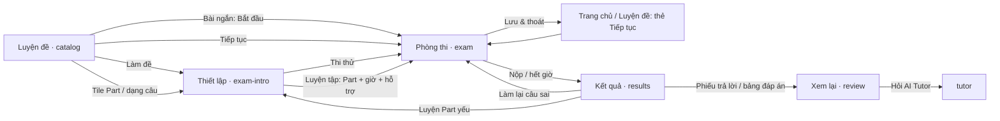
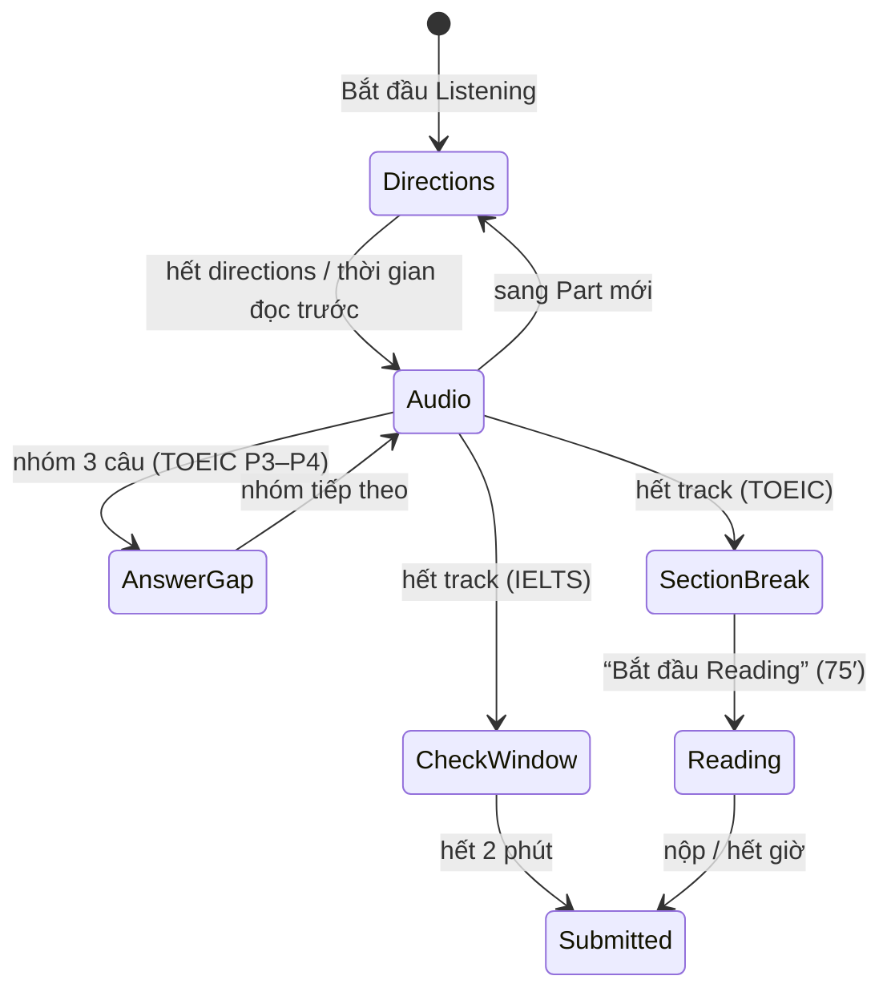

# Engrisk — Luyện đề & Phòng thi TOEIC / IELTS (design spec)

> Thiết kế chi tiết cho luồng **Luyện đề → Thiết lập → Phòng thi (test player) → Kết quả → Xem lại → Làm lại câu sai**.
> Prototype: `ux-preview.html` (màn `catalog`, `exam-intro`, `exam`, `results`, `review`; panel trái có nút demo “TOEIC thi thử / luyện tập / IELTS Reading / IELTS Listening”).
> Code tham chiếu: `scripts/player-core.js`, `player-toeic.js`, `player-ielts.js`, `player-events.js`, `screens-practice.js`, `screens-results.js`, `styles/player.css`.
> Dữ liệu: `backend/docs_design/schema.dbml` (`exam_revisions.sections`, `attempts.settings/resume_state`, `attempt_responses`, `attempt_annotations`; catalog: `exams.cover_style/provenance`, `exam_credits`, `exam_ratings`).
> Nguồn nội dung (Content Studio, đóng góp cộng đồng, kiểm duyệt): `content_studio_spec.md`.

---

## 1. Nguyên tắc thiết kế

| # | Nguyên tắc | Hệ quả trong UI |
|---|---|---|
| 1 | **Thi thử giống phòng thi thật** — người học quen áp lực và quy tắc trước ngày thi | TOEIC: đề + phiếu trả lời, Listening chạy theo một bản ghi liên tục, Part 1–2 không in phương án, không ghi lên đề. IELTS: bố cục IELTS trên máy tính (đồng hồ “phút còn lại”, chia đôi màn hình, highlight/ghi chú, Review flag, thanh số câu ở đáy, 2 phút kiểm tra Listening) |
| 2 | **Luyện tập thì tiện tối đa** — công cụ chỉ có ở chế độ luyện | Chọn Part, tự đặt giờ, kiểm tra theo trang, nghe lại/tua/đổi tốc độ, transcript đồng bộ, loại trừ phương án, tạm dừng |
| 3 | **Một engine, hai bố cục** | `attempts` + `attempt_responses` dùng chung; khác biệt nằm ở `exam_revisions.sections` (rules) và layout `toeic`/`ielts` |
| 4 | **Đúng số câu, đúng tên phần** | Câu hỏi giữ số thứ tự thật (TOEIC 1–200, IELTS 1–40); bản demo chỉ chứa câu mẫu nhưng không đánh số lại |
| 5 | **Không mất bài** | Tự lưu mỗi thay đổi, tiếp tục đúng trang/vị trí audio, offline vẫn làm được, server quyết định giờ |
| 6 | **Trung thực về điểm** | Điểm TOEIC/IELTS luôn có nhãn “ước tính”; giải thích quy đổi |

### Cấu trúc kỳ thi dùng làm chuẩn

| TOEIC Listening & Reading (ETS) | Câu | Số thứ tự | Thời gian |
|---|---|---|---|
| Part 1 · Photographs | 6 | 1–6 | Listening ≈ 45′, chạy theo audio |
| Part 2 · Question–Response | 25 | 7–31 | |
| Part 3 · Conversations (13 × 3) | 39 | 32–70 | |
| Part 4 · Talks (10 × 3) | 30 | 71–100 | |
| Part 5 · Incomplete Sentences | 30 | 101–130 | Reading 75′, tự phân bổ |
| Part 6 · Text Completion (4 × 4) | 16 | 131–146 | |
| Part 7 · Reading Comprehension | 54 | 147–200 | |

| IELTS (on computer) | Câu | Thời gian | Ghi chú giao diện |
|---|---|---|---|
| Listening · 4 Part | 40 | ≈ 30′ + 2′ kiểm tra | Audio phát 1 lần; gõ đáp án trực tiếp; sai chính tả = sai |
| Academic Reading · 3 Passage | 40 | 60′ | Passage ↔ câu hỏi, highlight, ghi chú, Review flag |
| Writing · 2 Task | — | 60′ | Đếm từ trực tiếp, không spell-check (màn `writing`) |

Nguồn: [ETS TOEIC L&R Examinee Handbook](https://www.ets.org/pdfs/toeic/toeic-listening-reading-test-examinee-handbook.pdf), [IDP — How IELTS on computer works](https://ielts.idp.com/uruguay/prepare/article-how-computer-delivered-ielts-works), [British Council — IELTS on computer](https://takeielts.britishcouncil.org/en-gb/what-is-ielts/how-it-works/test-modes/ielts-on-computer). Giao diện thi thật có thể thay đổi; Engrisk tái hiện **hành vi** (công cụ, quy tắc, nhịp thời gian), không sao chép pixel.

---

## 2. Luồng tổng thể



---

## 3. Trang “Luyện đề” (`catalog`)

**Mục tiêu:** chọn đúng loại luyện trong ≤ 2 chạm, thấy ngay mình yếu ở đâu.

| Vùng (trên → dưới) | Component | Hành vi |
|---|---|---|
| Header | `Tabs` TOEIC L&R / IELTS Academic · `InputGroup` tìm kiếm | Đổi tab giữ bộ lọc loại; tìm theo tên đề/Part/tác giả |
| Lọc loại | `Tabs sm`: Tất cả · Đề đầy đủ · Theo Part (TOEIC) / Dạng câu hỏi (IELTS) · Bài ngắn · **Cộng đồng** | Ẩn/hiện section, không reload. “Cộng đồng” chỉ hiện section “Từ cộng đồng” |
| Tiếp tục | Card viền accent: đề, phần, câu đang dừng, thời gian còn | Chỉ hiện nếu có attempt dở của kỳ thi đang chọn; CTA “Tiếp tục” |
| Từ Sunrise English (tenant) | `sectionTitle` + grid thẻ: bìa compact có tenant mark, tên, chip “Chỉ thành viên” (`persons-lock`), “Giao bởi Hạnh Vũ” (avatar), chip “Hạn 30/10” | Chỉ khi `active_tenant` là tổ chức và có đề `visibility = tenant` đã xuất bản; đặt **trên** đề đầy đủ (bài được giao trước). Ẩn khi trống |
| Đề thi thử đầy đủ | Grid 3 cột `test-card`: **bìa** (§3.1) + badge nguồn gốc, eyebrow kỳ thi + tên ngắn, Listening·45′ / Reading·75′, 200 câu, độ khó, ★ + lượt làm; footer = **1** chip trạng thái (“Đang làm dở” / “Tốt nhất 600” / “Chưa làm” / khóa) + CTA | “Làm đề” → Thiết lập. Khóa: “Cần tài khoản” (khách) / “Premium · tương lai” |
| Luyện theo Part (TOEIC) | Grid 4 cột `part-tile`: **icon Part** trong tile tô màu kỹ năng (§3.2) + số Part lớn, tên, “Câu 32–70 · 39 câu/đề”, thanh + % độ chính xác của bạn trên cùng hàng (đỏ < 55%, vàng < 70%, xanh — luôn kèm số %) | Bấm → Thiết lập ở chế độ Luyện tập, **chỉ Part đó được chọn sẵn** |
| Luyện theo dạng câu (IELTS) | 8 tile có icon: TFNG, Summary completion, Matching headings, Matching features, Form, Map, Multiple choice (2), Note completion | Mở đúng đề + Part chứa dạng câu đó |
| Bài ngắn | List card: **thumbnail bìa compact** · phút · câu · độ khó · “Bắt đầu” | Vào thẳng phòng thi (luyện tập, cấu hình mặc định) |
| Từ cộng đồng | `sectionTitle` “Từ cộng đồng” + count + `tertiary sm` “Đóng góp đề” (học viên → `contribute`; khách → tạo tài khoản; staff → ẩn). Thẻ: bìa compact + avatar tác giả, tên, chip **“Đã kiểm duyệt”** (`shield-check`), ★ + lượt làm, giấy phép (CC BY 4.0 / Engrisk license), “Bắt đầu” | Chỉ đề `provenance = community` đã qua duyệt. ★/lượt làm/CTA ở cột cố định để thẳng hàng |

Trạng thái: loading (skeleton 3 card), error (Alert + Thử lại; vẫn tiếp tục được bài dở từ Trang chủ), empty khi tìm kiếm không ra (Pip `think` + Xóa tìm kiếm). Section tenant/cộng đồng **ẩn** khi không có đề (không empty state riêng).

### 3.1 Ảnh bìa đề
- Dựng bằng `examCover(idOrSpec, {h, compact})` — một hàm cho catalog, Studio, Đóng góp. Nền gradient theo token tint kỹ năng (đúng 5 preset, sáng/tối, accent tenant); motif theo loại: **full mock** = phiếu trả lời xếp chồng + thanh L/R · **Listening** = sóng âm · **Reading** = dòng chữ/khối đoạn · **IELTS** = trang passage có headings · label lớn trong mờ (“01”, “P5”).
- Badge nguồn gốc luôn có chữ + icon: **Engrisk Original** (`shield-check`) · tenant mark + “Thành viên” · avatar tác giả + “Cộng đồng”. Bìa là trang trí (`aria-hidden`); tên đề vẫn là text thật.
- Dữ liệu: `exams.cover_style` (motif/tint/label), `exams.cover_asset_id` (ảnh tải lên, chỉ staff), `exams.provenance`. Chi tiết: `content_studio_spec.md` §4.

### 3.2 Icon Part & dạng câu hỏi
| TOEIC | Icon | IELTS | Icon |
|---|---|---|---|
| P1 Photographs | `camera` | True/False/Not Given | `check-double` |
| P2 Question–Response | `comments` | Matching headings | `list-ul` |
| P3 Conversations | `persons` | Summary completion | `text` |
| P4 Talks | `volume` | Matching features | `link` |
| P5 Incomplete Sentences | `font` | Form completion | `square-dashed-text` |
| P6 Text Completion | `file-text` | Map labelling | `map-pin` |
| P7 Reading Comprehension | `files` | Multiple choice | `list-check` |
| | | Note completion | `pencil` |

Icon bổ trợ cho số Part/tên dạng câu (không thay chữ). `exam-intro` và `results` dùng cùng icon cho dòng Part.

### 3.3 Nguồn gốc & tin cậy trên `exam-intro` / `results`
- `exam-intro`: dòng **Ghi công** (Biên soạn · Giọng đọc) + giấy phép cho đề cộng đồng/đối tác (`exam_credits`); “Báo cáo vi phạm” ở menu ⋯.
- `results`: thẻ đánh giá ★ 1–5 (sau bài hoàn thành, `exam_ratings`) + “Báo lỗi câu hỏi” (wrong key / audio không rõ / lỗi chính tả) → việc cần làm trong Content Studio của chủ sở hữu đề.

---

## 4. Trang “Thiết lập bài làm” (`exam-intro`)

Bố cục Web: cột trái (nội dung) + cột phải **Tóm tắt sticky** (chế độ, số phần, số câu thật/demo, thời gian, hỗ trợ, CTA). Mobile: một cột, CTA sticky đáy.

1. **Header đề**: chip kỳ thi/loại/độ khó, mô tả, khối **cấu trúc** theo section (Listening · 45′ · theo audio — chip Part 1·6, Part 2·25…).
2. **Chọn cách làm** (`RadioGroup` dạng card, chỉ với đề đầy đủ):
   - **Thi thử** — toàn bộ đề, đúng giờ, audio một lần, không tạm dừng, đáp án sau khi nộp.
   - **Luyện tập** — chọn Part, tự đặt giờ, kiểm tra từng trang, nghe lại, tốc độ, transcript.
3. **Luyện tập → Chọn phần**: nhóm theo section, checkbox “chọn cả phần”; mỗi dòng: tag Part, tên tiếng Anh chuẩn, “39 câu · demo 3 · ~18 phút”, `Meter` độ chính xác, chip **Yếu nhất** cho Part thấp nhất của section. Bỏ hết → lỗi inline “Chọn ít nhất 1 phần”, CTA disabled.
4. **Thời gian & hỗ trợ**: `Tabs` Không giới hạn · **Theo đề (tự tính)** · 15′ · 30′ · 45′. “Theo đề” = tổng thời gian khuyến nghị theo nhịp đề thật của các Part đã chọn (P5 11′, P6 8′, P7 56′…). `Switch`: Kiểm tra từng trang · Nghe lại & tốc độ · Transcript (2 switch sau chỉ hiện khi có Part Listening).
5. **Thi thử → Quy tắc phòng thi**: danh sách 4 quy tắc theo kỳ thi (TOEIC: audio liên tục 45′, Reading 75′ ngay sau, phiếu trả lời, không ghi lên đề · IELTS: audio 1 lần + thời gian đọc trước + 2′ kiểm tra, đồng hồ đổi màu ở 10′/5′, highlight & ghi chú, nút Ẩn). IELTS trên mobile: Alert “Nên làm đề IELTS trên máy tính”.
6. **Kiểm tra âm thanh** (khi có Listening): phát âm thanh mẫu, `Slider` âm lượng, checkbox “Tôi nghe rõ”. Không chặn bắt đầu, nhưng thi thử nhắc rõ “Listening không thể phát lại”.
7. **Lịch sử làm đề này**: list attempt (ngày, chế độ, thời gian, điểm, trạng thái) → mở kết quả/tiếp tục.

**CTA:** có bài dở cùng chế độ → “Tiếp tục bài đang làm · câu 104” là primary, “Làm lại từ đầu” tertiary; khác chế độ → “Bắt đầu luyện” primary, “Tiếp tục…” tertiary. Khách mở đề `registered` → “Tạo tài khoản để làm đề”.

---

## 5. Test player — mô hình chung

### 5.1 Khái niệm

| Khái niệm | Định nghĩa | Lưu ở |
|---|---|---|
| **Page** | Đơn vị hiển thị: 1 câu (TOEIC P1, P2, P5) hoặc 1 nhóm câu dùng chung stimulus (P3/P4 hội thoại 3 câu, P6 văn bản 4 chỗ trống, P7 văn bản; IELTS: 1 Passage / 1 Part) | Tính từ `questions.question_group_id` |
| **Focus** | Câu đang làm — nhận phím tắt, đếm thời gian, được highlight ở phiếu/thanh câu | `resume_state.focus_position` |
| **Section** | Listening / Reading với quy tắc riêng (paced audio, time limit, check window) | `exam_revisions.sections` |
| **Track** | Chuỗi segment của bản ghi Listening thi thử: directions / đọc trước câu hỏi → audio nhóm câu → thời gian trả lời | `resume_state.track` |
| **Annotation** | Highlight / ghi chú trên stimulus | `attempt_annotations` |

### 5.2 Công cụ theo chế độ

| Công cụ | TOEIC thi thử | TOEIC luyện tập | IELTS thi thử | IELTS luyện tập |
|---|---|---|---|---|
| Phiếu trả lời (bubble) | ✓ | ✓ (xanh/đỏ sau kiểm tra) | — (thanh số câu đáy) | — |
| Đánh dấu (Flag / Review) | ✓ | ✓ | ✓ (checkbox Review) | ✓ |
| Highlight · Ghi chú | — (không viết lên đề) | ✓ | ✓ | ✓ |
| Loại trừ phương án (gạch) | — | ✓ | — | ✓ |
| Kiểm tra theo trang | — | ✓ | — | ✓ |
| Audio | Liên tục, chỉ âm lượng | Play/pause, −5s, 0.75–1.25×, scrub | Liên tục, chỉ âm lượng | như TOEIC luyện tập |
| Transcript đồng bộ | — | Sau khi kiểm tra cả trang | — | Sau khi kiểm tra |
| Cỡ chữ (Chuẩn/Lớn/Rất lớn) · Màu nền (Mặc định/Kem/Tối) | ✓ | ✓ | ✓ | ✓ |
| Ẩn màn hình | — | — | ✓ (đồng hồ vẫn chạy) | ✓ |
| Tạm dừng | — | ✓ (dừng giờ + audio) | — | ✓ |
| Ghi chú panel | — | ✓ | ✓ | ✓ |

### 5.3 Thời gian & Listening thi thử



- **Tự theo audio:** khi segment đổi sang nhóm câu mới, player chuyển trang **nếu** người học đang ở trang đang phát. Nếu họ quay lại câu trước, player không giật trang; hiện **follow-bar** “Audio đang phát ở câu 71–73 · Đi tới”.
- Trong lúc nghe vẫn sửa được đáp án các câu Listening khác (như bài thi giấy); trang Reading bị khóa đến khi Listening kết thúc. Sau khi chuyển sang Reading **không quay lại** Listening.
- Đồng hồ: TOEIC hiện thời lượng audio còn lại khi Listening, mm:ss khi Reading (vàng ≤ 10′, đỏ nhấp nháy ≤ 5′). IELTS hiện “52 phút còn lại”, đổi màu ở 10′/5′, phút cuối hiện mm:ss.
- Thoát giữa chừng: thi thử vẫn chạy theo server; nếu ranh giới section đi qua khi vắng mặt, lần mở lại hiện ngay hộp thoại chuyển phần; quá `deadline_at` → server tự nộp.

### 5.4 Autosave & tiếp tục

Mỗi thay đổi đáp án/flag → badge “Đang lưu… → Đã lưu” (debounce 600 ms); mất mạng → “Lưu trên thiết bị”, đồng bộ lại theo thứ tự. `resume_state` giữ section, trang, câu focus, vị trí track, phương án đã loại trừ, tỷ lệ chia màn hình. Highlight/ghi chú lưu riêng (`attempt_annotations`).

---

## 6. Bố cục TOEIC — “đề + phiếu trả lời”

```
┌ exam bar: ✕ │ Tên đề · Thi thử │ (Listening 1–100) — (Reading 101–200) │ Đã lưu │ ⏱ │ [⏸] [≡] [⚙] │ Nộp bài ┐
├──────────────────────────────────────────────────────────────┬────────────────────────────┤
│ follow-bar (khi audio ở trang khác)                            │ Phiếu trả lời  12/200 ▬▬▬ │
│ Part banner: [Part 3] Conversations · Câu 32–70 · Directions ▾ │ LISTENING                  │
│ Audio bar (thi thử: trạng thái + âm lượng; luyện: controls)    │ Part 1  1 Ⓐ Ⓑ Ⓒ Ⓓ           │
│ Nội dung trang theo Part (bảng dưới)                           │ …       7 Ⓐ Ⓑ Ⓒ   (Part 2)  │
│                                                                │ READING · mở sau Listening │
├ footer: ‹ Trước │ Câu 32–34 · trang 7/14 │ phím tắt │ Tiếp › ──┴────────────────────────────┘
```

| Part | Bố cục trang | Chi tiết thực tế |
|---|---|---|
| 1 | Ảnh lớn (trái) + câu hỏi (phải) | 4 phương án **không in**: “Phương án (A) — chỉ nghe”. Luyện tập hiện chữ sau khi kiểm tra |
| 2 | Một cột “Mark your answer on your answer sheet.” | Chỉ A–C; phiếu cũng chỉ có 3 bubble |
| 3 · 4 | Tiêu đề nhóm “Questions 32–34 refer to…” + 3 câu; Part 4 có **graphic** (bảng lịch) bên phải | Câu “Look at the graphic” buộc kết hợp nghe + bảng |
| 5 | Một câu / trang, tối đa 760px | Phím A–D, chuyển trang ←/→ |
| 6 | Văn bản (trái) với chỗ trống dạng nút “(131) ______” → điền chữ đã chọn; câu hỏi (phải) | Có câu **chèn câu** (sentence insertion) |
| 7 | Văn bản (trái, cuộn riêng) — đoạn kép/ba xếp chồng có nhãn “Advertisement / E-mail” — + câu hỏi (phải) | Câu **liên kết hai văn bản** (cross-reference) |

**Phiếu trả lời:** tô bubble trực tiếp (giống bài giấy) hoặc chọn ở câu hỏi — hai nơi luôn đồng bộ; số câu bấm được để nhảy tới; câu đang focus nền accent; câu flag viền vàng; Reading mờ + “mở sau phần Listening”. Mobile: nút “Phiếu 12/200” mở bottom sheet, bubble 34px.

---

## 7. Bố cục IELTS — “IELTS on computer”

```
┌ ip-bar: ✕ │ Thí sinh · Minh Nguyễn · 0123 4567 │      52 phút còn lại      │ Đã lưu [≡][⚙][Ẩn] ┐
├ strip: Passage 1 · Đọc văn bản và trả lời câu hỏi 1–13                                          ┤
├──────────────────────────────┬┬──────────────────────────────────────────────────────────────────┤
│ Passage (cuộn riêng)          ││ Questions 1–4 · instructions · TRUE/FALSE/NOT GIVEN legend    │
│ highlight / ghi chú           ││ Questions 5–7 · summary với ô trống đánh số                    │
│                               ││                                                                │
├──────────────────────────────┴┴──────────────────────────────────────────────────────────────────┤
│ ☐ Review │ [Passage 1  1 2 3 4 5 6 7] Passage 2 0 of 6 · Passage 3 0 of 3 │  ← → ✓            │
└────────────────────────────────────────────────────────────────────────────────────────────────────┘
```

- **Chia đôi kéo được** (28–72%, có phím ←/→ khi divider được focus).
- **Thanh câu hỏi đáy:** Part hiện tại mở rộng thành các số; Part khác thu gọn “0 of 6”. Số đã trả lời gạch chân, số đang làm nền đen, flag chấm vàng. ← → đi theo **câu**, tự sang Part kế tiếp. ✓ mở hộp thoại nộp.
- **Highlight/Ghi chú:** bôi đen văn bản → menu nổi “Highlight · Ghi chú”; bấm vào vùng đã highlight → “Bỏ highlight”. Ghi chú mở panel bên phải với trích dẫn + textarea; dữ liệu giữ đến trang Xem lại.
- **Nội dung đề luôn bằng tiếng Anh** (“Questions 14–17”, “List of Headings”, “Write ONE WORD ONLY for each answer”); chrome giao diện theo ngôn ngữ người học.

| Dạng câu | Component | Tương tác | `attempt_responses.answer` |
|---|---|---|---|
| TRUE/FALSE/NOT GIVEN, MC 1 đáp án | Radio card | Click / phím T·F·N hoặc A–D | `{"choice":"NOT GIVEN"}` |
| Summary / Form / Note completion | Ô nhập inline có số câu | Gõ trực tiếp; giới hạn từ hiển thị ở đầu set | `{"text":"competition"}` |
| Matching headings | List of Headings + ô thả | **Kéo–thả** hoặc chọn tiêu đề → bấm ô (cách thay thế cho bàn phím/khiếm khuyết vận động); mỗi tiêu đề dùng một lần; bấm ô đã điền để gỡ | `{"choice":"iv"}` |
| Choose TWO letters | Checkbox card | Giới hạn 2, phương án còn lại disabled khi đủ; 1 điểm cho mỗi chữ đúng | `{"choices":["A","C"]}` |
| Matching features | List box + `Select` mỗi câu | Chọn A–C | `{"choice":"B"}` |
| Map / plan labelling | Ảnh bản đồ + lưới radio (hàng = câu, cột = chữ) | Click ô | `{"choice":"F"}` |

**Listening:** audio phát liên tục; trước mỗi Part có thời gian đọc trước câu hỏi; gõ đáp án ngay khi nghe; hết bản ghi → banner vàng “Bạn có 2 phút để kiểm tra đáp án” + đếm ngược → tự nộp.

---

## 8. Hành vi luyện tập (tiện lợi)

| Hành vi | Chi tiết |
|---|---|
| Kiểm tra theo trang | Nút “Kiểm tra (n)” chấm các câu đã trả lời của trang; câu chưa làm vẫn mở. Phản hồi: đáp án đúng/sai trên từng phương án + khối “Đáp án đã kiểm duyệt” (giải thích, **Xem bằng chứng** tô sáng câu trong bài, **Hỏi AI Tutor** nếu sai) |
| Transcript đồng bộ | Mở khi mọi câu của trang đã kiểm tra (tránh “nhìn bài”); dòng đang phát được tô; bấm dòng để nghe lại từ đó |
| Audio | Space = phát/dừng; −5s; 0.75× / 1× / 1.25×; bấm waveform để tua |
| Loại trừ | Icon mắt-gạch cạnh phương án (hiện khi hover, luôn hiện trên cảm ứng); phương án bị gạch mờ + gạch ngang; chọn lại thì bỏ gạch |
| Tạm dừng | Che màn hình, dừng đồng hồ, dừng audio |
| Hiển thị | Cỡ chữ 3 mức (16/18/21 px cho văn bản), nền Kem dịu mắt (pha swatch vàng Theme Builder), nền Tối (dark theme HeroUI chỉ trong player) |
| Làm lại câu sai | Từ Kết quả: tạo attempt luyện tập mới chỉ với câu sai, bật kiểm tra + transcript |

---

## 9. Phím tắt (Web)

| Phím | Tác dụng |
|---|---|
| A–D | Chọn phương án cho câu đang focus (TOEIC, MC) |
| T · F · N | TRUE / FALSE / NOT GIVEN (IELTS) |
| ← / → | TOEIC: trang trước/sau · IELTS: câu trước/sau |
| F | Đánh dấu câu đang focus |
| Space | Phát/dừng audio (chỉ luyện tập) |
| Esc | Đóng popover / hộp thoại (trừ “Đang chấm”, “Chuyển phần”) |

Phím không hoạt động khi đang gõ trong ô nhập/textarea. Danh sách phím tắt nằm trong popover **Cài đặt** của phòng thi (Web), không hiển thị thường trực ở footer — footer chỉ còn Trước · “Câu x–y · trang n/N” · Tiếp/Nộp.

---

## 10. Nộp bài

Hộp thoại nộp: 3 số (đã trả lời · bỏ trống · đánh dấu), **tiến độ theo Part**, danh sách số câu đánh dấu và bỏ trống (bấm để quay lại — vô hiệu nếu thuộc section đã đóng), cảnh báo nếu nộp khi đang ở Listening (“sẽ kết thúc cả phần Reading chưa làm”), câu chốt “Bỏ trống tính là sai — không bị trừ điểm khi đoán”.

---

## 11. Kết quả & Xem lại

**Kết quả (`results`)**

| Khối | TOEIC | IELTS |
|---|---|---|
| Hero | Tiêu đề cảm xúc theo % · ring độ chính xác · **Điểm ước tính 705** · Listening 315 · Reading 390 · thời gian làm · Pip | Band ước tính · “Đúng 11/15 → ≈ 29/40” · giải thích quy đổi |
| Phân tích | Bảng **theo Part**: đúng/tổng, meter, **thời gian TB/câu**, “Luyện” (mở Thiết lập Part đó) | Bảng **theo dạng câu** |
| Đáp án | **Phiếu trả lời** dạng lưới: số câu · đáp án của bạn · → đáp án đúng; lọc Sai/Bỏ trống/Đánh dấu | **Answer key** dạng bảng: # · bạn trả lời · đáp án · ✓/✗ (+ điểm 1/2 cho câu chọn hai) |
| Bước tiếp | **Làm lại câu sai** (primary) · Luyện kỹ năng yếu nhất | như TOEIC |
| Thời gian | 3 câu tốn thời gian nhất + gợi ý “bỏ qua và quay lại” | như TOEIC |

**Xem lại (`review`)** — theo **nhóm câu**, không theo từng câu rời: dải số câu (xanh/đỏ/xám, mờ câu đúng khi bật “Chỉ câu sai”), stimulus bên trái (ảnh/graphic/văn bản với **bằng chứng tô vàng** và **highlight + ghi chú của chính người học**, transcript cho Listening), câu hỏi bên phải ở trạng thái review + giải thích + thời gian đã dùng mỗi câu; Trước/Tiếp theo nhóm.

---

## 12. Mobile

| Tình huống | Thiết kế |
|---|---|
| TOEIC | Thanh trên: ✕ · tên đề · đồng hồ · ⋯ (tạm dừng, cỡ chữ & màu, ghi chú, nộp). Thanh audio dưới header. P6/P7: Tabs “Văn bản / Câu 131–134”. Đáy: ‹ · “Phiếu 12/200” (bottom sheet) · › |
| IELTS | Khuyến nghị làm đề đầy đủ trên máy tính (setup), nhưng vẫn hỗ trợ: Tabs “Bài đọc / Câu hỏi”, thanh số câu cuộn ngang, đồng hồ rút gọn “52 phút” |
| Chạm | Phương án ≥ 44px, bubble 34px, nút loại trừ luôn hiện |

---

## 13. Edge cases

| Tình huống | Hành vi |
|---|---|
| Mất mạng | Banner cảnh báo; đáp án lưu cục bộ; đồng hồ theo server; khi có mạng gửi theo thứ tự |
| Audio lỗi (thi thử) | Thông báo + ghi log sự cố; đề xuất cho phát lại đoạn bị lỗi 1 lần — **cần PO quyết định** |
| Mở trên hai thiết bị | Last-write-wins từng câu; track Listening theo server |
| Hết giờ Reading khi vắng mặt | Server tự nộp; mở lại → trang Kết quả với nhãn “Hết giờ · nộp tự động” |
| Nộp khi còn Listening | Cảnh báo trong hộp thoại nộp |
| Gõ khác hoa/thường, khoảng trắng | Chấm không phân biệt hoa thường, gộp khoảng trắng; danh sách biến thể chấp nhận trong answer key (vd. `pollinator-friendly` / `pollinator friendly`) |
| Câu chọn hai đáp án | 2 số câu, 2 điểm, chấm từng chữ |

---

## 14. Accessibility

- Mọi lựa chọn là `radio`/`checkbox` thật trong `fieldset` có `legend`; đúng/sai luôn có icon + chữ.
- Kéo–thả luôn có cách thay thế bằng click/bàn phím; divider dùng được bằng phím.
- `role="timer"` không đọc mỗi giây (`aria-live="off"`); cảnh báo 10′/5′ thể hiện bằng màu **và** chữ.
- Cỡ chữ/màu nền trong player; tôn trọng `prefers-reduced-motion`.

---

## 15. Đo lường

| Chỉ số | Định nghĩa |
|---|---|
| Setup → start | % mở Thiết lập rồi bắt đầu trong 60 giây |
| Hoàn thành thi thử | % attempt mock được nộp (không bỏ dở) |
| Dùng công cụ | % attempt có highlight/ghi chú/loại trừ/đổi tốc độ |
| Làm lại câu sai | % kết quả dẫn tới “Làm lại câu sai” trong 24h |
| Thời gian/câu theo Part | So với nhịp chuẩn (P5 ≈ 22s, P7 ≈ 62s) để gợi ý chiến lược |

---

## 16. Phạm vi prototype

- TOEIC Practice Test 01: 25 câu mẫu đủ 7 Part, số thứ tự thật (1, 2, 7–9, 32–34, 71–73, 101–104, 131–134, 147–149, 176–178). IELTS Reading Test 01: câu 1–7, 14–19, 27–29 (16 câu, 5 dạng: TFNG, summary, headings, choose two, matching features); IELTS Listening Test 01: câu 1–5, 11–14, 21–23, 31–33 (15 câu, 4 Part: form, map, choose two + MC, notes). Nội dung tự biên soạn, không phải đề ETS/IELTS.
- Audio, ảnh Part 1, bản đồ là **mô phỏng** (thời lượng rút gọn, minh họa SVG). Track Listening thi thử chạy thật theo giây; panel trái có “Tua audio tới cuối phần nghe” / “Tua tới 15 giây cuối”.
- Điểm quy đổi là ước tính trên bảng mô phỏng; band IELTS dùng bảng quy đổi phổ biến cho 4–40 câu, 1–3 câu ngoại suy.
