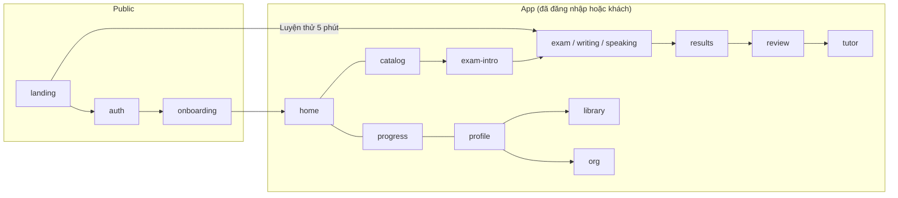
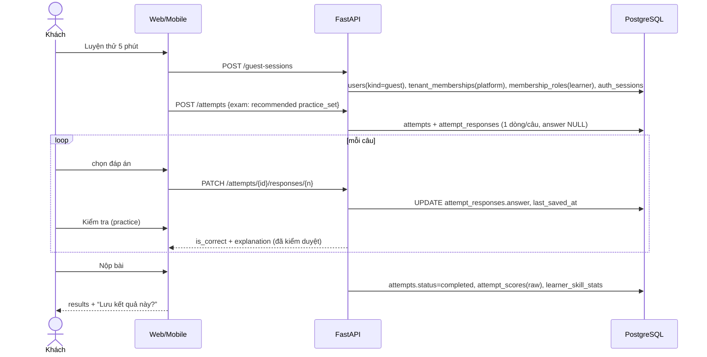
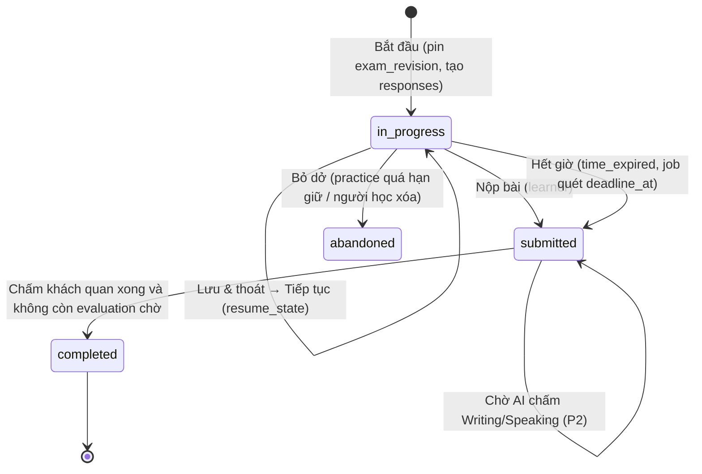
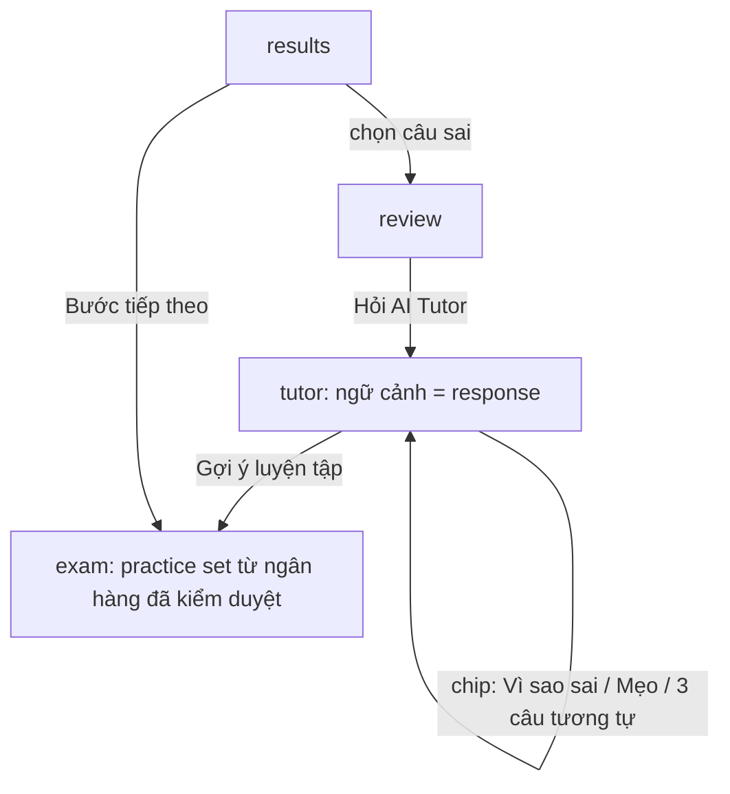
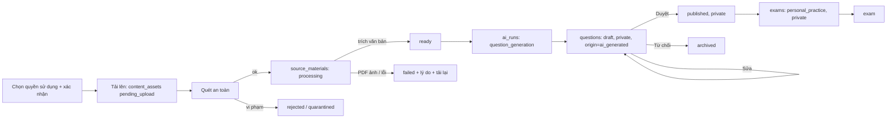

# Engrisk — Product Flow (nguồn sự thật về chức năng & hành vi)

> Bộ ba tài liệu thiết kế phải được đọc cùng nhau:
>
> | Tài liệu | Vai trò |
> |---|---|
> | `apps/ux_preview/product_flow.md` (tài liệu này) | Hành vi sản phẩm, hành trình, màn hình, quy tắc thi, AI, RBAC, roadmap |
> | `apps/ux_preview/ux-preview.html` | Prototype tương tác (Web + Mobile) — mở trực tiếp bằng trình duyệt |
> | `backend/docs_design/schema.dbml` | Mô hình dữ liệu PostgreSQL (33 bảng, 6 domain) |
>
> Trạng thái: **đề xuất thiết kế để product review**, chưa phải cam kết triển khai. Nhãn giai đoạn `P1`…`P4` dùng thống nhất trong cả ba file.

---

## A. Product vision

### Vấn đề
Người học TOEIC/IELTS tại Việt Nam (sinh viên, người đi làm) có ít thời gian, học rời rạc và **không biết vì sao mình sai**. Các công cụ hiện tại thường là kho đề lớn: phải chọn đề, làm 2 tiếng, nhận một con số và không biết bước tiếp theo.

### Người dùng mục tiêu
| Nhóm | Nhu cầu chính | Giai đoạn |
|---|---|---|
| Người luyện TOEIC L&R (sinh viên năm cuối, người đi làm) | Đạt mốc 550/650/750 cho tốt nghiệp/tuyển dụng | P1 |
| Người luyện IELTS Academic | Reading/Listening (P1), Writing/Speaking có nhận xét (P2) | P1–P2 |
| Người có 10–20 phút/ngày | Bài ngắn, dừng–tiếp tục, dùng điện thoại | P1 |
| Trung tâm, trường, doanh nghiệp | Thương hiệu riêng, nội dung riêng, thư viện được cấp phép | P4 |

### Khác biệt cốt lõi
1. **Thời gian tới bài luyện đầu tiên ≈ 1 chạm**: khách bấm “Luyện thử 5 phút” là vào làm ngay, không đăng ký, không onboarding bắt buộc.
2. **Hiểu lỗi sai có kiểm chứng**: mỗi câu có *đáp án đã kiểm duyệt + giải thích + vị trí bằng chứng trong bài*. AI Tutor chỉ diễn giải thêm và luôn được gắn nhãn AI.
3. **Một hành động tiếp theo rõ ràng**: dashboard luôn đề xuất đúng một việc (tiếp tục / luyện kỹ năng yếu nhất), kèm lý do.
4. **Tiến bộ minh bạch**: điểm luôn ghi rõ loại (thô / ước tính / AI ước tính), không bao giờ giả làm điểm chính thức.

### Vì sao “behavior-first”
Hành vi cần tối ưu là *quay lại học thường xuyên trong phiên ngắn*. Thiết kế ưu tiên: khởi động nhanh, phiên ngắn có kết thúc rõ ràng, phản hồi ngay, và gợi ý tiếp theo. Không dùng streak gây áp lực, không đếm ngược gây lo lắng ngoài phòng thi; nhắc học tối đa 1 lần/ngày và không nhắc khi người học đã học.

---

## B. Product principles

| Nguyên tắc | Biểu hiện trong sản phẩm | Ví dụ trong prototype |
|---|---|---|
| **Frictionless practice** | Khách làm bài ngay; bài ngắn không có màn intro; tự lưu sau mỗi câu; tiếp tục trên thiết bị khác | `landing` → “Luyện thử 5 phút” → `exam` |
| **Fast feedback** | Chế độ luyện tập: “Kiểm tra” từng câu; chế độ thi: kết quả ngay khi nộp | Practice set Reading Part 5 & 7 |
| **Consistent learning experience** | Một engine làm bài cho mọi loại bài; một bộ token HeroUI cho Web + Mobile | `exam` dùng chung cho TOEIC/IELTS, practice/mock |
| **Transparent AI assistance** | Khối “Đáp án đã kiểm duyệt” (viền xanh lá) tách khỏi khối “AI tạo · có thể sai” (viền accent) | `tutor`, `writing`, `speaking` |
| **Progress-oriented motivation** | Mục tiêu, phút học/tuần, kỹ năng yếu; không phạt khi nghỉ | `home`, `progress` |

---

## C. Information architecture

### Điều hướng

| Khu vực | Web (sidebar trái) | Mobile (bottom tab) |
|---|---|---|
| Trang chủ | `home` | Tab “Trang chủ” |
| Luyện tập | `catalog` → `exam-intro` | Tab “Luyện tập” |
| AI Tutor | `tutor` | Tab “AI Tutor” |
| Tài liệu (P3) | Mục riêng trên sidebar | Trong tab “Tôi” → Tài liệu của tôi |
| Tiến độ | `progress` (+ `results`, `review`) | Tab “Tiến độ” |
| Tài khoản | `profile` | Tab “Tôi” |
| Ngữ cảnh tổ chức (P4) | Nút tenant ở đầu sidebar → `org` | Tab “Tôi” → Tổ chức |
| Làm bài | Chế độ tập trung: ẩn sidebar | Chế độ tập trung: ẩn bottom tab |

Nút **“Luyện nhanh 5 phút”** luôn có trên topbar Web (trừ `catalog`): đi thẳng vào bài luyện được gợi ý.

### Khác biệt Web vs Mobile (không chỉ thu nhỏ)
| Tình huống | Web (HeroUI React) | Mobile (HeroUI Native) |
|---|---|---|
| Reading có đoạn văn | Split view: đoạn văn trái, câu hỏi phải, navigator câu hỏi cột phải | Một cột; segmented “Đoạn văn / Câu n” |
| Điều hướng câu | Lưới câu hỏi luôn hiển thị + phím tắt A–D, ←/→, F | Thanh dưới Trước / n/N / Tiếp; lưới câu trong bottom sheet |
| Listening | Audio card trong vùng câu hỏi | Audio card cố định đầu màn hình (audio-first), nút play 56px |
| Dialog xác nhận | Modal giữa màn hình | Bottom sheet (HeroUI Native `BottomSheet`) |
| IELTS Writing | Đề trái, editor lớn phải, timer + tự lưu | Gợi ý: viết toàn bài / luyện mở bài 10 phút / tiếp tục trên web |
| IELTS Speaking | Hỗ trợ, nhưng không tối ưu | Trải nghiệm chính: nút micro lớn, quyền micro hệ thống |
| Lịch sử bài làm | Bảng (Table) | Danh sách (ListGroup) |
| Touch target | Nút 36px (HeroUI md) | Tối thiểu 44px, lựa chọn đáp án ≥ 56px |

### Khách vs đã đăng nhập
| Năng lực | Khách (`users.kind = guest`) | Đã đăng ký |
|---|---|---|
| Làm bài `access_tier = guest` | Có | Có |
| Đề `access_tier = registered` (ví dụ Full Test) | Thấy, bị khóa → mời tạo tài khoản | Có |
| Lưu kết quả | Có, gắn với phiên khách trên thiết bị | Có, mọi thiết bị |
| AI Tutor, Tài liệu, Tiến độ | Màn hình mời tạo tài khoản | Có (theo entitlement) |
| Chuyển đổi | Tạo tài khoản giữ nguyên `users.id` → giữ mọi attempt | — |

---

## D. User journeys

### D1. Khám phá → luyện thử với tư cách khách
- **Entry point:** `landing`, quảng cáo, link chia sẻ.
- **Intent:** “Thử xem có hợp không, không muốn đăng ký.”
- **Actions:** bấm “Luyện thử 5 phút” (hoặc chọn TOEIC/IELTS → `catalog`).
- **System:** tạo user khách + membership trong platform tenant + phiên khách; tạo attempt practice với bộ 5 câu gợi ý; vào `exam` ngay.
- **Decision points:** chọn đáp án → “Kiểm tra” → xem giải thích → câu tiếp.
- **Success:** hoàn thành 5 câu, thấy `results` với kỹ năng yếu và một gợi ý tiếp theo.
- **Error/empty:** mất mạng → đáp án lưu tạm trên thiết bị (banner cảnh báo), đồng bộ sau.
- **Next:** thẻ “Lưu kết quả này?” → D2.

### D2. Đăng ký / đăng nhập / chuyển đổi khách
- **Entry:** `auth` từ landing, từ thẻ chuyển đổi ở `results`, hoặc khi mở nội dung bị khóa.
- **Actions:** Google (1 chạm) hoặc email + mật khẩu; tab Đăng nhập/Đăng ký; “Quên mật khẩu?”.
- **System:**
  - Đăng ký mới: `users(kind=registered)` + `auth_identities(provider=password|google)` + membership platform + vai trò learner.
  - Chuyển đổi khách: **cập nhật** user khách (kind → registered, email, registered_at) và thêm `auth_identities` — attempt cũ giữ nguyên.
  - Google trùng email đã có tài khoản mật khẩu: yêu cầu đăng nhập mật khẩu một lần rồi liên kết (không tự gộp).
- **Error:** sai thông tin → Alert + FieldError, không tiết lộ email có tồn tại hay không; khóa tạm sau 5 lần sai (đề xuất).
- **Success:** đăng ký → `onboarding`; đăng nhập → `home` đúng chỗ dừng.
- **Next:** onboarding (luôn bỏ qua được).

### D3. Onboarding mục tiêu (≤ 4 câu, bỏ qua được)
- Câu hỏi: kỳ thi (TOEIC L&R / IELTS Academic / General / chưa chắc) → trình độ tự đánh giá → mục tiêu (+ ngày thi tùy chọn) → thời gian mỗi ngày.
- Nút “Tiếp tục” bị **disabled** đến khi chọn; “Bỏ qua” luôn hiện.
- **System:** ghi `learner_goals` (thời gian/ngày × 7 = `weekly_study_minutes`). Bỏ qua = không có dòng nào; `home` hiển thị thẻ “Đặt mục tiêu”.
- **Next:** `home` với gợi ý bài đầu tiên.

### D4. Dashboard → hành động tiếp theo
- **Thứ tự ưu tiên trên `home`:** (1) Tiếp tục bài đang làm → (2) Gợi ý tiếp theo có lý do → (3) Mục tiêu & điểm ước tính → (4) Phút học tuần này → (5) Kỹ năng cần luyện → (6) Gần đây.
- **Trạng thái:** loading (skeleton), empty (người mới: “Bắt đầu với bài 5 phút”), sau bài đầu (gợi ý dựa trên bài vừa làm, độ tin cậy thấp), error (vẫn cho “Luyện nhanh”).
- **Data:** gợi ý được **tính khi đọc** từ `learner_skill_stats` + `learner_goals`, không lưu bảng riêng (P1).

### D5. Chọn bài (catalog)
- Bộ lọc: Kỳ thi (TOEIC/IELTS) → Loại (Tất cả / Luyện ngắn / Thi thử) → Kỹ năng (chip toggle).
- Thẻ bài: loại, kỹ năng, thời lượng, số câu, độ khó (Dễ/Trung bình/Khó), khóa (Cần tài khoản / Premium · tương lai / Sắp ra mắt).
- **Luyện ngắn**: bấm “Bắt đầu” → vào `exam` ngay (không qua intro). **Thi thử**: “Xem đề” → `exam-intro` (quy tắc phòng thi cần đọc trước).
- Empty: “Chưa có bài phù hợp” + giải thích (ví dụ TOEIC L&R không có Writing) + “Xóa bộ lọc”. Error: Alert + Thử lại.

### D6. Làm bài thi thử (mock) & luyện tập (practice)

- **Entry:** `catalog`, `exam-intro`, “Tiếp tục” trên `home`, gợi ý từ `results`/`tutor`.
- **Actions:** chọn đáp án (click / phím A–D), điều hướng (lưới câu, ←/→), đánh dấu (F), “Kiểm tra” (practice), Lưu & thoát, Nộp bài.
- **Decision points:** nộp khi còn câu trống → modal liệt kê câu trống (bấm để nhảy tới); thoát mock → cảnh báo đồng hồ vẫn chạy.
- **System:** mỗi thay đổi đáp án → autosave một response; badge “Đang lưu… / Đã lưu / Lưu trên thiết bị”.
- **Success:** `results`.
- **Error:** mất mạng (banner cảnh báo, hàng đợi lưu cục bộ); hết giờ → tự nộp + toast.

### D7. Kết quả → xem lại → AI Tutor
- `results`: tổng điểm (loại điểm ghi rõ), điểm theo phần (TOEIC), theo kỹ năng, danh sách câu (lọc Tất cả/Sai/Bỏ trống/Đã đánh dấu), bước tiếp theo.
- `review`: câu hỏi + đáp án của bạn + đáp án kiểm duyệt + giải thích + đoạn văn có **tô sáng bằng chứng** hoặc transcript; switch “Chỉ câu sai”; Trước/Tiếp.
- “Hỏi AI Tutor về câu này” → `tutor` với ngữ cảnh response.

### D8. IELTS Writing (P2)
- Web: đề trái, editor phải, đếm từ, timer 40 phút, tự lưu; “Dùng bài mẫu (demo)” chỉ có trong prototype.
- Mobile: 3 lựa chọn — viết toàn bài / **luyện mở bài 10 phút** / tiếp tục trên web (bài làm đồng bộ).
- Nộp khi < 250 từ → cảnh báo, vẫn cho nộp. Sau nộp: “AI đang chấm…” (có thể rời màn hình) → nhận xét: band ước tính dạng khoảng, 4 tiêu chí, sửa lỗi gợi ý; lỗi chấm → bài vẫn an toàn, thử lại.

### D9. IELTS Speaking (P2)
- Giới thiệu → **xin quyền micro** (giải thích trước khi hộp thoại hệ thống xuất hiện) → Từ chối: hướng dẫn bật lại + vẫn luyện bằng cue card → Cho phép: 60 giây chuẩn bị (ghi chú, có thể bỏ qua) → ghi âm (tự dừng 2:00) → nghe lại / ghi lại / nộp → chuyển giọng nói + chấm → nhận xét (phát âm gắn cờ “độ tin cậy thấp hơn”).

### D10. Tải tài liệu & AI tạo câu hỏi (P3)

- Nút tải lên **disabled** đến khi chọn quyền sử dụng và tick xác nhận.
- Câu AI không chắc có cờ “Cần xem kỹ” (`questions.review_flags`).
- Không có đường nào từ tài liệu cá nhân ra thư viện công khai/tổ chức trong P3. Chia sẻ cho tổ chức (P4) cần content_manager duyệt và `rights_basis ≠ personal_study_only`.

### D11. Hồ sơ & lịch sử
- `progress`: biểu đồ điểm TOEIC ước tính (chỉ từ bài thi thử) + đường mục tiêu; kỹ năng 12 tuần; bảng lịch sử (bấm dòng hoàn thành → `results`; đang làm/bỏ dở → `exam-intro` để tiếp tục/làm lại).
- `profile`: mục tiêu (sửa → onboarding bước 3), phương thức đăng nhập (Email, Google, SSO tổ chức P4), tổ chức & ngữ cảnh học, nhắc học nhẹ nhàng, ngôn ngữ, đăng xuất, xóa tài khoản (AlertDialog).

### D12. Tham gia tổ chức (P4)
- Nhận lời mời (email/link) → `org` hiển thị tổ chức, vai trò, cam kết quyền riêng tư (“tiến độ cá nhân không chia sẻ với trung tâm”) → Tham gia / Từ chối.
- Tham gia → membership + vai trò → chuyển ngữ cảnh (đổi `active_tenant_id`) → giao diện đổi màu/logo theo tenant → thấy “Bài của trung tâm” + “Thư viện Engrisk (cấp phép)”.

---

## E. Screen inventory

Mã màn hình = `id` trong registry `SCREENS` của `ux-preview.html`. Trạng thái có thể chuyển trong bảng điều khiển bên trái prototype. Mục `design-system` (“Theme & Components”) trong prototype là trang tham chiếu bộ theme/component cho đội Web và Mobile, **không** phải màn hình sản phẩm nên không có trong bảng dưới.

| ID | Mục đích | CTA chính | Hành động phụ | Dữ liệu cần | Entity (schema.dbml) | Ghi chú responsive |
|---|---|---|---|---|---|---|
| `landing` (P1) | Giá trị cốt lõi, vào luyện ngay | Luyện thử 5 phút | Đăng nhập, chọn TOEIC/IELTS, xem trước tổ chức | Danh sách kỳ thi, bài gợi ý cho khách | `exam_types`, `exams`, `exam_revisions` | Mobile: hero 1 cột, nút full-width; ẩn minh họa câu hỏi |
| `auth` (P1) | Đăng nhập/đăng ký/chuyển đổi khách | Đăng nhập / Tạo tài khoản | Google, quên mật khẩu, tiếp tục là khách | — | `users`, `auth_identities`, `auth_sessions`, `auth_tokens`, `tenant_memberships`, `membership_roles` | Input 48px, font 16px (tránh zoom iOS) |
| `onboarding` (P1) | Thu mục tiêu tối thiểu | Tiếp tục / Hoàn tất | Bỏ qua, Quay lại | Thang điểm theo kỳ thi | `learner_goals`, `exam_types.score_scale` | Thẻ lựa chọn ≥ 60px |
| `home` (P1) | Một hành động tiếp theo | Tiếp tục / Bắt đầu (gợi ý) | Chọn bài khác, Luyện kỹ năng yếu | Attempt đang làm, gợi ý, mục tiêu, phút/tuần, kỹ năng | `attempts`, `learner_goals`, `learner_skill_stats`, `attempt_scores`, `exams` | Web: 2 cột; Mobile: xếp chồng theo ưu tiên |
| `catalog` (P1) | Chọn bài | Bắt đầu / Xem đề | Lọc kỳ thi, loại, kỹ năng; tạo bài từ tài liệu | Exam + revision hiện hành, quyền truy cập | `exams`, `exam_revisions`, `exam_types`, `exam_licenses` (P4) | Web lưới 3 cột; Mobile 1 cột, tabs full-width |
| `exam-intro` (P1) | Cấu trúc + quy tắc trước khi thi | Bắt đầu thi thử / Tiếp tục | Làm lại từ đầu, Tạo tài khoản (nếu khóa) | Sections, thời lượng, attempt đang làm | `exams`, `exam_revisions.sections`, `attempts` | Mobile: CTA sticky dưới |
| `exam` (P1) | Làm bài Reading/Listening | Câu tiếp / Nộp bài | Đánh dấu, Kiểm tra (practice), Lưu & thoát, lưới câu | Câu hỏi đã ẩn đáp án, response, timer | `attempts`, `attempt_responses`, `exam_revision_items`, `questions`, `question_groups`, `content_assets` | Web split + navigator; Mobile 1 cột, sheet lưới câu, audio cố định |
| `writing` (P2) | IELTS Writing | Nộp bài | Bài mẫu (demo), Viết lại, Hỏi AI | Đề, nội dung đã lưu, đánh giá | `attempts`, `attempt_responses`, `evaluations`, `ai_runs` | Mobile: chọn chế độ phù hợp màn hình nhỏ |
| `speaking` (P2) | IELTS Speaking | Bắt đầu / Nộp để AI nhận xét | Từ chối quyền, Ghi lại, Bỏ chuẩn bị | Cue card, bản ghi, đánh giá | `attempt_responses.answer_asset_id`, `content_assets`, `evaluations`, `ai_runs` | Mobile là trải nghiệm chính |
| `results` (P1) | Điểm, kỹ năng, bước tiếp theo | Luyện ngay (kỹ năng yếu) | Xem lại câu sai, lọc đáp án, Tạo tài khoản (khách) | Điểm theo loại, response đã chấm, kỹ năng | `attempts`, `attempt_scores`, `attempt_responses`, `question_skills`, `skills`, `learner_skill_stats` | Mobile: tóm tắt → bước tiếp → chi tiết |
| `review` (P1) | Hiểu vì sao sai | Hỏi AI Tutor | Trước/Tiếp, Chỉ câu sai | Đáp án kiểm duyệt, giải thích, bằng chứng/transcript | `attempt_responses`, `questions` (answer_key, explanation), `question_groups` (transcript) | Web: đoạn văn trái + câu phải; câu độc lập: 1 cột |
| `tutor` (P1) | Giải thích & hỏi tiếp | Gửi | Chip gợi ý, đánh giá hữu ích, Bắt đầu luyện | Ngữ cảnh response, lịch sử hội thoại, hạn mức | `tutor_conversations`, `tutor_messages`, `ai_runs`, `tenant_entitlements` | Web: danh sách hội thoại trái; Mobile: chat toàn màn |
| `library` (P3) | Tài liệu riêng → câu hỏi riêng | Tải lên / Tạo câu hỏi / Tạo bộ luyện riêng | Sửa, Duyệt, Từ chối, Xóa | Tài liệu, trạng thái xử lý, bản nháp | `content_assets`, `source_materials`, `ai_runs`, `question_groups`, `questions`, `exams`, `exam_revisions` | Web: danh sách trái, dropzone phải |
| `progress` (P1) | Xu hướng & lịch sử | Luyện (theo kỹ năng) | Mở kết quả cũ, tiếp tục bài dở | Điểm theo thời gian, kỹ năng, attempts | `attempts`, `attempt_scores`, `learner_skill_stats`, `skills` | Web bảng; Mobile danh sách |
| `profile` (P1) | Tài khoản, mục tiêu, ngữ cảnh | Chỉnh sửa mục tiêu | Liên kết Google, đổi tổ chức, nhắc học, đăng xuất, xóa tài khoản | Hồ sơ, identities, memberships, preferences | `users` (+`preferences`), `auth_identities`, `learner_goals`, `tenant_memberships`, `auth_sessions` | Mobile: tab “Tôi” chứa Tài liệu & Tổ chức |
| `org` (P4) | Trải nghiệm học viên trong tổ chức | Tham gia | Từ chối, chuyển ngữ cảnh, chọn màu thương hiệu (admin) | Tenant, lời mời, nội dung tenant, giấy phép, entitlements | `tenants.branding`, `tenant_invitations`, `tenant_memberships`, `membership_roles`, `exam_licenses`, `tenant_entitlements` | Không phải bảng quản trị doanh nghiệp |

**Trạng thái được minh họa:** loading (`home`, `catalog`, `progress`, `results`, `auth`), empty (`home`, `catalog`, `progress`, `tutor`, `library`), error (`home`, `catalog`, `auth`, `exam` offline, `writing`, `tutor`, `library`), quota (`tutor`), disabled (Tiếp tục ở onboarding, tải lên khi chưa xác nhận quyền, nút Kiểm tra khi chưa trả lời, bài Premium/Sắp ra mắt), confirmation (nộp bài, lưu & thoát, nộp Writing ngắn, xóa tài khoản), completed (kết quả, toast).

---

## F. Exam behavior specification

### Chế độ
| | Practice (`attempt_mode = practice`) | Mock (`attempt_mode = mock`) |
|---|---|---|
| Dùng cho | `practice_set`, `section_test` (tùy chọn), `personal_practice` | `full_mock`, `section_test` có giờ |
| Phản hồi | Nút “Kiểm tra” từng câu → khóa câu + giải thích | Không có đến khi nộp |
| Thời gian | Không giới hạn, đếm thời gian đã luyện, tạm dừng khi thoát | `deadline_at = started_at + time_limit` (máy chủ quyết định) |
| Listening | Nghe lại, transcript sau khi kiểm tra | Mỗi audio phát **1 lần**, không tua; người học tự bấm phát (không autoplay — tiếp cận tốt hơn) |
| TOEIC Part 2 | Hiện nội dung đáp án sau kiểm tra | Chỉ hiện (A)(B)(C) như đề thật |
| Thoát | Tạm dừng | Đồng hồ vẫn chạy; quá hạn → tự nộp |

### Quy tắc chung
- **Bắt đầu:** pin `exam_revision_id` (bản đang phát hành); tạo sẵn 1 `attempt_responses`/câu (`answer = NULL`), sao chép `position`, `section_key`, `max_points`.
- **Chọn đáp án:** single choice (radio), TRUE/FALSE/NOT GIVEN (radio 3 lựa chọn), fill blank (text, so khớp không phân biệt hoa thường theo danh sách chấp nhận); multiple choice, matching, ordering, short answer dùng cùng cơ chế `answer jsonb` theo `question_type`.
- **Lưu & tiếp tục:** autosave mỗi lần đổi đáp án (debounce ~500ms); `resume_state` lưu vị trí, tiến độ audio. Đa thiết bị: last-write-wins theo từng câu. Offline: hàng đợi cục bộ, gửi lại theo thứ tự; server từ chối ghi sau `deadline_at` + ân hạn ngắn (đề xuất 30 giây).
- **Đánh dấu:** `is_flagged`; hiện trên lưới câu và trong modal nộp.
- **Nộp:** modal tổng kết (đã trả lời / bỏ trống / đánh dấu, bấm số câu để quay lại). Mock: không sửa sau nộp; bỏ trống = sai.
- **Hết giờ:** job quét `ix_attempts_deadline_sweep` → `submit_reason = time_expired` → chấm như bình thường; toast thông báo.
- **Xem lại:** practice — giải thích hiện ngay khi kiểm tra; mock — chỉ sau nộp. API không bao giờ trả `answer_key`/`explanation`/`transcript` trước thời điểm cho phép.
- **Phiên bản nội dung:** sửa đề sau khi người học bắt đầu không ảnh hưởng bài đang làm hoặc lịch sử (revision và question version bất biến).

### Giả định chấm điểm
| Loại điểm | Định nghĩa | Lưu ở | Nhãn UI |
|---|---|---|---|
| Raw | Tổng điểm đúng / tổng điểm tối đa (tất định) | `attempt_scores (score_kind = raw)` | “Đúng 7/10” |
| Normalized (%) | raw / max | **Không lưu** (suy ra) | “70% chính xác” |
| Exam-specific scaled | TOEIC: mỗi phần 5–495, tổng 10–990; IELTS L/R: band từ raw/40 — qua bảng quy đổi có version | `attempt_scores (scaled_estimate)` + `scoring_policy_key` | “Điểm TOEIC **ước tính**” |
| AI-estimated | Band Writing/Speaking do AI đánh giá, hiển thị dạng khoảng | `evaluations.estimated_score` → `attempt_scores (ai_estimate)` | “Ước tính của AI · không chính thức” |
| Official | Điểm do ETS/IDP/British Council cấp | **Không có trong hệ thống** | Không bao giờ hiển thị như của Engrisk |

- Bài ngắn (`practice_set`) chỉ hiện raw/%, không quy đổi thang điểm (mẫu quá nhỏ).
- IELTS overall chỉ tính khi đủ 4 kỹ năng trong một mock; nếu có thành phần AI thì cả overall mang nhãn ước tính có AI.
- Prototype dùng **bảng quy đổi mô phỏng tuyến tính**; bảng thật là quyết định nội dung (mục M).

---

## G. AI interaction design

| Tính năng | Giai đoạn | Đầu vào (grounding) | Đầu ra lưu ở | Nhãn UI |
|---|---|---|---|---|
| AI Tutor giải thích câu sai | P1 | Câu hỏi, đáp án người học, **answer_key + explanation đã kiểm duyệt** | `tutor_messages` (+ `ai_runs` purpose `tutor_reply`/`explanation`) | “AI tạo · có thể sai” |
| Gợi ý luyện tập trong Tutor | P1 | `learner_skill_stats`, ngân hàng đã phát hành | Tin nhắn có thẻ gợi ý (chỉ chọn bài **đã kiểm duyệt**, không tự sinh câu) | “AI Tutor · gợi ý” |
| AI chấm Writing | P2 | Bài viết + `rubric_key` | `evaluations` (evaluator_kind = ai) | “Ước tính của AI” + khoảng band |
| AI chấm Speaking | P2 | Bản ghi → `transcription` → `speaking_evaluation` | `evaluations` + transcript trong `feedback` | Như trên; phát âm “độ tin cậy thấp hơn” |
| AI tạo câu hỏi từ tài liệu | P3 | `source_materials.extracted_text` | `questions`/`question_groups` (origin ai_generated, draft, private) | “Do AI tạo”, “Riêng tư”, cờ “Cần xem kỹ” |

### Nguyên tắc
1. **Đáp án kiểm duyệt là chuẩn.** Khi AI mâu thuẫn với answer key, UI vẫn hiển thị answer key; prompt yêu cầu AI không lật ngược đáp án; phản hồi “chưa hữu ích” (`learner_rating`) được rà soát.
2. **Tách bạch thị giác:** khối kiểm duyệt (viền success + icon khiên) vs khối AI (viền accent + icon sparkle + nhãn).
3. **Không chắc thì nói không chắc:** nhận xét AI dùng khoảng điểm; câu hỏi AI có `review_flags`.
4. **Con người duyệt trước khi dùng:** câu AI chỉ thành `published` sau khi có người duyệt (người học tự duyệt cho bộ riêng; content_manager cho nội dung tổ chức/công khai). Teacher có thể chấm lại Writing/Speaking (P4) — bản người chấm thay thế bản AI (`superseded`).
5. **Provenance:** mọi output AI trỏ về `ai_runs` (provider, model, version, prompt_key/version, chi phí). Không lưu prompt/completion thô trong PostgreSQL.
6. **Hạn mức & chi phí:** `tenant_entitlements.limits` (ví dụ 30 lượt/học viên/ngày); đếm qua `ai_runs` theo user/ngày. Hết lượt → trạng thái `quota` trong Tutor, các giải thích kiểm duyệt vẫn dùng được.
7. **An toàn nội dung:** tài liệu tải lên được quét trước xử lý; nội dung vi phạm → `rejected`; tutor từ chối chủ đề ngoài học tập.
8. **Suy giảm nhẹ nhàng:** AI lỗi → bài làm vẫn được lưu, người học vẫn có giải thích kiểm duyệt; Writing/Speaking tự thử lại.

---

## H. Authentication & RBAC

### Xác thực
- **Email/password:** `auth_identities(provider = password)` chứa hash argon2id; xác minh email và đặt lại mật khẩu qua `auth_tokens` (chỉ lưu hash, dùng 1 lần).
- **Google OAuth:** `auth_identities(provider = google, provider_subject = sub)`; không lưu token Google.
- **Nhà cung cấp tương lai:** Apple, Microsoft, OIDC/SSO theo tenant — thêm giá trị provider + adapter; bảng `users` không đổi.
- **Phiên:** access token ngắn hạn (JWT: `user_id`, `active_tenant_id`) + refresh token xoay vòng lưu hash trong `auth_sessions`.
- **Khách:** user `kind = guest`, có membership + phiên, chưa có identity.

### Vai trò & quyền
| Vai trò | Scope | Ở đâu | Quyền chính (ví dụ permission key) | Giai đoạn |
|---|---|---|---|---|
| learner (Student/Member) | tenant | Mọi người dùng trong tenant | `exam.take`, `attempt.read_own`, `tutor.use`, `material.upload_own` | P1 |
| content_manager | tenant | Đội nội dung Engrisk **trong platform tenant**; đội nội dung của tổ chức (P4) | `content.author`, `content.review`, `content.publish` | P1 |
| teacher | tenant | Tổ chức | `evaluation.review`, `learner_progress.read` (trong tenant) | P4 |
| tenant_admin | tenant | Tổ chức | `member.manage`, `role.assign`, `branding.manage`, `entitlement.read` | P4 |
| platform_admin | platform | `platform_role_assignments` | `platform.tenant.manage`, `platform.license.grant` | P1 |
| platform_support | platform | `platform_role_assignments` | `platform.support.read` (đọc có kiểm toán) | P1 |

### Ranh giới quyền
- Kiểm tra theo **permission**, không theo tên role; quyền tenant chỉ hiệu lực trong `active_tenant_id` của phiên. Danh mục quyền nằm ở `permissions`, gom vào vai trò qua `role_permissions`, seed từ code (không có màn hình quản trị RBAC trong P1).
- Vai trò platform **không** cấp qua membership (khóa bằng composite FK `(role_id, role_scope)`), nên học viên B2C trong platform tenant không bao giờ có quyền nhân viên.
- Dữ liệu học tập (attempt, tutor, tài liệu riêng) chỉ chủ sở hữu đọc; teacher/admin của tổ chức chỉ đọc dữ liệu phát sinh **trong tenant đó** (P4, chi tiết ở mục M).
- Content manager tổ chức không sửa được nội dung Engrisk được cấp phép.

---

## I. Multi-tenant product evolution

| Chủ đề | P1 (một sản phẩm logic) | P4 (B2B) |
|---|---|---|
| Tenant | Một dòng `tenants(kind = platform)`; mọi người dùng là thành viên | Thêm `tenants(kind = organization)` |
| Onboarding tổ chức | — | Platform admin tạo tenant → mời tenant_admin (`tenant_invitations`) → admin mời học viên |
| Thương hiệu | Mặc định Engrisk | `tenants.branding` (tên hiển thị, logo, `accent_color`) → map vào token `--accent` của HeroUI Web/Native; subdomain `*.engrisk.app` |
| Nội dung | Platform tenant sở hữu toàn bộ đề công khai | Tổ chức có nội dung riêng (`visibility = tenant`); dùng đề Engrisk qua `exam_licenses` hoặc entitlement `platform_library` |
| Chia sẻ | — | Cấp phép theo **exam**, không theo câu hỏi; người được cấp phép không sửa nội dung |
| Tính năng | Entitlements của platform tenant | `tenant_entitlements` theo gói/override; kiểm tra theo feature key |
| Cô lập dữ liệu | Service layer luôn lọc theo tenant của phiên | Bật PostgreSQL RLS theo `app.tenant_id` (đã chuẩn bị cột/khóa) |
| Ngữ cảnh người dùng | Ẩn bộ chọn tenant khi chỉ có 1 membership | Bộ chọn tenant ở sidebar/“Tôi”; tiến độ tách theo tenant |

### Vì sao schema hỗ trợ được mà không phải viết lại
- Mọi bảng gốc thuộc tenant đã có `tenant_id NOT NULL` từ P1 → B2B = thêm dòng tenant, không migrate cột.
- Composite FK `(tenant_id, …)` chặn liên kết chéo tenant trong đồ thị nội dung và buộc dữ liệu học tập nằm trong một membership hợp lệ.
- Cạnh chéo tenant duy nhất được phép: dữ liệu học tập → nội dung **đã phát hành** của platform/được cấp phép.
- Định danh toàn cục (`users`) + membership nhiều tenant → một người có thể vừa học B2C vừa học tại trung tâm.

---

## J. Domain & data mapping

| Hành động sản phẩm | Màn hình | Ghi/đọc chính (schema.dbml) |
|---|---|---|
| Luyện thử với tư cách khách | `landing` → `exam` | INSERT `users(kind=guest)`, `tenant_memberships`, `membership_roles`, `auth_sessions`, `attempts`, `attempt_responses` |
| Sign up (email) | `auth` | INSERT `users`, `auth_identities(password)`, `auth_tokens(email_verification)`, `tenant_memberships`, `membership_roles(learner)`, `auth_sessions` |
| Sign in with Google | `auth` | SELECT/INSERT `auth_identities(google)`; INSERT `auth_sessions` |
| Chuyển đổi khách | `results` → `auth` | UPDATE `users(kind, email, registered_at)`; INSERT `auth_identities` — attempts giữ nguyên |
| Quên mật khẩu | `auth` | INSERT `auth_tokens(password_reset)`; UPDATE `auth_identities.password_hash`; revoke `auth_sessions` |
| Đặt mục tiêu | `onboarding`, `profile` | UPSERT `learner_goals` |
| Xem catalog | `catalog` | SELECT `exams` ⋈ `exam_revisions` (current) theo tenant/visibility/`access_tier`, + `exam_licenses` (P4) |
| Start exam | `exam-intro`/`catalog` → `exam` | INSERT `attempts(exam_revision_id, mode, deadline_at)`; INSERT N `attempt_responses` từ `exam_revision_items` |
| Save answer / đánh dấu | `exam` | UPDATE `attempt_responses(answer, is_flagged, last_saved_at, time_spent_ms)`; UPDATE `attempts(resume_state, last_activity_at)` |
| Kiểm tra (practice) | `exam` | UPDATE `attempt_responses(is_correct, points_awarded, graded_at)`; trả `explanation` |
| Save & exit / Resume | `exam`, `home` | `attempts.resume_state`; SELECT `ix_attempts_resume` |
| Submit attempt | `exam` | UPDATE `attempts(status, submitted_at, submit_reason)` |
| Grade attempt (khách quan) | hệ thống | UPDATE `attempt_responses`; INSERT `attempt_scores(raw, scaled_estimate)`; UPSERT `learner_skill_stats`; `attempts.status = completed` |
| Auto-submit hết giờ | hệ thống | `ix_attempts_deadline_sweep` → như Submit với `submit_reason = time_expired` |
| Nộp Writing / Speaking (P2) | `writing`, `speaking` | `attempt_responses.answer {text}` / `answer_asset_id` → `content_assets(learner_response)`; INSERT `ai_runs`, `evaluations(pending → completed)`; INSERT `attempt_scores(ai_estimate)` |
| Xem kết quả / lịch sử | `results`, `progress` | SELECT `attempt_scores`, `attempt_responses` ⋈ `question_skills` ⋈ `skills` (kỹ năng suy ra) |
| Review answer | `review` | SELECT `questions(answer_key, explanation)`, `question_groups(transcript)` — chỉ khi được phép |
| Hỏi AI Tutor | `review` → `tutor` | INSERT `tutor_conversations(response_id)`, `tutor_messages`, `ai_runs(tutor_reply)`; đọc `tenant_entitlements.limits` |
| Đánh giá câu trả lời AI | `tutor` | UPDATE `tutor_messages.learner_rating` |
| Upload material (P3) | `library` | INSERT `content_assets(source_material, pending_upload)` → `available`; INSERT `source_materials(rights_basis, rights_confirmed_at)` → `processing` → `ready/failed` |
| Generate questions (P3) | `library` | INSERT `ai_runs(question_generation)`; INSERT `question_groups`, `questions(origin=ai_generated, status=draft, visibility=private, review_flags)`, `question_skills` |
| Sửa / duyệt / từ chối nháp | `library` | UPDATE `questions` (draft sửa tại chỗ); duyệt → `status=published, reviewed_by_user_id`; từ chối → `archived` |
| Publish question (nội dung chung) | công cụ nội dung (ngoài prototype) | `questions.status: in_review → published` bởi content_manager; sửa sau đó = dòng mới (`version+1`, `supersedes_id`) |
| Tạo bộ luyện riêng (P3) | `library` | INSERT `exams(kind=personal_practice, visibility=private, owner_user_id)`, `exam_revisions`, `exam_revision_items` |
| Publish exam | công cụ nội dung | INSERT `exam_revisions(status=published, question_count, max_points)`; UPDATE `exams.current_revision_id` |
| View progress | `home`, `progress` | SELECT `learner_skill_stats`, `attempt_scores` theo thời gian, `attempts.active_seconds` (phút/tuần) |
| Liên kết Google | `profile` | INSERT `auth_identities(google)` |
| Nhắc học | `profile` | UPDATE `users.preferences` |
| Join organization (P4) | `org` | UPDATE `tenant_invitations(accepted_at)`; INSERT `tenant_memberships`, `membership_roles` |
| Switch tenant | sidebar, `profile`, `org` | Kiểm tra membership; UPDATE `auth_sessions.active_tenant_id`; cấp access token mới |
| Branding (P4) | `org` | UPDATE `tenants.branding` (quyền `branding.manage`) |
| Xóa tài khoản | `profile` | UPDATE `users(status=deleted)`, xóa PII; DELETE `auth_identities`, `auth_sessions`; xóa tài liệu riêng; ẩn danh hóa attempts |

### Thuật ngữ thống nhất
| Thuật ngữ sản phẩm | Bảng | Ghi chú |
|---|---|---|
| User | `users` | Định danh toàn cục |
| Tenant | `tenants` | Tổ chức; P1 chỉ có platform tenant “Engrisk” |
| Membership | `tenant_memberships` | User ∈ Tenant |
| Role | `roles` (+ `permissions`, `role_permissions`, `membership_roles`, `platform_role_assignments`) | Không có màn hình trong prototype; seed từ code |
| Exam | `exams` + `exam_revisions` | “Bài”, “đề”, “practice set”, “mock” đều là Exam với `kind` khác nhau |
| Question | `questions` (+ `question_groups` = đoạn văn/audio dùng chung) | |
| Attempt | `attempts` | “Bài làm” |
| Response | `attempt_responses` | “Câu trả lời” |
| Evaluation | `evaluations` | Chấm chủ quan (AI/giáo viên); chấm theo đáp án nằm trên Response |
| Content Asset | `content_assets` | Tệp nhị phân |
| Source Material | `source_materials` | “Tài liệu của tôi” |
| AI Run | `ai_runs` | Provenance của mọi output AI |

---

## K. Roadmap (đề xuất)

### Phase 1 — Minimal usable product
- Web + Mobile: `landing`, `auth` (email, Google, khách + chuyển đổi), `onboarding`, `home`, `catalog`, `exam-intro`, `exam`, `results`, `review`, `progress`, `profile`.
- Nội dung: TOEIC L&R (practice sets theo Part + full mock), IELTS Academic Reading (+ Listening nếu kịp nội dung).
- AI Tutor giải thích câu sai, grounded trên đáp án kiểm duyệt, có hạn mức.
- Công cụ nội dung nội bộ tối giản cho content_manager (ngoài phạm vi prototype).
- Bảng: toàn bộ bảng gắn `[P1]` trong `schema.dbml`.

### Phase 2 — Personalization & richer exam practice
- IELTS Writing & Speaking với AI evaluation (`evaluations`).
- Adaptive practice (attempt không có `exam_revision_id`, chọn câu theo kỹ năng yếu).
- Gợi ý chính xác hơn (độ tin cậy, khoảng thời gian thi), nhắc học theo lịch.

### Phase 3 — AI-powered learning expansion
- `library`: tải tài liệu, AI tạo câu hỏi riêng tư, duyệt, bộ luyện riêng.
- AI hỗ trợ content team tạo nháp cho ngân hàng chung (vẫn qua duyệt).
- Phân tích câu hỏi (độ khó thực tế, phương án nhiễu) từ `attempt_responses`.

### Phase 4 — Multi-tenant B2B
- Tổ chức, lời mời, vai trò teacher/tenant_admin, branding, subdomain, entitlements theo gói, `exam_licenses`, SSO, giáo viên chấm lại Writing/Speaking, RLS.
- Chưa mô hình hóa (sẽ thiết kế khi cần): lớp học & giao bài (classes/assignments), billing/subscriptions, tenant_domains, báo cáo cho tổ chức.

---

## L. Architecture decisions & tradeoffs

| Quyết định | Lý do | Đánh đổi |
|---|---|---|
| **FastAPI + PostgreSQL** | Python mạnh cho AI/NLP; FastAPI có Pydantic để validate JSONB theo `question_type`, OpenAPI sinh contract cho Web/Mobile. PostgreSQL: ràng buộc mạnh (composite FK, CHECK, partial index), JSONB, RLS cho multi-tenant | Không dùng NoSQL cho nội dung linh hoạt — JSONB đã đủ |
| **Shared domain contracts (API-first)** | Web và React Native gọi cùng API/DTO sinh từ OpenAPI; một engine thi, một định nghĩa điểm | Cần kỷ luật versioning API |
| **UX Web/Mobile khác nhau** | Hành vi khác nhau: web = phiên dài, đọc split view, viết luận; mobile = phiên ngắn, audio-first, nói | Hai bố cục cho cùng màn hình; dùng chung token HeroUI để nhất quán |
| **Mức chuẩn hóa** | Thực thể ổn định thành bảng (question, exam, attempt, response); payload theo loại câu hỏi trong JSONB có schema; sections trong JSONB của revision bất biến | Truy vấn sâu vào JSONB khó hơn — chấp nhận vì không cần truy vấn theo phương án |
| **Copy-on-write cho câu hỏi, revision cho exam** | Lịch sử bất biến mà vẫn tái sử dụng câu hỏi; `lineage_id` gom thống kê qua các version | Sửa một passage tạo lại cả nhóm câu hỏi |
| **Response tạo sẵn khi bắt đầu** | Navigation, đánh dấu, đếm câu trống, resume đơn giản; là bản ghi lịch sử “đã phát gì” | Nhiều dòng hơn (200/attempt TOEIC) — không đáng kể |
| **Lưu `attempt_scores`, `learner_skill_stats`** | Điểm phụ thuộc bảng quy đổi/AI có version; dashboard cần đọc nhanh | Dữ liệu dẫn xuất; `learner_skill_stats` dựng lại được |
| **Platform tenant thay vì `tenant_id NULL`** | Tránh NULL phá unique/FK/RLS; B2B chỉ là thêm dòng | B2C users có membership “ẩn” |
| **Không thêm `tenant_id` mọi nơi** | Bảng con kế thừa qua cha; chỉ thêm khi cần composite FK | Policy RLS bảng con cần EXISTS |
| **RBAC đơn giản** | Roles + permissions + gán theo membership đủ cho mọi vai trò dự kiến; không cần policy engine | Quy tắc theo thuộc tính (ví dụ “giáo viên chỉ xem lớp mình”) sẽ cần bổ sung khi có lớp học |
| **Không mô hình hóa sớm** | Classes/assignments, billing, recommendations log, analytics events, tenant domains, tags tự do — chưa có hành vi P1 cần chúng | Sẽ thêm bảng mới, không phải sửa bảng lõi |
| **Một bảng `ai_runs`** | Provenance + trạng thái job + chi phí/hạn mức trong một chỗ; không có hệ thống `ai_questions` song song | Không lưu prompt thô — debug dựa vào log có thời hạn |
| **Prototype HTML thuần** | Review nhanh, không build; tái tạo token HeroUI v3 thật (`variables.css`) và tên class BEM (`button--primary`, `chip--success`) | Không phải component React thật; animation/ARIA của React Aria chỉ được mô phỏng |

### Engrisk Theme trên HeroUI (nguồn & mức độ gần đúng)
Bộ theme và component chuẩn được trình bày trong prototype tại màn `design-system` (nút **Theme & Components** trên thanh công cụ): token màu, typography, radius/shadow/spacing, icon, component HeroUI, pattern riêng của Engrisk và bảng ánh xạ Web ↔ Native.
- **Đã đối chiếu thực tế:**
  - Token lấy từ `heroui-inc/heroui@v3/packages/styles/themes/default/variables.css` và thang radius từ `shared/theme.css`. Accent giữ màu xanh mặc định của HeroUI. Màu trung tính được pha một chút sắc độ (chroma 0.0015) theo hue 253.83 của accent, giống cơ chế “Base” trong Theme Builder.
  - Các màu dẫn xuất (`*-hover`, `*-soft`, `separator-*`) dùng đúng công thức `color-mix` của HeroUI cho cả light và dark, nên tenant branding chỉ cần override `--accent`.
  - Kích thước và biến thể của button, chip (soft/primary/tertiary), card, tabs, input (không viền, `shadow-field`, biến thể secondary trong card), checkbox, radio, switch, progress-bar, meter, alert, modal, toast, list-box-item lấy theo `packages/styles/components/*.css`.
  - Bố cục app shell (sidebar trong suốt 256px, navbar 64px, KPI card, card `rounded-2xl`, tiêu đề section đặt ngoài card) theo template Dashboard của HeroUI Pro; số đo được lấy trực tiếp từ trang Theme Builder.
  - Font Inter là mặc định của HeroUI Theme Builder. Icon Gravity UI là bộ icon dùng trong tài liệu HeroUI, nhúng trực tiếp từ Iconify.
  - Danh mục component HeroUI Native (BottomSheet, ListGroup, Dialog, Toast, ControlField…) được dùng để ánh xạ sang mobile.
- **Gần đúng / phụ thuộc mạng:**
  - Inter tải từ Google Fonts. Khi offline, prototype dùng font hệ thống.
  - Hành vi React Aria (focus management, typeahead) chỉ được mô phỏng bằng HTML và JS thuần.
  - ProgressCircle và biểu đồ là SVG tự vẽ, dùng chung token.
  - Animation được rút gọn và tôn trọng `prefers-reduced-motion`.

---

## M. Open questions & assumptions

### Cần product owner quyết định
1. **AI Tutor có thuộc P1 không?** Đề xuất: có (chỉ giải thích câu sai, grounded, hạn mức 30 lượt/ngày). Nếu không, P1 vẫn đủ nhờ giải thích kiểm duyệt.
2. **Bảng quy đổi điểm TOEIC/IELTS:** dùng bảng công khai nào, cập nhật ra sao, hiển thị điểm ước tính từ mock rút gọn hay chỉ từ full test?
3. **Monetization:** gói Premium B2C (user-level) hay chỉ B2B? Ảnh hưởng tới bảng `subscriptions` tương lai và `access_tier = premium`.
4. **Giữ dữ liệu khách:** bao lâu thì xóa khách không chuyển đổi (đề xuất 30 ngày)?
5. **Xóa tài khoản:** ẩn danh hóa attempts (giữ thống kê câu hỏi) hay xóa hẳn? Cần đối chiếu Nghị định 13/2023/NĐ-CP về dữ liệu cá nhân.
6. **Quyền xem của tổ chức (P4):** teacher thấy nội dung hội thoại AI Tutor của học viên hay chỉ số lượng? Đề xuất: chỉ số lượng.
7. **Lớp học & giao bài:** có cần cho P4 đầu tiên? (chưa có trong schema).
8. **IELTS Listening trong P1** phụ thuộc năng lực sản xuất audio có bản quyền.
9. **Nguồn nội dung & bản quyền:** tự biên soạn hay mua license; ảnh hưởng `origin = imported` và quy trình duyệt.
10. **Chia sẻ tài liệu người học cho tổ chức:** có cho phép không, với điều kiện quyền sử dụng nào?

### Giả định đang dùng
- Giao diện mặc định tiếng Việt, nội dung đề tiếng Anh; locale `vi-VN`, múi giờ `Asia/Ho_Chi_Minh`.
- Mock được phép tạm thoát nhưng đồng hồ vẫn chạy; không có “tạm dừng” trong mock.
- Listening mock: người học tự bấm phát (không autoplay), mỗi audio 1 lần.
- Không có streak; nhắc học tối đa 1 lần/ngày, tắt được.
- Mỗi user chỉ một mục tiêu active cho mỗi loại kỳ thi trong mỗi tenant.
- Công cụ biên soạn nội dung (CMS) cho content_manager là ứng dụng nội bộ, chưa thiết kế trong prototype.
- Dữ liệu trong prototype là giả lập tất định; không có xác thực, AI, lưu trữ hay chấm điểm thật.
