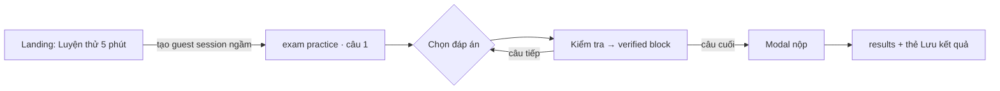
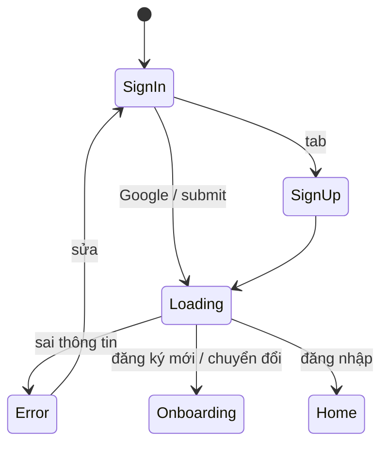
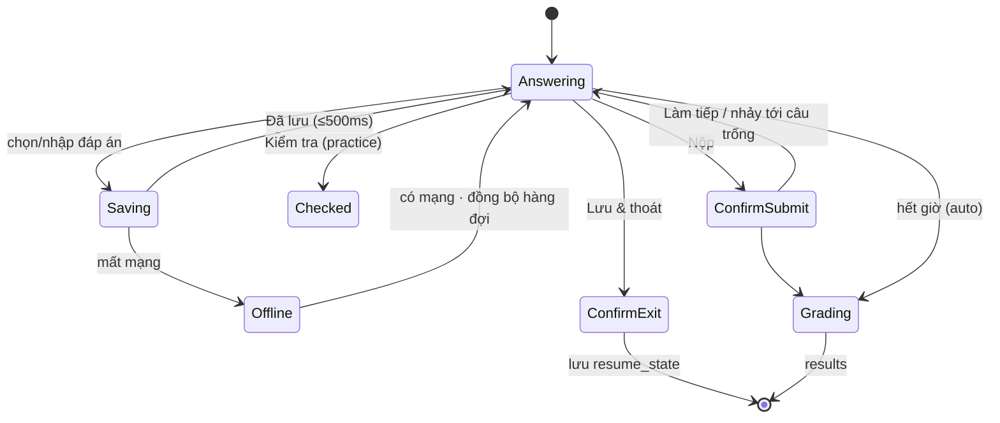
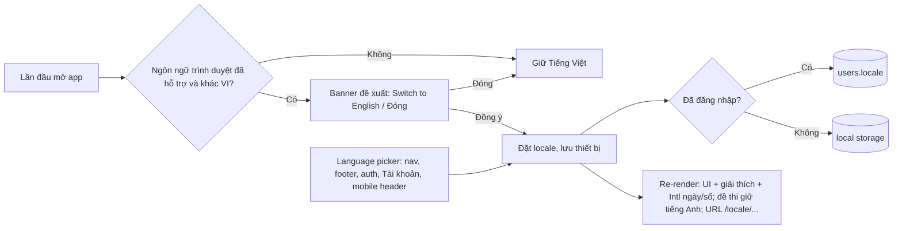

# Engrisk — UX Spec: Feature flow, bố cục component, behavior & khả năng mở rộng

> Tài liệu chuẩn cho đội Design / Web (HeroUI React) / Mobile (HeroUI Native) trước khi code.
> Đi cùng: `product_flow.md` (hành trình, roadmap, mapping dữ liệu) · `ux-preview.html` (prototype + màn **Theme & Components**) · `backend/docs_design/schema.dbml`.
> Phương pháp: skill `product-designer` (borghei/claude-skills) — Discover → Define → Develop → Test → Deliver; journey map và heuristic critique được tạo bằng `journey_mapper.py` và `design_critique.py` của skill (mục 8–9).

**Giả định đầu vào** (chưa có dữ liệu phỏng vấn thật — cần xác nhận ở vòng usability test, mục 11):
- Persona chính: *Minh, 23 tuổi, sinh viên năm cuối, cần TOEIC 650+ để tốt nghiệp, 15–20 phút/ngày, 70% thời gian dùng điện thoại.*
- Persona phụ: *Lan, 27 tuổi, đi làm, luyện IELTS Academic 6.5 để du học, học tối trên laptop, cần chấm Writing.*
- Job-to-be-done: “Khi tôi có 15 phút rảnh, tôi muốn luyện đúng phần mình yếu và hiểu ngay vì sao sai, để điểm tăng trước ngày thi.”
- Mức fidelity: **mid/high-fi để dev handoff**; prototype HTML là nguồn tham chiếu trực quan.

---

## 1. Nguyên tắc đặt component (layout rules)

Áp dụng cho mọi màn hình. Khi phân vân, chọn theo thứ tự ưu tiên từ trên xuống.

| # | Nguyên tắc | Quy tắc cụ thể | Lý do hành vi |
|---|---|---|---|
| L1 | **Một hành động chính mỗi vùng nhìn** | Đúng 1 `Button variant="primary"` trong viewport đầu tiên. Hành động khác: `secondary` (thay thế) / `tertiary` (phụ) / `ghost` (hủy, bỏ qua). | Giảm thời gian quyết định (Hick). |
| L2 | **Việc dở dang trước, việc mới sau** | Thứ tự ưu tiên khối nội dung: *Tiếp tục bài đang làm → Gợi ý tiếp theo → Mục tiêu/tiến độ → Kỹ năng yếu → Lịch sử*. | Hoàn thành việc dở tạo cảm giác tiến bộ, giảm bỏ dở. |
| L3 | **Lý do đi kèm gợi ý** | Mọi khuyến nghị phải có 1 dòng “Vì sao” (dữ liệu nào dẫn tới gợi ý). | Tăng niềm tin, giảm cảm giác bị “ép”. |
| L4 | **Nguồn tin luôn tách bạch** | Đáp án kiểm duyệt = `block-verified` (success-soft + icon khiên). Nội dung AI = `block-ai`/chip “AI tạo · có thể sai” (accent-soft + sparkles). Không bao giờ trộn trong 1 khối. | Tránh hiểu nhầm AI là đáp án chính thức. |
| L5 | **Vùng ngón cái trên mobile** | CTA chính, điều hướng câu hỏi, nộp bài nằm ở **1/3 dưới màn hình** (sticky bar hoặc tab bar). Hành động phá hủy không đặt ở vùng ngón cái mặc định. | Thao tác một tay. |
| L6 | **Đọc bên trái, làm bên phải (Web)** | Màn có tài liệu nguồn (passage, đề Writing): tài liệu cột trái, câu hỏi/editor cột phải, điều hướng cột phải ngoài cùng. | Theo hướng đọc F-pattern; không phải cuộn qua lại. |
| L7 | **Tiết lộ dần (progressive disclosure)** | Transcript, giải thích dài, đề Writing trên mobile, cue card khi ghi âm → `Disclosure`/`Accordion`. Chỉ mở mặc định khi là nội dung chính. | Giữ màn tập trung. |
| L8 | **Tiêu đề section ngoài card** | `Hoạt động gần đây 6` đặt ngoài card; card chỉ chứa nội dung. Không lồng card quá 2 cấp. | Nhịp thị giác HeroUI Pro, scan nhanh. |
| L9 | **Trạng thái tại chỗ** | Lỗi field ngay dưới field; lỗi tải dữ liệu thay chỗ nội dung; thông báo hệ thống bằng `Toast`. Không dùng modal cho thông báo. | Gần nguồn lỗi (Nielsen N9). |
| L10 | **Cùng nội dung, khác cách đặt** | Web và Mobile dùng chung thứ tự ưu tiên nội dung, khác container: Modal ↔ BottomSheet, Table ↔ ListGroup, Split view ↔ Tabs. | Một mental model, hai thiết bị. |

### 1.1 Zone model — App shell

```
WEB (≥1024px)                                         MOBILE (HeroUI Native)
┌──────────┬───────────────────────────────────────┐  ┌──────────────────────────┐
│ SIDEBAR  │ NAVBAR 64px                           │  │ STATUS BAR               │
│ 256px    │ [Page title + subtitle]  [🔍][?][CTA] │  │ LARGE TITLE 30px  [🔔][👤]│
│          ├───────────────────────────────────────┤  │ subtitle                 │
│ Brand    │ Z1  KPI ROW (Stat × 4)                │  ├──────────────────────────┤
│ Tenant ▾ │ Z2  PRIMARY (2/3)  │ Z3 SECONDARY(1/3)│  │ Z1 KPI 2×2               │
│ Học tập  │     Resume card    │   Skill meters   │  │ Z2 Resume card           │
│ Thư viện │     Recommendation │   Weekly rhythm  │  │ Z2 Recommendation        │
│          │ Z4  SECTION TITLE + LIST/TABLE        │  │ Z3 Skills / Week         │
│ Cài đặt  │                                       │  │ Z4 Recent list           │
│ User ⋯   │                                       │  ├──────────────────────────┤
└──────────┴───────────────────────────────────────┘  │ TAB BAR (5) · blur       │
                                                       └──────────────────────────┘
```

| Zone | Nội dung được phép | Component HeroUI | Quy tắc |
|---|---|---|---|
| Sidebar | Brand, tenant switcher, nav nhóm “Học tập/Thư viện”, cài đặt, user | `ListBox` item dạng nav, `Chip` phase | Tối đa 7 mục chính; mục tương lai có `phase` chip, không ẩn. |
| Navbar | Tiêu đề trang (h1 20/28), subtitle, tìm kiếm, trợ giúp, **1 CTA “Luyện nhanh”** | `Button size=sm` | CTA toàn cục ẩn khi trang đã là nơi chọn bài (`catalog`). |
| Z1 KPI | 2–4 chỉ số có ngữ cảnh (giá trị + đơn vị + xu hướng) | `Card` + `Chip trend` + `ProgressBar sm` | Mỗi KPI trả lời 1 câu hỏi; không KPI “cho đẹp”. |
| Z2 Primary | Hành động tiếp theo (resume, gợi ý) | `Card lg` + `Button primary` | Tối đa 2 card; card đầu chứa primary CTA. |
| Z3 Secondary | Thông tin hỗ trợ quyết định | `Card` + `Meter` | Không chứa primary CTA (chỉ `secondary`/`ghost`). |
| Z4 Lists | Lịch sử, danh sách | `ListBox`/`Table` (Web), `ListGroup` (Mobile) | Section title ngoài card + count. |
| Tab bar (mobile) | 5 đích: Trang chủ, Luyện tập, AI Tutor, Tiến độ, Tôi | Native `Tabs`/bottom tabs | Không quá 5; tính năng mới vào “Tôi” trước. |
| Sticky bar (mobile) | CTA chính của màn chi tiết (intro, writing) | `Button lg full` | Thay tab bar khi đang trong luồng nhiệm vụ. |

### 1.2 Zone model — Chế độ tập trung (làm bài)

```
WEB                                                       MOBILE
┌───────────────────────────────────────────────────┐    ┌──────────────────────────┐
│ [✕] Tên đề · chế độ   ......  Đã lưu  ⏱14:58  [Lưu&thoát] [Nộp]│ │ [✕] Tên đề      ⏱ [▦]    │
├────────────────────────┬──────────────────┬───────┤    │ ▬▬▬▬▬▬ progress           │
│ PASSAGE / ĐỀ (đọc)     │ CÂU HỎI          │ NAV   │    │ AUDIO (listening) sticky  │
│ cuộn độc lập           │ Câu n/N · Part   │ ▬▬ 3/10│   │ [Đoạn văn | Câu n] tabs   │
│ tô sáng bằng chứng     │ [Đánh dấu]       │ L 1-5 │    │ Stem 18px                 │
│ (sau nộp)              │ Options (cards)  │ R 6-10│    │ Options ≥56px             │
│                        │ [Kiểm tra]       │ legend│    │ Feedback (practice)       │
├────────────────────────┴──────────────────┤ mode  │    ├──────────────────────────┤
│ [‹ Câu trước]  A–D ←→ F          [Câu tiếp ›]│ alert │    │ [‹ Trước]  3/10  [Tiếp ›] │
└───────────────────────────────────────────┴───────┘    └──────────────────────────┘
```

Quy tắc: ẩn toàn bộ navigation app; thoát luôn qua “Lưu & thoát” (không mất dữ liệu); nộp bài có 2 vị trí (header + câu cuối) nhưng luôn qua modal xác nhận.

### 1.3 Thứ tự đặt component trong một Card (anatomy chuẩn)

```
┌ Card ──────────────────────────────────────────┐
│ [Icon tile] Title (16/24 medium)     [Chip|Btn]│  ← Card.Header: định danh + trạng thái
│             Description (14 muted)             │
│ Content: giá trị chính / progress / list       │  ← Card.Content: 1 ý chính
│ Meta: icon + text 12px (thời lượng, số câu…)   │
│ ───────────── Separator (tùy chọn) ─────────── │
│ [hint muted]                  [Secondary][Primary]│ ← Card.Footer: hành động, primary bên phải (Web)
└────────────────────────────────────────────────┘     Mobile: primary full-width, xếp trên secondary
```

---

## 2. Ma trận đặt component theo màn hình

| Màn (`id`) | Zone / vị trí | Component (HeroUI React → Native) | Ưu tiên | Ghi chú Web | Ghi chú Mobile |
|---|---|---|---|---|---|
| `landing` | Hero trái | Chip “Mới”, Heading, Lead, `Button primary lg` “Luyện thử 5 phút”, `Button tertiary` | P0 | Hero 2 cột, mock câu hỏi bên phải làm bằng chứng giá trị | Ẩn mock, CTA full-width |
|  | Dưới hero | 2 `Card` press TOEIC/IELTS → `catalog` | P1 | Grid 2 | 1 cột |
| `auth` | Card trung tâm | `Tabs` Đăng nhập/Đăng ký, `Button tertiary` Google (trên cùng), `TextField secondary`, `Button primary full` | P0 | 460px giữa màn | Full-width, input 48px |
| `onboarding` | Trung tâm | `ProgressBar sm` + “Bước n/4”, `RadioGroup` dạng choice tile, `Button` Tiếp tục (disabled tới khi chọn), `ghost` Bỏ qua (góc phải trên) | P0 | 460px | Tile ≥64px |
| `home` | Z1 | 4 `Stat` | P1 | Grid 4 | Grid 2×2, chip xu hướng xuống dòng |
|  | Z2 | Resume card → Recommendation card | P0 | 2/3 trái | Đầu trang |
|  | Z3 | Skill meters + nút “Luyện”, nhịp tuần | P1 | 1/3 phải | Sau Z2 |
|  | Z4 | Section “Hoạt động gần đây” + `ListBox` | P2 | Full width | Cuối |
| `catalog` | Toolbar | `Tabs` kỳ thi, `SearchField`, `Tabs sm` loại bài, `ToggleButtonGroup` kỹ năng | P0 | 1 hàng + 1 hàng | Xếp dọc, tabs full |
|  | Grid | Exam `Card` (icon tile, chip loại, title, desc 2 dòng, meta, footer CTA) | P0 | Grid 3 | 1 cột |
| `exam-intro` | Trái | Card tổng quan + 3 thông số, cấu trúc, quy tắc | P0 | 2/3 | Xếp dọc |
|  | Phải / Sticky | Card “Sẵn sàng?” + CTA | P0 | Sticky phải | Sticky bar dưới |
| `exam` | Xem §1.2 | `RadioGroup` → QuestionOption, AudioPlayer, QuestionNavigator, ExamTimer, SaveStatus, `Modal`/`BottomSheet` nộp bài | P0 | Split + nav phải | Tabs passage/câu, sheet lưới câu |
| `results` | Trái | Summary (ProgressCircle + score + loại điểm + alert ước tính), section stats, đáp án (`Tabs` lọc + list) | P0 | 2/3 | Summary → bước tiếp → chi tiết |
|  | Phải | Bước tiếp theo (primary), skill meters, thẻ chuyển đổi khách | P0 | 1/3 | Ngay sau summary |
| `review` | Hai cột | Passage có bằng chứng tô sáng / transcript ↔ câu hỏi + verified block + “Hỏi AI Tutor” | P0 | Câu độc lập: 1 cột 760px | Câu → bằng chứng → điều hướng |
| `tutor` | Trái | Danh sách hội thoại | P2 | 248px | Ẩn (vào từ ngữ cảnh) |
|  | Phải | Context card (verified) → chat → suggestion chips → composer | P0 | max 760px | Composer cuối |
| `library` | Trái | Danh sách tài liệu + trạng thái + nháp AI | P0 | 2/3 | Sau dropzone |
|  | Phải | Upload card (quyền sử dụng + checkbox + CTA disabled) | P0 | 1/3 | Đầu trang |
| `progress` | Z1/Z2/Z4 | KPI, biểu đồ + `Tabs sm` khoảng thời gian, skill meters, `Table` lịch sử | P1 | Table | ListGroup |
| `profile` | 2 cột | Header hồ sơ, mục tiêu, tổ chức, đăng nhập, cài đặt | P1 | 2 cột | 1 cột |
| `org` | — | Banner P4, invitation card, context alert, nội dung tenant, branding | P4 | 2/3 + 1/3 | 1 cột |

---

## 3. Feature flow specs

Mỗi feature theo cùng khung: **Mục tiêu → Entry → Flow → Component theo bước → Behavior/trạng thái → Microcopy → Đo lường → Đường mở rộng (scale)**.

### F1. Luyện thử không cần đăng ký (Guest quick practice) · P1

- **Mục tiêu:** từ lần mở đầu tiên tới câu hỏi đầu tiên ≤ 1 chạm, ≤ 5 giây.
- **Entry:** `landing` CTA chính · nút “Tiếp tục với tư cách khách” ở `auth` · deep link `/practice/:slug`.



| Bước | Component | Behavior |
|---|---|---|
| Tạo khách | (không UI) | Tạo user guest ngầm; nếu lỗi mạng → vẫn vào bài, lưu cục bộ, đồng bộ sau. |
| Làm bài | QuestionOption, `Button` Kiểm tra (disabled khi chưa chọn) | Chọn → autosave ≤500ms; Kiểm tra → khóa câu, hiện đúng/sai + giải thích. |
| Kết quả | Thẻ “Lưu kết quả này?” (viền accent) ở vị trí #2 sau summary | Không popup chặn; “Để sau” luôn có. |

- **Microcopy:** “Luyện thử 5 phút” · “Kết quả khách được giữ khi bạn đăng ký”.
- **Đo lường:** time-to-first-question < 5s; % khách hoàn thành bài đầu ≥ 60%; guest→account ≥ 25%.
- **Scale:** bài quick practice chọn bởi rule engine (P1: cố định; P2: theo kỹ năng phổ biến nhất của nguồn traffic; P3: placement test ngắn). Vị trí CTA không đổi.

### F2. Đăng nhập / Đăng ký / Chuyển đổi khách · P1



- **Thứ tự component:** Tabs → **Google (trên cùng, 1 chạm)** → separator “hoặc dùng email” → Email → Mật khẩu (+ “Quên mật khẩu?” cùng hàng label) → CTA → “Tiếp tục với tư cách khách”.
- **Behavior:** validate email khi blur (định dạng), lỗi đăng nhập hiển thị Alert flat trong card + FieldError dưới field, không tiết lộ email có tồn tại hay không; CTA chuyển `isPending` (spinner, disabled) trong lúc gửi; khóa 15 phút sau 5 lần sai.
- **Chuyển đổi khách:** tiêu đề đổi thành “Lưu kết quả của bạn”, ẩn tabs, giữ nguyên attempt (không di chuyển dữ liệu).
- **Scale:** thêm Apple/Microsoft/SSO = thêm `Button tertiary` cùng nhóm phía trên separator (tối đa 3; nhiều hơn → “Cách khác” mở `Dropdown`). SSO tổ chức (P4): field email phát hiện domain → chuyển nút thành “Tiếp tục với SSO của Sunrise”.

### F3. Onboarding mục tiêu · P1

- 4 bước, mỗi bước 1 câu hỏi, 1 `RadioGroup` dạng tile; “Bỏ qua” luôn ở góc phải; “Quay lại” tertiary bên trái; “Tiếp tục” primary bên phải, disabled tới khi chọn.
- **Behavior:** chọn tile không tự chuyển bước (tránh chạm nhầm) — cần bấm Tiếp tục; bước Mục tiêu đổi thang theo kỳ thi đã chọn; bỏ qua → `home` hiển thị thẻ “Đặt mục tiêu” (không nhắc lại bằng popup).
- **Đo lường:** completion ≥ 70%, thời gian < 40s.
- **Scale:** thêm câu hỏi = thêm bước nhưng **tổng ≤ 5**; câu hỏi tùy chọn đưa vào `profile`. Kỳ thi mới chỉ thêm 1 tile (dữ liệu `exam_types.score_scale` quyết định thang mục tiêu).

### F4. Trang chủ “Hành động tiếp theo” · P1

- **Thuật toán ưu tiên khối (render theo thứ tự, ẩn khối không có dữ liệu):**

| Hạng | Khối | Điều kiện hiện | CTA |
|---|---|---|---|
| 1 | Tiếp tục bài đang làm | có attempt `in_progress` | Tiếp tục (primary) |
| 2 | Gợi ý tiếp theo | luôn (fallback: bài 5 phút) | Bắt đầu (primary nếu không có khối 1, ngược lại secondary) |
| 3 | KPI | ≥1 bài hoàn thành | — |
| 4 | Kỹ năng cần luyện | ≥1 bài | Luyện (secondary) |
| 5 | Nhịp tuần | đã đăng ký | — |
| 6 | Hoạt động gần đây | ≥1 bài | Xem lịch sử (ghost) |

- **Trạng thái:** loading = skeleton đúng hình khối (không spinner toàn trang); error = Alert + vẫn giữ “Luyện nhanh”; empty (người mới) = 1 card gợi ý lớn + 2 card trống có hành động.
- **Scale:** Home là **feed khối có thứ tự ưu tiên** — tính năng mới (bài được giao P4, thử thách tuần, lớp học) thêm khối mới với hạng ưu tiên, không đổi layout. Tối đa 2 khối có primary CTA.

### F5. Danh mục bài (Catalog) · P1

- **Thứ tự lọc = thứ tự quyết định của người học:** Kỳ thi → Loại bài → Kỹ năng → Tìm kiếm.
- **Behavior:** lọc tức thì (không nút Áp dụng); toggle kỹ năng bấm lại để bỏ; kết quả rỗng → empty state giải thích *vì sao* (ví dụ TOEIC L&R không có Writing) + “Xóa bộ lọc”. Bài ngắn bấm “Bắt đầu” vào thẳng `exam`; thi thử bấm “Xem đề” vào `exam-intro`.
- **Khóa nội dung:** 3 mức hiển thị — *Cần tài khoản* (chip lock + CTA dẫn đăng ký), *Premium · tương lai* (chip warning, CTA disabled), *Sắp ra mắt* (chip tertiary, card mờ 72%). Không ẩn bài bị khóa (người học biết giá trị còn ở phía trước).
- **Scale:** bộ lọc sinh từ dữ liệu (`exam_types`, `skills.area`, `exams.kind`); > 5 kỹ năng → `ToggleButtonGroup` cuộn ngang; > 30 bài → nhóm theo section (“Thi thử”, “Part 5”…) + phân trang vô hạn; tenant P4 thêm tab nguồn “Của trung tâm / Thư viện Engrisk”.

### F6. Làm bài (Exam engine) · P1



| Hành vi | Practice | Mock |
|---|---|---|
| Timer | Đếm lên, tạm dừng khi thoát | Đếm ngược theo server; vàng ≤5 phút, đỏ ≤1 phút; tự nộp khi 0 |
| Phản hồi | “Kiểm tra” từng câu, khóa câu đã kiểm tra | Ẩn đến khi nộp |
| Audio | Phát/nghe lại, transcript sau kiểm tra | Phát 1 lần, nút disabled sau khi phát |
| TOEIC Part 2 | Hiện text phương án sau kiểm tra | Chỉ (A)(B)(C) |
| Navigator | Màu đúng/sai + ký hiệu ✓/✕ | Đã trả lời / chưa / đánh dấu |

- **Bàn phím (Web):** A–D chọn, ←/→ chuyển câu, F đánh dấu; không bắt phím khi focus ở ô nhập; sau khi chọn bằng phím, focus không nhảy vào radio (để ←/→ vẫn chuyển câu).
- **Touch (Mobile):** cả thẻ đáp án là vùng chạm ≥56px; lưới câu trong BottomSheet; nút “n/N” ở giữa thanh dưới mở lưới.
- **Scale:** renderer theo `question_type` (single/multiple choice, fill blank, matching, ordering, short answer, essay, speaking) — mỗi loại là 1 component `QuestionBody` cắm vào cùng khung `qwrap`; định dạng đề mới (Cambridge, TOEIC S&W) chỉ thêm section rules + renderer, giữ nguyên header/nav/footer.

### F7. Kết quả & xem lại · P1

- **Thứ tự:** Summary (loại điểm luôn có nhãn) → Bước tiếp theo (primary) → Điểm theo phần → Theo kỹ năng → Danh sách đáp án (lọc Sai/Bỏ trống/Đánh dấu).
- **Review:** mặc định “Chỉ câu sai” khi có câu sai; bằng chứng tô sáng ngay trong passage; nút “Hỏi AI Tutor” chỉ hiện ở câu sai/bỏ trống.
- **Scale:** khối “Bước tiếp theo” nhận nhiều loại gợi ý (luyện kỹ năng, xem video bài giảng P3, giáo viên chấm lại P4) — luôn chỉ 1 primary.

### F8. AI Tutor · P1

- **Bố cục cố định:** Context card (đáp án + giải thích **đã kiểm duyệt**) → hội thoại → chip gợi ý → composer.
- **Behavior:** mỗi tin AI có nhãn “AI tạo · có thể sai” + đánh giá 👍/👎 + sao chép; gợi ý luyện tập chỉ lấy từ ngân hàng đã kiểm duyệt (thẻ có CTA); lỗi AI → Alert danger, giải thích kiểm duyệt vẫn hiển thị; hết lượt → Alert warning + giờ mở lại; composer disabled khi đang trả lời.
- **Scale:** loại ngữ cảnh mở rộng (câu hỏi, bài Writing, kỹ năng, kế hoạch học) = loại Context card khác, cùng khung chat. Giọng nói (P3) = nút micro trong composer.

### F9. IELTS Writing · P2

- Web: split đề | editor; đếm từ realtime (xanh khi đạt yêu cầu); nộp < 250 từ → modal cảnh báo nhưng cho nộp.
- Mobile: màn chọn chế độ trước (viết toàn bài / luyện mở bài 10 phút / tiếp tục trên web).
- Sau nộp: trạng thái “AI đang chấm” cho phép rời màn; kết quả = band dạng khoảng + 4 tiêu chí + sửa lỗi; lỗi chấm → bài an toàn + Thử lại.
- **Scale:** Task 1 (biểu đồ) = thêm ảnh vào cột đề; giáo viên chấm (P4) thêm khối “Nhận xét giáo viên” phía trên khối AI.

### F10. IELTS Speaking · P2

- Thứ tự trạng thái: Giới thiệu → giải thích quyền micro → hộp thoại hệ thống → (Từ chối → hướng dẫn + vẫn xem cue card) → Chuẩn bị 60s (ghi chú) → Ghi âm (nút dừng lớn trung tâm, tự dừng 2:00) → Nghe lại / Ghi lại / Nộp → Chấm → Nhận xét.
- **Behavior:** không xin quyền micro trước khi người học bấm “Bắt đầu”; cảnh báo nếu bản ghi < 30s; tiêu chí phát âm gắn cờ độ tin cậy thấp.

### F11. Tài liệu & AI tạo câu hỏi · P3

- **Gating trước hành động:** nút tải lên disabled tới khi chọn quyền sử dụng + tick xác nhận (giải thích ngay dưới nút).
- **Trạng thái tài liệu:** Đã tải lên → Đang xử lý (progress) → Sẵn sàng | Lỗi (lý do + Tải lại/Xóa).
- **Duyệt nháp:** mỗi câu Sửa / Duyệt / Từ chối, có Hoàn tác; cờ “Cần xem kỹ” khi AI không chắc; “Tạo bộ luyện riêng” disabled tới khi ≥1 câu được duyệt.
- **Scale:** “Duyệt tất cả” khi > 10 câu (backlog); chia sẻ cho tổ chức (P4) là bước tách riêng có người duyệt.

### F12. Tiến độ & mục tiêu · P1

- KPI → biểu đồ điểm ước tính (đường mục tiêu nét đứt) → kỹ năng → lịch sử. Biểu đồ chỉ hiện khi ≥1 bài thi thử; ít dữ liệu → Alert “Cần thêm dữ liệu” + lịch sử.
- **Scale:** thêm khoảng thời gian (`Tabs sm`), thêm loại kỳ thi (Select ở header khi người học có >1 mục tiêu).

### F13. Tài khoản & ngữ cảnh tổ chức · P1/P4

- Nhóm theo tần suất dùng: Mục tiêu → Tổ chức → Đăng nhập → Cài đặt → Đăng xuất → Xóa tài khoản (cuối, màu danger, AlertDialog).
- Tenant switcher: sidebar (Web) và “Tôi” (Mobile); chuyển ngữ cảnh → toast xác nhận + theme đổi ngay.

### F14. Tổ chức & thương hiệu · P4

- Lời mời: card trung tâm (logo, vai trò, cam kết quyền riêng tư) → Tham gia/Từ chối. Sau tham gia: alert ngữ cảnh + nội dung tenant + thư viện cấp phép.
- Branding: tenant admin chỉ chọn `accent` + logo; toàn bộ component tự đổi qua token.

---

## 4. Behavior standards (toàn cục)

### 4.1 Phản hồi theo thời gian

| Thời gian xử lý | Phản hồi | Component |
|---|---|---|
| < 100ms | Trạng thái pressed (scale .97) | Button/Card press |
| 100ms – 1s | Không hiển thị gì thêm; nếu là lưu → “Đang lưu…” → “Đã lưu” | SaveStatus |
| > 300ms khi tải trang | Skeleton đúng hình nội dung | `Skeleton` |
| > 1s hành động người dùng | Button `isPending` (spinner + disabled) | `Button` |
| > 10s (AI chấm, xử lý tài liệu) | Chuyển thành job nền: cho rời màn, báo bằng Toast khi xong | `Toast` + status chip |

### 4.2 Xác nhận & hoàn tác

| Mức rủi ro | Ví dụ | Cách xử lý |
|---|---|---|
| Đảo ngược được | Đánh dấu câu, lọc, từ chối nháp | Làm ngay, có Hoàn tác tại chỗ |
| Mất trạng thái có thể khôi phục | Lưu & thoát bài thi | Modal ngắn giải thích hệ quả (đồng hồ vẫn chạy) |
| Không đảo ngược | Nộp bài, xóa tài khoản | Modal/AlertDialog với tóm tắt + nút hành động rõ nghĩa (“Nộp bài”, “Xóa vĩnh viễn”), nút hủy là tertiary |
| Xóa dữ liệu người học tạo | Xóa tài liệu | Toast “Đã xóa” + Hoàn tác 5s (backlog, xem §9) |

### 4.3 Lỗi

- **Field:** `FieldError` dưới field + `aria-invalid`; validate định dạng khi blur, nghiệp vụ khi submit.
- **Khối dữ liệu:** Alert thay chỗ nội dung, có “Thử lại”; các phần khác vẫn hoạt động.
- **Hệ thống:** Toast; không dùng modal để báo lỗi.
- **Câu chữ:** nói điều gì xảy ra + dữ liệu có an toàn không + làm gì tiếp (“Bài làm đã được lưu an toàn. Thử lại sau ít phút.”).

### 4.4 Empty state = Pip (hoặc icon tile) + tiêu đề + 1 câu lý do + ≤2 hành động

Không bao giờ để màn trống không có hành động. Empty state cho người mới phải dẫn về **bài 5 phút**. Empty state “chưa có dữ liệu” dùng Pip `think`, “cần tài khoản” dùng Pip `wave`; kết quả lọc rỗng nhỏ trong card dùng icon tile (§13.4).

### 4.5 Offline & đồng bộ
Đáp án lưu hàng đợi cục bộ, badge “Lưu trên thiết bị”; đồng hồ mock theo server; khi có mạng đồng bộ theo thứ tự, last-write-wins từng câu.

### 4.6 Motion
Chuyển động phục vụ phản hồi và định hướng: vào màn (stagger 1 lần), số liệu/tiến độ lớn dần, phản hồi chọn/kiểm tra đáp án, overlay, hover nâng thẻ, linh vật. Không lặp animation khi re-render; tắt toàn bộ với `prefers-reduced-motion`. Token chi tiết ở §13.5.

### 4.7 Động lực không thao túng
Không streak, không đếm ngược ngoài phòng thi, không “bạn sắp mất…”. Nhắc học ≤1 lần/ngày và không nhắc khi đã học. Câu khích lệ dựa trên dữ kiện (“3 ngày có học tuần này”).

---

## 5. Quy tắc chọn component (decision table)

| Nhu cầu | Dùng | Không dùng |
|---|---|---|
| Chuyển giữa 2–4 chế độ xem cùng cấp | `Tabs` (segmented) | Dropdown |
| Lọc nhiều lựa chọn bật/tắt | `ToggleButtonGroup` | Checkbox list dài |
| Chọn 1 trong > 5 mục ít thay đổi | `Select` | Tabs |
| Chọn 1 đáp án / onboarding | `RadioGroup` dạng tile | Select |
| Trạng thái ngắn (≤3 từ) | `Chip soft` | Alert |
| Thông báo trong ngữ cảnh | `Alert` (flat khi trong card) | Toast |
| Xác nhận sau hành động | `Toast` | Modal |
| Quyết định chặn luồng | `Modal`/`AlertDialog` (Web) → `BottomSheet`/`Dialog` (Mobile) | Toast |
| Danh sách điều hướng | `ListBox` item / `ListGroup` | Table trên mobile |
| Dữ liệu nhiều cột so sánh | `Table` (Web) | Card grid |
| Tiến trình nhiệm vụ | `ProgressBar` | Meter |
| Mức độ/thành thạo | `Meter` | ProgressBar |
| Nội dung phụ dài | `Disclosure`/`Accordion` | Modal |
| Input trên nền background | `Input` primary (field shadow) | — |
| Input trong card | `Input variant="secondary"` | Input có viền dày |

---

## 6. Khung mở rộng tính năng (feature scale)

### 6.1 Slot thay vì layout mới
| Slot | Cơ chế mở rộng | Ví dụ tương lai |
|---|---|---|
| Home feed | Danh sách khối có `priority` + điều kiện hiển thị | Bài được giao (P4), thử thách tuần |
| Catalog filters | Sinh từ dữ liệu `exam_types`/`skills`/`exams.kind` | Cambridge, TOEIC S&W |
| Question renderer | Registry theo `question_type` | Matching, ordering, speaking Part 3 |
| Results “Bước tiếp theo” | Danh sách gợi ý có hạng, render 1 | Giáo viên chấm lại |
| Tutor context | Loại context card | Bài Writing, kế hoạch học |
| “Tôi” (mobile) | List nhóm theo tần suất | Lớp học, hóa đơn |
| Sidebar “Thư viện” | Nhóm mở rộng, có phase chip | Lớp học, báo cáo |

### 6.2 Gating tính năng (entitlement / phase)
| Trạng thái | Hiển thị | Khi nào |
|---|---|---|
| Ẩn | Không render | Tính năng không thuộc tenant (vd. tenant tắt upload) |
| Khóa – có đường mở | Chip lock + CTA dẫn đăng ký/nâng cấp | Khách, gói thấp |
| Khóa – chưa có | Chip “tương lai/Sắp ra mắt”, CTA disabled | Roadmap đã công bố |
| Hết hạn mức | Alert warning trong ngữ cảnh + thời điểm mở lại | Quota AI |

### 6.3 Checklist khi thêm một feature mới
1. Feature thuộc slot nào ở 6.1? Nếu không có slot → review IA trước khi thiết kế màn mới.
2. Primary CTA duy nhất của màn là gì? Có tranh chấp với khối hạng cao hơn không?
3. Đủ 6 trạng thái: default, loading, empty, error, disabled, success.
4. Phiên bản Web và Mobile: container nào thay đổi (L10)?
5. Có dùng AI? → nhãn AI + nguồn kiểm duyệt + hành vi khi lỗi/hết quota.
6. Gating: ẩn / khóa / hạn mức theo 6.2.
7. Dữ liệu: entity nào trong `schema.dbml`; cập nhật `product_flow.md` §J.
8. Đo lường: 1 chỉ số thành công + 1 chỉ số an toàn (lỗi/bỏ dở).

---

## 7. Information architecture

```
Engrisk
├── Public
│   ├── Landing  (/)
│   ├── Đăng nhập / Đăng ký  (/login)
│   └── Onboarding  (/onboarding)
├── Học tập
│   ├── Trang chủ  (/home)
│   ├── Luyện tập  (/practice)
│   │   └── Chi tiết bài  (/practice/:slug)
│   │       └── Làm bài  (/attempts/:id)  [focus mode]
│   │           ├── Kết quả  (/attempts/:id/result)
│   │           └── Xem lại  (/attempts/:id/review/:n)
│   ├── AI Tutor  (/tutor/:conversationId)
│   └── Tiến độ  (/progress)
├── Thư viện
│   ├── Tài liệu của tôi  (/library)  [P3]
│   └── Tổ chức  (/org/:slug)  [P4]
└── Tài khoản  (/account)
```

Kiểm chứng IA (cần làm): tree test 8 tác vụ với 10 người (“Tìm bài luyện Part 7”, “Xem lại câu sai của bài hôm qua”, “Đổi mục tiêu điểm”…), mục tiêu ≥ 80% tìm đúng lần đầu.

---

## 8. Journey map (tạo bằng `journey_mapper.py`)

Persona: *Minh, sinh viên năm cuối, cần TOEIC 650+, 15–20 phút/ngày, chủ yếu điện thoại.*

```
EMOTION CURVE
Khám phá             |******************              3/5 - Tò mò nhưng ngại đăng ký
Bài đầu tiên         |************************        4/5 - Bất ngờ vì hiểu ngay lỗi sai
Lưu kết quả          |******************              3/5 - Do dự khi phải tạo tài khoản
Thói quen hằng ngày  |************************        4/5 - Nhẹ nhàng, biết việc cần làm
Thi thử              |************                    2/5 - Căng thẳng, sợ mất bài
Hiểu điểm yếu        |************************        4/5 - Có định hướng rõ
Tiến bộ              |******************************  5/5 - Tự tin trước ngày thi

METRICS: Avg emotion 3.6/5 · Lowest: Thi thử · Highest: Tiến bộ · 14 pain points · 16 opportunities
BIGGEST DROPS: Thói quen → Thi thử (−2) · Bài đầu tiên → Lưu kết quả (−1)
```

| Giai đoạn | Pain point | Cơ hội → đã đưa vào thiết kế |
|---|---|---|
| Khám phá | Bị bắt đăng ký; không biết bắt đầu bài nào | F1 guest 1 chạm; L1 một CTA |
| Bài đầu tiên | Giải thích dài; không biết còn bao nhiêu câu | Verified block ngắn + bằng chứng; progress + n/N |
| Lưu kết quả | Sợ mất kết quả; form dài | Chuyển đổi giữ attempt; Google trên cùng; onboarding bỏ qua được |
| Thói quen | Phải tự chọn bài; bị nhắc nhiều | F4 feed ưu tiên + lý do; nhắc ≤1/ngày |
| **Thi thử (điểm thấp nhất)** | Mất mạng; không rõ quy tắc audio; không biết câu chưa làm | Autosave + offline badge; quy tắc ở intro; modal nộp liệt kê câu trống; cảnh báo thời gian 2 mức |
| Hiểu điểm yếu | Không tin điểm ước tính; nghi AI sai | Nhãn loại điểm; tách verified vs AI |
| Tiến bộ | Biểu đồ trống | Empty state có hành động; đường mục tiêu |

**Ưu tiên thiết kế tiếp theo:** giảm cú rơi cảm xúc ở *Thi thử* — đề xuất thêm “chế độ thi thử từng phần” (section mock 30–45 phút) để làm quen trước full mock, và màn “Kiểm tra trước khi thi” (âm lượng, kết nối) ở `exam-intro`.

---

## 9. Đánh giá heuristic (tạo bằng `design_critique.py`, trên `ux-preview.html` hiện tại)

```
COMPLIANCE SCORE: 86.5% (Grade: B) · 45 passed / 7 failed / 52 total
Critical 0 · Major 0 · Minor 6 · Cosmetic 1
```

**Đã sửa trước khi chấm (trong lần cập nhật này):**

| Vấn đề | Đo được | Sửa |
|---|---|---|
| Chữ trắng trên nút accent không đạt AA | 3.59:1 | ~~Giảm L accent~~ — **đã thay**: giữ nguyên giá trị HeroUI Theme Builder theo yêu cầu; rủi ro + đề xuất ở §13.3, PO quyết định preset mặc định (product_flow M-11) |
| Chữ phụ (`--muted`) trên nền | 4.42:1 | ~~Giảm L muted~~ — **đã thay**: chữ phụ dài đặt trong Card (`--surface`, 4.81:1), §13.3 |
| Navigator practice chỉ phân biệt đúng/sai bằng màu | — | Thêm ký hiệu ✓/✕ trên ô câu |
| Tiêu đề card/section không phải heading | — | Card title → `h3`, section title → `h2` (h1 = tiêu đề trang) |
| Không có điểm vào trợ giúp (Web) | — | Icon “Trợ giúp” trên navbar |
| Phím ←/→ bị radio nuốt sau khi chọn bằng phím A–D | — | Không chuyển focus vào radio sau phím tắt |

**Backlog còn lại:**

| # | Mức | Heuristic | Vấn đề | Đề xuất |
|---|---|---|---|---|
| 1 | Minor | N3 Kiểm soát | Xóa tài liệu không có hoàn tác | Toast “Đã xóa” + Hoàn tác 5s (§4.2) |
| 2 | Minor | N5 Phòng lỗi | Đăng nhập chỉ validate khi submit | Validate định dạng email khi blur |
| 3 | Minor | N6/N10 Trợ giúp | Mobile chưa có điểm vào trợ giúp; chưa có trung tâm trợ giúp | Mục “Trợ giúp & phản hồi” trong tab “Tôi”; help center tra cứu được (P2) |
| 4 | Minor | N7 Hiệu quả | Không có “Duyệt tất cả” câu nháp | Thêm khi > 10 câu |
| 5 | Minor | N10 | Tài liệu chưa tra cứu được | FAQ theo tác vụ |
| 6 | Cosmetic | N7 | Không tùy biến giao diện (ngoài sáng/tối) | Chấp nhận ở P1 |

---

## 10. Accessibility checklist (bắt buộc cho mọi màn)

- Tương phản: chữ thường ≥ 4.5:1, chữ lớn/icon ≥ 3:1 — dùng token, không hard-code màu.
- Không truyền đạt chỉ bằng màu: đúng/sai luôn kèm icon hoặc chữ.
- Vùng chạm mobile ≥ 44×44px; đáp án ≥ 56px.
- Focus ring 2px `--focus` trên mọi phần tử tương tác; modal chuyển focus vào nút đầu tiên; Esc đóng (trừ “Đang chấm”).
- Heading: 1 `h1`/trang → `h2` section → `h3` card.
- Live region: trạng thái lưu, toast, audio label.
- Timer có `role="timer"`; không đọc mỗi giây.
- Audio không autoplay; có transcript sau khi được phép xem.

---

## 11. Kế hoạch usability test (xác nhận giả định)

**Mục tiêu:** xác nhận người học bắt đầu luyện < 1 phút, hiểu lỗi sai và quay lại bài dở mà không cần hướng dẫn.

**Người tham gia:** 6 người (3 TOEIC sinh viên, 3 IELTS đi làm); 4 dùng mobile, 2 dùng web; 3 người mới, 3 từng dùng app luyện thi khác.

| # | Tác vụ | Thành công | Thời gian mục tiêu |
|---|---|---|---|
| T1 | “Bạn có 5 phút, hãy luyện thử một bài TOEIC” (từ landing) | 100% | < 60s tới câu 1 |
| T2 | “Tìm hiểu vì sao bạn sai câu 1” | ≥ 90% | < 45s |
| T3 | “Lưu kết quả vừa làm vào tài khoản” | ≥ 90% | < 90s |
| T4 | “Thoát bài thi thử rồi làm tiếp từ chỗ cũ” | ≥ 85% | < 30s |
| T5 | “Tìm kỹ năng yếu nhất và luyện nó” | ≥ 85% | < 40s |
| T6 | (IELTS) “Nộp một bài Writing và đọc nhận xét” | ≥ 80% | < 120s sau khi viết |
| T7 | “Đâu là điểm chính thức, đâu là ước tính?” (câu hỏi hiểu) | 100% trả lời đúng | — |

**Chỉ số:** task completion, time on task, error count, SUS (mục tiêu ≥ 80, tối thiểu 68). Phân tích bằng `usability_scorer.py --sus-responses … --task-data …`.

---

## 12. Dev handoff checklist

- [ ] Import `@heroui/styles` + 5 preset export từ HeroUI Theme Builder (`styles/tokens.css` trong prototype) scoped bằng `data-palette` × `data-theme`; Native dùng cùng giá trị token qua theme provider.
- [ ] i18n: catalog ICU theo key (Web: i18next/FormatJS; Native: cùng key), không ghép chuỗi; `Intl` cho ngày/số; tiền tố URL `/{locale}`; đọc/ghi `users.locale`.
- [ ] Linh vật Pip: export SVG theo 5 mood (§13.4); tai nghe dùng token `accent`; tôn trọng reduced motion.
- [ ] Component nghiệp vụ dùng chung tên: `QuestionOption`, `QuestionNavigator`, `ExamTimer`, `SaveStatus`, `AudioPlayer`, `VerifiedBlock`, `AIBlock`, `ScoreSummary`, `StatCard`, `RecommendationCard`, `EmptyState`.
- [ ] Mỗi màn có đủ 6 trạng thái (§6.3-3) và đối chiếu với panel “Trạng thái màn hình” trong prototype.
- [ ] Phím tắt bài thi + hành vi focus như F6.
- [ ] Nhãn loại điểm theo `score_kind` (raw / scaled_estimate / ai_estimate); không có “official”.
- [ ] Gating theo `tenant_entitlements` + `access_tier` đúng 4 trạng thái §6.2.
- [ ] Analytics events cho các chỉ số ở F1–F14 (định nghĩa ở P1 sprint đầu).

---

## 13. Redesign theo trang: theme, ngôn ngữ, linh vật, motion

> Bản redesign này dùng **HeroUI Theme Builder (https://heroui.com/en/themes) làm nguồn sự thật duy nhất** cho màu, font, radius. Prototype tách thành `styles/` (tokens, components, patterns, layout) và `scripts/` (i18n, data, ui, screens-*, app). Mục tiêu trải nghiệm: dịu mắt, thân thiện, chuyển động mềm, không gây áp lực.

### 13.1 Giao diện (theme) do người học chọn

| Thuộc tính | Lựa chọn | Nguồn | Lưu ở | Nơi đổi |
|---|---|---|---|---|
| Preset màu | Default · Sky · Lavender · Mint · Rabbit | Theme Builder export, nguyên văn | `users.preferences.theme.palette` (khách: thiết bị) | `profile` → Giao diện (RadioGroup dạng tile có xem trước 3 màu) |
| Chế độ | Sáng · Tối · Theo hệ thống | HeroUI `[data-theme]` | `users.preferences.theme.mode` | `profile` → Giao diện (Tabs) |
| Branding tổ chức (P4) | 1 accent từ 16 swatch Theme Builder | Theme Builder swatch | `tenants.branding` | `org` (tenant_admin) |

- **Behavior:** áp dụng ngay, không cần Lưu; chuyển màu toàn app 350ms (`.theming`), không reload. Ưu tiên: branding tenant ghi đè `--accent` preset của người học; chế độ sáng/tối luôn theo người học.
- **Không đổi theme trong lúc làm bài** (không có entry trong focus mode) để tránh xao nhãng.
- Preset mang tên thương hiệu bên thứ ba (Netflix, Spotify, Airbnb…) không được cung cấp.

### 13.2 Đa ngôn ngữ (người học nhiều quốc gia)



- **Component:** `Dropdown` (Web) / `Menu` hoặc `BottomSheet` (Native), item `menuitemradio` gồm mã 2 chữ + tên bản ngữ + tên tiếng Anh; ngôn ngữ chưa có hiển thị disabled + chip “Sắp có” (không ẩn, để người học biết lộ trình). Ghi chú cuối menu: “Nội dung đề thi luôn bằng tiếng Anh”.
- **Vị trí:** public nav (phải, trước Đăng nhập), footer landing (mở lên), khối “Học bằng ngôn ngữ của bạn” trên landing, navbar app (Web), header large-title (Mobile), Tài khoản → Ngôn ngữ, toolbar prototype.
- **Quy tắc nội dung:** không ghép chuỗi; chừa ≥30% độ dài; nút không cắt chữ (cho xuống dòng ở mobile); tên riêng kỳ thi (TOEIC, IELTS, Part 5) không dịch; xác nhận đổi ngôn ngữ bằng toast nói rõ đề thi vẫn tiếng Anh.
- Prototype có đủ VI + EN; ja, ko, zh, th, id, es là “Sắp có”.

### 13.3 Tương phản với preset HeroUI nguyên văn (đề xuất cho production)

Đo được: xem `product_flow.md` §L. Ba rủi ro và đề xuất **không đổi giá trị token**:
1. Default — chữ trên nút primary 3.59:1: dùng button `lg` (16px) cho CTA chính, hoặc PO chọn Rabbit làm mặc định (M-11).
2. Sky/Lavender/Mint — `--accent-soft-foreground` 3.0–3.7:1: chip accent/tiêu đề alert accent dùng font 600; trạng thái quan trọng luôn kèm icon; nếu audit a11y bắt buộc AA tuyệt đối, chuyển chip thông tin sang `chip--default` khi palette thuộc nhóm accent sáng.
3. `--muted` trên `--background` 4.42:1: chữ phụ dài (mô tả, ghi chú) đặt trong `Card` (`--surface`, 4.81:1); trên nền canvas chỉ dùng muted cho nhãn ngắn ≥14px.

### 13.4 Linh vật “Pip”

| Mood | Dùng ở | Không dùng |
|---|---|---|
| `wave` | Landing hero, auth (Web panel trái), hero card “Kế hoạch hôm nay”, empty state cần tài khoản, sidebar khách | — |
| `think` | Onboarding (bong bóng lời thoại), empty state không dữ liệu, đang chấm bài, xin quyền micro | — |
| `happy` | Kết quả 40–59%, nhận xét Writing/Speaking, intro “Sẵn sàng chưa?”, bước 4 onboarding | — |
| `cheer` | Kết quả ≥ 60% (kèm confetti 1 lần), CTA cuối landing | Kết quả thấp |
| `calm` | Kết quả < 40% (động viên, không chê) | — |

- Tối đa **1 Pip mỗi màn**; **không** xuất hiện trong màn làm bài (focus mode); Pip không bao giờ nói thay AI Tutor (AI có avatar + nhãn riêng).
- Thân/mỏ/chân/má = swatch Theme Builder; tai nghe = `--accent` → đổi theo preset/tenant. Animation: bob 3.4s, blink 5.2s, wave 1.6s; tắt khi reduced motion.

### 13.5 Motion tokens

| Hiệu ứng | Thông số | Kích hoạt | Không làm |
|---|---|---|---|
| Vào màn (stagger) | `rise` 480ms ease-out-quart, trễ 50ms/khối (tối đa 280ms) | Đổi màn (`data-enter`) | Không chạy lại khi state re-render |
| Số liệu đếm lên | 900ms ease-out quart | KPI, điểm kết quả, khi vào màn | Không đếm trong màn làm bài |
| Progress/meter/ring | `grow` 900ms, `ringIn` 1100ms | Khi vào màn | — |
| Biểu đồ | `draw` 1400ms | `progress` | — |
| Chọn đáp án | `optPop` 420ms ease-out-fluid | Phần tử vừa chọn | Không animate đáp án khác |
| Kiểm tra đáp án | `reveal` 420ms + `shake` cho đáp án sai | Practice “Kiểm tra” | Không âm thanh |
| Hover | Card nhấc 2px; nút primary glow; icon mũi tên nhích 2px | Chỉ `hover:hover` | Không hover trên touch |
| Overlay | Modal `pop` 260ms; BottomSheet `sheet` 340ms; Toast 450ms | Mở overlay | Không chạy lại khi re-render |
| Ăn mừng | Confetti 36 mảnh, 1.6s, 1 lần | Kết quả ≥ 60% | Kết quả thấp; khi reduced motion |
| Đổi theme | Transition màu 350ms | Đổi preset/chế độ/tenant | — |

### 13.6 Spec từng trang

Mỗi trang: **Mục tiêu → Bố cục Web / Mobile → Component chính → Motion & linh vật → Luồng người dùng**. Trạng thái màn (loading/empty/error…) giữ nguyên như §2–§3.

#### `landing` — Landing / Khám phá (P1)
- **Mục tiêu:** hiểu giá trị trong 5 giây; bắt đầu bài 5 phút trong 1 chạm.
- **Web:** pub-nav trong suốt (blur) → banner gợi ý ngôn ngữ (nếu có) → Hero 2 cột (trái: chip “Mới”, H1 46px có dòng gradient, lead, 2 CTA `xl`, social proof AvatarGroup; phải: Pip `wave` 230px trên 3 blob mềm + 4 thẻ nổi minh họa sản phẩm: điểm ước tính, đáp án kiểm duyệt, AI Tutor, Part 3) → 3 thẻ kỳ thi → “Cách hoạt động” 3 bước (Pip 3 mood) → Bento tính năng (thẻ lớn có QuestionOption đúng/sai thật) → khối “Học bằng ngôn ngữ của bạn” → Testimonials → CTA band (Pip `cheer`) → footer có language picker.
- **Mobile:** một cột; CTA full-width `lg`; hero art 300px dưới CTA; ẩn 2 thẻ nổi dưới; bento 1 cột.
- **Luồng:** Luyện thử 5 phút → `exam` (khách) · Chọn kỳ thi → `catalog` · Đăng nhập/Đăng ký → `auth` · Đổi ngôn ngữ → re-render tại chỗ.

#### `auth` — Đăng nhập / Đăng ký (P1)
- **Web:** split 50/50 — trái: panel gradient accent-soft, Pip, tagline, 3 lợi ích có icon tile; phải: form 420px. **Mobile:** form một cột, Pip 80px trên tiêu đề.
- **Component:** Tabs full-width (Đăng nhập/Đăng ký), Google button tertiary, separator “hoặc dùng email”, TextField secondary, InputGroup mật khẩu (hiện/ẩn), primary `lg` full-width có pending.
- **Behavior:** validate email khi blur; lỗi chung không tiết lộ email tồn tại; chuyển đổi khách giữ kết quả → `onboarding`.

#### `onboarding` — Mục tiêu (P1)
- **Bố cục:** “Bước n/4” + Bỏ qua → progress `sm` → **Pip `think` + bong bóng lời thoại** giải thích vì sao hỏi → câu hỏi H1 → RadioGroup tile (icon kỹ năng) stagger → Quay lại / Tiếp tục.
- **Luồng:** Kỳ thi → Trình độ → Mục tiêu (+ ngày thi) → Thời gian/ngày → `home` (toast “Đã lưu mục tiêu”).

#### `home` — Dashboard (P1)
- **Web:** greeting theo giờ + ngày (Intl) → **Hero “Kế hoạch hôm nay”** (eyebrow, 1 câu kế hoạch, chip thời lượng + lý do, CTA `lg`, Pip `wave` góc phải) → 4 KPI đếm lên → grid chính: Tiếp tục bài đang làm + Hoạt động gần đây | Kỹ năng cần luyện + Nhịp học tuần (bar chart 7 ngày, không streak).
- **Mobile:** large title “Chào Minh” + language/avatar; hero card; KPI 2×2; các card xếp dọc; tab bar 5 mục (tab hiện tại có pill accent-soft + icon pop).
- **Người mới / khách:** hero “Bắt đầu với một bài 5 phút” (Pip `wave`) → sau bài đầu: hero gợi ý kỹ năng yếu nhất (Pip `happy`).

#### `catalog` — Danh mục (P1)
- **Bố cục:** banner track (tint theo kỳ thi, Pip `think` trên Web) → Tabs kỳ thi + Search → Tabs loại + ToggleGroup kỹ năng → (bộ riêng nếu có) → grid thẻ bài 3 cột.
- **Thẻ bài:** dải tint màu kỹ năng (swatch) chứa icon tile lớn + chip loại → tiêu đề, mô tả 2 dòng → meta (phút, câu, độ khó) → footer: trạng thái khóa/ghi chú + CTA. Hover nhấc thẻ.
- **Luồng:** bài ngắn → `exam` ngay; thi thử/bài cần tài khoản → `exam-intro`.

#### `exam-intro` — Giới thiệu bài (P1)
- **Web:** trái: header tint (chip, H2, mô tả, 3 thông số) → Cấu trúc đề → Quy tắc chế độ (icon tile warning cho mock, success cho practice); phải: card sticky “Sẵn sàng chưa?” với Pip `happy` + CTA. **Mobile:** CTA ở thanh sticky đáy.

#### `exam` — Làm bài (P1)
- **Không linh vật, không entrance animation lặp** — chỉ motion phản hồi: `optPop` khi chọn, `reveal`/`shake` khi kiểm tra, audio play ring + waveform sống, timer pulse khi < 60s.
- **Web:** exam bar (thoát, icon kỹ năng, tiêu đề, save status, timer, Lưu & thoát, Nộp) → split passage/question hoặc single → footer gợi ý phím tắt → navigator phải (✓/✕ ở practice).
- **Mobile:** app bar gọn + progress `sm` → audio (nếu có) → Tabs Đoạn văn/Câu → nội dung → thanh Trước / n/N (mở BottomSheet) / Tiếp.

#### `writing` · `speaking` — IELTS (P2)
- Writing: như F9; trạng thái chấm có Pip `think`; nhận xét có ring band + Pip `happy`. Speaking: như F10; xin quyền có Pip `think`; nút mic lớn có 2 vòng sóng lan; nhận xét có Pip `happy`.

#### `results` — Kết quả (P1)
- **Hero kết quả:** chip loại/lý do nộp → tiêu đề cảm xúc theo % (Xuất sắc / Làm tốt lắm / Đang tiến bộ / Khởi đầu tốt) → ring % + điểm (đếm lên) → Alert “ước tính, không chính thức” → Pip theo mood (cheer/happy/calm; chỉ Web — Mobile bỏ Pip để điểm số chiếm trọn chiều ngang). Confetti chỉ khi ≥ 60%.
- **Web:** trái: hero, điểm theo phần, danh sách đáp án (Tabs lọc); phải: thẻ chuyển đổi khách, Bước tiếp theo (tint theo kỹ năng yếu), theo kỹ năng. **Mobile:** hero → chuyển đổi → bước tiếp theo → phần → kỹ năng → đáp án.

#### `review` — Xem lại (P1)
- Web 2 cột: passage/transcript (bằng chứng tô sáng có animation `highlight` 1.2s) | câu hỏi + Verified block + Trước/Tiếp. Mobile: câu → bằng chứng → điều hướng. Switch “Chỉ câu sai”.

#### `tutor` — AI Tutor (P1)
- Web: danh sách hội thoại 248px | context card (đáp án + giải thích kiểm duyệt) → chat (tin mới `rise`, tin cũ không animate lại) → chip gợi ý → composer pill (focus ring). Mobile: một cột, không danh sách hội thoại.
- Empty/khách: Pip `think`/`wave`. AI luôn có avatar đen + sparkle + chip “AI tạo · có thể sai”.

#### `library` — Tài liệu & AI tạo câu hỏi (P3)
- Web: trái danh sách tài liệu + nháp; phải dropzone (viền nét đứt, hover accent-soft) + quyền sử dụng. **Xóa có Hoàn tác** trong toast (thay vì hỏi xác nhận). “Duyệt tất cả” khi ≥ 2 nháp. Empty: Pip `think`.

#### `progress` — Tiến độ (P1)
- KPI đếm lên → biểu đồ (vùng gradient accent, đường vẽ dần, mục tiêu nét đứt success) | Kỹ năng → bảng lịch sử (icon kỹ năng ở cột Bài). Mobile: list thay bảng.

#### `profile` — Tài khoản, giao diện & ngôn ngữ (P1)
- **Thứ tự:** header hồ sơ (avatar xl, chip vai trò/xác minh) → **Giao diện** (5 preset tile + Sáng/Tối/Hệ thống) → **Ngôn ngữ** (Dropdown + danh sách ngôn ngữ, chip “sắp có”) → Mục tiêu → Tổ chức → Đăng nhập → Cài đặt (nhắc học, tài liệu, trợ giúp, đăng xuất, xóa tài khoản).
- Web 2 cột: (Giao diện, Mục tiêu, Tổ chức) | (Ngôn ngữ, Đăng nhập, Cài đặt). Khách: chỉ thẻ tạo tài khoản (Pip `wave`) + Giao diện + Ngôn ngữ (khách vẫn chỉnh được, lưu trên thiết bị).

#### `org` — Tổ chức (P4)
- Lời mời: brand mark lớn theo accent tenant, cam kết quyền riêng tư → Tham gia/Từ chối. Sau tham gia: alert ngữ cảnh, nội dung tenant + thư viện cấp phép | Branding (3 swatch Theme Builder: Teal #008080, Indigo #2662D9, Purple #AD5CD6) + tính năng theo gói.

#### `design-system` — Theme & Components (review)
- Mục lục: Nền tảng (Tổng quan, **Theme presets**, Màu, **Swatch minh họa**, Typography, Radius/Shadow, **Motion**, Icon) · Thương hiệu (**Linh vật Pip**, **Đa ngôn ngữ**) · Component · Engrisk patterns · Web ↔ Native.
