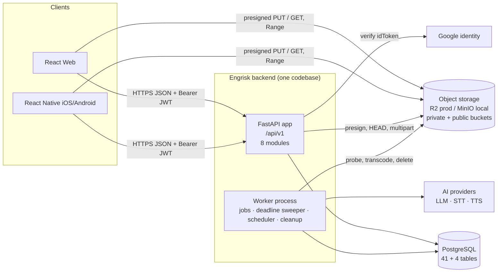
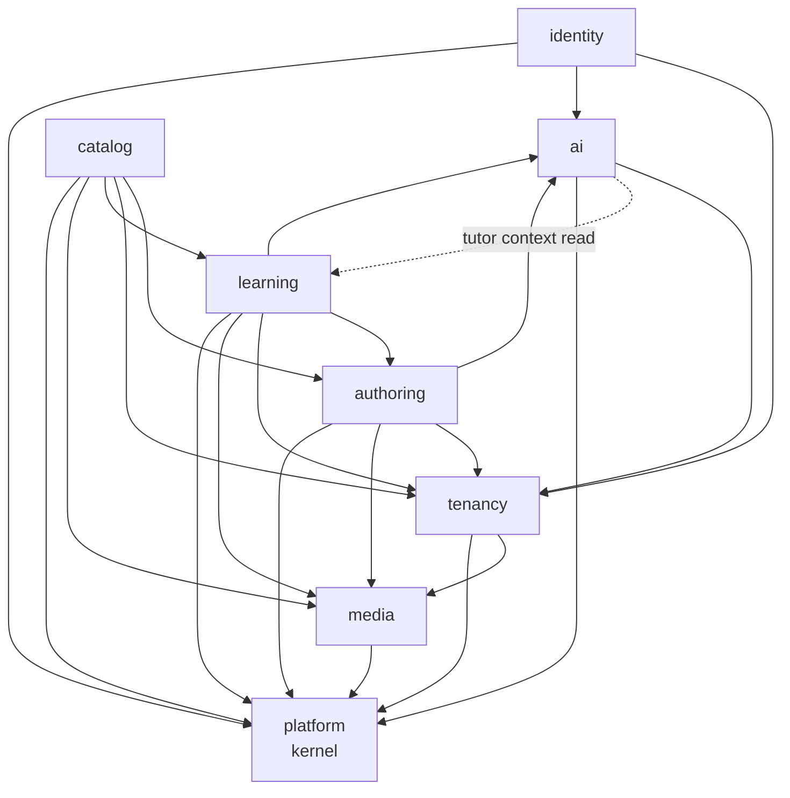
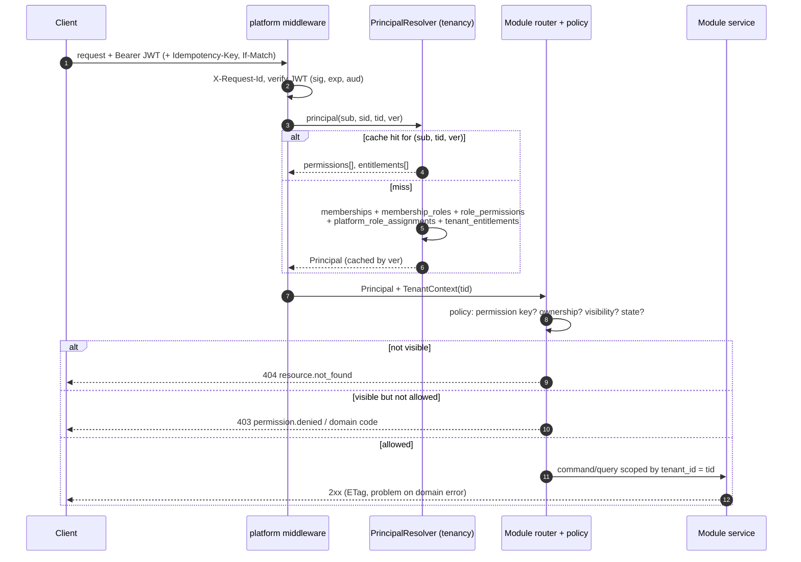

# Engrisk API — Architecture

| | |
|---|---|
| Status | Design proposal for owner review (no code, no migrations) |
| Scope | Public HTTP API `/api/v1` for React Web and React Native, backend module structure, cross-cutting concerns |
| Companion documents | [api_contract.md](./api_contract.md) (endpoint-level contract and scenarios) · [openapi.yaml](./openapi.yaml) (machine-readable OpenAPI 3.1 contract) · [api_data_mapping.md](./api_data_mapping.md) (API ↔ `schema.dbml`) · [storage_architecture.md](./storage_architecture.md) (R2/MinIO, upload/download) · [api_design_review.md](./api_design_review.md) (critical review, risks, open decisions) |
| Baseline inputs | [schema.dbml](./schema.dbml) (41 tables) · [product_flow.md](../../apps/ux_preview/product_flow.md) · [content_studio_spec.md](../../apps/ux_preview/content_studio_spec.md) · [exam_practice_spec.md](../../apps/ux_preview/exam_practice_spec.md) |

---

## 1. Executive summary

Engrisk exposes **one resource-oriented REST API** (`/api/v1`, OpenAPI 3.1, 103 operations) served by a **FastAPI modular monolith** on **one PostgreSQL database**, plus a **worker process** from the same codebase and **S3-compatible object storage** (Cloudflare R2 in production, MinIO locally). Web and mobile consume the API identically through OpenAPI-generated TypeScript clients; there is no per-client BFF.

The design is shaped by five product facts:

1. **One exam engine for TOEIC and IELTS.** Practice sets, section tests and full mocks are the same `Exam → ExamRevision → Attempt` model; differences live in revision `sections` rules and a typed question union (8 `question_type` values). No per-exam or per-Part routes exist.
2. **Protected content is the core asset.** Answer keys, explanations, transcripts and fine audio cues are disclosed only through representation-specific schemas (`*Delivery` vs `*Review`/`*Authoring`) governed by a normative disclosure table. Learners reach content only through their attempts.
3. **Mobile sessions are short and unreliable.** Attempt progress is synced through a single typed change-set (`PATCH /attempts/{attemptId}`) with per-change sequence numbers, so retries, offline queues and multiple devices converge deterministically. Time is server-authoritative.
4. **Guest-first.** Every client starts as a real (guest) user; sign-up adds an identity to the same user id, so nothing migrates.
5. **Multi-tenant from day one, B2B later.** Tenant context is a token claim; every lookup is tenant-scoped; foreign ids return 404. Phase 1 runs entirely in the platform tenant; Phase 4 adds organizations without changing the contract shape.

Phase distribution of the 103 operations: **P1 = 61, P2 = 2, P3 = 27, P4 = 13** (§10).



## 2. Design principles

| # | Principle | What it means in the API | Where it shows |
|---|---|---|---|
| P1 | **Resource / aggregate-first** | Endpoints model aggregates with clear consistency boundaries (Attempt, ExamRevision, QuestionGroup, ContentSubmission), not tables or screens. Children are changed through their root. | `PATCH /attempts/{attemptId}` changes responses, annotations, resume state and clock in one aggregate write; revision items are replaced through `PUT …/items`. |
| P2 | **Contract-first** | [openapi.yaml](./openapi.yaml) is the normative contract; FastAPI implementation must match it (CI diff), not the other way round. Client SDKs are generated from it. | §6 versioning rules; operationIds are stable public names. |
| P3 | **Consolidation over proliferation** | Prefer one well-typed endpoint with a discriminated union or `view=` to several near-duplicates. Every "missing" endpoint is a recorded decision. | `/reference-data` replaces `/exam-types`, `/skills`, `/voices`; `POST /jobs` replaces `/ai/explanations`, `/studio/generate-toeic-voice`; full list in [api_contract.md](./api_contract.md) ("Endpoints deliberately not created"). |
| P4 | **Representation views** | `view=` selects a *representation* of the same resource with its own schema and authorization: `view=catalog|authoring` on exams, `view=delivery|review|authoring` on content. A view is never a filter that can be widened to bypass protection. | `ExamCatalogDetail` vs `ExamAuthoringDetail`; `ContentDelivery` vs `ContentReview` vs `ContentAuthoring`. |
| P5 | **Disclosure by construction** | Protected fields exist only in schemas named `*Review`, `*Authoring`, `*Feedback`, `*Staff`. `*Delivery` schemas have **no** such properties (not nullable — absent), enforced by separate Pydantic models and contract tests. | Disclosure table in [api_contract.md](./api_contract.md); TOEIC Part 1–2 options text absent in delivery. |
| P6 | **Server-authoritative time** | Deadlines, section windows, pause and auto-submit are computed and enforced by the server; every attempt payload carries `timing.serverNow`; client countdowns are display only. | `attempts.sections_state`, deadline sweeper every 15 s, 30 s grace, `attempt.section_closed` acks. |
| P7 | **Provider-neutral media** | Clients receive `MediaAccess {assetId, kind, mimeType, url, urlExpiresAt, …}`; they never see bucket, key or provider. Uploads go directly to storage via presigned URLs. | `POST /media-assets` → `UploadInstructions`; `MediaAccess` embedded in content. See [storage_architecture.md](./storage_architecture.md). |
| P8 | **Async uniformity** | Every long-running or AI operation is a public `Job` with one lifecycle (`queued → running → succeeded|failed|cancelled`), polled via `GET /jobs/{jobId}` (SSE optional, P2). Internal provider calls are recorded separately in `ai_runs`. | Evaluations, tutor replies, TTS, alignment, imports, account deletion. |
| P9 | **Tenant in the token, 404 for the invisible** | No tenant header; `tid` claim is the context; non-visible ids are indistinguishable from non-existent ones. | §7. |
| P10 | **Boring, explicit HTTP** | RFC 9457 problems with stable domain codes, ETag/If-Match, `Idempotency-Key`, cursor pagination without totals, merge-patch for simple edits, `POST /{id}/{verb}` only for real lifecycle commands from a fixed verb list. | §6, [api_contract.md](./api_contract.md). |

## 3. Domain boundaries

### 3.1 Modules

Eight Python packages under `backend/engrisk/<module>/`; seven are bounded domain modules, `platform` is the shared kernel. Routers map 1:1 to modules. Cross-module access goes through the other module's `service.py` interface — never through its tables or ORM models.

| Module | Responsibility | Owned tables (DBML + new) | Exposed resources (tags) | Ops (P1/P2/P3/P4) | Depends on |
|---|---|---|---|---|---|
| `identity` | Sign-in (guest, password, Google), sessions & refresh rotation, verification tokens, `/me`, identity linking / guest conversion, account deletion request | `users`, `auth_identities`, `auth_sessions`, `auth_tokens` | Session, Me, VerificationToken — `Auth`, `Me` (ops 1–10) | 10 / 0 / 0 / 0 | platform, tenancy (default membership, permission set), ai (account-deletion job) |
| `tenancy` | Tenants, memberships, role → permission resolution, entitlements & usage limits, invitations (P4), exam licensing (P4), branding (P4) | `tenants`, `tenant_memberships`, `membership_roles`, `roles`, `permissions`, `role_permissions`, `platform_role_assignments`, `tenant_entitlements`, `tenant_invitations`, `exam_licenses` | Tenant (current), members, invitations, branding, licenses — `Tenants`, `Licensing` (ops 11–20, 70–72) | 0 / 0 / 0 / 13 | platform, media (branding logo) |
| `catalog` | Read side of published content: reference data bundle, learner exam catalog & exam intro, ratings, content reports, `exam_stats` read model | `exam_ratings`, **new** `content_reports`, **new** `exam_stats` (read model); reads authoring tables through authoring's read service | ReferenceData, Exam (`view=catalog`), ExamRating, ContentReport — `Reference`, `Exams`, `ContentReports` (ops 21–24, 67–69) | 3 / 0 / 4 / 0 | platform, authoring (published projections), tenancy (visibility, licenses, entitlements), learning (viewer state), media (covers) |
| `authoring` | Write side of content: exams, revisions, items, audio tracks & cue invariants, question bank (standalone and grouped, copy-on-write versions), validation (B01–B12, W01–W08), publish/schedule, imports, submissions & moderation, credits; owns seeded `exam_types`/`skills` | `exam_types`, `skills`, `exams`, `exam_revisions`, `exam_revision_items`, `question_groups`, `questions`, `question_skills`, `revision_audio_tracks`, `exam_credits`, `content_import_jobs`, `content_submissions`, `submission_reviews`, `review_comments` | Exam (`view=authoring`, write), ExamRevision, QuestionGroup, Question, ContentImport, ContentSubmission — `Authoring`, `QuestionBank`, `ContentImports`, `Submissions` (ops 25–66) | 26 / 0 / 16 / 0 | platform, tenancy, media, ai (job enqueue for auto-checks, import validation) |
| `learning` | Attempts (start, delivery projection, sync, submit, grading, results, review), timing & deadline enforcement, evaluations records, goals, progress read model, skill stats | `learner_goals`, `attempts`, `attempt_responses`, `attempt_annotations`, `evaluations`, `attempt_scores`, `learner_skill_stats` | Attempt, Goal, Progress — `Attempts`, `Progress` (ops 81–93) | 12 / 1 / 0 / 0 | platform, authoring (pinned revision projection, scorers), tenancy (entitlements), media (MediaAccess signing, recordings), ai (evaluation jobs) |
| `media` | Asset registry, upload sessions (single/multipart), completion & verification, access URLs, storage adapter, scan/probe/transcode, cleanup; learner source materials | `content_assets`, `source_materials` | MediaAsset, SourceMaterial — `Media`, `Library` (ops 73–80) | 4 / 0 / 4 / 0 | platform, object storage; reference checks delegated to owning modules through registered resolvers (§3.3) |
| `ai` | Public jobs (create/list/get/cancel/events), job runtime & dispatch, provider adapters (LLM/STT/TTS/alignment), `ai_runs` ledger, quotas, tutor conversations | `ai_runs`, `tutor_conversations`, `tutor_messages`, **new** `jobs` | Job, TutorConversation — `Jobs`, `Tutor` (ops 94–103) | 6 / 1 / 3 / 0 | platform, tenancy (entitlements/quotas), learning (disclosed tutor context — read only) |
| `platform` | Shared kernel: auth dependencies & principal, tenant context, Problem Details, pagination cursors, ETag/If-Match, idempotency store, rate limiting, request id/tracing, settings | **new** `idempotency_keys` | none (cross-cutting headers and error model) | — | nothing (leaf) |

Operation ownership sums to 103: identity 10, tenancy 13, catalog 7, authoring 42, media 8, learning 13, ai 10. The "Ops" column is P1 / P2 / P3 / P4; §10 has the per-tag breakdown.

### 3.2 Module dependency graph

Dependencies are acyclic. The two potential cycles (learning ↔ ai for evaluations, authoring ↔ ai for generation/alignment) are broken by **job handlers living in the domain module that owns the written records**: `ai` provides the job runtime and provider gateway; `learning.jobs.writing_evaluation` calls the gateway and writes `evaluations` itself. Likewise `media` never imports domain modules — owners register reference resolvers.



The dotted edge `ai → learning` (tutor reads the disclosed response/question context) and the edge `learning → ai` (enqueue evaluation job, call provider gateway) are both service-interface calls; to keep import-time acyclicity the tutor uses a `DisclosedContextReader` protocol declared in `ai` and implemented in `learning`, wired in the app factory.

### 3.3 Cross-module contracts (in-process interfaces)

| Interface | Provider → consumer | Purpose |
|---|---|---|
| `PrincipalResolver` | platform ← tenancy | Resolve `(userId, tid, ver)` → permission keys + entitlements; cached per `ver`. |
| `RevisionProjection` | authoring → learning, catalog | Immutable per-(revision, section, view) content projection; scorer lookup by `scoring_policy_key`. |
| `AssetReferenceResolver` | learning, authoring, tenancy → media | "May principal P read asset A, and with which TTL?" — decided by purpose + referencing entity (see [storage_architecture.md §8.2](./storage_architecture.md#82-ttl-policy) and [§10](./storage_architecture.md#10-security)). |
| `MediaSigner` | media → all | Batch-sign `MediaAccess` for a set of asset ids (pure CPU, no network). |
| `JobQueue` / `JobHandler` registry | ai → all; handlers registered by owners | Enqueue typed jobs; worker dispatches by `JobType` to the owning module's handler. |
| `ProviderGateway` | ai → learning, authoring, media | LLM/STT/TTS/alignment calls, each recorded as an `ai_runs` row linked to the job. |
| `DisclosedContextReader` | learning → ai (tutor) | Returns only content already disclosed to the learner (checked practice positions or submitted attempts). |
| `ViewerState` | learning → catalog | In-progress attempt, recent attempts, best score for a batch of exam ids. |

## 4. Resource modeling & aggregate roots

| API resource | Aggregate root | Children (managed through root) | DBML | Rationale |
|---|---|---|---|---|
| Session | AuthSession | access/refresh tokens | `auth_sessions` | A session is the unit of revocation and tenant context; refresh rotation and reuse detection act on it. |
| Me | User | identities, preferences, memberships (read), invitations (P4) | `users`, `auth_identities`, `tenant_memberships`, `membership_roles`, `tenant_invitations` | Bootstrap needs one call (`GET /me`); identity linking changes `users.kind`, so identities belong under the user. |
| VerificationToken | AuthToken | — | `auth_tokens` | Single-use command resource; request always 202 (no enumeration). |
| Tenant (current) — P4 | Tenant | members, invitations, branding, entitlements (read) | `tenants`, `tenant_memberships`, `membership_roles`, `tenant_invitations`, `tenant_entitlements` | `/tenants/current` is relative to `tid`, so admins never pass tenant ids. |
| ReferenceData | read model | exam types, skills, structure templates, speech voices, sound check | `exam_types`, `skills` (+ code config) | Small, slow-changing, needed by every screen → one cacheable bundle. |
| Exam | Exam | credits, licenses (P4), ratings (aggregate read) | `exams`, `exam_credits`, `exam_licenses`, `exam_ratings` | The stable catalog product (slug, title, tier, visibility). Metadata is not revisioned; content is. |
| ExamRevision | ExamRevision | items, audio tracks, validation (computed) | `exam_revisions`, `exam_revision_items`, `revision_audio_tracks` | Unit of immutability and publication; attempts pin it. |
| QuestionGroup | QuestionGroup (versioned with its questions) | questions in the group | `question_groups`, `questions`, `question_skills` | A Part 3 conversation and its 3 questions change together (copy-on-write clones group + questions). |
| Question | Question (standalone) | skills | `questions`, `question_skills` | Standalone items (TOEIC Part 2/5) version independently; grouped questions version via the group (`409 question.grouped`). |
| ContentImport — P3 | ContentImportJob | issues (report) | `content_import_jobs` | Long-running validate → commit workflow with a persistent report. |
| ContentSubmission — P3 | ContentSubmission | reviews (decisions), comments | `content_submissions`, `submission_reviews`, `review_comments` | Moderation workflow with immutable decisions per round. |
| ContentReport — P3 | ContentReport | — | **new** `content_reports` | Learner-raised issues feeding Studio todos and takedown. |
| MediaAsset | ContentAsset | upload session, variants | `content_assets` | One registry for every binary; access decided by referencing entity. |
| SourceMaterial — P3 | SourceMaterial | — | `source_materials` (+ `content_assets`) | Private learner document with its own processing lifecycle. |
| Attempt | Attempt | responses, annotations, scores, evaluations (read), content (projection of pinned revision) | `attempts`, `attempt_responses`, `attempt_annotations`, `attempt_scores`, `evaluations` | The learner's sitting is the consistency boundary for timing, sync and disclosure. |
| Goal | LearnerGoal | — | `learner_goals` | Natural key `examTypeCode` (one active goal per exam type) → idempotent `PUT`. |
| Progress (me) | read model | next action, KPIs, skills, parts, trend, recent | `learner_skill_stats`, `attempt_scores`, `attempts`, `learner_goals` | One dashboard aggregate replaces per-widget endpoints. |
| Job | Job (**new** public async operation) | events | **new** `jobs`, `ai_runs` (internal ledger) | Stable client handle independent of provider retries and pipelines. |
| TutorConversation | TutorConversation | messages | `tutor_conversations`, `tutor_messages` | Thread is the unit of privacy and quota display. |
| ExamRating — P3 | ExamRating (keyed by user + exam) | — | `exam_ratings` | Natural key → `PUT /me/exam-ratings/{examId}` upsert. |

Write-method rules follow from the aggregates: **PUT** for whole replacement with natural keys (goals, ratings, credits, revision items, audio tracks, assignee); **merge-patch PATCH** (`application/merge-patch+json`) for every simple field edit (me, exams, revisions — including un-scheduling via `{status: draft}` —, questions, groups, tenant, members, content reports, review comments, tutor message rating); **typed change-set PATCH** (`application/json`) only for `syncAttempt` on the attempt aggregate (multi-entity, ordered, per-item results); **POST** for creation and lifecycle commands.

## 5. Architecture decisions & tradeoffs

D1–D10 are the decisions submitted for owner approval; D11–D18 are supporting decisions. Each lists the alternatives considered; deeper critique lives in [api_design_review.md](./api_design_review.md).

### D1 — One exam/attempt engine and a unified question union
- **Decision:** TOEIC and IELTS share `/exams`, `/attempts`, `/questions`; question polymorphism is a `oneOf` discriminated by `type` (8 DBML `question_type` values) with per-type `Prompt*`, `*Key`, `*Answer` schemas. No per-exam or per-Part routes.
- **Alternatives:** per-exam APIs (`/toeic/part3/questions`, `/ielts/listening/...`); generic untyped `prompt: object`.
- **Consequences:** + one client renderer pipeline, one scorer interface, new exam types are data + scorer; + generated TS clients get exhaustive unions. − Clients must implement an "unsupported question" fallback for unknown `type` values; − exam-specific rules live in revision `sections` JSON that must be validated server-side.

### D2 — Learners access content only through attempts
- **Decision:** `GET /attempts/{attemptId}/content` (section-chunked, `view=delivery|review`) is the only learner content path; representation-separated DTOs and a normative disclosure table govern what appears. Authors preview via `GET /exams/{examId}/revisions/{revisionId}/content` with the same schemas plus `ContentAuthoring`.
- **Alternatives:** learners read revisions/questions directly with field filtering; a single DTO with nullable protected fields.
- **Consequences:** + disclosure decided by attempt state (mode, checked positions, submitted) in one place; + the server knows exactly what was served (one response row per served question). − Starting an attempt is a prerequisite even for browsing questions; − review and delivery are two fetches of the same structure.

### D3 — Attempt sync via one typed change-set
- **Decision:** `PATCH /attempts/{attemptId}` carries `AttemptChangeSet` (responses, annotations, resume state, clock, display) with per-change `seq` and batch `deviceId`; the server acks each change (`applied|ignored_stale|rejected`). Cross-device conflicts resolve last-write-wins per question by arrival; same-device out-of-order or duplicate changes are ignored by `seq`.
- **Alternatives:** `PUT /attempts/{id}/responses/{position}` per answer plus annotation CRUD; JSON Patch; WebSocket session.
- **Consequences:** + one request per debounce window (~600 ms) instead of N; + retries are safe without `Idempotency-Key`; + partial success is explicit. − A custom media type semantics for PATCH (documented exception to merge-patch); − needs new columns `attempt_responses.client_seq`, `client_device_id`.

### D4 — Guest-first identity
- **Decision:** Clients without a session call `POST /auth/sessions {method: guest}`; guests are `users.kind = guest` with a platform membership. Sign-up is `POST /me/identities` on the guest session — same `users.id`, attempts preserved, new tokens returned (`knd` changes). Tenant switch is `POST /auth/sessions/refresh {activeTenantId}`.
- **Alternatives:** anonymous device-local practice with later upload; separate `/registrations` that merges guest data.
- **Consequences:** + "≈ 1 tap to first practice" and zero data migration; + one authorization path for everyone. − Guest rows accumulate (cleanup job, `ix_users_guest_cleanup`); − guest-session creation needs abuse controls (§7.7); − Google sign-in to an *existing* account from a guest device leaves the guest's attempts behind (open decision in the review).

### D5 — Tenant context only in the token; foreign ids → 404
- **Decision:** `tid` claim is the only tenant context; every tenant-owned lookup includes `tenant_id = tid`; non-visible ids return `404 resource.not_found`. 403 only when the resource is visible but the action is not permitted.
- **Alternatives:** `X-Tenant-Id` header; tenant in the path (`/tenants/{id}/exams`); 403 for foreign ids.
- **Consequences:** + no confused-deputy header spoofing; + no existence oracle; + URLs identical across tenants. − Switching tenant costs a refresh round-trip; − a user active in two tenants on two devices sees different data per device (by design).

### D6 — Direct-to-storage uploads with provider-neutral `MediaAccess`
- **Decision:** `POST /media-assets` returns presigned single or multipart upload instructions; the client uploads directly to R2/MinIO, then `POST /media-assets/{assetId}/complete`. Downloads are signed GET URLs embedded as `MediaAccess`; public assets (covers, logos) use unsigned immutable URLs from a public bucket. R2 presigning uses the S3 API domain (no CDN for private media in P1).
- **Alternatives:** server-proxied upload/download; presigned POST (not supported by R2); CDN custom domain with edge token auth.
- **Consequences:** + API servers never stream bytes; + `Range` playback works natively in `<audio>`/RN players. − A leaked signed URL is a bearer token until expiry; − no edge caching for private media; − MinIO needs a browser-reachable presign endpoint. Details in [storage_architecture.md](./storage_architecture.md).

### D7 — Public `jobs` separate from internal `ai_runs`
- **Decision:** A `Job` is the client-visible handle for one async operation; `ai_runs` remains the append-only provenance/cost ledger per provider invocation (`ai_runs.job_id`). Polling `GET /jobs/{jobId}` with `Retry-After` is the default; SSE `GET /jobs/{jobId}/events` (P2) for tutor token streaming and long Studio jobs. Jobs never mutate published or in-review content; they produce drafts, assets or suggestions that authors apply through normal endpoints (exceptions: evaluation, tutor, import, originality jobs write their own domain records).
- **Alternatives:** expose `ai_runs` as jobs (the DBML's original intent: "no separate generation-job table"); per-feature status endpoints; WebSockets.
- **Consequences:** + retries and multi-step pipelines (speaking = transcription + evaluation) keep one handle; + non-AI async work (normalization, account deletion, media processing) shares the lifecycle; + provider metadata stays internal. − One new table and a deliberate reversal of a DBML design note (flagged in the review).

### D8 — One `/exams` resource with `view=catalog|authoring`
- **Decision:** Catalog and Studio share `/exams` and `/exams/{examId}`; authoring sub-resources (`/revisions`, `/items`, `/audio-tracks`, `/validation`, `/publish`) hang off the exam. Publish is a command with in-transaction validation; community provenance can only publish through submissions (`403 publish.review_required`).
- **Alternatives:** separate `/admin/exams` API; `/studio/*` namespace; generic CRUD over tables.
- **Consequences:** + no duplicated admin API; + authorization lives in policies, not URL prefixes. − `listExams` response is a `oneOf` (`ExamCatalogPage | ExamAuthoringPage`) discriminated by `view`; − Studio overview needs up to 4 calls (open consolidation item).

### D9 — Read models: `/me/progress` and `exam_stats`
- **Decision:** `GET /me/progress` is the single dashboard aggregate (Home, Progress, catalog Part tiles). `learner_skill_stats` and `exam_stats` are precomputed; `nextAction` is computed on read.
- **Alternatives:** per-widget endpoints; computing everything on read; a stored recommendations table.
- **Consequences:** + one mobile call for Home; + ETag makes refresh cheap. − The aggregate's latency is the sum of its parts (bounded queries, §8.4); − read models must be rebuildable and are never sources of truth.

### D10 — Minimal DBML changes
- **Decision:** Only the changes listed in [api_data_mapping.md](./api_data_mapping.md): new `jobs`, `idempotency_keys`, `content_reports`, `exam_stats`; `attempt_responses.client_seq/client_device_id`; `attempts.paused_at/sections_state`; `content_assets.variants/upload/original_filename`; enum values `asset_status.processing`, `asset_purpose.import_report`; `ai_runs.job_id`, `evaluations.job_id`; JSON-shape conventions for `questions.explanation`, `question_groups.content` and cue `source = synthesized` (no column change).
- **Alternatives:** API-shaped tables (e.g. a `deliveries` table); no schema changes (encode everything in JSONB).
- **Consequences:** + the DBML stays the source of truth with small, additive migrations; − some API fields are derived (e.g. derived authoring status) rather than stored.

### Supporting decisions

| # | Decision | Alternatives considered | Consequences |
|---|---|---|---|
| D11 | **RFC 9457 Problem Details** with stable domain codes (`attempt.deadline_passed`) and `errors[]` JSON-Pointer validation items | Ad-hoc `{error: string}`; HTTP status only | Clients switch on `code`; codes are part of the contract (renaming = breaking). |
| D12 | **Cursor pagination, no totals** (`?cursor=&limit=`, default 20, max 100); content endpoints bounded and unpaginated; `facets` only where documented | Offset/limit with `total` | Stable under inserts and cheap on large tables; Studio KPIs use `facets=status` instead of totals. |
| D13 | **Optimistic concurrency** with strong `ETag` + mandatory `If-Match` on authoring resources, `/me`, goals (`412`/`428`); attempts use `seq` instead | Last-write-wins; pessimistic locks | Two editors on question 32 get `412` and a reload, matching the Studio conflict state. |
| D14 | **Idempotency-Key** required on the 10 creation/command endpoints that are dangerous to repeat; stored 24 h in Postgres `idempotency_keys` | No idempotency; Redis store in P1 | Double-tap submit/start are safe; replay returns `Idempotent-Replayed: true`; Postgres write per call on those endpoints only. |
| D15 | **Postgres-backed job queue** (`SELECT … FOR UPDATE SKIP LOCKED` on `jobs`) in P1; Redis optional later | Celery/RQ + Redis; managed queue | One fewer stateful dependency; throughput sufficient for P1 volumes; see §8.6. |
| D16 | **One reference-data bundle** (`GET /reference-data`, ETag; `Cache-Control: public, max-age=3600`, except responses that include author-only `speechVoices`, which are sent `private`) | Separate `/exam-types`, `/skills`, `/voices` | One cached call at boot; bundle size must be watched (review). |
| D17 | **Contract-first OpenAPI 3.1 + generated TypeScript clients** for Web and RN | Hand-written clients; GraphQL codegen | Shared types across platforms; discipline required on operationIds and schema names (§6). |
| D18 | **Server-owned section windows** (`attempts.sections_state`) and practice pause (`attempts.paused_at`) | Client-reported timing; section start/pause endpoints | Mock fairness and resume after app kill; consolidation of "section start" into server computation. |

## 6. API versioning & naming

### 6.1 Naming conventions (normative summary)

| Topic | Rule |
|---|---|
| Base path | `/api/v1` (major version in URI). Servers `https://api.engrisk.app/api/v1`, `http://localhost:8000/api/v1`. |
| Paths | Plural nouns, lowercase kebab-case (`/content-submissions`, `/media-assets`); max nesting `/{collection}/{id}/{sub-collection}/{id}`; path params camelCase in OpenAPI (`{examId}`). |
| Commands | `POST /{resource}/{id}/{verb}` with the fixed vocabulary `submit`, `resubmit`, `withdraw`, `abandon`, `publish`, `complete`, `commit`, `cancel`, `redeem`, `refresh`, `decision`. |
| JSON fields / query params | camelCase; booleans `is*/has*` only where not obvious (`isCorrect`, `isFlagged`). |
| Enum values | lowercase snake_case, same spelling as DBML enums (`in_progress`, `single_choice`, `full_mock`); extensible enums marked `x-extensible-enum: true`. |
| IDs | UUID strings, opaque. Natural keys only where stable: `examTypeCode`, `sectionKey`, `skillCode`, identity `provider`, response `position`. |
| Time | RFC 3339 UTC with `Z`, suffix `At`; dates `…Date`; durations with unit suffix (`durationMs`, `timeLimitSeconds`). |
| Scores | Always carry `kind` (`raw`, `scaled_estimate`, `ai_estimate`); never "official". |
| Localized text | `LocalizedText {vi, en}`; `Accept-Language: vi|en` (default `vi`) resolves single strings. Exam content is English plain text. |
| operationId | lowerCamelCase verb + noun (`startAttempt`, `syncAttempt`, `publishExamRevision`); unique; **frozen once released** (§6.4). |
| Tags | Exactly one per operation from: `Auth, Me, Tenants, Reference, Exams, Authoring, QuestionBank, ContentImports, Submissions, ContentReports, Licensing, Media, Library, Attempts, Progress, Jobs, Tutor`. |
| Schema names | PascalCase nouns with representation suffix (`ExamCatalogDetail`, `QuestionDelivery`, `ContentReview`, `AudioTrackAuthoring`); write models end in `Create`, `Update`, `Input`, `Request`. Protected data only in `*Review`, `*Authoring`, `*Feedback`, `*Staff`. |

### 6.2 Breaking vs non-breaking changes

| Non-breaking (allowed in v1) | Breaking (requires new operation, new major, or deprecation cycle) |
|---|---|
| New operation, new optional query parameter, new `include=` value | Removing or renaming a path, operation, field, query parameter or header |
| New optional request field; relaxing validation (wider length, more mime types) | Making an optional request field required; adding a required request field; tightening validation |
| New response field (clients ignore unknown fields) | Changing a field's type, format, unit, nullability (`null` where it was never null) or meaning |
| New value in an `x-extensible-enum` (response or request) | Removing an enum value; adding a value to a non-extensible enum in a response |
| New `oneOf` variant in an extensible union (`QuestionDelivery`, `JobResult`, `UploadContext`) — clients render a fallback | Changing a discriminator property or mapping of an existing variant |
| New error `code` under an already documented status for that operation | Renaming or re-statusing an existing error `code`; changing success status (200 → 202) |
| Shorter cache TTLs, new optional headers | Stricter authorization than documented for existing callers; changing pagination model; changing idempotency semantics |
| New `view=` value | Changing the content of an existing `view` to include protected fields (also a security review) |

CI enforces the table with an OpenAPI diff (e.g. `oasdiff breaking`) between the committed [openapi.yaml](./openapi.yaml) and the previous release tag, plus a check that the FastAPI-generated document matches the committed contract.

### 6.3 Deprecation and client compatibility

- Deprecated operations/fields get `deprecated: true` in OpenAPI and response headers `Deprecation` (RFC 9745) and `Sunset` (RFC 8594) with a link to the migration note.
- Minimum sunset window: **6 months** for anything used by released mobile builds (store review + slow upgrade curve); 1 month for Studio-only (web) surfaces.
- Clients send `X-Client-Version: web/1.4.0 | ios/1.2.0 | android/1.2.0`. The server keeps a minimum-supported matrix and answers `426 client_upgrade_required` for builds below it; this is the last-resort lever, not a substitute for additive change.
- A `/api/v2` is introduced only for a wholesale model change; v1 and v2 routers run in the same app, sharing services, until v1's sunset.

### 6.4 Generated TypeScript clients and operationId stability

- One generated package (e.g. `@engrisk/api-client`) from [openapi.yaml](./openapi.yaml), consumed by React Web and React Native. Recommended generator: types via `openapi-typescript` and a thin fetch wrapper (`openapi-fetch`), which works on RN without Node polyfills; TanStack Query hooks are written per screen on top (not generated) to keep cache keys deliberate.
- `operationId` → function name, schema name → type name. Renaming either breaks client code even when the wire format is unchanged, so both are treated as breaking (§6.2).
- Discriminated unions (`type`, `view`, `method`, `provider`, `strategy`, `evaluator`, `op`, `kind`) become TS discriminated unions; clients must keep a `default` branch for extensible unions.
- The client package owns cross-cutting behavior once: bearer refresh on `401 auth.token_expired`, `Idempotency-Key` generation for the required operations, `X-Request-Id` logging, `Accept-Language`, `X-Client-Version`, problem parsing into a typed `ApiProblem`.

## 7. Authorization & tenant isolation

### 7.1 Tokens and sessions

| Item | Design |
|---|---|
| Access token | JWT, 15 min, `Authorization: Bearer`. Claims: `sub` (userId), `sid` (sessionId), `tid` (activeTenantId), `knd` (`guest|registered`), `ver` (permission version), standard `iat/exp/iss/aud`. |
| Refresh token | Opaque, rotating, SHA-256 hash in `auth_sessions.refresh_token_hash`. Reuse of a rotated token revokes the session (`auth.refresh_invalid`). |
| Web transport | Refresh token in `HttpOnly; Secure; SameSite=Strict` cookie scoped to `/api/v1/auth`; refresh requires `X-Requested-With: engrisk` and an allowed `Origin` (CSRF guard). Access token in memory only. |
| Mobile transport | Refresh token in the response body, stored in Keychain/Keystore. |
| Tenant switch | `POST /auth/sessions/refresh {activeTenantId}` → membership check (`tenant.membership_required`), update `auth_sessions.active_tenant_id`, mint new tokens. |
| Sign-out | `DELETE /auth/sessions/current` revokes the session; password reset revokes all sessions. |

### 7.2 Request pipeline and permission resolution



- **Permission keys, never role names.** Effective permissions are resolved per (user, active tenant): tenant-scope roles via `membership_roles`, platform-scope roles via `platform_role_assignments`, joined to `role_permissions`. Keys used by the API: `exam.take`, `attempt.read_own` (implicit owner), `tutor.use`, `material.upload_own`, `submission.create`, `content.author`, `content.import`, `content.review`, `content.publish`, `content.publish_tenant`, `content.review_tenant`, `evaluation.review` (P4), `learner_progress.read` (P4), `member.manage` (P4), `role.assign` (P4), `branding.manage` (P4), `platform.tenant.manage`, `platform.license.grant`, `platform.support.read`.
- **Entitlements** (`tenant_entitlements.feature_key`): `ai_tutor`, `writing_ai_feedback`, `speaking_ai_feedback`, `material_upload`, `question_generation`, `platform_library`, `custom_branding`. Feature checks read entitlements, never plan names; usage is counted from `jobs`/`ai_runs` per day.
- **`ver` claim.** The resolver caches the principal under `(sub, tid, ver)`. Any role/membership/entitlement change must bump the version so the next request recomputes; membership suspension is also checked on every refresh. The DBML has no column for this counter yet — see [api_design_review.md](./api_design_review.md) (contract/schema mismatches). `GET /me` returns `permissions[]` and `entitlements[]` for UI gating only; the server always re-checks.
- **Policies** live in each module's `policies.py` as pure functions `(principal, resource, action) → allow | deny_404 | deny_403(code)`; routers never inline checks.

### 7.3 Ownership rules

| Data class | Who may read | Who may write |
|---|---|---|
| Learner-private: attempts, responses, annotations, evaluations, tutor conversations, source materials, `learner_response` recordings, goals | Owning user in the active tenant only. P4 exceptions: `learner_progress.read` (progress/attempt summaries) and `evaluation.review` (Writing/Speaking responses + recordings) in the same tenant, audited; **never** tutor message content. | Owner (attempt state machine permitting); `evaluation.review` creates human evaluations (P4). |
| Authoring resources | Tenant staff with `content.author` in the owning tenant; reviewers (`content.review`/`content.review_tenant`) read-only on revisions under review; contributors (`submission.create`) only their own private community drafts in the platform tenant; learners (`material.upload_own`) only their own `personal_practice` exams and private generated questions | Same, plus publish keys: `content.publish` (platform, public/tenant), `content.publish_tenant` (org, tenant), owner of `personal_practice` (private) |
| Published catalog | Members of the owning tenant (`visibility = tenant`), everyone for platform `public` content (org tenants need entitlement `platform_library`), licensees via `exam_licenses` | — |
| Media | Decided by purpose + referencing entity, never by the asset alone (see [storage_architecture.md](./storage_architecture.md)) | Uploader; owning module for references |

### 7.4 404 policy

Every tenant-owned lookup includes `tenant_id = tid` (plus ownership predicates for learner-private data) **in the query itself**, so non-visible rows are simply not found → `404 resource.not_found`. 403 is reserved for resources the caller can see but cannot act on (`permission.denied`, `exam.access_denied` with `meta.reason`, `attempt.section_locked`, `publish.review_required`, `tutor.context_not_reviewable`, `attempt.review_not_available`). This removes existence oracles across tenants and across learners (scenario S10: learner B requesting A's recording or attempt gets 404).

### 7.5 The single cross-tenant edge

Learner records (attempts, ratings, reports) may reference **published** content owned by another tenant only when (a) it belongs to the platform tenant with `visibility = public` (org tenants additionally need entitlement `platform_library`), or (b) the exam is licensed to the learner's tenant through `exam_licenses` within its validity window. Attempts, answers, recordings and tutor data are always stored with `tenant_id = tid` and stay private to the learner. Content never references learner data. A Sunrise teacher therefore cannot read B2C attempts of the same person made in the platform tenant (scenario S8).

### 7.6 P4 path to PostgreSQL RLS

P1 isolation is enforced in the service layer (query predicates + composite FKs from the DBML). The P4 hardening path:

1. Each request transaction runs `SET LOCAL app.tenant_id = :tid, app.user_id = :sub` from the principal (one dependency in `platform`).
2. Policies on tenant-owned roots: `tenant_id = current_setting('app.tenant_id')::uuid`, plus a read policy on content tables for `status = published AND (visibility = public AND tenant is platform) OR licensed`.
3. Child tables get `EXISTS (parent)` policies or denormalized `tenant_id` where profiling requires.
4. The worker sets the same GUCs per job from `jobs.tenant_id`; platform-wide maintenance jobs use a dedicated role with `BYPASSRLS`, audited.
5. RLS is defense in depth; service predicates remain (they also produce the 404 semantics).

### 7.7 Guest model

- Guests are real users (`users.kind = guest`) with a platform membership, the `learner` role and a session. Guest capability equals `access_tier = guest` content plus own attempts and progress; operations marked `registered` (goals, tutor, ratings, reports, account deletion, identity removal) are rejected for guests with `403 permission.denied` (the client shows the "create an account" prompt), and registered-tier exams return `403 exam.access_denied` with `meta.reason = account_required`.
- Conversion is `POST /me/identities` on the guest session (password or Google): same `users.id`, `kind → registered`, new `SessionTokens` because `knd` changes.
- Guest creation requires `Idempotency-Key` (cold-start retries do not create duplicate users) and is rate-limited per IP/device; unconverted guests expire through a cleanup job (retention period is an owner decision; product proposes 30 days).

## 8. Performance & scalability

### 8.1 Mobile round-trip budget per key screen

Targets assume a warm session (valid access token). "Sequential" counts round trips on the critical path; parallel calls count once.

| Screen / flow | Calls | Critical-path round trips | Notes |
|---|---|---|---|
| Cold start → Home | `POST /auth/sessions/refresh` (only if access token expired) → `GET /me` ‖ `GET /reference-data` (usually 304) ‖ `GET /me/progress` | 1 (+1 refresh) | First-ever launch: `POST /auth/sessions {method: guest}` replaces refresh. |
| Catalog | `GET /exams?examType=…&kind=…` (Part tiles from already-loaded `/me/progress.parts`) | 1 | Covers are public immutable URLs. |
| Exam intro | `GET /exams/{examId}` (includes `viewer {inProgressAttemptId, bestScore, completedCount, recentAttempts, myRating}`) | 1 | Sound-check clip from reference data. |
| Start practice / mock | `POST /attempts` → `GET /attempts/{attemptId}/content` | 2 | Content is served from the cached revision projection. |
| Answering | `PATCH /attempts/{attemptId}` per debounce window (~600 ms), on background, before submit | 0 (async) | UI never waits on sync; `check:true` waits for one PATCH. |
| Submit → Results | `POST /attempts/{attemptId}/submit` → `GET /attempts/{attemptId}/result` | 2 | Objective grading ≤ 200 ms for 200 items. |
| Review | `GET /attempts/{attemptId}/content?view=review&section=…` | 1 | Result already loaded. |
| Resume after app kill | `GET /attempts/{attemptId}?include=responses,annotations` ‖ `GET …/content` | 1 | Attempt id from `/me/progress.nextAction` or local storage. |
| Speaking answer (P2) | `POST /media-assets` → `PUT` to storage → `POST …/complete` → `PATCH /attempts/{attemptId}` | 4 | Upload can run while the learner moves on; only `complete` gates the answer. |
| Tutor question | `POST /tutor-conversations/{conversationId}/messages` → poll `GET /jobs/{jobId}` (or SSE in P2) | 1 + polling | Poll interval from `Retry-After`. |
| Studio home (web/mobile) | `GET /exams?view=authoring&facets=status` ‖ `GET /content-submissions` ‖ `GET /content-imports` ‖ `GET /content-reports` | 1 (4 parallel) | Revisit if more than 4 calls are needed (review). |

### 8.2 Payload budgets (gzip, targets)

| Payload | Budget | Lever if exceeded |
|---|---|---|
| `GET /me` | ≤ 8 KB | Trim memberships/branding; permissions list is short. |
| `GET /reference-data` | ≤ 30 KB | Split `speechVoices` / templates out (only authors need them); ETag means it is rarely re-downloaded. |
| `GET /me/progress` | ≤ 10 KB | Cap `skills[]` (weakest first), `scoreTrend` 12 weeks, `recentAttempts` ≤ 5. |
| Catalog page (20 items) | ≤ 25 KB | Lean `ExamCatalogItem`; no revision structure in lists. |
| Practice-set content | ≤ 60 KB | Per-section chunking already applied. |
| TOEIC Reading section content | ≈ 80–120 KB | Full mock fetched per section (`section=`), media URLs de-duplicated in `media{}`. |
| `PATCH /attempts` request | ≤ 16 KB typical | Client coalesces per position; essays are the outlier (≤ ~20 KB text). |
| `GET /attempts/{attemptId}/result` (200 items) | ≤ 40 KB | `responses[]` is compact `ResponseOutcome`; review content is a separate call. |

### 8.3 Caching layers

| Layer | What | Mechanism |
|---|---|---|
| Client | `/me`, `/reference-data`, `/me/progress`, catalog, exam intro, attempt content | ETag + `If-None-Match` → 304; TanStack Query stale times; content refetched before `expiresAt` (earliest media URL expiry). |
| HTTP shared cache / CDN in front of API | Only `public` responses: `/reference-data` without `speechVoices` (`public, max-age=3600`; the author variant is `private`), `/tenants/{tenantSlug}/branding` (public, 1 h) | Everything else `private`; protected/review views never in shared caches. |
| Public object CDN | Covers, logos, sound-check clip | Content-addressed keys, `Cache-Control: public, max-age=31536000, immutable`. |
| In-process (per API instance) | Immutable revision projections per (revision, section, view); principal per (sub, tid, ver); reference-data bundle | LRU with size cap; immutability makes invalidation trivial (published revisions never change). |
| Database read models | `attempt_scores`, `learner_skill_stats`, `exam_stats` | Written at grading / by worker; rebuildable. |
| Redis (later) | Shared projection cache, rate-limit counters, idempotency hot path, SSE fan-out | Introduced only on the triggers in §8.7. |

### 8.4 Precomputed vs on-demand

| Metric / view | Strategy | Source | Refresh trigger |
|---|---|---|---|
| Attempt scores (raw, scaled estimate, AI estimate) | Precomputed, stored | `attempt_scores` | Submit (objective, in transaction); evaluation completion (subjective) |
| Per-skill counts and mastery | Precomputed incrementally | `learner_skill_stats` | Grading of an attempt; full rebuild job from `attempt_responses` + `question_skills` |
| Result breakdown (sections, parts, skills, slowest) | On demand (≤ 200 rows per attempt) | `attempt_responses`, `question_skills`, revision `sections` | — |
| `nextAction` | On read | in-progress attempt (`ix_attempts_resume`), `learner_goals`, `learner_skill_stats` | — |
| KPIs (`weekMinutes`, `accuracy7d`, …) | On read, bounded window | `attempts.active_seconds`, `attempt_scores` (`ix_attempts_history`) | Precompute per day if p95 > 50 ms |
| Score trend (12 weeks) | On read | `attempt_scores` of mock attempts | — |
| Exam play count, completed count, rating avg/count | Precomputed | **new** `exam_stats` | Worker every few minutes + on rating upsert |
| Studio status facets | On read (`GROUP BY` derived status) | `exams`, `exam_revisions`, `content_submissions` | — |
| Revision validation (B01–B12, W01–W08) | On demand; re-run in the publish transaction | revision graph | — |
| Entitlement usage (`usage` in `/me`) | On read | `jobs`/`ai_runs` per user per day (`ix_ai_runs_user`) | — |
| Question usage (`usage.examCount`) | On demand | `ix_exam_revision_items_question` | — |
| Revision delivery projection | Lazily precomputed, cached | revision items + questions + groups + tracks | Immutable once published; drafts never cached |

### 8.5 Database indexes relied on

From [schema.dbml](./schema.dbml): `ix_attempts_resume` (resume / `attempt.in_progress_exists`), `ix_attempts_deadline_sweep` (auto-submit), `ix_attempts_history` (lists, KPIs), `uq_attempt_responses_position` (sync by position), `ix_attempt_annotations_attempt`, `ix_exams_catalog`, `ix_exams_provenance`, `ix_exams_owner`, `uq_exams_tenant_slug`, `ix_exam_revisions_status` (one draft per exam, scheduler), `uq_exam_revision_items_position`, `ix_exam_revision_items_question` (usage), `ix_questions_bank`, `ix_questions_group`, `ix_questions_source_material`, `ix_question_groups_bank`, `uq_revision_audio_tracks_section`, `ix_revision_audio_tracks_asset`, `ix_content_submissions_queue|submitter|reviewer|active`, `ix_review_comments_open`, `ix_content_import_jobs_tenant`, `ix_learner_goals_user`, `ix_exam_ratings_exam`, `ix_ai_runs_user` (quotas), `ix_tutor_conversations_user`, `ix_tutor_messages_conversation`, `ix_content_assets_owner`, `uq_auth_sessions_refresh_token_hash`, `uq_auth_tokens_token_hash`.

New indexes required by the new tables (to be carried into [api_data_mapping.md](./api_data_mapping.md)): `jobs` queue partial index on `(run_after)` where `status = queued`; `jobs (requested_by_user_id, created_at)`; `jobs (target_type, target_id)`; `idempotency_keys` PK `(user_id, key)` + `created_at` for TTL purge; `content_reports (tenant_id, status, created_at)`; `exam_stats` PK. Candidates to evaluate with real data (see review): `question_groups (audio_asset_id)` / `(image_asset_id)` for media policy lookups, and an `attempts (user_id, exam_id)` path for exam-intro viewer state (attempts reference `exam_revision_id`, not `exam_id`).

### 8.6 Worker and queue

- **Process:** `python -m engrisk.worker` from the same image; scaled independently of the API. Loops: (1) job queue — claim with `SELECT … FROM jobs WHERE status = 'queued' AND run_after <= now() ORDER BY run_after FOR UPDATE SKIP LOCKED LIMIT n`, dispatch by `JobType` to the owning module's handler; (2) deadline sweeper every 15 s over `ix_attempts_deadline_sweep` (auto-submit with `time_expired` after 30 s grace); (3) scheduled publish (`exam_revisions.status = scheduled`, `publish_at <= now()`); (4) `exam_stats` refresh; (5) cleanup: expired `pending_upload` assets and multipart uploads, soft-deleted objects, `idempotency_keys` older than 24 h, unconverted guests.
- **Semantics:** at-least-once; handlers are idempotent on `jobs.id`; transient provider errors retried with exponential backoff (max 3) inside one job (`jobs.attempts`, `run_after`); terminal failure sets `failed` with `error.retryable`. Jobs left `running` by a crashed worker are re-queued by a sweeper using `started_at` plus a per-type timeout; `cancel_requested_at` is checked between pipeline stages.
- **Pools by class:** interactive types (`tutor_reply`, `writing_evaluation`, `speaking_evaluation`) and bulk types (`speech_synthesis`, `audio_alignment`, `import_validation`, `question_generation`, `media_processing`) run in separate worker pools filtered by `type`, so a large import never delays a tutor reply.

### 8.7 When to add Redis, CDN, edge auth

| Trigger | Add |
|---|---|
| More than one API instance and projection cache hit rate drops, or Postgres CPU dominated by projection rebuilds | Redis shared cache for revision projections |
| Rate limiting must be exact across instances (auth brute force, guest creation, AI) | Redis counters (P1 can use per-instance limits + Cloudflare rate rules) |
| Idempotency writes become a measurable share of Postgres load | Redis idempotency store (same semantics) |
| SSE streaming (P2) across API instances: worker produces tutor deltas, client connected to another instance | Postgres `LISTEN/NOTIFY` first; Redis pub/sub when fan-out or payload size outgrows it |
| Job throughput > low thousands/min or need for delayed/priority semantics beyond SKIP LOCKED | Dedicated queue (Redis-based or managed) behind the same `JobQueue` interface |
| Learner audio latency from the R2 S3 endpoint is poor in Vietnam, or URL-leak risk demands revocation | R2 custom domain + Cloudflare CDN with WAF HMAC token auth (paid plan) for private media; owner decision |
| Static public assets volume | Already on public bucket + CDN in P1 |

### 8.8 N+1 avoidance

- Content projection is built with a fixed number of queries (revision + items, questions by id list, groups by id list, audio tracks, asset rows) regardless of item count, then cached.
- Media signing is local CPU work (SigV4 HMAC) — no network per URL; `media{}` de-duplicates URLs by `assetId`.
- Catalog lists: one exams query joined to `exam_stats`; viewer state for the page's exam ids in one batched query; covers are public URLs.
- Policies evaluate in bulk for lists (visibility predicates in SQL, not per-row checks).
- `include=` and `view=` are allow-listed per endpoint; no generic expansion.
- Tests assert query counts per endpoint for the hot paths (content, sync, submit, progress, catalog).

## 9. Modular monolith organization

### 9.1 Proposed tree

```text
backend/
├── main.py                      # ASGI entry: `app = create_app()` (uvicorn main:app)
├── config/                      # environment templates (.env.example), logging config — no secrets
├── api/
│   ├── app.py                   # create_app(): middleware, problem handlers, mounts module routers under /api/v1, lifespan (engine, storage)
│   └── deps.py                  # FastAPI dependency wiring composed from engrisk.platform (principal, tenant ctx, db session, idempotency, etag)
├── engrisk/
│   ├── platform/                # shared kernel: auth.py (JWT), context.py (Principal, TenantContext), problems.py, pagination.py,
│   │                            #   etag.py, idempotency.py, ratelimit.py, observability.py, settings.py
│   ├── db/
│   │   ├── engine.py            # async engine + session factory, SET LOCAL hooks (RLS-ready)
│   │   └── models.py            # declarative Base, naming conventions, metadata registry importing every module's models (Alembic)
│   ├── identity/   {api.py, service.py, models.py, schemas.py, policies.py}
│   ├── tenancy/    {api.py, service.py, models.py, schemas.py, policies.py, principal.py}
│   ├── catalog/    {api.py, service.py, models.py, schemas.py, policies.py, read_models.py}
│   ├── authoring/  {api.py, service.py, models.py, schemas.py, policies.py, validation.py, projection.py, jobs.py}
│   ├── learning/   {api.py, service.py, models.py, schemas.py, policies.py, timing.py, sync.py, scoring/, jobs.py}
│   ├── media/      {api.py, service.py, models.py, schemas.py, policies.py, storage.py (ObjectStorage, S3CompatibleStorage), jobs.py}
│   ├── ai/         {api.py, service.py, models.py, schemas.py, policies.py, jobs_runtime.py, providers/, tutor.py}
│   └── worker.py                # worker entry: queue loop, sweeper, scheduler, cleanup; imports handler registries
└── docs_design/
```

Per-module file roles: `api.py` (router; HTTP only), `service.py` (use cases, transactions, the module's public interface), `models.py` (SQLAlchemy, private to the module), `schemas.py` (Pydantic DTOs — the OpenAPI components), `policies.py` (authorization), optional `jobs.py` (job handlers registered with the `ai` runtime).

### 9.2 Reuse of the existing skeleton

All existing files are empty placeholders; the plan reuses them where the role fits and removes the rest (no re-export shims):

| Existing path | Fate |
|---|---|
| `backend/main.py` | Kept: ASGI entry that calls `create_app()`. |
| `backend/api/app.py` | Kept: app factory and router mounting (composition root). |
| `backend/api/deps.py` | Kept: FastAPI dependency wiring built on `engrisk.platform` (one place routers import `CurrentPrincipal`, `DbSession`, `IdempotencyKey`, `IfMatch` from). |
| `backend/api/routes/auth.py` | Removed; replaced by `engrisk/identity/api.py` (Auth + Me routers). |
| `backend/api/routes/agent.py` | Removed; replaced by `engrisk/ai/api.py` (Jobs + Tutor routers). |
| `backend/engrisk/agent/` | Renamed to `backend/engrisk/ai/` (the module name used by the contract). |
| `backend/engrisk/db/engine.py`, `models.py` | Kept as shared DB plumbing (engine/session, Base/metadata registry); tables live in module `models.py`. |
| `backend/engrisk/services/` | Removed; services live inside their module to avoid a second layering convention. |
| `backend/config/` | Kept for non-secret configuration templates. |

### 9.3 Module rules (enforced by import linting)

- A module may import another module only via `engrisk.<module>.service` (and its DTOs) — never `models`, `api`, or `policies`. Enforced with `import-linter` contracts in CI.
- No cross-module foreign-key navigation in ORM relationships; cross-module joins happen only in read models owned by the reading module (e.g. `catalog.read_models`) and are documented.
- One transaction per request command; cross-module side effects that can be async go through jobs (outbox-style: the job row is inserted in the same transaction).

### 9.4 Extraction path (only if ever needed)

The modular boundaries are the extraction seams. Likely candidates and preconditions:

1. **`ai` job workers** first — already a separate process; extraction means pointing handlers at a queue and giving them service credentials. No API change.
2. **`media` processing** (transcode, scan, probe) — CPU-heavy, stateless; moves with the worker.
3. **`learning` sync hot path** — only if attempt write volume outgrows a single Postgres primary; would require partitioning `attempt_responses` before splitting services.

Preconditions for any extraction: module owns its tables exclusively, communicates only via service interfaces/jobs, and the public contract stays `/api/v1` behind the same gateway. Not planned for P1–P4.

## 10. MVP vs future scope

| Phase | Ops | Operations (numbering of [api_contract.md §2](./api_contract.md#2-endpoint-inventory-103-operations)) | Product scope |
|---|---|---|---|
| **P1** — MVP | **61** | 1–10, 21–23, 25, 26, 28–51, 73–76, 81–88, 90–93, 96, 99–103 | Guest/auth/me, reference data, catalog & intro, minimal authoring for content_manager (exams, revisions, items, audio tracks, validation, publish, question bank), media upload/access, attempts (practice + mock, sync, submit, results, review), progress & goals, `getJob`, AI tutor |
| **P2** — Writing/Speaking AI | **2** | 89 (`requestEvaluation`), 98 (`streamJobEvents`) | IELTS Writing/Speaking evaluations (auto-created on submit), SSE; adaptive practice as an extension of `POST /attempts` (no new route) |
| **P3** — Content Studio full | **27** | 24, 27, 52–69, 77–80, 94, 95, 97 | Ratings, credits, imports, submissions & moderation, content reports, learner library, client-created jobs (generation, TTS, alignment, normalization, assist, quality check), job list/cancel |
| **P4** — B2B tenants | **13** | 11–20, 70–72 | Invitations, tenant admin, members, branding, licensing |
| **Total** | **103** | | |

Per tag: Auth 5 (P1) · Me 5 (P1) · Tenants 10 (P4) · Reference 1 (P1) · Exams 3 (2 P1, 1 P3) · Authoring 15 (14 P1, 1 P3) · QuestionBank 12 (P1) · ContentImports 5 (P3) · Submissions 10 (P3) · ContentReports 3 (P3) · Licensing 3 (P4) · Media 4 (P1) · Library 4 (P3) · Attempts 9 (8 P1, 1 P2) · Progress 4 (P1) · Jobs 5 (1 P1, 1 P2, 3 P3) · Tutor 5 (P1).

Per module: identity 10 (P1) · tenancy 13 (P4) · catalog 7 (3 P1, 4 P3) · authoring 42 (26 P1, 16 P3) · media 8 (4 P1, 4 P3) · learning 13 (12 P1, 1 P2) · ai 10 (6 P1, 1 P2, 3 P3).

Notes on phase tagging:
- `createMediaAsset` is P1 for staff uploads; speaking recordings (P2) and library/import packages (P3) are new `purpose` values on the same operation, not new operations.
- `DELETE /me` (P1) returns a `JobRef` of system type `account_deletion`, which is why the `jobs` table and `getJob` are P1 even though `POST /jobs` is P3.
- Phase-1 isolation runs in the single platform tenant; all tenant-scoping code paths exist from P1 so P4 is additive.
- Tenant creation (P4) is a platform-operations/console concern outside the public API v1; P4 operations act only on the current tenant.
- P1 tutor replies are delivered by polling (`GET /jobs/{jobId}` → `GET /tutor-conversations/{conversationId}`); pulling SSE (`streamJobEvents`) into P1 is an open owner decision ([api_design_review.md](./api_design_review.md) Q5).
