# Engrisk API Contract

> **Status:** design baseline for `/api/v1` (OpenAPI 3.1). **Audience:** backend, Web (React), Mobile (React Native), QA, and architecture review.
> **Companion documents:** [api_architecture.md](./api_architecture.md) (modules, security, runtime) · [openapi.yaml](./openapi.yaml) (machine contract; schema names used below) · [api_data_mapping.md](./api_data_mapping.md) (DTO ↔ `schema.dbml`) · [storage_architecture.md](./storage_architecture.md) (R2/MinIO, keys, TTLs) · [api_design_review.md](./api_design_review.md) (risks, open issues).
> **Product inputs:** `apps/ux_preview/product_flow.md` (journeys D1–D14, screens §E, exam rules §F, AI §G, RBAC §H), `content_studio_spec.md`, `exam_practice_spec.md`. **Data baseline:** `schema.dbml` (41 tables).

This document is the human-readable contract. Where it lists paths, `operationId`s, schema names, enum values, and error codes, those are normative and match `openapi.yaml` exactly.

## Contents
1. [Conventions](#1-conventions)
2. [Endpoint inventory (103 operations)](#2-endpoint-inventory-103-operations)
3. [Resource → operation mapping](#3-resource--operation-mapping)
4. [Lifecycles and command endpoints](#4-lifecycles-and-command-endpoints)
5. [Concurrency, idempotency, and sync](#5-concurrency-idempotency-and-sync)
6. [Disclosure policy and views](#6-disclosure-policy-and-views)
7. [Media workflow contracts](#7-media-workflow-contracts)
8. [AI and async workflow contracts](#8-ai-and-async-workflow-contracts)
9. [Example payloads](#9-example-payloads)
10. [End-to-end scenarios S1–S10](#10-end-to-end-scenarios-s1s10)
11. [Coverage matrix: journeys and screens](#11-coverage-matrix-journeys-and-screens)
12. [Consolidation decisions](#12-consolidation-decisions)
13. [Contradictions and gaps found while writing](#13-contradictions-and-gaps-found-while-writing)

---

## 1. Conventions

### 1.1 Request and response basics
| Topic | Rule |
|---|---|
| Base URL | `https://api.engrisk.app/api/v1` (prod), `http://localhost:8000/api/v1` (local). The major version is in the URI; breaking changes mean `/api/v2`. |
| Paths | Plural, lowercase kebab-case nouns (`/content-submissions`, `/media-assets`). Nesting is at most `/{collection}/{id}/{sub-collection}/{id}`. Path parameters are camelCase in OpenAPI (`{examId}`, `{revisionId}`, `{sectionKey}`). |
| Commands | Lifecycle transitions that are not plain field updates use `POST /{resource}/{id}/{verb}`. Verbs come from a closed list: `submit`, `resubmit`, `withdraw`, `abandon`, `publish`, `complete`, `commit`, `cancel`, `redeem`, `refresh`, `decision`. Each command is justified in [§4](#4-lifecycles-and-command-endpoints). |
| JSON | camelCase fields. Use the `is*`/`has*` prefix only when a boolean's meaning isn't obvious (`isCorrect`, `isFlagged`). `null` means "known to be empty". An absent property means "not part of this representation". |
| Enums | Lowercase snake_case, spelled the same as the DBML enums (`in_progress`, `single_choice`, `full_mock`). Enums that may grow carry `x-extensible-enum: true`, so clients MUST tolerate unknown values: show a fallback, never crash. |
| IDs | UUID strings that clients treat as opaque. Natural keys are used only where they are stable: `examTypeCode` (`toeic_lr`), `sectionKey` (`L`, `R`, `P1`…), `skillCode`, identity `provider`, response `position`. |
| Time | RFC 3339 UTC with `Z`. Fields end in `At` (`startedAt`). Dates are `…Date` (`YYYY-MM-DD`). Durations name their unit (`durationMs`, `timeLimitSeconds`). |
| Scores | Always numbers with a `kind` of `raw`, `scaled_estimate`, or `ai_estimate`. A score is never labelled "official". |
| Localized text | `LocalizedText` = `{ "vi": "…", "en": "…" }`. Where a single string is natural (explanations, problem titles), the server resolves it using `Accept-Language: vi|en` (default `vi`). Exam content (stems, passages, scripts) is English-only plain text. |
| Tracing | Every response carries `X-Request-Id`, which equals `Problem.traceId`. W3C `traceparent` is accepted. |
| Client version | Clients send `X-Client-Version: web/1.4.0` or `ios/1.2.0`. The server may answer `426 client_upgrade_required`. |
| Deprecation | Deprecated operations send `Deprecation` (RFC 9745) and `Sunset` (RFC 8594) headers and are marked `deprecated: true` in OpenAPI. Mobile clients get at least 6 months' notice. |
| Rate limits | `429` responses carry `Retry-After`, `RateLimit-Policy`, and `RateLimit` (IETF draft). Applied to auth, AI, and uploads. |

### 1.2 Headers
| Header | Direction | Used on |
|---|---|---|
| `Authorization: Bearer <jwt>` | request | All operations except `public` ones. The access token lives 15 min and carries the claims `sub`, `sid`, `tid` (active tenant), `knd` (guest/registered), and `ver` (permission version). |
| `Cookie: engrisk_rt` + `X-Requested-With: engrisk` | request | Web refresh (`refreshSession`). The cookie is HttpOnly, Secure, SameSite=Strict, and scoped to `/api/v1/auth`. The header is the CSRF guard, and the server also checks Origin. |
| `Accept-Language` | request | Localized strings. |
| `If-Match` / `If-None-Match: *` | request | Optimistic concurrency ([§5.3](#53-etag--if-match-flows)). |
| `Idempotency-Key` | request | Required on the operations listed in [§1.6](#16-idempotency). |
| `ETag`, `Cache-Control` | response | Editable resources, reference data, catalog, content. |
| `Location` | response | `201` and `202` creates (`Job`, `Attempt`, `MediaAsset`…). |
| `Retry-After` | response | `429`, `503`, and `GET /jobs/{jobId}` while a job is running. |
| `Idempotent-Replayed: true` | response | The response is a replay of an earlier request with the same idempotency key. |

### 1.3 Media types
| Media type | Use |
|---|---|
| `application/json` | Default for request and response bodies. Also used by the typed change-set `PATCH /attempts/{attemptId}`. |
| `application/merge-patch+json` | RFC 7396 sparse updates. Every simple PATCH uses it (amendment A7): `updateMe`, `updateCurrentTenant`, `updateTenantMember`, `updateExam`, `updateExamRevision`, `updateQuestion`, `updateQuestionGroup`, `updateContentReport`, `updateReviewComment`, `rateTutorMessage`. |
| `application/problem+json` | Every error ([§1.7](#17-error-contract)). |
| `text/event-stream` | `streamJobEvents` (SSE). |
| `text/csv` | `listContentImportIssues` with `Accept: text/csv`. The server answers `303` with a redirect to a signed URL of the report asset. |

### 1.4 Pagination, filtering, sorting
- **Collections:** `GET` responses have the shape `{ "items": [...], "nextCursor": "opaque" | null }`. Request pages with `?cursor=<opaque>&limit=<1..100>` (default limit 20). There's no total count, and no `pageSize`/`offset`. When `nextCursor` is `null`, there are no more pages.
- **Bounded content is not paginated.** Attempt/revision content, `getMe`, `getReferenceData`, and `getMyProgress` always return complete documents.
- **Filtering:** each endpoint has its own explicit, typed query parameters (`examType`, `kind`, `status`, `owner=me`…). There's no generic filter DSL. Free-text search uses `q`.
- **Sorting:** `?sort=field` (ascending) or `?sort=-field` (descending), limited to each endpoint's allow-list. For example, `listExams` in catalog view allows `-publishedAt|title|-playCount|-ratingAverage`; in authoring view it allows `-updatedAt|title`.
- **Facets:** only where documented. Currently that is `GET /exams?view=authoring&facets=status`, which returns `AuthoringFacets` with Studio KPI counts.

### 1.5 Views and include
- `view=` picks a **representation** of the same resource. Each view has its own schema and its own authorization check, and it can never bypass protection:
  - Exams: `view=catalog` (`ExamCatalogItem`/`ExamCatalogDetail`) or `view=authoring` (`ExamAuthoringItem`/`ExamAuthoringDetail`). The response is discriminated by a top-level `view`.
  - Content: `view=delivery` (`ContentDelivery`), `view=review` (`ContentReview`), or `view=authoring` (`ContentAuthoring`, revision preview only).
- `include=` takes a comma list and is supported only where documented. Today that is `GET /attempts/{attemptId}?include=responses,annotations`, where `responses` is the default. v1 has no sparse `fields=`.

### 1.6 Idempotency
An `Idempotency-Key` header (a client-generated UUID) is **required** on the operations in the table below and optional on every other `POST`.

| Required on | Why |
|---|---|
| `createSession` (guest) | Retried app launches must not create a second guest user each time. |
| `startAttempt` | A double tap must not create two attempts. |
| `submitAttempt` | A double tap must return the same result (the operation is also idempotent by state). |
| `createMediaAsset` | Retries must not leave behind orphan `pending_upload` rows or duplicate multipart uploads. |
| `createJob` | AI calls are expensive and quota-counted. |
| `sendTutorMessage` | Retries must not double-charge quota or duplicate messages. |
| `createContentImport`, `commitContentImport` | Retries must not create a second validation job or a duplicate draft exam. |
| `createContentSubmission` | Retries must not create duplicate review-queue entries. |
| `requestEvaluation` | Retries must not trigger a second AI run or a duplicate human evaluation. |

How keys are stored and replayed (`idempotency_keys` table):
- Keys are stored for 24 h with primary key (principal, key): principal = userId, or a client fingerprint for guest `createSession` (no user exists yet). The stored request fingerprint = SHA-256 of method + path + body.
- A replay with the same key and the same fingerprint returns the original status and body with `Idempotent-Replayed: true`. Exception: `createSession` stores only `{userId, sessionId}` and re-issues fresh `SessionTokens` on replay, so tokens are never persisted in the idempotency store.
- The same key with a different fingerprint (different body, or reused on another endpoint) returns `422 idempotency_key_reused`.
- A duplicate that arrives while the original is still in flight returns `409 request_in_progress`. The client retries after `Retry-After`.

### 1.7 Error contract
All errors are RFC 9457 Problem Details (`Problem` schema, `application/problem+json`):

```json
{
  "type": "https://docs.engrisk.app/problems/attempt.in_progress_exists",
  "title": "You already have an attempt in progress for this exam",
  "status": 409,
  "detail": "Resume attempt 7f1d… or submit it before starting a new one.",
  "instance": "/api/v1/attempts",
  "code": "attempt.in_progress_exists",
  "traceId": "01JB6V9Q7T2M4K8X3N5R0PZC1D",
  "meta": { "attemptId": "7f1d2a8e-5c43-4e8b-9f61-2a1b0c9d8e77" }
}
```

Validation failures add `errors[]` (`ValidationIssue {pointer, code, message}`):

```json
{
  "type": "https://docs.engrisk.app/problems/validation.failed",
  "title": "Request validation failed",
  "status": 422,
  "code": "validation.failed",
  "traceId": "01JB6VA3…",
  "errors": [
    { "pointer": "/targetScore", "code": "goal.out_of_scale", "message": "TOEIC L&R target must be between 10 and 990." }
  ]
}
```

Rules:
- `code` is the stable machine key. `title` is localized through `Accept-Language`. `meta` carries typed extras where an operation documents them (`attemptId`, `requiredTier`, `reason`, `limit`, `resetsAt`, `blocking[]`, `resultUrl`).
- A foreign-tenant or non-owned id returns **`404 resource.not_found`**, never 403, so the API never confirms that a resource exists. 403 is used only when the caller can see the resource but lacks the permission, or the resource is in the wrong state for the action.
- For per-item outcomes inside `syncAttempt`, the code appears in `ChangeAck.code` and the HTTP status stays 200.

#### Error code catalog
| Code | HTTP | Raised by / meaning |
|---|---|---|
| `validation.failed` | 422 | Body or query schema/semantic violation; `errors[]` present. |
| `request.malformed` | 400 | Unparseable JSON or wrong content type. |
| `auth.unauthenticated` | 401 | Missing or invalid access token. |
| `auth.invalid_credentials` | 401 | `createSession` with a wrong password or bad Google token. |
| `auth.token_expired` | 401 | Expired access token (client refreshes). |
| `auth.verification_expired` | 410 | `redeemVerificationToken` with an expired verification/reset token (A1). |
| `auth.refresh_invalid` | 401 | Invalid or reused refresh token. Reuse detection revokes the session. |
| `auth.account_locked` | 423 | Too many failed sign-ins. |
| `auth.identity_conflict` | 409 | A Google sign-in whose email belongs to a password account. The user must sign in with the password and then link Google. |
| `auth.token_invalid` | 400 | Unknown or used verification/reset token. |
| `permission.denied` | 403 | Visible resource, missing permission. |
| `resource.not_found` | 404 | Unknown, foreign-tenant, or non-owned resource. |
| `precondition_failed` | 412 | `If-Match` doesn't match the current ETag. |
| `precondition_required` | 428 | `If-Match` missing on a protected mutation. |
| `idempotency_key_reused` | 422 | Same key, different request hash. |
| `request_in_progress` | 409 | A duplicate request with the same key is still running. |
| `rate_limited` | 429 | Generic throttle (auth, uploads). |
| `client_upgrade_required` | 426 | Unsupported `X-Client-Version`. |
| `internal_error` | 500 | Unexpected failure; quote `traceId`. |
| `service_unavailable` | 503 | Maintenance or dependency outage; `Retry-After`. |
| `tenant.membership_required` | 403 | `refreshSession` with an `activeTenantId` the user isn't a member of. |
| `identity.email_taken` | 409 | `addIdentity` with an email owned by another user. |
| `identity.already_linked` | 409 | The provider is already linked to this or another user. |
| `identity.last_identity` | 409 | `removeIdentity` on the user's only sign-in method. |
| `exam.access_denied` | 403 | `startAttempt` when the exam is visible but locked. `meta.requiredTier`, `meta.reason`: `account_required` / `entitlement_required` / `coming_soon`. |
| `attempt.in_progress_exists` | 409 | `startAttempt` while an attempt of the same exam **and mode** is open (`meta.attemptId`). One practice and one mock attempt per exam may coexist. |
| `attempt.mode_not_allowed` | 422 | Mode not allowed for the exam kind. Matrix: `full_mock` → mock or practice (per-Part practice from exam-intro); `section_test` → mock or practice; `practice_set`, `personal_practice` → practice only. Example: `mode: mock` on a `practice_set`. (Practice on full mocks is owner question Q13 in the review.) |
| `attempt.not_in_progress` | 409 | `syncAttempt`/`submitAttempt` on a closed attempt (`meta.status`, `meta.resultUrl`). |
| `attempt.deadline_passed` | 409 | Whole-request rejection after deadline + grace. |
| `attempt.section_locked` | 403 | `getAttemptContent` for a future mock section. |
| `attempt.section_closed` | ack | Per change: a write to a closed section. |
| `attempt.pause_not_allowed` | 422 | `clock` change in mock mode. |
| `attempt.mock_cannot_abandon` | 422 | `abandonAttempt` on a mock. |
| `attempt.review_not_available` | 403 | `view=review` before the content is disclosed. |
| `response.locked` | ack | Per change: answer change on a position that is checked or graded. |
| `response.invalid_answer` | ack | Per change: the `Answer.type` doesn't match the question type, or the shape is invalid. |
| `revision.immutable` | 409 | Content write to a non-draft (scheduled/published/retired) revision. |
| `revision.under_review` | 409 | Authoring mutation on a draft revision referenced by an active submission (`submitted`/`in_review`) (A5). |
| `revision.only_revision` | 409 | `deleteExamRevision` on the only revision of a never-published exam; archive the exam instead (A6). |
| `revision.draft_exists` | 409 | `createExamRevision` when a draft already exists (`meta.revisionId`). |
| `revision.validation_failed` | 422 | `publishExamRevision` with blocking issues (`meta.blocking[]`). |
| `publish.review_required` | 403 | Direct publish of community-provenance content. |
| `question.immutable` | 409 | `updateQuestion` on a published question (use `createQuestionVersion`). |
| `question.in_use` | 409 | `deleteQuestion` on a referenced question, or one that was ever published. |
| `question.grouped` | 409 | `createQuestionVersion` on a grouped question (version the group instead). |
| `audio_track.invalid_cues` | 422 | `putAudioTrack` cue invariant violation: exactly one cue per listening position of the section, `0 ≤ startMs < endMs ≤ durationMs`, ascending by position, overlap only within the same question group (`AudioTrackInput` in [openapi.yaml](./openapi.yaml)). `errors[]` points at the offending cues. |
| `import.package_not_ready` | 422 | `createContentImport` before the package asset is `available`. |
| `import.not_validated` | 409 | `commitContentImport` when the import isn't `validated`. |
| `import.package_errors` | 422 | Commit blocked by package-level errors. |
| `submission.validation_failed` | 422 | Submitting a revision that has blocking issues. |
| `submission.active_exists` | 409 | Revision or exam already has an active submission. |
| `submission.unresolved_comments` | 409 | `resubmit` while previous-round comments are still open. |
| `submission.self_review` | 409 | Assigning or reviewing your own submission. |
| `submission.invalid_transition` | 409 | Command not allowed in the current status. |
| `review.checklist_incomplete` | 422 | `approve` without every checklist item set to `true`. |
| `media.unsupported_type` | 422 | MIME type not allowed for the purpose. |
| `media.too_large` | 413 | Byte size over the purpose limit. |
| `media.upload_incomplete` | 409 | `complete` before the object or parts exist. |
| `media.checksum_mismatch` | 422 | Single-PUT object whose stored SHA-256 ≠ declared. For multipart uploads the whole-object SHA-256 is verified asynchronously during `processing`; a mismatch quarantines the asset (`failureReason: checksum_mismatch`) instead. |
| `media.size_mismatch` | 422 | Stored size ≠ declared. |
| `media.upload_expired` | 410 | Upload window lapsed. Create a new asset. |
| `media.in_use` | 409 | Delete of a referenced asset. |
| `media.quarantined` | 409 | Using an asset that failed scanning. |
| `ai.quota_exceeded` | 429 | Entitlement quota reached (`meta.limit`, `meta.resetsAt`). |
| `ai.feature_disabled` | 403 | Entitlement off for the tenant. |
| `job.not_cancellable` | 409 | Job is terminal, or its type can't be cancelled. |
| `tutor.context_not_reviewable` | 403 | Tutor context targets an undisclosed response. |
| `rating.attempt_required` | 409 | Rating without a completed attempt. |
| `goal.out_of_scale` | 422 | Goal target outside the exam type's score scale. |

The integrator rulings A1–A14 are recorded in [api_design_review.md — Integrator rulings](./api_design_review.md) and are applied throughout this document. There is no `exam.not_found`: an unknown or invisible exam on `startAttempt` returns `404 resource.not_found` (A2).

---

## 2. Endpoint inventory (103 operations)

Auth legend: `public` means no token. `session` means any token, including a guest's. `registered` means a non-guest user. `owner` means the resource policy restricts access to its owner. Other entries are permission keys (resolved server-side for the active tenant). The "why" column says why the operation exists and why it isn't merged into another one.

### 2.1 Identity — tags `Auth`, `Me` (10 ops: P1 10)
| # | Method | Path | operationId | Phase | Auth / permission | Purpose and why it exists |
|---|---|---|---|---|---|---|
| 1 | POST | `/auth/sessions` | createSession | P1 | public (Idempotency-Key for guest) | One sign-in entry for guest, password, and Google (`SessionCreateRequest` oneOf `method`). One resource instead of three login routes. Guests are real users, so every client starts here. |
| 2 | POST | `/auth/sessions/refresh` | refreshSession | P1 | public (refresh cookie/body) | Rotates the refresh token. `activeTenantId` switches tenant context. Separate because it uses refresh credentials, not a bearer token. Replaces a tenant-switch endpoint. |
| 3 | DELETE | `/auth/sessions/current` | deleteCurrentSession | P1 | session | Sign out by revoking the current session. Modelled as a delete on the session resource, so no logout verb is needed. |
| 4 | POST | `/auth/verification-tokens` | requestVerificationToken | P1 | public \| session | Issues an email-verification or password-reset token. Always returns 202 to prevent account enumeration. One resource covers both purposes. |
| 5 | POST | `/auth/verification-tokens/redeem` | redeemVerificationToken | P1 | public | Consumes a token (verify email or reset password). It's a command because the token is single-use and isn't addressable by id. |
| 6 | GET | `/me` | getMe | P1 | session | Bootstrap document: user, identities, active tenant, memberships, permissions, entitlements, preferences. One call gates the whole UI. |
| 7 | PATCH | `/me` | updateMe | P1 | session + If-Match | Profile and preferences (merge-patch). |
| 8 | DELETE | `/me` | deleteMe | P1 | registered | Account deletion. Returns 202 `JobRef` (`account_deletion`) because anonymizing data and purging files is asynchronous. |
| 9 | POST | `/me/identities` | addIdentity | P1 | session | Links a sign-in method. On a guest, this **is** sign-up (same `users.id`), so no `/registrations` endpoint is needed. |
| 10 | DELETE | `/me/identities/{provider}` | removeIdentity | P1 | registered | Unlinks a method. Guarded by `identity.last_identity`. |

### 2.2 Tenancy — tag `Tenants` (10 ops: P4 10)
| # | Method | Path | operationId | Phase | Auth / permission | Purpose and why it exists |
|---|---|---|---|---|---|---|
| 11 | GET | `/me/invitations` | listMyInvitations | P4 | registered | Invitations addressed to the learner's verified email. These are user-scoped, so they live under `/me`, not under a tenant the user hasn't joined yet. |
| 12 | POST | `/me/invitations/{invitationId}/decision` | decideInvitation | P4 | registered | Accept or decline. A command because accepting creates a membership and roles atomically. |
| 13 | GET | `/tenants/current` | getCurrentTenant | P4 | `member.manage` \| `branding.manage` | Admin view of the active tenant (`TenantAdmin`). `current` comes from the `tid` claim, so tenant ids never appear in paths. |
| 14 | PATCH | `/tenants/current` | updateCurrentTenant | P4 | `branding.manage` + If-Match | Branding and default locale. |
| 15 | GET | `/tenants/current/members` | listTenantMembers | P4 | `member.manage` | Member list. |
| 16 | PATCH | `/tenants/current/members/{userId}` | updateTenantMember | P4 | `member.manage` (+`role.assign` for roles) | Status and role changes in one sparse update. |
| 17 | GET | `/tenants/current/invitations` | listTenantInvitations | P4 | `member.manage` | Pending invitations sent by the tenant. This is the admin side of op 11. |
| 18 | POST | `/tenants/current/invitations` | createTenantInvitation | P4 | `member.manage` | Invite by email and role. |
| 19 | DELETE | `/tenants/current/invitations/{invitationId}` | revokeTenantInvitation | P4 | `member.manage` | Revoke a pending invitation. |
| 20 | GET | `/tenants/{tenantSlug}/branding` | getTenantBranding | P4 | public | Pre-login theming for `{slug}.engrisk.app`. It's the only slug-addressed tenant read because no token exists yet at that point. |

### 2.3 Reference — tag `Reference` (1 op: P1 1)
| # | Method | Path | operationId | Phase | Auth / permission | Purpose and why it exists |
|---|---|---|---|---|---|---|
| 21 | GET | `/reference-data` | getReferenceData | P1 | public | One versioned, cacheable bundle: exam types, section/part templates, skills, question types, speech voices (authors only), sound-check clip, and locales. Replaces `/exam-types`, `/skills`, and `/voices`. Cached `public, max-age=3600`, except responses that include `speechVoices`, which are sent `Cache-Control: private`. |

### 2.4 Catalog and exam metadata — tag `Exams` (3 ops: P1 2, P3 1)
| # | Method | Path | operationId | Phase | Auth / permission | Purpose and why it exists |
|---|---|---|---|---|---|---|
| 22 | GET | `/exams` | listExams | P1 | session (`view=authoring` needs `content.author`, or own-only for `submission.create`/`material.upload_own`) | The single exam collection for both the learner catalog and the Studio library (`view`, `facets=status`). Avoids a parallel admin API. |
| 23 | GET | `/exams/{examId}` | getExam | P1 | session | `ExamCatalogDetail` (exam-intro structure, rules, `access {status: available\|requires_account\|requires_entitlement\|coming_soon}`, `viewer {inProgressAttemptId, bestScore, completedCount, recentAttempts, myRating}`) or `ExamAuthoringDetail`. One resource, two representations. Catalog cards (op 22) carry the same `access` and a reduced `viewer`, `difficulty` as an integer 1–5, and `license {code: ContributionLicense, label} \| null` for community content. That is not the P4 tenant grant `ExamLicense`. |
| 24 | PUT | `/me/exam-ratings/{examId}` | putMyExamRating | P3 | registered | Idempotent upsert keyed by (user, exam). It sits under `/me` because a rating is user-owned and there's one per exam. |

### 2.5 Authoring: exams and revisions — tag `Authoring` (15 ops: P1 14, P3 1)
| # | Method | Path | operationId | Phase | Auth / permission | Purpose and why it exists |
|---|---|---|---|---|---|---|
| 25 | POST | `/exams` | createExam | P1 | `content.author` \| `submission.create` \| `material.upload_own` | Creates the exam and draft revision r1. The provenance is derived server-side from the caller's role. |
| 26 | PATCH | `/exams/{examId}` | updateExam | P1 | owner policy + If-Match | Catalog metadata (title, cover, tier, visibility, `archived`). Not revisioned, so it isn't merged with the revision. |
| 27 | PUT | `/exams/{examId}/credits` | replaceExamCredits | P3 | owner policy + If-Match (exam) | Ordered credit list replaced as a whole. Simpler than per-credit CRUD. |
| 28 | GET | `/exams/{examId}/revisions` | listExamRevisions | P1 | owner \| reviewer | Revision history. |
| 29 | POST | `/exams/{examId}/revisions` | createExamRevision | P1 | owner | Opens a new draft by cloning the base revision. Revisions make published content immutable. |
| 30 | GET | `/exams/{examId}/revisions/{revisionId}` | getExamRevision | P1 | owner \| reviewer | `ExamRevisionAuthoring`: sections, items, audio summary, validation summary, ETag. |
| 31 | PATCH | `/exams/{examId}/revisions/{revisionId}` | updateExamRevision | P1 | owner + If-Match | Draft-only structure edits (`sections`, `timeLimitSeconds`, `releaseNotes`). Also un-schedules a `scheduled` revision with `{status: draft}` (A4). Under an active submission it returns `409 revision.under_review`. |
| 32 | DELETE | `/exams/{examId}/revisions/{revisionId}` | deleteExamRevision | P1 | owner | Discards a draft. On the only revision of a never-published exam it returns `409 revision.only_revision`; archive the exam via `updateExam {status: archived}` instead. |
| 33 | PUT | `/exams/{examId}/revisions/{revisionId}/items` | replaceRevisionItems | P1 | owner + If-Match (revision) | Ordered item list replaced as a whole. Positions are dense and ordered, so per-item CRUD would need reorder semantics. |
| 34 | GET | `/exams/{examId}/revisions/{revisionId}/content` | getRevisionContent | P1 | owner \| reviewer | Preview in `delivery`, `review`, or `authoring` view. It reuses the learner schemas, so the preview is exactly what learners get. |
| 35 | GET | `/exams/{examId}/revisions/{revisionId}/validation` | getRevisionValidation | P1 | owner \| reviewer | Computed publish checklist (B01–B12, W01–W08), diff, and impact. It's a separate read because computing it is expensive and the editor polls it on its own. |
| 36 | POST | `/exams/{examId}/revisions/{revisionId}/publish` | publishExamRevision | P1 | `content.publish` \| `content.publish_tenant` \| owner (personal) + If-Match | Validates in the same transaction and has many side effects (freeze, move the current pointer, retire the previous revision, publish questions). Needs to be a command. |
| 37 | GET | `/exams/{examId}/revisions/{revisionId}/audio-tracks/{sectionKey}` | getAudioTrack | P1 | owner \| reviewer | Full track: QC, cues, script segments. Heavy, so it isn't embedded in the revision. |
| 38 | PUT | `/exams/{examId}/revisions/{revisionId}/audio-tracks/{sectionKey}` | putAudioTrack | P1 | owner, draft | Upsert keyed by section (`If-None-Match: *` to create, `If-Match` to replace). Validates cue invariants. |
| 39 | DELETE | `/exams/{examId}/revisions/{revisionId}/audio-tracks/{sectionKey}` | deleteAudioTrack | P1 | owner, draft | Remove a section track. |

### 2.6 Authoring: question bank — tag `QuestionBank` (12 ops: P1 12)
| # | Method | Path | operationId | Phase | Auth / permission | Purpose and why it exists |
|---|---|---|---|---|---|---|
| 40 | GET | `/questions` | listQuestions | P1 | `content.author` \| own private | Bank search. It also serves the library draft review (`sourceMaterialId`, `owner=me`). |
| 41 | POST | `/questions` | createQuestion | P1 | authoring policy | Creates a draft (`QuestionCreate` oneOf `type`), optionally inside a group. |
| 42 | GET | `/questions/{questionId}` | getQuestion | P1 | authoring policy | `QuestionAuthoring` plus usage and versions. |
| 43 | PATCH | `/questions/{questionId}` | updateQuestion | P1 | authoring policy + If-Match | Draft edits, `archived`, and `reviewed: true` for AI drafts. Published questions are immutable. |
| 44 | DELETE | `/questions/{questionId}` | deleteQuestion | P1 | authoring policy | Hard delete of a never-published, unreferenced draft only. |
| 45 | POST | `/questions/{questionId}/versions` | createQuestionVersion | P1 | authoring policy | Copy-on-write of a published standalone question, optionally swapping the reference in a draft revision. It's a sub-collection create, not a verb. |
| 46 | GET | `/question-groups` | listQuestionGroups | P1 | authoring policy | Stimulus bank (passages, conversations). |
| 47 | POST | `/question-groups` | createQuestionGroup | P1 | authoring policy | Atomically creates the stimulus and its questions, so a TOEIC Part 3 set (1 conversation + 3 questions) takes one call. |
| 48 | GET | `/question-groups/{groupId}` | getQuestionGroup | P1 | authoring policy | Group with its questions embedded. |
| 49 | PATCH | `/question-groups/{groupId}` | updateQuestionGroup | P1 | authoring policy + If-Match | Draft stimulus edits, including attaching `audioAssetId` after TTS. |
| 50 | DELETE | `/question-groups/{groupId}` | deleteQuestionGroup | P1 | authoring policy | Deletes an unreferenced draft group and its draft questions. |
| 51 | POST | `/question-groups/{groupId}/versions` | createQuestionGroupVersion | P1 | authoring policy | Copy-on-write of the group together with its questions. The group is the versioning unit for grouped questions. |

### 2.7 Authoring: imports — tag `ContentImports` (5 ops: P3 5)
| # | Method | Path | operationId | Phase | Auth / permission | Purpose and why it exists |
|---|---|---|---|---|---|---|
| 52 | POST | `/content-imports` | createContentImport | P3 | `content.import` | Starts validation of an uploaded ZIP and manifest. Returns 202 `ContentImport` with `jobId`. A domain resource because the validated report persists and is later committed. |
| 53 | GET | `/content-imports` | listContentImports | P3 | `content.import` | Import history and Studio todos. |
| 54 | GET | `/content-imports/{importId}` | getContentImport | P3 | `content.import` | Summary, first 50 issues, file matching, report asset. |
| 55 | GET | `/content-imports/{importId}/issues` | listContentImportIssues | P3 | `content.import` | Paginated issues, or `text/csv` (303 to a signed report). Separate because one import can have thousands of issues. |
| 56 | POST | `/content-imports/{importId}/commit` | commitContentImport | P3 | `content.import` | Turns a `validated` import into a draft exam and revision. It's a command so the user decides explicitly after reading the report. |

### 2.8 Submissions and moderation — tag `Submissions` (10 ops: P3 10)
| # | Method | Path | operationId | Phase | Auth / permission | Purpose and why it exists |
|---|---|---|---|---|---|---|
| 57 | POST | `/content-submissions` | createContentSubmission | P3 | `submission.create` \| `content.author` (review-required orgs) | Freezes a revision for review, records license and rights, starts auto-checks. |
| 58 | GET | `/content-submissions` | listContentSubmissions | P3 | registered (`submitter=me`) \| `content.review`/`content.review_tenant` | One collection serves both "my contributions" and the reviewer queue (`status`, `origin`, `assignee`, SLA sort). |
| 59 | GET | `/content-submissions/{submissionId}` | getContentSubmission | P3 | submitter \| reviewer | Rounds, decisions, and auto-checks. Reviewers get full detail, submitters a summary. |
| 60 | POST | `/content-submissions/{submissionId}/resubmit` | resubmitContentSubmission | P3 | submitter | `changes_requested` → `submitted`, round+1. Guarded by unresolved comments. |
| 61 | POST | `/content-submissions/{submissionId}/withdraw` | withdrawContentSubmission | P3 | submitter | Terminal `withdrawn` from any non-terminal status. |
| 62 | PUT | `/content-submissions/{submissionId}/assignee` | assignContentSubmission | P3 | reviewer | Claim, reassign, or release (`null`). A single-valued sub-resource, so PUT fits. |
| 63 | POST | `/content-submissions/{submissionId}/reviews` | createSubmissionReview | P3 | reviewer | Immutable decision record (approve/request_changes/reject + checklist). Approve publishes. Modelled as a resource, not a verb, because decisions are kept as history. |
| 64 | GET | `/content-submissions/{submissionId}/comments` | listReviewComments | P3 | submitter \| reviewer | Anchored comment thread. |
| 65 | POST | `/content-submissions/{submissionId}/comments` | createReviewComment | P3 | submitter \| reviewer | Anchored comment on a question, field, or audio offset. |
| 66 | PATCH | `/content-submissions/{submissionId}/comments/{commentId}` | updateReviewComment | P3 | submitter/reviewer (`resolved`), author (`body`) | Resolve or reopen, or edit the body before a decision. |

### 2.9 Content reports — tag `ContentReports` (3 ops: P3 3)
| # | Method | Path | operationId | Phase | Auth / permission | Purpose and why it exists |
|---|---|---|---|---|---|---|
| 67 | POST | `/content-reports` | createContentReport | P3 | registered | A learner reports a question error, copyright issue, or other problem. Separate from ratings because a report is actionable and has its own lifecycle. |
| 68 | GET | `/content-reports` | listContentReports | P3 | `content.author`/`content.review` (owning tenant) | Studio todo list. |
| 69 | PATCH | `/content-reports/{reportId}` | updateContentReport | P3 | `content.author`/`content.review` | Resolve or dismiss with a note. |

### 2.10 Licensing — tag `Licensing` (3 ops: P4 3)
| # | Method | Path | operationId | Phase | Auth / permission | Purpose and why it exists |
|---|---|---|---|---|---|---|
| 70 | GET | `/exams/{examId}/licenses` | listExamLicenses | P4 | `platform.license.grant` | Which tenants may use a platform exam. |
| 71 | PUT | `/exams/{examId}/licenses/{tenantId}` | putExamLicense | P4 | `platform.license.grant` | Upsert keyed by (exam, tenant). |
| 72 | DELETE | `/exams/{examId}/licenses/{tenantId}` | deleteExamLicense | P4 | `platform.license.grant` | Revoke a license. |

### 2.11 Media — tag `Media` (4 ops: P1 4)
| # | Method | Path | operationId | Phase | Auth / permission | Purpose and why it exists |
|---|---|---|---|---|---|---|
| 73 | POST | `/media-assets` | createMediaAsset | P1 (staff; P2 speaking, P3 library/import purposes) | session + purpose policy, Idempotency-Key | Registers an asset and returns direct-to-storage upload instructions (single or multipart). The one upload entry for every purpose. |
| 74 | GET | `/media-assets/{assetId}` | getMediaAsset | P1 | asset policy (404 otherwise) | Status, fresh `MediaAccess`, or resumable upload instructions plus `uploadedParts[]`. |
| 75 | POST | `/media-assets/{assetId}/complete` | completeMediaUpload | P1 | uploader | Verifies the stored object (size, MIME, checksum) and completes the multipart upload. Needed because the bytes bypass the API. |
| 76 | DELETE | `/media-assets/{assetId}` | deleteMediaAsset | P1 | uploader/owner | Soft-delete of an unreferenced asset. Aborts any open multipart upload. |

### 2.12 Learner library — tag `Library` (4 ops: P3 4)
| # | Method | Path | operationId | Phase | Auth / permission | Purpose and why it exists |
|---|---|---|---|---|---|---|
| 77 | POST | `/source-materials` | createSourceMaterial | P3 | `material.upload_own` + `material_upload` entitlement | Registers an uploaded document with rights confirmation and starts extraction (202). Separate from the media asset because it carries rights, extracted text, and processing status. |
| 78 | GET | `/source-materials` | listSourceMaterials | P3 | own | Library list. |
| 79 | GET | `/source-materials/{materialId}` | getSourceMaterial | P3 | own | Status, failure reason, draft counts. |
| 80 | DELETE | `/source-materials/{materialId}` | deleteSourceMaterial | P3 | own | 202. The cascade to private drafts runs as a job. |

### 2.13 Attempts — tag `Attempts` (9 ops: P1 8, P2 1)
| # | Method | Path | operationId | Phase | Auth / permission | Purpose and why it exists |
|---|---|---|---|---|---|---|
| 81 | POST | `/attempts` | startAttempt | P1 | session + `exam.take`, Idempotency-Key | Pins the current revision, materializes responses, computes timing. The only way into content for learners. |
| 82 | GET | `/attempts` | listAttempts | P1 | own | History and the in-progress list (`AttemptSummary`). |
| 83 | GET | `/attempts/{attemptId}` | getAttempt | P1 | own | Attempt state: timing with `serverNow`, section windows, resume state, responses and annotations. Doesn't include question content (that's cached separately). |
| 84 | PATCH | `/attempts/{attemptId}` | syncAttempt | P1 | own, `in_progress` | Typed change-set covering answers, flags, eliminations, time, annotations, resume state, clock, and practice check. Per-change acks. Replaces the per-response and annotation CRUD endpoints. |
| 85 | GET | `/attempts/{attemptId}/content` | getAttemptContent | P1 | own | Questions and stimuli for the pinned revision, one section at a time, in `delivery` or `review` view, with signed media. |
| 86 | POST | `/attempts/{attemptId}/submit` | submitAttempt | P1 | own, Idempotency-Key | Grades and closes the attempt or a single section. Has side effects (grading, evaluation jobs, stats), so it's a command. |
| 87 | POST | `/attempts/{attemptId}/abandon` | abandonAttempt | P1 | own (practice) | Terminal `abandoned` without grading. Distinct from submit. |
| 88 | GET | `/attempts/{attemptId}/result` | getAttemptResult | P1 | own, submitted/completed | Score report: scores, breakdowns, per-response outcomes, evaluations, next step. Exists only after submit and is computed from different tables than the live state. |
| 89 | POST | `/attempts/{attemptId}/evaluations` | requestEvaluation | P2 | own (AI retry) \| `evaluation.review` (human, P4) | Retries a failed AI evaluation, or records a human evaluation that supersedes it. Evaluations are otherwise created automatically on submit. |

### 2.14 Progress and goals — tag `Progress` (4 ops: P1 4)
| # | Method | Path | operationId | Phase | Auth / permission | Purpose and why it exists |
|---|---|---|---|---|---|---|
| 90 | GET | `/me/progress` | getMyProgress | P1 | session | One read model for Home, Progress, and the catalog Part tiles: next action, goal, estimate, KPIs, skills, parts, trend, recent attempts. |
| 91 | GET | `/me/goals` | listMyGoals | P1 | registered | Goals for each exam type. |
| 92 | PUT | `/me/goals/{examTypeCode}` | putMyGoal | P1 | registered (If-Match required only when replacing an existing active goal, else 428; A12) | Upsert keyed by exam type (onboarding and profile edit). |
| 93 | DELETE | `/me/goals/{examTypeCode}` | archiveMyGoal | P1 | registered | Archives a goal (status `archived`). |

### 2.15 Jobs — tag `Jobs` (5 ops: P1 1, P2 1, P3 3)
| # | Method | Path | operationId | Phase | Auth / permission | Purpose and why it exists |
|---|---|---|---|---|---|---|
| 94 | POST | `/jobs` | createJob | P3 | per-type authoring/library permission, Idempotency-Key | One typed entry for client-started AI and media work (`JobCreate` oneOf `type`). Replaces `/ai/*` and `/studio/*` verb routes. |
| 95 | GET | `/jobs` | listJobs | P3 | own \| tenant staff | Studio and library job lists. |
| 96 | GET | `/jobs/{jobId}` | getJob | P1 | requester \| staff \| owner | Polling handle for every async operation, including system-created jobs (tutor reply, evaluations, account deletion), which is why it's P1. |
| 97 | POST | `/jobs/{jobId}/cancel` | cancelJob | P3 | requester | Cooperative cancel of a cancellable job. |
| 98 | GET | `/jobs/{jobId}/events` | streamJobEvents | P2 | requester | SSE with status, progress, token deltas, and result. An optional upgrade over polling. |

### 2.16 Tutor — tag `Tutor` (5 ops: P1 5)
| # | Method | Path | operationId | Phase | Auth / permission | Purpose and why it exists |
|---|---|---|---|---|---|---|
| 99 | GET | `/tutor-conversations` | listTutorConversations | P1 | registered + `ai_tutor` | Conversation list. |
| 100 | POST | `/tutor-conversations` | createTutorConversation | P1 | registered + `ai_tutor` | Starts a conversation grounded on a response, a question, or a general topic. An optional `initialMessage` saves a round trip. The `attempt_response` and `question` contexts must already be disclosed to the caller, else `403 tutor.context_not_reviewable` (A13). |
| 101 | GET | `/tutor-conversations/{conversationId}` | getTutorConversation | P1 | own | Latest 50 messages, a `before` cursor, and quota. |
| 102 | POST | `/tutor-conversations/{conversationId}/messages` | sendTutorMessage | P1 | own, Idempotency-Key | Learner message → 202 with `replyJobId`. The reply is produced asynchronously. |
| 103 | PATCH | `/tutor-conversations/{conversationId}/messages/{messageId}` | rateTutorMessage | P1 | own | Helpful (+1) / not helpful (−1). |

### 2.17 Phase totals
| Domain (tag) | P1 | P2 | P3 | P4 | Total |
|---|---|---|---|---|---|
| Auth + Me | 10 | – | – | – | 10 |
| Tenants | – | – | – | 10 | 10 |
| Reference | 1 | – | – | – | 1 |
| Exams (catalog + rating) | 2 | – | 1 | – | 3 |
| Authoring | 14 | – | 1 | – | 15 |
| QuestionBank | 12 | – | – | – | 12 |
| ContentImports | – | – | 5 | – | 5 |
| Submissions | – | – | 10 | – | 10 |
| ContentReports | – | – | 3 | – | 3 |
| Licensing | – | – | – | 3 | 3 |
| Media | 4 | – | – | – | 4 |
| Library | – | – | 4 | – | 4 |
| Attempts | 8 | 1 | – | – | 9 |
| Progress | 4 | – | – | – | 4 |
| Jobs | 1 | 1 | 3 | – | 5 |
| Tutor | 5 | – | – | – | 5 |
| **Total** | **61** | **2** | **27** | **13** | **103** |

**P1** is ops 1–10, 21–23, 25–26, 28–51, 73–76, 81–88, 90–93, 96, 99–103. **P2** is 89 and 98. **P3** is 24, 27, 52–69, 77–80, 94, 95, 97. **P4** is 11–20 and 70–72. P1 includes the minimal authoring surface for platform `content_manager`. The Studio screens (P3) are richer clients of the same operations.

---

## 3. Resource → operation mapping

| Resource (aggregate root) | Read | Create | Update / replace | Delete | Lifecycle commands | Child resources (managed via root) |
|---|---|---|---|---|---|---|
| Session (`auth_sessions`) | – | createSession | refreshSession (rotate, switch tenant) | deleteCurrentSession | `refresh` | tokens |
| VerificationToken (`auth_tokens`) | – | requestVerificationToken | – | – | `redeem` | – |
| Me (User) | getMe | – | updateMe | deleteMe (→ job) | – | identities: addIdentity, removeIdentity. Invitations: listMyInvitations, decideInvitation (`decision`). Ratings: putMyExamRating. Goals, progress (below). |
| Tenant (current) | getCurrentTenant, getTenantBranding | – | updateCurrentTenant | – | – | members: listTenantMembers, updateTenantMember. Invitations: list/create/revokeTenantInvitation. |
| ReferenceData | getReferenceData | – | – | – | – | – |
| Exam | listExams, getExam | createExam | updateExam (incl. `status: archived`), replaceExamCredits | – (archive) | – | licenses: listExamLicenses, putExamLicense, deleteExamLicense |
| ExamRevision | listExamRevisions, getExamRevision, getRevisionContent, getRevisionValidation | createExamRevision | updateExamRevision, replaceRevisionItems | deleteExamRevision | `publish` | audio tracks: getAudioTrack, putAudioTrack, deleteAudioTrack |
| Question | listQuestions, getQuestion | createQuestion | updateQuestion | deleteQuestion | createQuestionVersion (copy-on-write) | – |
| QuestionGroup | listQuestionGroups, getQuestionGroup | createQuestionGroup | updateQuestionGroup | deleteQuestionGroup | createQuestionGroupVersion | grouped questions |
| ContentImport | listContentImports, getContentImport, listContentImportIssues | createContentImport | – | – | `commit` | issues |
| ContentSubmission | listContentSubmissions, getContentSubmission | createContentSubmission | assignContentSubmission (assignee) | – | `resubmit`, `withdraw`; decision via createSubmissionReview | reviews (create-only), comments (list/create/update) |
| ContentReport | listContentReports | createContentReport | updateContentReport | – | – | – |
| ExamRating | (aggregate in catalog `RatingSummary`, `viewer.myRating` in catalog detail, `viewer.rating` in result) | putMyExamRating | putMyExamRating | – | – | – |
| MediaAsset | getMediaAsset | createMediaAsset | – | deleteMediaAsset | `complete` | upload session, variants |
| SourceMaterial | listSourceMaterials, getSourceMaterial | createSourceMaterial | – | deleteSourceMaterial | – | – |
| Attempt | listAttempts, getAttempt, getAttemptContent, getAttemptResult | startAttempt | syncAttempt (change-set) | – | `submit`, `abandon` | responses, annotations, scores, evaluations (requestEvaluation) |
| Progress (read model) | getMyProgress | – | – | – | – | – |
| Goal | listMyGoals | putMyGoal | putMyGoal | archiveMyGoal | – | – |
| Job | listJobs, getJob, streamJobEvents | createJob (client types); system creates the rest | – | – | `cancel` | events |
| TutorConversation | listTutorConversations, getTutorConversation | createTutorConversation | – | – | – | messages: sendTutorMessage, rateTutorMessage |

---

## 4. Lifecycles and command endpoints

**Command verb rule ([§1.1](#11-request-and-response-basics)):** a `POST /{resource}/{id}/{verb}` exists only when **all** of the following hold:
1. The transition can't be expressed as setting a field. It has side effects on other entities or computed effects such as grading or publishing.
2. The transition needs its own authorization (for example, publish ≠ author).
3. It must be idempotent and auditable as one event.

Plain status changes that have no side effects use merge-PATCH instead (for example, `updateExam {status: archived}`, `updateContentReport {status}`).

| Command | Verb | Why a command (not PATCH) |
|---|---|---|
| refreshSession | `refresh` | Exchanges refresh credentials for new tokens, rotates the refresh token, and may switch `tid`. It's an exchange, not an update. |
| redeemVerificationToken | `redeem` | The token isn't addressable by id. Redeeming consumes it and mutates the user (email verified) or the password, and revokes sessions. |
| decideInvitation | `decision` | Accepting creates a membership and roles atomically. Declining closes the invitation. Both are terminal. |
| publishExamRevision | `publish` | Validates in the same transaction, freezes counts and the scoring policy, moves `exams.current_revision_id`, retires the previous revision, publishes questions, and may schedule. Needs `content.publish*`, which plain authors lack. |
| resubmitContentSubmission | `resubmit` | Opens a new round, checks that comments are resolved, and restarts auto-checks. |
| withdrawContentSubmission | `withdraw` | Terminal, and releases the revision lock. Only the submitter may do it. |
| commitContentImport | `commit` | Creates the exam, revision, groups, questions, and tracks from a validated report. Not a field change. |
| completeMediaUpload | `complete` | Verifies the stored object, completes the multipart upload, and starts processing. The bytes were uploaded out of band. |
| submitAttempt | `submit` | Grades, writes scores, enqueues evaluations, updates stats. Idempotent by state. |
| abandonAttempt | `abandon` | Terminal without grading. Must not be confused with submit. |
| cancelJob | `cancel` | Asks the worker to stop cooperatively. The status changes asynchronously. |

Review decisions use `POST …/reviews` (a sub-resource create) rather than a `decision` verb, because every decision is an immutable record kept for history and audit.

### 4.1 Session and guest conversion
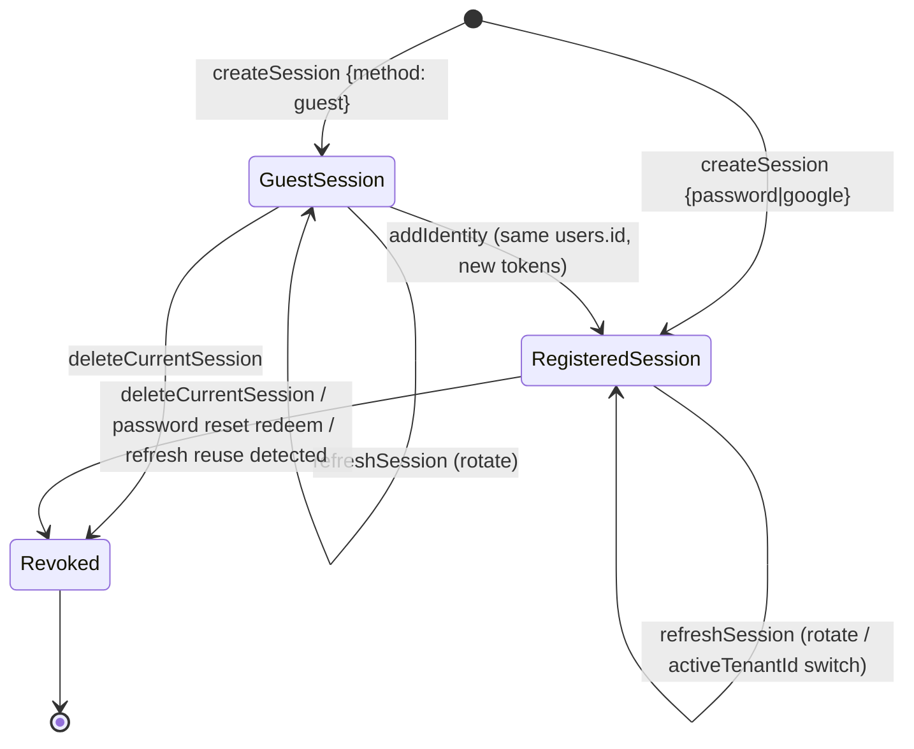
Conversion keeps `users.id`, so attempts, goals, and progress carry over. The response to `addIdentity` is `IdentityLinkResult {me, tokens}`, because the `knd` claim changes.

### 4.2 Attempt
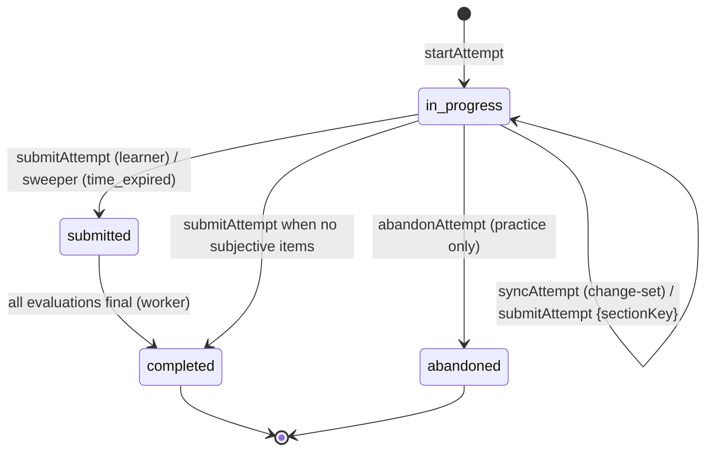
- `submitted` means objective grading is done and evaluations are still pending. `completed` means every score is final.
- The deadline sweeper runs every 15 s and auto-submits with `time_expired` after a 30 s grace period.

### 4.3 Response lock and practice check
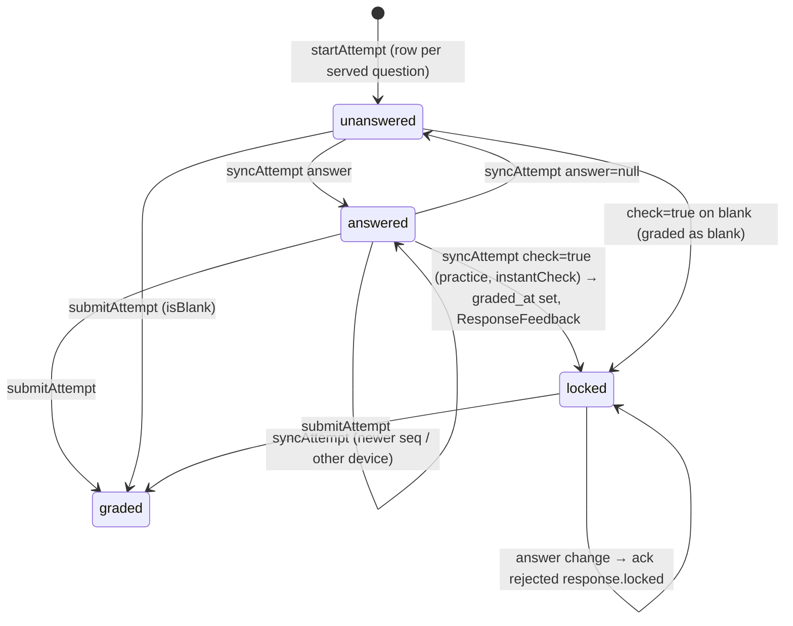
In mock mode, the `check` flag is ignored. Locking happens only at submit, and `isCorrect` is never returned before then.

### 4.4 Mock section windows (`attempts.sections_state`)
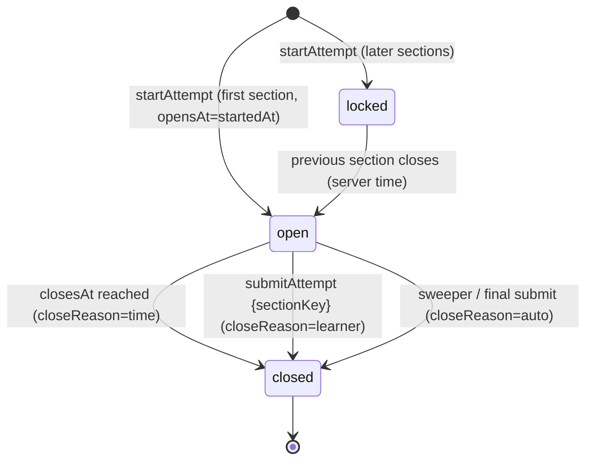
- **No start or pause commands exist.** Windows are computed from the revision `sections`: listening windows use the track `durationMs` (+ `checkSeconds` for IELTS); timed sections use `timeLimitSeconds`.
- `getAttemptContent?section=X` for a `locked` section returns `403 attempt.section_locked`.
- Writes to a `closed` section are acked `attempt.section_closed`.
- Practice attempts have a single clock that runs or pauses via the change-set `clock`.

### 4.5 Media asset
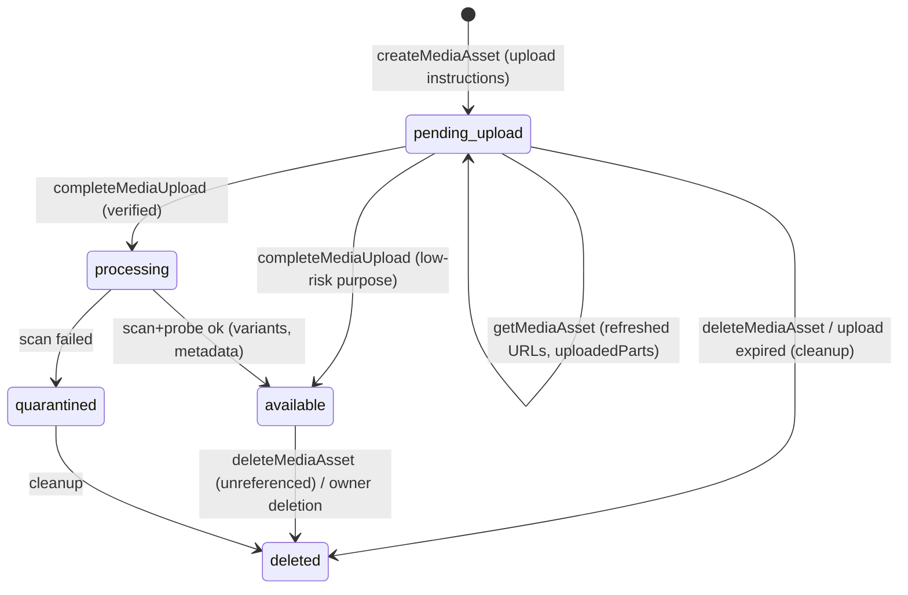

### 4.6 Job
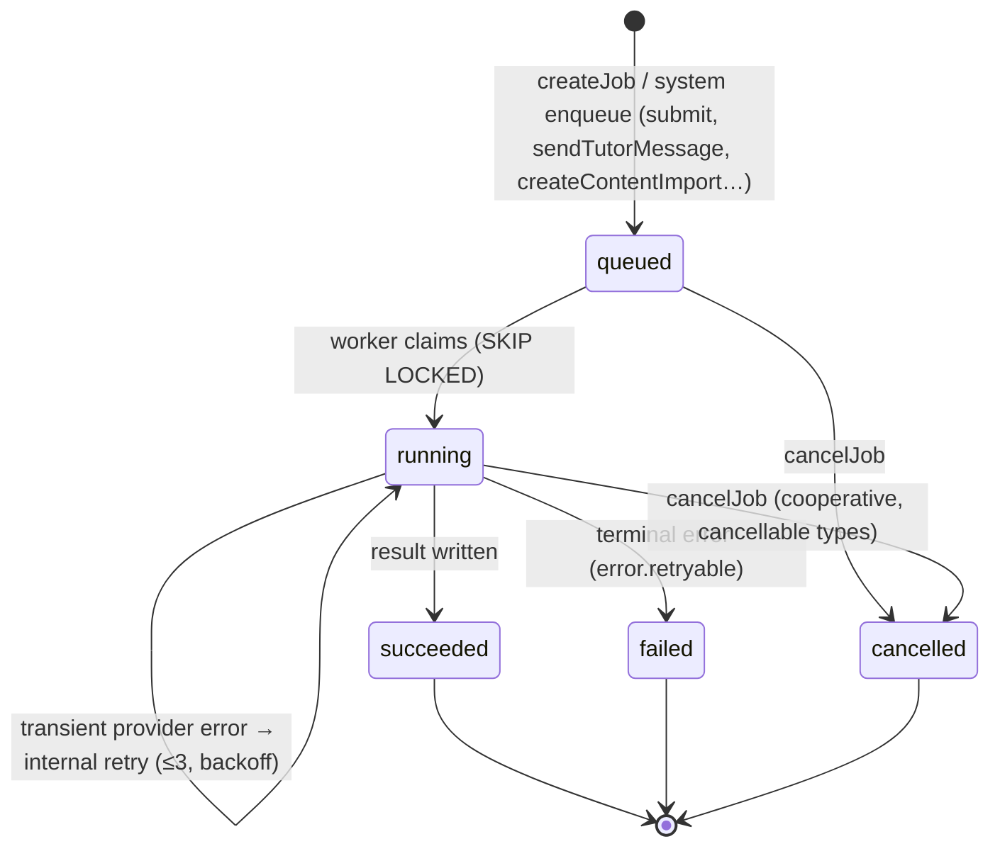
A failed job is never restarted. To retry, the client creates a new job, or uses the domain command for evaluations (`requestEvaluation`).

### 4.7 Exam revision
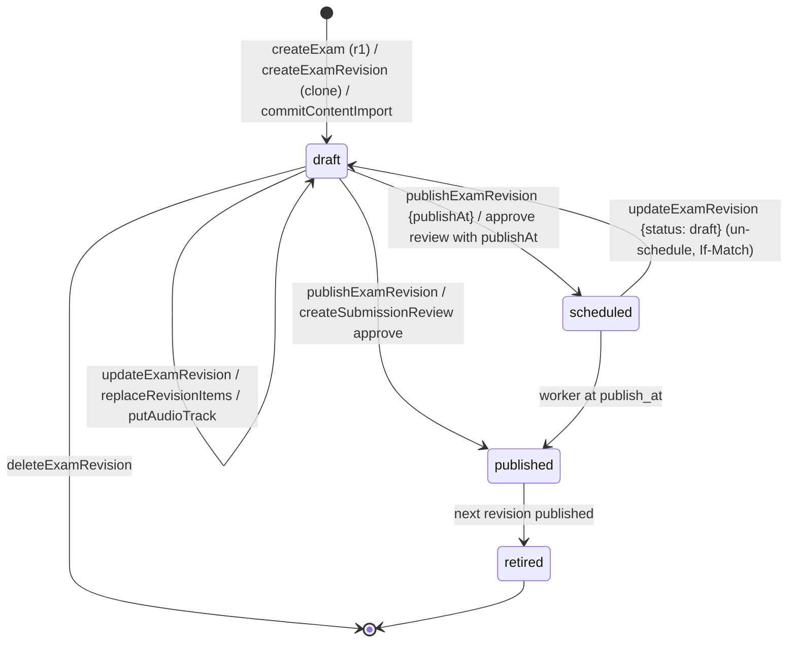
- A draft revision referenced by an active submission (`submitted`/`in_review`) is read-only: authoring mutations return `409 revision.under_review` (A5). Editing is possible again after `changes_requested` or `withdraw`. The derived `revisionStatus` shown in authoring lists is `in_review`/`changes_requested`.
- The content of a `scheduled` revision is immutable (`409 revision.immutable`); only un-scheduling is allowed.
- Exam-level status (`draft|published|archived`) is separate. `archived` is set with `updateExam`.

### 4.8 Question copy-on-write
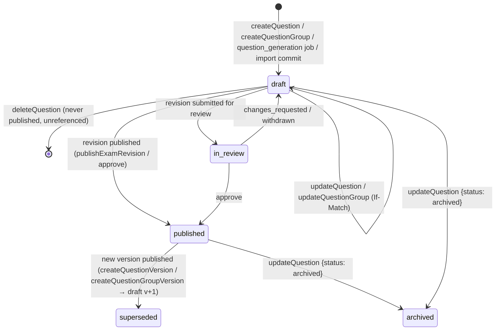
- Published questions are immutable (`409 question.immutable`). `createQuestionVersion {replaceInRevisionId}` creates version v+1 as a draft in the same lineage and swaps the reference in that draft revision. Old revisions keep pointing at v.
- Grouped questions are versioned only through `createQuestionGroupVersion`; calling `createQuestionVersion` on one returns `question.grouped`.

### 4.9 Content import
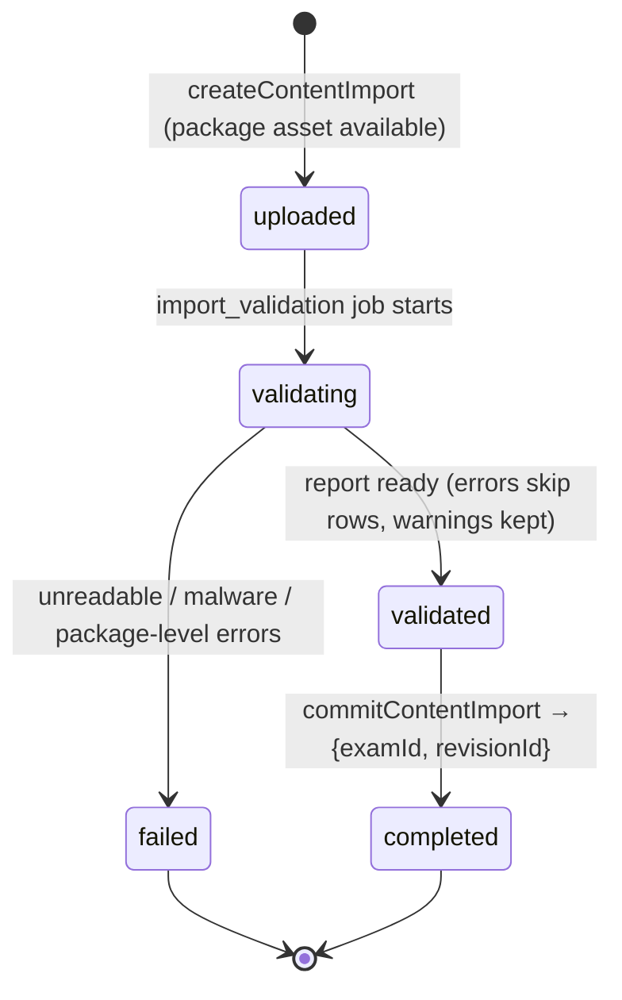

### 4.10 Content submission
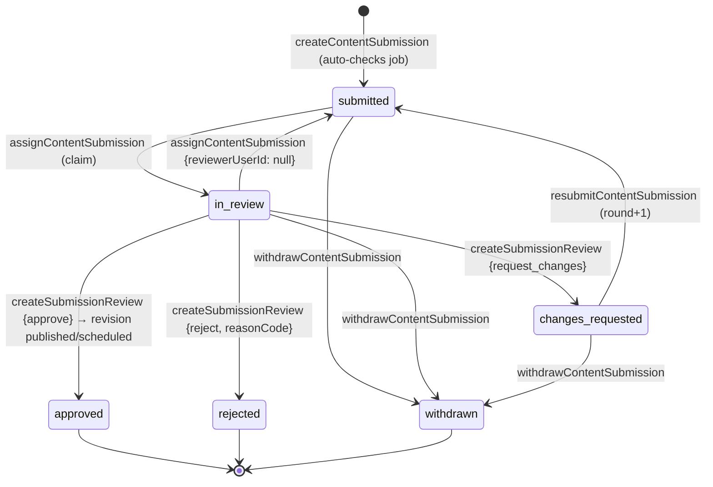
- An appeal is a new submission with `appealOfSubmissionId` set.
- DBML `submission_status.draft` is unused: a community draft is just a draft exam without a submission.

### 4.11 Evaluation (P2)
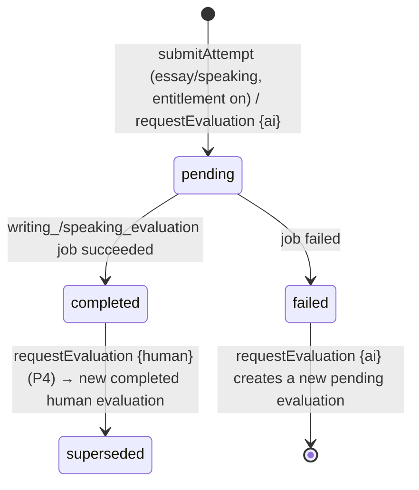
If the entitlement is disabled, no evaluation is created and the result reports `evaluationAvailable: false`.

---

## 5. Concurrency, idempotency, and sync

### 5.1 PUT vs PATCH vs change-set
| Style | Used for | Rationale |
|---|---|---|
| `PUT` (whole replacement, natural key) | `putMyGoal`, `putMyExamRating`, `replaceExamCredits`, `replaceRevisionItems`, `putAudioTrack`, `assignContentSubmission`, `putExamLicense` | The client owns the full value. The key is natural (exam type, exam, section, tenant), which makes upserts idempotent. Ordered lists (items, credits) avoid reorder semantics. |
| `PATCH` merge-patch (RFC 7396) | `updateMe`, `updateCurrentTenant`, `updateExam`, `updateExamRevision`, `updateQuestion`, `updateQuestionGroup` | Sparse field edits on single entities, protected by `If-Match`. |
| `PATCH` typed change-set (`AttemptChangeSet`) | `syncAttempt` | The attempt aggregate spans responses, annotations, resume state, and clock. Changes are ordered, each one is keyed (position / annotation id), and each needs its own result (`ChangeAck`). Merge-patch can't express "delete annotation X", sequence numbers, or per-item partial success. |
| `POST` | Creates and commands | Not idempotent by nature. Made safe with `Idempotency-Key` where required. |

### 5.2 Sequence numbers and last-write-wins
**Client side**
- Keeps a persisted local queue per attempt, coalesced per position: the latest local value wins before sending.
- Flushes on a ~600 ms debounce, on visibility change or backgrounding (web keepalive fetch, RN AppState), and in `submitAttempt.finalChanges`.
- Each change carries `seq`, a client counter per attempt that only increases and is persisted locally. Each batch carries a `deviceId`.

**Server rule, per response row** (`attempt_responses.client_seq`, `client_device_id`):
```
if change.deviceId != stored.client_device_id  → apply (cross-device LWW by arrival); store (seq, deviceId)
elif change.seq > stored.client_seq             → apply; store seq
else                                            → ack ignored_stale (duplicate or out-of-order)
locked position (graded_at) & answer change     → ack rejected response.locked
closed section / past deadline+grace            → ack rejected attempt.section_closed
```
`timeSpentMsDelta` is added only when its change is applied, so retries never double-count time. Because each change is either applied once or ignored, retrying a whole request is safe without an `Idempotency-Key`.

**Worked example** (attempt A, position 12):
| # | Arrives | deviceId | seq | answer | Stored before | Outcome | Stored after |
|---|---|---|---|---|---|---|---|
| 1 | t1 | phone | 41 | B | (null, –) | `applied` | phone/41 = B |
| 2 | t2 | phone | 43 | D | phone/41 | `applied` (43 > 41) | phone/43 = D |
| 3 | t3 | phone | 42 | C | phone/43 | `ignored_stale`: sent earlier, arrived late after a network retry | phone/43 = D |
| 4 | t4 | phone | 43 | D | phone/43 | `ignored_stale` (duplicate retry of the whole batch) | phone/43 = D |
| 5 | t5 | web | 7 | A | phone/43 | `applied` (different device → last arrival wins) | web/7 = A |
| 6 | t6 | phone | 44 | B | web/7 | `applied` (device differs again) | phone/44 = B |

Every ack returns the server's `version`. On resume, a client reconciles by calling `GET /attempts/{attemptId}?include=responses,annotations` and replacing its local state for any position it has no pending change for. Annotations follow the same rule, keyed by the client-generated annotation `id`.

### 5.3 ETag / If-Match flows
- **Which resources carry an ETag:** editable resources return a strong `ETag` (derived from `updated_at`/version). Mutations of authoring resources, `/me`, and tenant **require** `If-Match`. A missing header returns `428 precondition_required`; a mismatch returns `412 precondition_failed`. Exception for `putMyGoal` (A12): `If-Match` is optional, but if it's absent while an active goal exists, the server returns `428`.
- **Create-if-absent:** `putAudioTrack` and `putMyGoal` creation accept `If-None-Match: *`.
- **Child replacements:** `replaceRevisionItems` uses the revision ETag; `replaceExamCredits` uses the exam ETag.
- **Attempts** use `seq` instead. `getAttempt` returns an ETag for cache revalidation only.
- **Read caching:** reference data, catalog, and progress use `If-None-Match` and `304`.

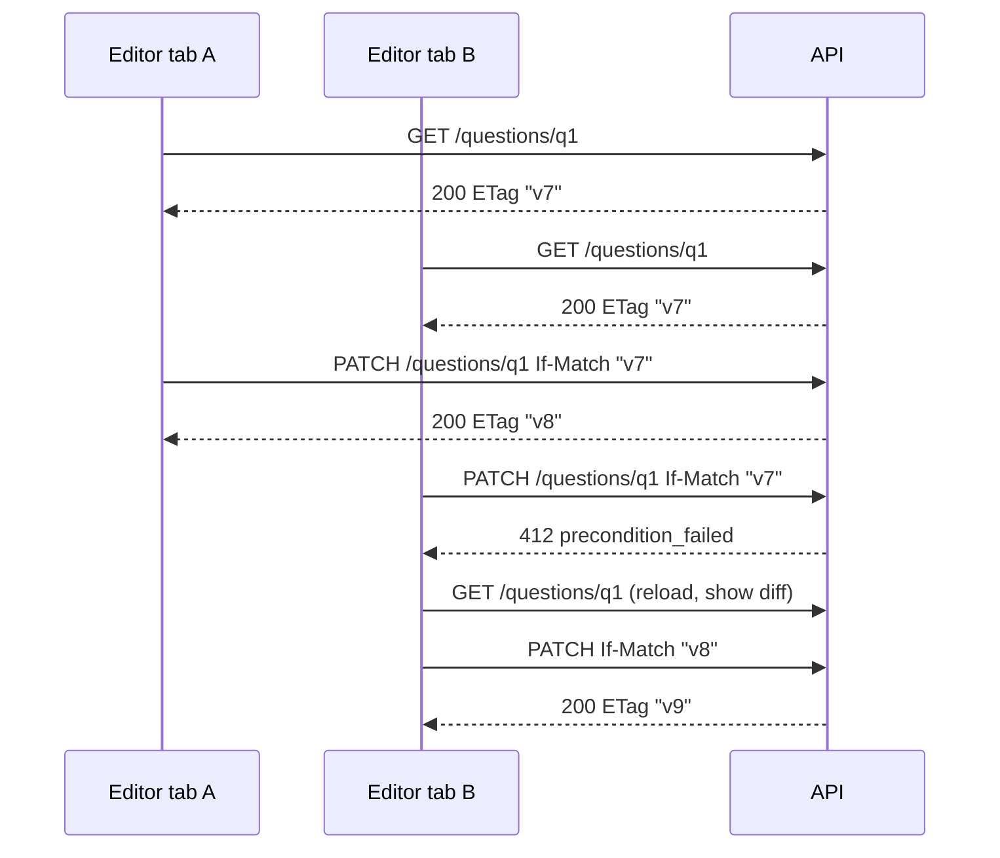

---

## 6. Disclosure policy and views

### 6.1 Normative disclosure table
| Data | Delivery (in progress) | Practice after `check` | After submit (review) | Authoring/reviewer |
|---|---|---|---|---|
| prompt (stem, options) | ✓ (TOEIC P1–P2 option text hidden) | ✓ | ✓ | ✓ |
| isCorrect / correctAnswer / points | ✗ | ✓ checked positions | ✓ | ✓ |
| explanation + evidence | ✗ | ✓ checked | ✓ | ✓ |
| transcript / script segments | ✗ | ✓ when the group is fully checked AND `settings.transcript` | ✓ | ✓ |
| fine cues | ✗ (coarse schedule only in mock) | practice clip ranges only | ✓ (per-position seek) | ✓ |
| rubric key | ✗ | ✗ | rubric name and criteria labels only | ✓ |
| review flags, auto-check details, provenance | ✗ | ✗ | ✗ | ✓ |

Tutor context must already be disclosed to the caller, otherwise the API returns `403 tutor.context_not_reviewable`:
- `attempt_response`: the targeted response is checked in practice, or the attempt is submitted.
- `question` (A13): the caller has seen this question disclosed in one of their own submitted attempts or checked practice positions, or the caller is authoring staff of the owning tenant.

A `question` context therefore can't be used to get answers to questions the learner hasn't been shown.

### 6.2 Schema families per view
Protected fields exist **only** in schemas whose names end in `Review`, `Authoring`, `Feedback`, or `Staff`. `*Delivery` schemas don't have these properties at all; a null placeholder isn't enough. This is enforced with separate Pydantic models and contract tests.

| View / context | Operations | Schemas |
|---|---|---|
| `delivery` | getAttemptContent (default), getRevisionContent `view=delivery` | `ContentDelivery`, `QuestionDelivery` (+8 variants), `StimulusDelivery`, `AudioTrackDelivery`, `PlaybackPolicy`, `ScheduleSegment`, `ContentSection`/`ContentPart`/`ContentPage`, `MediaAccess`, `MediaClip`, `MediaImage` |
| practice check | syncAttempt (`check: true`) | `ResponseFeedback` (correctness, `correctAnswer`, `Explanation`, `Evidence`, transcript when allowed) |
| `review` | getAttemptContent `view=review`, getRevisionContent `view=review` | `ContentReview`, `QuestionReview` (+8 variants: adds `answerKey`, `Explanation`, `Evidence`, outcome), `StimulusReview` (transcript segments), learner `Annotation`s |
| result | getAttemptResult | `AttemptResult`, `ResponseOutcome`, `ResultBreakdown`, `Evaluation`, `EvaluationFeedback`, `SpeakingTranscript` |
| `authoring` | getRevisionContent `view=authoring`, question bank, revision, audio track | `ContentAuthoring`, `QuestionAuthoring` (+8), `QuestionGroupAuthoring`, `ExamRevisionAuthoring`, `AudioTrackAuthoring`, `AudioQc`, `ReviewFlag` |
| reviewer | getContentSubmission | `ContentSubmission` with `AutoChecks` (full). The submitter sees `AutoChecksSummary`. |
| staff | getJob/listJobs with `view=staff` (`content.author`) | `Job.provenance`/`usage` (provider, model, tokens, cost); never prompts |
| catalog | listExams / getExam `view=catalog` | `ExamCatalogItem`, `ExamCatalogDetail`, `RevisionStructure`, `ExamRules`, `ExamViewerState` (no item content) |

In practice mode, `view=review` before submit returns only the checked positions; the others are omitted. In mock mode it returns `403 attempt.review_not_available` until submit.

---

## 7. Media workflow contracts

### 7.1 Principles
- **Direct-to-storage.** Bytes never pass through the API. The server issues SigV4 presigned `PUT` or `UploadPart` URLs against R2 (prod) or MinIO (local). Clients see only the provider-neutral `UploadInstructions` and `MediaAccess`; bucket, key, and provider are never exposed.
- **Policy by purpose and referencing entity.** For example, a `learner_response` asset belongs to its attempt owner. An unauthorized caller gets `404`.
- **Embedded access.** Content, results, and the authoring DTOs embed `MediaAccess` (signed or public URL plus `urlExpiresAt`). `getMediaAsset` serves refreshes and status checks. See [storage_architecture.md](./storage_architecture.md) for keys, buckets, and lifecycle rules.

### 7.2 Purposes and limits
| purpose | MIME | Max | Upload strategy | Access TTL |
|---|---|---|---|---|
| `question_media` | audio wav/flac/mp3/m4a, image jpeg/png/webp | audio 500 MB, image 15 MB | single ≤ 64 MiB, else multipart | authoring 15 min; learners: practice 30 min, mock section track = window + 10 min |
| `learner_response` | m4a/aac, webm/opus, mp3, wav | 25 MB, ≤ 5 min | single | 5 min (owner playback) |
| `source_material` | pdf, docx, txt, jpeg/png, mp3 | 20 MB | single | owner, 15 min |
| `exam_cover` | jpeg/png/webp | 5 MB | single | public immutable URL once published (private while draft) |
| `import_package` | zip | 2 GB | multipart | 10 min |
| `branding` | png, sanitized svg, webp | 2 MB | single | public |
| `import_report` (system) | text/csv | – | – | 10 min |

Thresholds: multipart above `STORAGE_MULTIPART_THRESHOLD_BYTES` = 64 MiB, using uniform 16 MiB parts.

### 7.3 Single upload
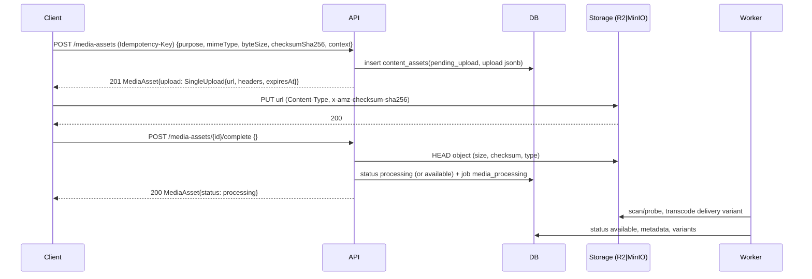

### 7.4 Multipart and resume
1. `createMediaAsset` with `byteSize` over 64 MiB → `MultipartUpload {partSizeBytes, partCount, parts[{partNumber, url, expiresAt}], expiresAt}`.
2. The client PUTs each part and records the `ETag` header that storage returns for it.
3. **Resume** (after a crash or network loss): call `getMediaAsset`. While the asset is `pending_upload`, the response contains fresh `upload` instructions and `uploadedParts[] {partNumber, etag, byteSize}` (the server calls `list_parts`). The client uploads only the missing parts.
4. `completeMediaUpload {parts:[{partNumber, etag}]}` → the server completes the multipart upload and verifies size and per-part SHA-256 (storage-enforced composite checksum). The whole-object SHA-256 is verified by the worker while streaming the object in `processing`; a mismatch moves the asset to `quarantined` with `failureReason: checksum_mismatch` (R2 offers SHA-256 only as a composite checksum for multipart uploads).
5. Errors:
   - `media.upload_incomplete` 409: parts are missing.
   - `media.size_mismatch` 422 (both strategies); `media.checksum_mismatch` 422 (single PUT only).
   - `media.upload_expired` 410: create a new asset. Storage lifecycle aborts stale multipart uploads after 7 days.

### 7.5 Access
- `MediaAccess {assetId, kind, mimeType, byteSize?, durationMs?, width?, height?, url, urlExpiresAt|null, rangeSupported}`. `urlExpiresAt` is `null` for public URLs.
- Learners always receive the delivery variant (for example `aac_96k`), never the master file.
- `ContentDelivery.expiresAt` is the earliest URL expiry in the payload. Before that time, the client refetches the content (cheap, because the projection is cached) or calls `getMediaAsset` for a single asset.
- A signed URL acts as a bearer token until it expires. Mitigations: short TTLs, unguessable keys, no bucket listing, revocation by deleting the object. See [storage_architecture.md](./storage_architecture.md).

---

## 8. AI and async workflow contracts

### 8.1 Job types
| Type | Created by | Input summary | Result summary | Writes domain records? |
|---|---|---|---|---|
| `question_generation` | createJob (P3: library `material.upload_own` + `question_generation`; authors) | `sourceMaterialId` \| `examType`+`topic`, `count` 1–20, `questionTypes[]`, `difficulty?` | `{groupIds[], questionIds[]}`: private or tenant **drafts** | Creates drafts only |
| `speech_synthesis` | createJob (authors) | `target` (audio_track \| question_group), `scriptSource`, `segments?`, `voices{label: voiceId}`, `output{format, sampleRateHz}` | `{assetId, durationMs, suggestedCues[], scriptSegments[]}` | New asset only. The author applies it with `putAudioTrack`/`updateQuestionGroup`. |
| `audio_alignment` | createJob | `{examId, revisionId, sectionKey, overwriteManual=false}` | `{cues[], scriptSegments[], summary{matched, needsReview, missing}}` | No (suggestion) |
| `audio_normalization` | createJob | `{assetId, targetLufs: -16, truePeakDbtp: -1}` | `{assetId (new), loudnessLufs, truePeakDbtp}` | New asset only |
| `content_assist` | createJob | `{task: translate_explanation\|suggest_alt_text\|suggest_skill_tags\|draft_explanation, questionIds[]}` | `{suggestions[{questionId, field, value}]}` | No |
| `quality_check` | createJob | `{revisionId}` \| `{questionIds[]}` | `{flags[{questionId, code, detail}]}` | No |
| `writing_evaluation` | system (submitAttempt, requestEvaluation) | response ref | `EvaluationJobResult` → `Evaluation` | Yes (evaluations) |
| `speaking_evaluation` | system | response + recording (transcription + evaluation) | `EvaluationJobResult` (with transcript) | Yes |
| `tutor_reply` | system (createTutorConversation with initialMessage, sendTutorMessage) | conversation, message | `TutorReplyResult {messageId}` | Yes (tutor_messages) |
| `originality_check` | system (createContentSubmission) | revision | part of `AutoChecks` | Yes (submission auto_checks) |
| `import_validation` | system (createContentImport) | import | `ImportValidationResult` | Yes (content_import_jobs) |
| `media_processing` | system (completeMediaUpload) | asset | metadata, variants | Yes (content_assets) |
| `material_extraction` | system (createSourceMaterial) | material | extracted text, status | Yes (source_materials) |
| `account_deletion` | system (deleteMe) | user | `AccountDeletionResult` | Yes |

**Rule:** jobs never mutate published or in-review content. They produce drafts, assets, or suggestions, which authors apply through the normal authoring endpoints so the change is audited and concurrency-checked. The exceptions are evaluation, tutor, import, originality, and the system jobs listed above, which write their own domain records.

### 8.2 Polling vs SSE
- **Default (P1/P2):** poll `GET /jobs/{jobId}`. The response sets `Retry-After` (e.g. 2 s for tutor replies, 5 s for evaluations, 10 s for Studio jobs) while the job is `queued` or `running`.
- **P2:** `GET /jobs/{jobId}/events` (`text/event-stream`), with events `status`, `progress`, `delta` (tutor tokens), `result`, and `error`. It supports `Last-Event-ID`, sends a heartbeat every 15 s, and closes after the terminal event. There's no WebSocket because nothing needs bidirectional traffic.
- Domain resources mirror job outcomes: `getAttemptResult.evaluations[].status`, `getContentImport.status`, `getTutorConversation` messages. Clients can poll those instead of the job.

### 8.3 Quotas, failure, retry
- **Entitlements:** `ai_tutor`, `writing_ai_feedback`, `speaking_ai_feedback`, `material_upload`, `question_generation`. When a feature is off, the API returns `403 ai.feature_disabled`.
- **Quotas:** quota limits (for example, tutor 30/day) are counted from jobs and `ai_runs`. When exceeded, the API returns `429 ai.quota_exceeded` with `meta {limit, resetsAt}`. `getMe.entitlements[].usage` and `getTutorConversation.quota` (`AiQuota`) expose the remaining budget.
- **Worker retries:** transient provider errors are retried with exponential backoff (max 3) inside a single job; each attempt adds an `ai_runs` row.
- **Terminal failure:** `failed` with `error {code, message, retryable}`. A user-level retry means a new job, or `requestEvaluation` for evaluations.
- **Never exposed:** prompts, completions, provider keys, chain-of-thought. Provider and model metadata appear only in staff `provenance`.

---

## 9. Example payloads

### 9.1 `createSession` (guest) → `SessionTokens`
```http
POST /api/v1/auth/sessions
Idempotency-Key: 2b0c7d3e-1f5a-4c8e-9d2b-6a7e5f4c3b21
Content-Type: application/json

{ "method": "guest", "locale": "vi", "timezone": "Asia/Ho_Chi_Minh" }
```
```json
{
  "accessToken": "eyJhbGciOiJFZERTQSIs…",
  "accessTokenExpiresAt": "2026-10-28T09:15:00Z",
  "refreshToken": "rt_9Qm…",
  "refreshTokenExpiresAt": "2026-11-27T09:00:00Z",
  "tokenType": "Bearer",
  "user": { "id": "0b6f1c9e-3d2a-4f7b-8e1d-5c4a3b2f1e0d", "kind": "guest" },
  "activeTenantId": "00000000-0000-4000-8000-000000000001"
}
```
`refreshToken` appears in the body for mobile clients only. Web receives it as the `engrisk_rt` cookie.

### 9.2 `startAttempt` (TOEIC Part 3 practice) → `Attempt`
```json
{
  "examId": "6a1e2d3c-7b8f-4a9e-b0c1-d2e3f4a5b6c7",
  "mode": "practice",
  "settings": { "parts": ["P3"], "instantCheck": true, "audioReplay": true, "transcript": true, "timeLimitSeconds": null }
}
```
```json
{
  "id": "9c8b7a6d-5e4f-4321-9abc-def012345678",
  "status": "in_progress",
  "mode": "practice",
  "exam": { "id": "6a1e2d3c-7b8f-4a9e-b0c1-d2e3f4a5b6c7", "title": "TOEIC Part 3 · Office Conversations Set 2", "kind": "practice_set", "examTypeCode": "toeic_lr" },
  "revisionId": "1f2e3d4c-5b6a-4798-8a7b-6c5d4e3f2a1b",
  "timing": {
    "serverNow": "2026-10-28T09:00:01Z",
    "startedAt": "2026-10-28T09:00:00Z",
    "deadlineAt": null,
    "paused": false,
    "sections": [{ "key": "L", "status": "open", "opensAt": "2026-10-28T09:00:00Z", "closesAt": null, "closeReason": null }]
  },
  "counts": { "answered": 0, "unanswered": 9, "flagged": 0 },
  "resumeState": null,
  "responses": [
    { "position": 32, "sectionKey": "L", "partKey": "P3", "answer": null, "isFlagged": false, "eliminated": [], "checked": false, "version": 0 }
  ]
}
```

### 9.3 `getAttemptContent` → `ContentDelivery` (excerpt)
```json
{
  "attemptId": "9c8b7a6d-5e4f-4321-9abc-def012345678",
  "revisionId": "1f2e3d4c-5b6a-4798-8a7b-6c5d4e3f2a1b",
  "view": "delivery",
  "sectionKey": "L",
  "sections": [{
    "key": "L", "title": "Listening", "skillArea": "listening", "delivery": "untimed",
    "parts": [{ "key": "P3", "title": "Part 3: Conversations",
      "directions": { "vi": "Bạn sẽ nghe các đoạn hội thoại…", "en": "You will hear some conversations…" },
      "pages": [{ "pageKey": "g1", "groupId": "a0b1c2d3-e4f5-4a6b-8c7d-9e0f1a2b3c4d", "positions": [32, 33, 34] }] }]
  }],
  "groups": {
    "a0b1c2d3-e4f5-4a6b-8c7d-9e0f1a2b3c4d": {
      "id": "a0b1c2d3-e4f5-4a6b-8c7d-9e0f1a2b3c4d", "stimulusType": "audio", "title": "Conversation 1",
      "content": { "stimulusType": "audio", "instructions": "Questions 32-34 refer to the following conversation." },
      "audio": { "assetId": "5d4c3b2a-1f0e-4d9c-8b7a-6f5e4d3c2b1a" }
    }
  },
  "questions": [{
    "position": 32, "numberLabel": "32", "sectionKey": "L", "partKey": "P3",
    "groupId": "a0b1c2d3-e4f5-4a6b-8c7d-9e0f1a2b3c4d", "questionId": "b1c2d3e4-f5a6-4b7c-8d9e-0f1a2b3c4d5e",
    "type": "single_choice", "points": 1,
    "prompt": { "stem": "Why is the woman calling?", "optionSet": "abcd",
      "options": [{ "key": "A", "text": "To reschedule a delivery" }, { "key": "B", "text": "To order office supplies" },
                  { "key": "C", "text": "To report a billing error" }, { "key": "D", "text": "To confirm a meeting room" }] },
    "presentation": { "optionsTextVisible": true, "inputMode": "choice" }
  }],
  "audioTracks": [],
  "media": {
    "5d4c3b2a-1f0e-4d9c-8b7a-6f5e4d3c2b1a": {
      "assetId": "5d4c3b2a-1f0e-4d9c-8b7a-6f5e4d3c2b1a", "kind": "audio", "mimeType": "audio/mp4",
      "durationMs": 41250, "url": "https://<signed-storage-url>", "urlExpiresAt": "2026-10-28T09:30:01Z", "rangeSupported": true
    }
  },
  "expiresAt": "2026-10-28T09:30:01Z"
}
```

### 9.4 `syncAttempt` → `AttemptSyncResult`
```json
{
  "deviceId": "ios-3F9A2C",
  "resumeState": { "seq": 118, "value": { "position": 33, "audioMs": 18400 } },
  "responses": [
    { "position": 32, "seq": 116, "answer": { "type": "single_choice", "choice": "A" }, "timeSpentMsDelta": 21400 },
    { "position": 33, "seq": 117, "answer": { "type": "single_choice", "choice": "C" }, "isFlagged": true, "eliminated": ["B"] },
    { "position": 32, "seq": 119, "check": true }
  ],
  "annotations": [
    { "op": "upsert", "id": "c7d8e9f0-1a2b-4c3d-8e4f-5a6b7c8d9e0f", "questionGroupId": "a0b1c2d3-e4f5-4a6b-8c7d-9e0f1a2b3c4d",
      "stimulusPart": "transcript", "kind": "highlight", "anchor": { "start": 120, "end": 168 } }
  ]
}
```
```json
{
  "attemptStatus": "in_progress",
  "timing": { "serverNow": "2026-10-28T09:03:12Z", "startedAt": "2026-10-28T09:00:00Z", "deadlineAt": null, "paused": false, "sections": [] },
  "acks": [
    { "target": "resume_state", "key": "resume", "status": "applied", "version": 118 },
    { "target": "response", "key": "32", "status": "applied", "version": 116 },
    { "target": "response", "key": "33", "status": "applied", "version": 117 },
    { "target": "response", "key": "32", "status": "applied", "version": 119 },
    { "target": "annotation", "key": "c7d8e9f0-1a2b-4c3d-8e4f-5a6b7c8d9e0f", "status": "rejected", "code": "attempt.review_not_available", "version": 0 }
  ],
  "feedback": [{
    "position": 32, "isCorrect": true, "correctAnswer": { "type": "single_choice", "choice": "A" }, "pointsAwarded": 1,
    "explanation": { "text": "Người phụ nữ nói “I need to move Thursday's delivery to Monday”.",
      "evidence": { "groupId": "a0b1c2d3-e4f5-4a6b-8c7d-9e0f1a2b3c4d", "stimulusPart": "transcript", "start": 0, "end": 52, "quote": "I need to move Thursday's delivery to Monday" } }
  }]
}
```
In this example, the annotation is rejected because annotations on the transcript need the transcript to be disclosed, and the group isn't fully checked yet. The other changes in the same request still apply.

### 9.5 `submitAttempt` → `AttemptSubmitResult`
```json
{ "finalChanges": { "deviceId": "ios-3F9A2C", "responses": [{ "position": 40, "seq": 131, "answer": { "type": "single_choice", "choice": "B" } }] } }
```
```json
{
  "attempt": { "id": "9c8b7a6d-5e4f-4321-9abc-def012345678", "status": "completed", "submitReason": "learner", "submittedAt": "2026-10-28T09:11:40Z" },
  "resultReady": true,
  "pendingEvaluations": 0,
  "jobIds": []
}
```

### 9.6 `getAttemptResult` → `AttemptResult` (IELTS Writing, P2, excerpt)
```json
{
  "attemptId": "e1d2c3b4-a5f6-4789-8a0b-1c2d3e4f5a6b",
  "scores": [{ "scope": "overall", "kind": "ai_estimate", "value": 6.5, "maxValue": 9, "scale": "ielts_band", "scoringPolicyKey": "ielts_writing_v1", "isEstimate": true }],
  "breakdown": { "sections": [], "parts": [], "skills": [] },
  "responses": [{ "position": 1, "sectionKey": "W", "partKey": "T2", "answer": { "type": "essay", "text": "…" }, "isBlank": false, "timeSpentMs": 2310000, "maxPoints": 0 }],
  "evaluations": [{
    "id": "f0e1d2c3-b4a5-4697-8879-6a5b4c3d2e1f", "position": 1, "evaluator": "ai", "status": "completed",
    "jobId": "7a6b5c4d-3e2f-4109-8a7b-6c5d4e3f2a1b", "rubricKey": "ielts_writing_task2",
    "criteria": [
      { "key": "task_response", "label": "Task Response", "score": 6.5 },
      { "key": "coherence_cohesion", "label": "Coherence & Cohesion", "score": 6.5 },
      { "key": "lexical_resource", "label": "Lexical Resource", "score": 6.0 },
      { "key": "grammatical_range_accuracy", "label": "Grammatical Range & Accuracy", "score": 6.5 }
    ],
    "estimatedScore": { "value": 6.5, "low": 6.0, "high": 7.0, "scale": "ielts_band", "kind": "ai_estimate" },
    "feedback": { "summary": "Clear position, but paragraph 3 lacks a supporting example.", "strengths": ["Clear thesis"], "improvements": ["Vary linking devices"],
      "inline": [{ "start": 412, "end": 431, "suggestion": "has risen sharply", "category": "grammar" }] },
    "lowConfidenceCriteria": [],
    "disclaimer": { "vi": "Ước tính của AI — không phải điểm IELTS chính thức", "en": "AI estimate — not an official IELTS score" },
    "createdAt": "2026-10-28T10:00:02Z", "completedAt": "2026-10-28T10:00:41Z"
  }],
  "next": { "redoAvailable": false, "incorrectCount": 0, "weakestSkill": "lexical_resource", "suggestedExamId": null, "suggestedPart": null }
}
```

### 9.7 `createMediaAsset` (speaking recording) → `MediaAsset`
```json
{
  "purpose": "learner_response", "mimeType": "audio/mp4", "byteSize": 1843200,
  "checksumSha256": "n4bQgYhMfWWaL+qgxVrQFaO/TxsrC4Is0V1sFbDwCgg=", "fileName": "part2.m4a",
  "context": { "type": "attempt_response", "attemptId": "3a4b5c6d-7e8f-4901-a2b3-c4d5e6f7a8b9", "position": 4 }
}
```
```json
{
  "id": "d4e5f6a7-b8c9-4d0e-9f1a-2b3c4d5e6f7a", "purpose": "learner_response", "status": "pending_upload",
  "mimeType": "audio/mp4", "byteSize": 1843200,
  "upload": { "strategy": "single", "method": "PUT", "url": "https://<presigned-put>",
    "headers": { "Content-Type": "audio/mp4", "x-amz-checksum-sha256": "n4bQgYhMfWWaL+qgxVrQFaO/TxsrC4Is0V1sFbDwCgg=" },
    "expiresAt": "2026-10-28T09:20:00Z" },
  "access": null
}
```
A multipart variant (`import_package`, 1.2 GB) returns `"upload": {"strategy": "multipart", "partSizeBytes": 16777216, "partCount": 72, "parts": [{"partNumber": 1, "url": "https://<presigned-part>", "expiresAt": "…"}], "expiresAt": "…"}`. `completeMediaUpload` then takes `{"parts": [{"partNumber": 1, "etag": "\"9b2cf5…\""}, …]}`.

### 9.8 `createJob` (speech synthesis) → `Job`
```json
{
  "type": "speech_synthesis",
  "target": { "type": "question_group", "groupId": "a0b1c2d3-e4f5-4a6b-8c7d-9e0f1a2b3c4d" },
  "scriptSource": "group_transcript",
  "voices": { "M1": "voice_en_us_m_02", "W1": "voice_en_gb_f_01" },
  "output": { "format": "wav", "sampleRateHz": 44100 }
}
```
```json
{
  "id": "4c5d6e7f-8a9b-4c0d-9e1f-2a3b4c5d6e7f", "type": "speech_synthesis", "status": "succeeded",
  "progress": { "percent": 100, "stage": "done" },
  "target": { "type": "question_group", "id": "a0b1c2d3-e4f5-4a6b-8c7d-9e0f1a2b3c4d" },
  "result": { "type": "speech_synthesis", "assetId": "8e9f0a1b-2c3d-4e5f-8a6b-7c8d9e0f1a2b", "durationMs": 39800,
    "suggestedCues": [{ "position": 32, "startMs": 0, "endMs": 39800, "confidence": 0.93, "source": "synthesized" }],
    "scriptSegments": [{ "startMs": 0, "endMs": 4100, "speaker": "W1", "accent": "uk", "text": "Hi, this is Dana from Brightway Logistics.", "positions": [32] }] },
  "error": null,
  "createdAt": "2026-10-28T08:40:00Z", "startedAt": "2026-10-28T08:40:02Z", "finishedAt": "2026-10-28T08:40:19Z",
  "links": { "self": "/api/v1/jobs/4c5d6e7f-8a9b-4c0d-9e1f-2a3b4c5d6e7f", "events": "/api/v1/jobs/4c5d6e7f-8a9b-4c0d-9e1f-2a3b4c5d6e7f/events", "target": "/api/v1/question-groups/a0b1c2d3-e4f5-4a6b-8c7d-9e0f1a2b3c4d" }
}
```

### 9.9 `sendTutorMessage` → `TutorMessageAccepted`
```json
{ "suggestionId": "why_wrong" }
```
```json
{
  "message": { "id": "6f7a8b9c-0d1e-4f2a-8b3c-4d5e6f7a8b9c", "role": "learner", "body": "Vì sao mình sai câu này?", "createdAt": "2026-10-28T09:15:03Z" },
  "replyJobId": "0a1b2c3d-4e5f-4a6b-8c7d-8e9f0a1b2c3d"
}
```

### 9.10 `publishExamRevision` failure (Problem)
```json
{
  "type": "https://docs.engrisk.app/problems/revision.validation_failed", "title": "Revision has blocking issues", "status": 422,
  "code": "revision.validation_failed", "traceId": "01JB6W…",
  "meta": { "blocking": [{ "code": "B04", "severity": "blocking",
    "message": { "vi": "Thiếu cue cho 2 câu Listening", "en": "2 listening questions have no cue" }, "count": 2,
    "targets": [{ "type": "audio_track", "sectionKey": "L", "position": 41 }, { "type": "audio_track", "sectionKey": "L", "position": 42 }],
    "fixHint": "Run audio alignment or add cues manually." }] }
}
```

### 9.11 `createContentSubmission` and `createSubmissionReview`
```json
{ "examId": "2b3c4d5e-6f7a-4b8c-9d0e-1f2a3b4c5d6e", "revisionId": "3c4d5e6f-7a8b-4c9d-8e0f-1a2b3c4d5e6f",
  "license": "platform_nonexclusive", "rightsBasis": "own_work", "rightsConfirmed": true,
  "messageToReviewer": "Part 5 set focused on prepositions of time." }
```
```json
{ "decision": "approve",
  "checklist": { "original": true, "keysCorrect": true, "explanations": true, "audioScript": true, "levelTagsCredits": true, "languageSafety": true },
  "summary": "Clean set, explanations are clear.", "publishAt": null }
```

### 9.12 `putMyGoal` and `getMyProgress` (excerpt)
```json
{ "selfAssessedLevel": "intermediate", "targetScore": 750, "targetDate": "2027-03-15", "weeklyStudyMinutes": 105 }
```
```json
{
  "examType": "toeic_lr", "generatedAt": "2026-10-28T09:20:00Z",
  "nextAction": { "kind": "recommended", "examId": "7b8c9d0e-1f2a-4b3c-8d4e-5f6a7b8c9d0e", "mode": "practice",
    "settings": { "parts": ["P5"], "instantCheck": true }, "reasonCode": "weakest_skill",
    "reason": { "vi": "Ngữ pháp Part 5 đang thấp nhất (58%)", "en": "Part 5 grammar is your weakest area (58%)" } },
  "estimatedScore": { "value": 615, "kind": "scaled_estimate", "scale": "toeic_total", "delta": 35, "basedOnAttemptId": "9c8b7a6d-5e4f-4321-9abc-def012345678" },
  "kpis": { "weekMinutes": 64, "weekTargetMinutes": 105, "accuracy7d": 0.71, "accuracyDelta": 0.04, "attemptsCompleted": 12, "studyHours": 9.5 },
  "skills": [{ "code": "toeic_grammar", "name": "Ngữ pháp", "accuracy": 0.58, "mastery": 0.42, "responses": 64, "suggestedExamId": "7b8c9d0e-1f2a-4b3c-8d4e-5f6a7b8c9d0e", "suggestedPart": "P5" }],
  "parts": [{ "key": "P5", "accuracy": 0.58, "responses": 64, "suggestedExamId": "7b8c9d0e-1f2a-4b3c-8d4e-5f6a7b8c9d0e" }],
  "scoreTrend": [{ "date": "2026-10-20", "value": 580, "attemptId": "…" }],
  "recentAttempts": []
}
```

---

## 10. End-to-end scenarios S1–S10

Participants in every diagram: Client (C), API, DB, Storage (S: R2 in prod, MinIO locally), Worker (W), AI provider (AI).

### S1 — TOEIC Part 3 practice
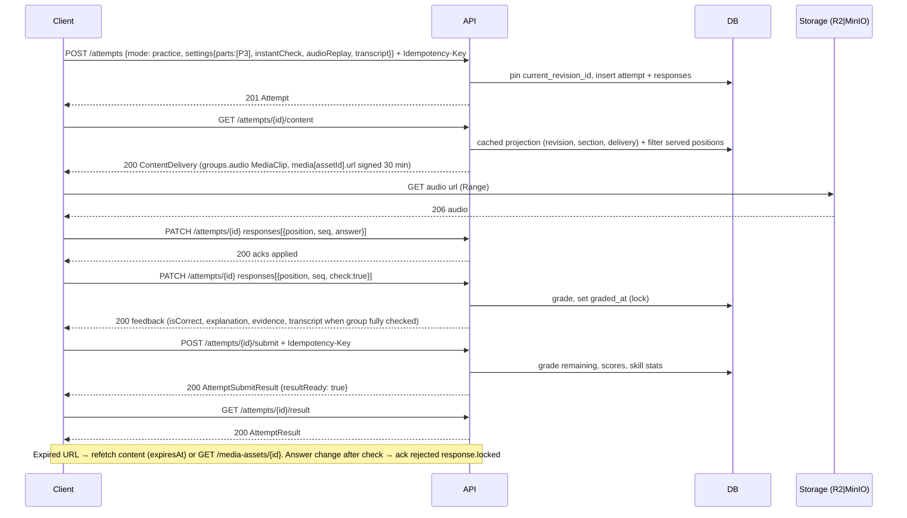

### S2 — TOEIC full mock
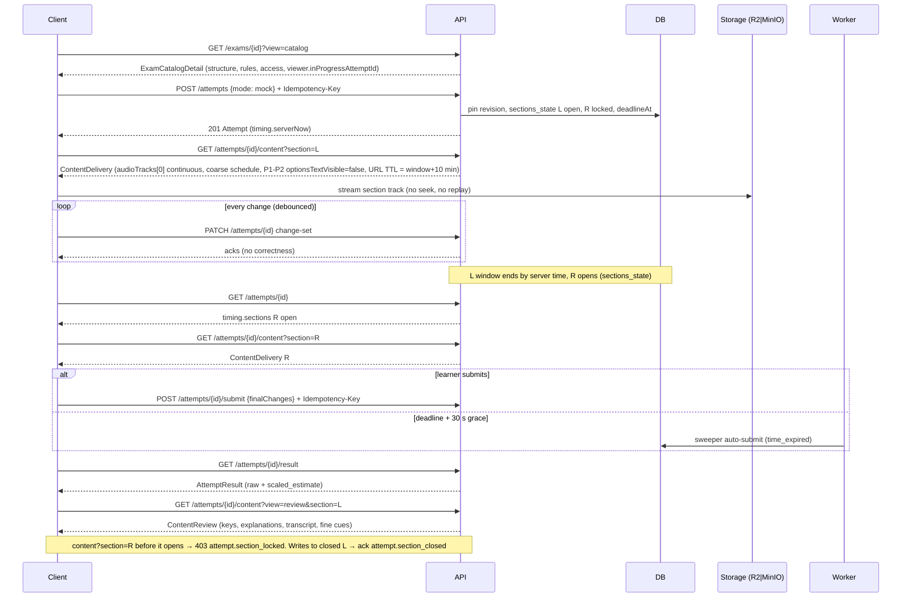

### S3 — IELTS Reading with interruption
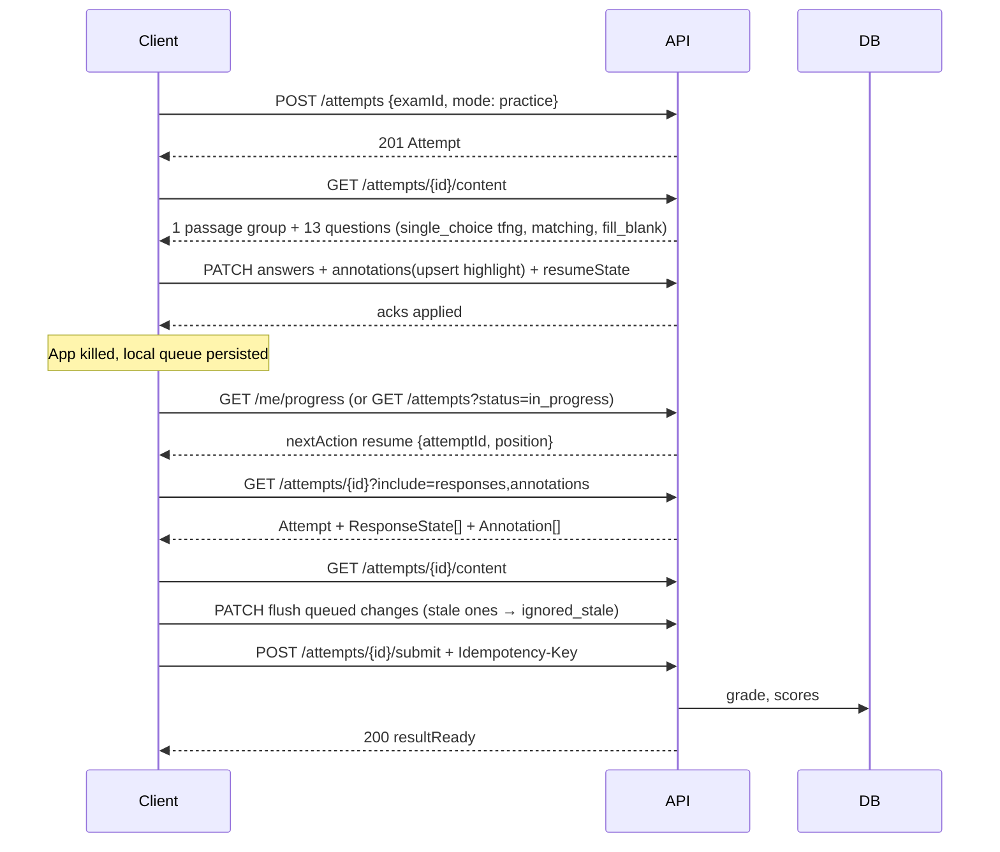

### S4 — IELTS Writing (P2)
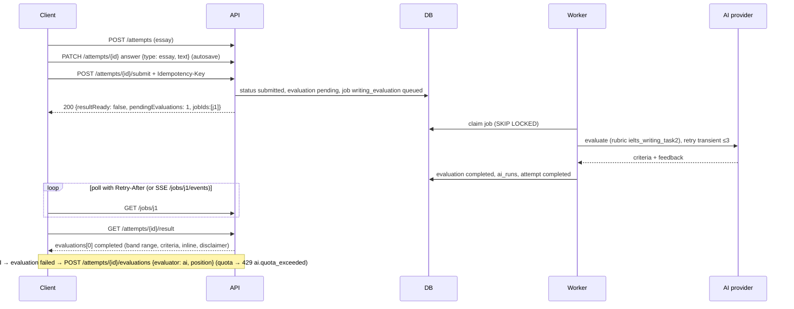

### S5 — IELTS Speaking on mobile (P2)
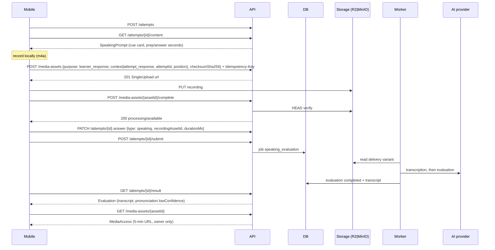

### S6 — AI listening content creation and publish (P3)
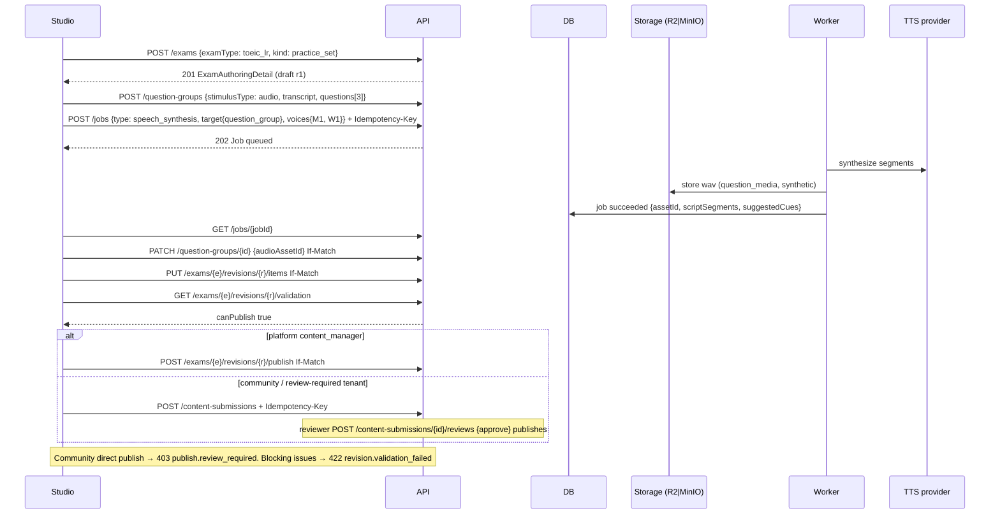

### S7 — Import package (P3)
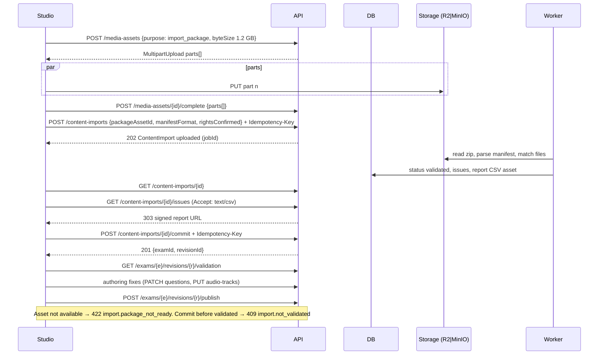

### S8 — B2B tenant isolation (P4)
```mermaid
sequenceDiagram
    participant T as Teacher (tid=sunrise)
    participant L as Sunrise learner
    participant B as B2C learner (tid=platform)
    participant API
    participant DB
    T->>API: POST /exams {visibility: tenant}
    T->>API: POST /exams/{e}/revisions/{r}/publish (content.publish_tenant)
    L->>API: GET /exams?view=catalog
    API->>DB: tenant=sunrise OR (platform public AND platform_library) OR licensed
    API-->>L: Sunrise + platform + licensed exams
    L->>API: POST /attempts → tenant_id = sunrise
    B->>API: GET /exams/{sunrise exam}
    API-->>B: 404 resource.not_found
    T->>API: GET /attempts/{B2C attempt of same user}
    API-->>T: 404 (different tenant; P4 learner_progress.read limited to sunrise)
```

### S9 — Interrupted mobile session
```mermaid
sequenceDiagram
    participant C as Mobile
    participant API
    participant DB
    participant S as Storage (R2|MinIO)
    C->>API: PATCH change-set seq 50..55 (timeout, response lost)
    C->>API: PATCH retry seq 50..55 + new 56
    API-->>C: acks 50..55 ignored_stale (already applied), 56 applied
    Note over C: backgrounded → flush via AppState
    C->>S: multipart part 3 of 5 fails (network)
    C->>API: GET /media-assets/{id}
    API->>S: list_parts
    API-->>C: pending_upload, uploadedParts[1,2], fresh part URLs
    C->>S: PUT parts 3..5
    C->>API: POST /media-assets/{id}/complete
    C->>API: POST /attempts/{id}/submit {finalChanges} Idempotency-Key K
    C->>API: POST /attempts/{id}/submit (double tap, key K)
    API-->>C: 200 same body, Idempotent-Replayed: true
    alt deadline passed while offline
        Note over API,DB: sweeper already submitted (time_expired)
        C->>API: PATCH late changes
        API-->>C: 409 attempt.not_in_progress (meta.resultUrl)
    end
```

### S10 — Media authorization
```mermaid
sequenceDiagram
    participant A as Learner A
    participant B as Learner B
    participant API
    participant DB
    participant S as Storage (R2|MinIO)
    A->>API: GET /media-assets/{recA}
    API->>DB: purpose learner_response, owner = A
    API-->>A: MediaAccess url (5 min, private bucket, unguessable key)
    B->>API: GET /media-assets/{recA}
    API-->>B: 404 resource.not_found (no existence oracle)
    B->>API: GET /attempts/{attemptA}
    API-->>B: 404
    Note over A,S: Leaked URL = bearer until expiry. Revoke by deleting object. P4 teacher only with evaluation.review in the same tenant, audited
```

---

## 11. Coverage matrix: journeys and screens

"First-load calls" means the operations a screen issues on open, assuming the app bootstrap is already cached. App bootstrap (once per launch) is `createSession` (guest, only when there's no stored session) or `refreshSession`, then `getMe`, then `getReferenceData` (cached with ETag): 2–3 calls.

### 11.1 Journeys D1–D14
| Journey | Operations (in order) | Phase |
|---|---|---|
| D1 Discover → guest practice | createSession (guest) → getReferenceData → listExams (`accessTier=guest`) → startAttempt → getAttemptContent → syncAttempt* → submitAttempt → getAttemptResult | P1 |
| D2 Sign up / sign in / guest conversion | addIdentity (guest → registered) \| createSession (password/google) → requestVerificationToken / redeemVerificationToken (verify, reset) → getMe | P1 |
| D3 Goal onboarding | Registered users only (A3): getReferenceData (scales) → putMyGoal (skip = no call) → getMyProgress. Guests can skip onboarding or set the goal after `addIdentity`. | P1 |
| D4 Dashboard → next action | getMyProgress (nextAction resume/recommended/set_goal; guests never get `set_goal`, and their `goal` is null) → getAttempt or startAttempt | P1 |
| D5 Catalog | listExams (`view=catalog`, filters, `q`) → getMyProgress (part accuracy) → getExam | P1 (community section P3) |
| D6 Mock & practice | getExam → startAttempt → getAttemptContent (per section) → syncAttempt* (check, clock, annotations) → getAttempt (section windows) → submitAttempt / abandonAttempt | P1 |
| D7 Results → review → tutor | getAttemptResult → getAttemptContent `view=review` → createTutorConversation (attempt_response) → sendTutorMessage → getJob / getTutorConversation → rateTutorMessage; "Làm lại câu sai" = startAttempt `source{redoOfAttemptId, filter: incorrect}` | P1 |
| D8 IELTS Writing | startAttempt → getAttemptContent → syncAttempt (essay) → submitAttempt → getJob / streamJobEvents → getAttemptResult → requestEvaluation (retry) | P2 |
| D9 IELTS Speaking | startAttempt → getAttemptContent → createMediaAsset → (storage PUT) → completeMediaUpload → syncAttempt (speaking) → submitAttempt → getJob → getAttemptResult → getMediaAsset (playback) | P2 |
| D10 Library & AI questions | createMediaAsset (source_material) → completeMediaUpload → createSourceMaterial → getSourceMaterial → createJob (question_generation) → getJob → listQuestions (`sourceMaterialId`) → updateQuestion (`reviewed`/archive) → createExam (personal_practice) → replaceRevisionItems → publishExamRevision | P3 |
| D11 Profile & history | getMyProgress, listAttempts, getAttemptResult; profile: getMe, listMyGoals, putMyGoal, updateMe, addIdentity/removeIdentity, deleteCurrentSession, deleteMe | P1 |
| D12 Join organization | listMyInvitations → decideInvitation → refreshSession `{activeTenantId}` → getMe → getTenantBranding (subdomain) | P4 |
| D13 Community contribution | createExam (community) → createQuestion/createQuestionGroup → replaceRevisionItems → getRevisionValidation → createContentSubmission → listContentSubmissions (`submitter=me`) → getContentSubmission → listReviewComments / updateReviewComment → resubmitContentSubmission / withdrawContentSubmission; appeal = createContentSubmission `appealOfSubmissionId` | P3 |
| D14 Content Studio & moderation | listExams (`view=authoring`, `facets=status`) → getExam → createExamRevision → getExamRevision → updateExamRevision / replaceRevisionItems / putAudioTrack / createJob (speech_synthesis, audio_alignment, audio_normalization) → getRevisionContent → getRevisionValidation → publishExamRevision; moderation: listContentSubmissions (queue) → assignContentSubmission → createReviewComment → createSubmissionReview; listContentReports / updateContentReport; replaceExamCredits | P3 (tenant P4) |

### 11.2 Screens (product_flow §E)
| Screen | Operations used | First-load calls |
|---|---|---|
| `landing` | getReferenceData, listExams (`accessTier=guest`, `kind=practice_set`), createSession (guest, on CTA), getTenantBranding (P4 subdomain) | 2 (reference + exams) |
| `auth` | createSession, addIdentity, requestVerificationToken, redeemVerificationToken, getMe | 0 (submit actions only) |
| `onboarding` | getReferenceData (cached), putMyGoal | 0–1 |
| `home` | getMyProgress, getMe (cached), startAttempt / getAttempt (CTA) | 1 |
| `catalog` | listExams (`view=catalog`), getMyProgress (parts tiles), createExam (Đóng góp đề, P3) | 2 |
| `exam-intro` | getExam (`view=catalog`, viewer state), getReferenceData `soundCheck` (cached), startAttempt / getAttempt | 1 |
| `exam` | getAttempt, getAttemptContent, syncAttempt (continuous), submitAttempt, abandonAttempt, getMediaAsset (URL refresh) | 2 (+ `startAttempt` when it comes from intro) |
| `writing` | getAttempt, getAttemptContent, syncAttempt, submitAttempt, getJob/streamJobEvents, getAttemptResult, requestEvaluation | 2 |
| `speaking` | getAttempt, getAttemptContent, createMediaAsset, completeMediaUpload, getMediaAsset, syncAttempt, submitAttempt, getJob | 2 |
| `results` | getAttemptResult, getJob (pending evaluations), startAttempt (redo), putMyExamRating (P3), createContentReport (P3) | 1 |
| `review` | getAttemptContent `view=review` (per section), getAttemptResult (cached from results), createTutorConversation | 1–2 |
| `tutor` | listTutorConversations, getTutorConversation \| createTutorConversation, sendTutorMessage, getJob / streamJobEvents, rateTutorMessage | 2 |
| `library` | listSourceMaterials, listQuestions (`owner=me`, `origin=ai_generated`), listJobs, createMediaAsset, completeMediaUpload, createSourceMaterial, createJob, updateQuestion, createExam, replaceRevisionItems, publishExamRevision, deleteSourceMaterial | 2 (+ listJobs when jobs are running) |
| `progress` | getMyProgress, listAttempts | 2 |
| `profile` | getMe (cached), listMyGoals, updateMe, putMyGoal, addIdentity, removeIdentity, deleteCurrentSession, deleteMe, refreshSession (switch org) | 1 |
| `org` | listMyInvitations, decideInvitation, refreshSession, getMe; admin: getCurrentTenant, updateCurrentTenant, listTenantMembers, updateTenantMember, list/create/revokeTenantInvitation | 1 (learner) / 2 (admin) |
| `contribute` | listContentSubmissions (`submitter=me`), listExams (`view=authoring`, `owner=me`), getContentSubmission, listReviewComments, updateReviewComment, resubmitContentSubmission, withdrawContentSubmission, createContentSubmission | 2 |
| `studio` | listExams (`view=authoring`, `facets=status`), listContentSubmissions, listContentImports, listContentReports, createExam | 4 (the threshold that triggers revisiting a Studio overview endpoint) |
| `studio-editor` | getExam (authoring), getExamRevision, getRevisionValidation, then per tab: updateExam, replaceExamCredits, updateExamRevision, replaceRevisionItems, listQuestions/listQuestionGroups, create/update question(s)/groups, createQuestionVersion/createQuestionGroupVersion, getAudioTrack/putAudioTrack/deleteAudioTrack, createJob, getJob, getRevisionContent, createMediaAsset, completeMediaUpload, publishExamRevision, createContentSubmission, createExamRevision, deleteExamRevision | 3 |
| `studio-import` | listContentImports, createMediaAsset (multipart), completeMediaUpload, getMediaAsset (resume), createContentImport, getContentImport, listContentImportIssues, commitContentImport | 1 |
| `moderation` | listContentSubmissions (queue). Detail: getContentSubmission, getRevisionContent (`view=authoring`), getRevisionValidation, listReviewComments, assignContentSubmission, createReviewComment, updateReviewComment, createSubmissionReview | 1 (queue) / 4 (detail) |

Every one of the 103 operations is reachable from at least one journey or screen. The licensing ops (70–72) are used by a platform-admin tool that has no screen in §E (see [§13](#13-contradictions-and-gaps-found-while-writing)). `cancelJob` is used from `studio-editor` and `library` when the user cancels a running job.

---

## 12. Consolidation decisions

### 12.1 Endpoints deliberately not created
| Not created | Reason | Covered by |
|---|---|---|
| Per-exam/per-Part routes (`/toeic/part3/questions`, `/ielts/listening/get-audio`) | One engine for every exam type; the question union is extensible | getAttemptContent + `QuestionDelivery` oneOf `type` |
| Next/previous question endpoints | Navigation is client-side over content that's already delivered | getAttemptContent |
| `GET/PUT /attempts/{id}/responses/{position}`, annotations CRUD | Chatty, with no ordering or partial-success semantics | syncAttempt (change-set) |
| "Check answer" endpoint | It's one more change in the same ordered stream | `ResponseChange.check: true` |
| Speaking-recording API | A recording is a media asset plus an answer | createMediaAsset + `SpeakingAnswer` via syncAttempt |
| `/studio/generate-toeic-voice`, `/ai/explanations`, `/ai/alt-text` | One async lifecycle and quota | createJob typed union |
| Separate admin question APIs | Authorization and representation differ, but the resource is the same | `/questions` + `*Authoring` schemas |
| Publish-question endpoint | Questions are published together with their revision or submission | publishExamRevision, createSubmissionReview |
| `/exam-types`, `/skills`, `/voices` | One cacheable bundle | getReferenceData |
| Per-widget dashboard endpoints | One read model, one round trip | getMyProgress |
| Studio overview/KPI endpoint | Facets plus existing lists are enough (revisit if the Studio home needs more than 4 calls on mobile) | listExams `facets=status` + submissions/imports/reports lists |
| `/registrations` | Sign-up is adding an identity to a guest | addIdentity |
| Tenant switch endpoint | Tenant context lives in the token | refreshSession `{activeTenantId}` |
| `GET /evaluations/{id}` | Evaluations are read inside results; progress comes from the job | getAttemptResult + getJob |
| Section start/pause endpoints | Windows are server-computed; the practice clock is in the change-set | `sections_state` + `clock` |
| Job retry endpoint | Jobs are immutable history | new createJob; requestEvaluation for evaluations |
| Playback-URL endpoint per context | URLs are embedded where they're used | `MediaAccess` + getMediaAsset |
| Media list endpoint | No product need | – |
| Import template endpoints | Static versioned files | public CDN |
| Notifications endpoints | Not modelled. The bell is derived from data that already exists | getMyProgress `nextAction` + listMyInvitations |
| Revision diff endpoint | Already computed alongside validation | getRevisionValidation `diff` |
| `GET /me/sessions` (device list) | Not in the product flows (P2 candidate) | – |
| Tenant creation (P4) | A platform-operations console concern, outside public API v1 (A11) | – |
| Search endpoint | Catalog search is a filter | listExams `q` |
| Random / adaptive next question | P2 adds `selection: adaptive` to startAttempt, not a new route | startAttempt |

### 12.2 Pairs that look similar but are justified
| Pair | Why both exist |
|---|---|
| `GET /exams/{examId}` vs `GET /exams/{examId}/revisions/{revisionId}` | The exam is the catalog product: metadata, ratings, viewer state, and a summary of the current structure. The revision is an immutable versioned content snapshot with items, tracks, and ETag, needed only by authors and reviewers. Merging them would leak authoring data into the catalog, or force learners to fetch revision ids. |
| `GET /attempts/{id}/content` vs `GET /exams/{e}/revisions/{r}/content` | Attempt content is filtered to the served positions, follows the learner's disclosure state, has section locks, and signs URLs per attempt. Revision content is an author/reviewer preview across all views, including `authoring`. Both use the same `ContentDelivery`/`ContentReview` schemas, so the preview matches what learners see. |
| `GET /attempts/{id}/result` vs `getAttemptContent?view=review` | The result is a compact score report (scores, breakdowns, outcomes, evaluations, next step) for the `results` screen. Review content is the heavy per-section question, explanation, and transcript payload for `review`. Splitting them keeps `results` fast on mobile. |
| `GET /attempts/{id}` vs `GET /attempts/{id}/result` | The first is live state (timing, `serverNow`, windows, resume, responses) used during the attempt and on resume. The second exists only after submit and is computed from scores and evaluations. |
| `GET /media-assets/{id}` vs embedded `MediaAccess` | Embedded access serves the normal path with zero extra calls. The endpoint serves URL refresh after expiry, owner playback of recordings, upload status, and resume. |
| `/jobs` vs domain async resources (`ContentImport`, `Evaluation`, `SourceMaterial`, tutor messages) | The domain resource is the business record and its lifecycle (a report to commit, a band score, a material). The job is the generic progress handle (status, progress, retry, SSE). Domain resources link `jobId`; neither duplicates the other. |
| `/me/progress` vs `GET /attempts` | Progress is a computed read model (next action, KPIs, skills, trend, at most 5 recent attempts). The attempts list is the full, paginated, filterable history (the `progress` history table, in-progress lookup). |
| `listExams view=catalog` vs `view=authoring` | Same aggregate, different schemas and permissions. Merging into one schema would risk leaking authoring fields. Separate admin routes would duplicate filters and paging. |
| `createQuestionVersion` vs `createQuestionGroupVersion` | The versioning unit differs. Grouped questions must move together with their stimulus. |
| `createSubmissionReview` vs `updateReviewComment` | A decision is an immutable state transition. Comments are mutable discussion items (resolve or edit). |
| `putMyGoal` vs `updateMe.preferences` | Goals are a validated domain entity (`learner_goals`, score scale) that progress reads. Preferences are free UI settings. |

---

## 13. Contradictions and gaps found while writing

Most issues found while writing this contract were resolved by the integrator rulings A1–A14 ([api_design_review.md — Integrator rulings](./api_design_review.md)), and this document applies them. The DBML changes behind them are tracked as gaps in [api_data_mapping.md](./api_data_mapping.md).

| # | Issue | Resolution |
|---|---|---|
| 1 | `auth.token_expired` was used as both 401 and 410 | A1: new `auth.verification_expired` 410 for redeem |
| 2 | `exam.not_found` (op 81) wasn't in the catalog | A2: `resource.not_found` 404 |
| 3 | Goals were registered-only, but guests could get `set_goal` | A3: guests never get `set_goal`; their `goal` is null |
| 4 | No way to un-schedule a revision | A4: `updateExamRevision {status: draft}` |
| 5 | Revision-under-review lock wasn't specified | A5: `409 revision.under_review` |
| 6 | Tutor streaming vs phase | A10: P1 polling; SSE P2 (owner decision; could move to P1) |
| 7 | Tenant creation had no endpoint | A11: outside public API (listed in §12.1) |
| 8 | PATCH media types were inconsistent | A7: merge-patch for all simple PATCH |
| 9 | Deleting the only revision orphaned a draft | A6: `409 revision.only_revision`; archive the exam |
| 10 | Failed evaluation retry semantics | A9: the failed row is kept; a retry creates a new row |
| 11 | `personal_study_only` wasn't accepted for source materials | A8: allowed for `createSourceMaterial` |
| 12 | Goal `If-Match` strictness | A12: optional unless replacing an existing goal (428) |
| 13 | The tutor `question` context could leak undisclosed answers | A13: `question` context only for disclosed questions or authoring staff, else `403 tutor.context_not_reviewable` |
| 14 | DBML gaps behind the contract (pending AI evaluations, P1 audio tracks, `ver` claim storage, revision ETags, `ai_purpose` values, guest idempotency) | A14: tracked in [api_data_mapping.md](./api_data_mapping.md) |

Still open:
- **Licensing ops 70–72** have no screen in product_flow §E. They are used by a platform-admin tool only.
- **`createMediaAsset` phase** is mixed across upload purposes. It's tagged P1 here; the purpose-level phases (P2 speaking, P3 library/import) are documented in the description.
