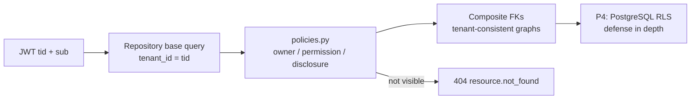
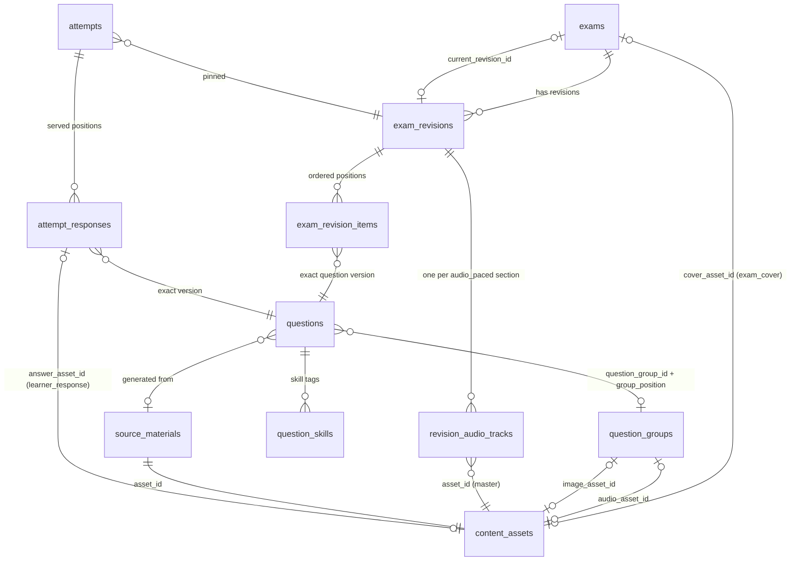
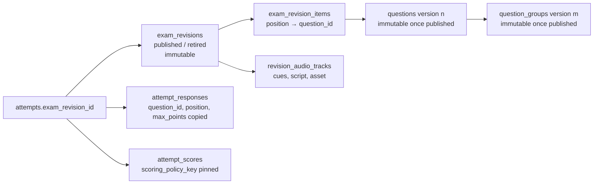
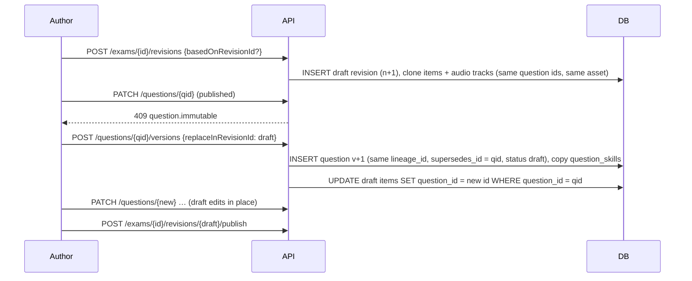
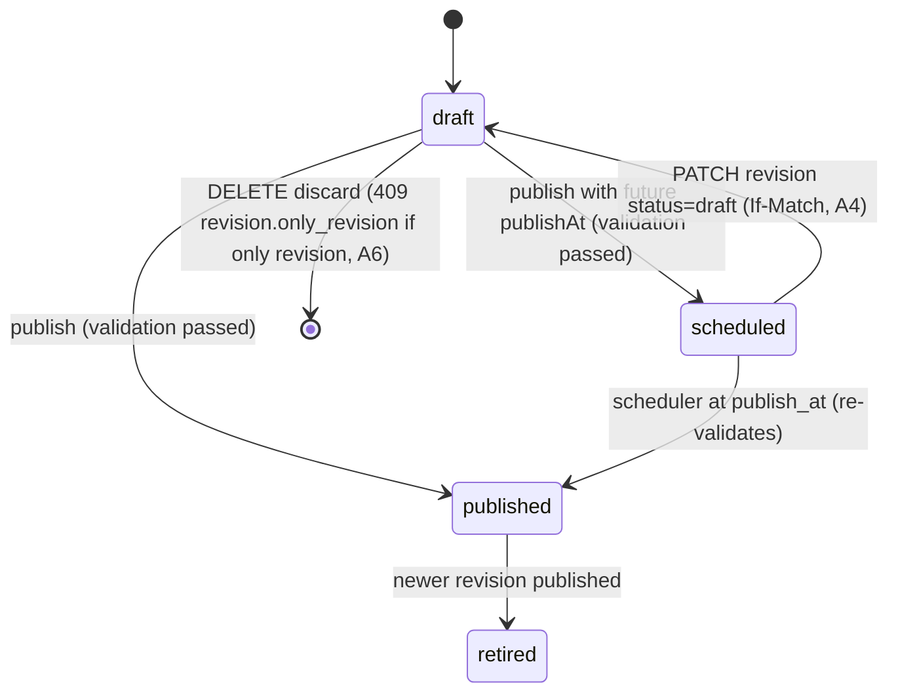

# Engrisk API ↔ Domain ↔ Data Mapping

| | |
|---|---|
| Status | Design (no migrations, no code). Proposed DBML changes below are **not applied** to [`schema.dbml`](schema.dbml). |
| Normative design | Resource model: [api_architecture.md §4](./api_architecture.md#4-resource-modeling--aggregate-roots); operations: [api_contract.md §2](./api_contract.md#2-endpoint-inventory-103-operations) and [openapi.yaml](./openapi.yaml); integrator rulings [api_design_review.md — Integrator rulings (A1–A14)](./api_design_review.md#integrator-rulings-a1a14) (relevant here: A3 goals registered-only, A4 un-schedule via PATCH, A5 `revision.under_review`, A6 `revision.only_revision`, A8 `personal_study_only` allowed for source materials, A9 failed evaluations kept, A13 tutor question context, A14 DBML follow-ups) |
| Audience | Backend engineers (SQLAlchemy models, Pydantic DTOs, read models), reviewers of the API contract |
| Companion documents | [`api_architecture.md`](api_architecture.md) · [`api_contract.md`](api_contract.md) · [`openapi.yaml`](openapi.yaml) · [`storage_architecture.md`](storage_architecture.md) · [`api_design_review.md`](api_design_review.md) |
| Baseline | `schema.dbml` (41 tables), `apps/ux_preview/product_flow.md` §J, `content_studio_spec.md`, `exam_practice_spec.md` |

This document explains where every public API resource comes from in the domain model and PostgreSQL schema, which fields are renamed or derived, which fields never leave the server, which DBML changes the API needs, and how version pinning keeps learner history immutable.

---

## 0. Mapping conventions

| Concern | Database | API | Rule |
|---|---|---|---|
| Naming | `snake_case` columns, JSONB keys in `snake_case` | `camelCase` properties | Pydantic `alias_generator=to_camel`; JSONB payloads (prompt, answer key, sections, cues, settings, feedback) are **stored snake_case and transformed at the DTO boundary**. One exception: `attempts.resume_state` is a client-owned opaque blob, returned verbatim (≤ 8 KB). |
| Foreign keys | `exam_revision_id`, `question_group_id` | `revisionId`, `groupId`, `questionGroupId` (annotations) | `_id` → `Id`; long table prefixes are dropped where the resource context is unambiguous. |
| Enums | DBML enum (implemented as `text + CHECK`) | Same lowercase snake_case string | Passed through unchanged (`in_progress`, `single_choice`, `full_mock`). API-only enums (`JobStatus`, `AssetStatus.processing`, …) are proposed in §3. |
| Ids | `uuid` | `string (format: uuid)` | Opaque. Natural keys only: `examTypeCode` (`exam_types.code`), `skillCode` (`skills.code`), `sectionKey`, `partKey`, `position`, identity `provider`. |
| Timestamps | `timestamptz` | RFC 3339 UTC with `Z`, suffix `At` | `date` → `…Date` (`targetDate`). |
| Numbers | `numeric(p,s)` | JSON `number` | Serialized as numbers (not strings); scores rounded per scale (IELTS 0.5, TOEIC 5). |
| Hashes | `bytea` (`sha256`) | base64 string (`checksumSha256`) | Only echoed to the uploader. Token hashes never leave the server. |
| Booleans from timestamps | `resolved_at`, `graded_at`, `consumed_at` | `resolved`, `isLocked`, … | Derived: `x_at IS NOT NULL`. |
| Localized text | `text` columns, JSONB `{vi, en}` | `LocalizedText {vi, en}` or a single locale-resolved string | Locale resolved from `Accept-Language` (default `vi`). Exam content (stems, passages, scripts) stays English plain text. |
| Units | `duration_ms`, `time_limit_seconds` | `durationMs`, `timeLimitSeconds` | Unit suffix preserved; never converted silently. |

Module ownership of tables (normative, from the architecture): **identity** users, auth_identities, auth_sessions, auth_tokens · **tenancy** tenants, tenant_memberships, membership_roles, roles, permissions, role_permissions, platform_role_assignments, tenant_entitlements, tenant_invitations, exam_licenses · **catalog** exam_ratings, *(new)* content_reports, *(new)* exam_stats (read side over authoring tables) · **authoring** exam_types, skills, exams, exam_revisions, exam_revision_items, question_groups, questions, question_skills, revision_audio_tracks, exam_credits, content_import_jobs, content_submissions, submission_reviews, review_comments · **learning** learner_goals, attempts, attempt_responses, attempt_annotations, evaluations, attempt_scores, learner_skill_stats · **media** content_assets, source_materials · **ai** ai_runs, tutor_conversations, tutor_messages, *(new)* jobs · **platform** *(new)* idempotency_keys. A module reads another module's data only through that module's service interface.

---

## 1. Resource → aggregate → tables (master mapping)

Ownership legend: **G** global (no tenant) · **T** tenant-owned (`tenant_id = tid` from the token) · **U** user-private inside the tenant (`tenant_id = tid AND user_id = sub`) · **X** cross-tenant read allowed (published platform/licensed content, see §6).

### 1.1 Resources ([api_architecture.md §4](./api_architecture.md#4-resource-modeling--aggregate-roots))

| API Resource | Domain Aggregate | DBML Tables | Ownership (tenant/user scope) | Notes |
|---|---|---|---|---|
| Session (`/auth/sessions…`) | AuthSession | `auth_sessions` (+ reads `users`, `auth_identities`, `tenant_memberships`) | G user; `active_tenant_id` must be a membership (composite FK) | `SessionTokens` = minted JWT + opaque refresh token; only `refresh_token_hash` is stored. Guest creation also inserts `users(kind=guest)`, platform membership, `membership_roles(learner)`. |
| Me (`/me`) | User | `users`, `auth_identities`, `tenant_memberships`, `membership_roles`, `roles`, `role_permissions`, `permissions`, `platform_role_assignments`, `tenant_entitlements`, `tenants` | G (user = `sub`); `activeTenant` = `tid` | Permissions/entitlements are resolved per (user, tid), cached by token `ver`. `entitlements[].usage` derived (gap G12). |
| Identity (`/me/identities`) | User (child) | `auth_identities` | G, own user | Guest conversion = INSERT identity + UPDATE `users.kind/email/registered_at`; same `users.id`. |
| VerificationToken | AuthToken | `auth_tokens` | G | Response is always 202 (no enumeration); only `token_hash` stored. |
| Tenant (current) P4 | Tenant | `tenants`, `tenant_memberships`, `membership_roles`, `tenant_invitations`, `tenant_entitlements` | T (`tenants.id = tid`) | `branding` JSONB → `TenantBranding`; `logo_asset_id` → public `MediaAccess`. |
| Invitation P4 | Tenant (child) | `tenant_invitations`, `roles` | T (admin list) / G by verified email (`/me/invitations`) | `roleKey` ← `roles.key`; `token_hash` internal. |
| ReferenceData | read model | `exam_types`, `skills` (+ code config: section templates, question type catalog, voices, sound-check clip) | G | One bundle with `version` = hash of rows + config. Localized names (gap G25). `speechVoices` only for `content.author`. |
| Exam (catalog view) | Exam | `exams`, `exam_revisions` (current), `exam_types`, `exam_credits`, *(new)* `exam_stats`, `exam_licenses` (P4), `attempts` (viewer state) | T or X (platform public + `platform_library`, licensed) | Never exposes drafts. `viewer` block is U (caller's attempts only). |
| Exam (authoring view) | Exam | `exams`, `exam_revisions` (draft + current), `content_submissions` (summary), *(new)* `exam_stats` | T (+ owner rule for private/community/personal) | `ExamAuthoringDetail` carries `ETag` ← `exams.updated_at`. |
| ExamRevision | ExamRevision | `exam_revisions`, `exam_revision_items`, `revision_audio_tracks` | T (owner/reviewer) | Draft-only mutations; ETag needs `exam_revisions.updated_at` (gap G16). Validation is computed (§5). |
| QuestionGroup | QuestionGroup (versioned with its questions) | `question_groups`, `questions`, `question_skills` | T; private when `visibility=private` (owner) | Copy-on-write by lineage; asset refs via composite FKs (same tenant). |
| Question | Question (standalone) | `questions`, `question_skills`, `skills` | T; private when owner-scoped | Grouped questions are versioned through the group (`409 question.grouped`). |
| ContentImport P3 | ContentImportJob | `content_import_jobs`, `content_assets` (package, report), *(new)* `jobs` (`import_validation`) | T (`content.import`) | Report asset reference missing (gap G19). |
| ContentSubmission P3 | ContentSubmission | `content_submissions`, `submission_reviews`, `review_comments`, `exams` (provenance → origin) | T (target tenant); submitter-private + reviewer queue | `draft` status unused (gap G11); comment rounds (gap G20). |
| ContentReport P3 | ContentReport | *(new)* `content_reports` | T = content-owner tenant; reporter is any registered user (possibly another tenant) | Gap G6. |
| MediaAsset | ContentAsset | `content_assets` | T; access decided by purpose + referencing entity ([storage_architecture.md §8](./storage_architecture.md#8-download-and-playback)) | `variants`, `upload`, `processing` (gap G5). |
| SourceMaterial P3 | SourceMaterial | `source_materials`, `content_assets` | U (owner only, always private) | `extracted_text` internal. |
| Attempt | Attempt | `attempts`, `attempt_responses`, `attempt_annotations`, `attempt_scores`, `evaluations`; reads pinned `exam_revisions`/`exam_revision_items`/`questions`/`question_groups`/`revision_audio_tracks` | U (+ X for the pinned content) | Sync columns (G3, G22, G23), timing (G4), `exam_id` (G21). |
| Goal | LearnerGoal | `learner_goals`, `exam_types` | U | Natural key `examTypeCode`; one active goal per exam type (partial unique). |
| Progress (me) | read model | `learner_skill_stats`, `attempt_scores`, `attempts`, `attempt_responses`, `learner_goals`, `skills` | U | Computed on read with precomputed inputs (§5). |
| Job | Job (**new**) | *(new)* `jobs`, `ai_runs` (internal ledger) | T; requester-private for learner jobs, tenant staff for authoring jobs | Gap G1. |
| TutorConversation | TutorConversation | `tutor_conversations`, `tutor_messages`, *(new)* `jobs` (`tutor_reply`) | U (never readable by tenant staff, even in P4) | Quota derived from jobs/ai_runs (G12). |
| ExamRating P3 | ExamRating | `exam_ratings` | U (keyed by user + exam); aggregate → `exam_stats` | Requires a completed attempt (service rule). |

### 1.2 Schema families (OpenAPI component groups)

| Schema family | Representation | Sources | Ownership | Notes |
|---|---|---|---|---|
| `Problem`, `ValidationIssue` | errors | — | — | No DB source; `traceId` = `X-Request-Id`. |
| `SessionTokens`, `Me*`, `Identity*`, `UserPreferences` | identity | `users`, `auth_identities`, `auth_sessions` | G | `users.preferences` JSONB → `UserPreferences` (camelCase keys, e.g. `studyReminder`, `theme`). |
| `TenantSummary`, `TenantBranding`, `Membership`, `Entitlement`, `Invitation*`, `TenantAdmin`, `TenantMember*` | tenancy | tenancy tables | T | `Entitlement.limits` passthrough; `source` internal. |
| `ReferenceData`, `ExamTypeInfo`, `SectionTemplate`, `PartTemplate`, `SkillInfo`, `QuestionTypeInfo`, `SpeechVoice` | reference | `exam_types`, `skills`, code config | G | `scoreScale` ← `exam_types.score_scale`. |
| `ExamCatalogItem/Page/Detail`, `ExamViewerState`, `RevisionStructure`, `SectionStructure`, `PartStructure`, `ExamRules`, `RatingSummary`, `ExamCover`, `ExamCredit` | catalog | `exams`, current `exam_revisions`, `exam_credits`, `exam_stats`, `attempts` | T / X / U(viewer) | §2.1. |
| `ExamCreate/Update`, `ExamAuthoringItem/Page/Detail`, `ExamStats`, `AuthoringFacets`, `CreditsReplace` | authoring | `exams`, `exam_revisions`, `exam_stats`, `content_submissions` | T | `facets.status` = `COUNT(*) GROUP BY` derived status. |
| `RevisionSummary/Page`, `ExamRevisionAuthoring`, `RevisionItem(Input)`, `RevisionItemsReplace`, `AudioTrack*`, `AudioQc`, `RevisionValidation`, `ValidationIssueItem`, `ValidationTarget`, `RevisionDiff`, `PublishImpact`, `PublishRequest` | authoring | `exam_revisions`, `exam_revision_items`, `revision_audio_tracks`, `questions`, `content_assets` | T | Validation, diff, impact computed (§5). |
| `ContentDelivery`, `ContentReview`, `ContentAuthoring`, `ContentSection/Part/Page`, `StimulusDelivery/Review`, `AudioTrackDelivery`, `PlaybackPolicy`, `ScheduleSegment` | content projection | pinned revision graph + `attempt_responses` (+ `attempt_annotations` for review) | U for attempts / T for preview | §2.4; disclosure table in [api_contract.md §6](./api_contract.md#6-disclosure-policy-and-views). |
| `QuestionDelivery/Review/Authoring/Create` + `*Prompt`, `*Key`, `*Answer`, `Explanation`, `Evidence`, `StimulusContent` | question union | `questions.prompt/answer_key/rubric_key/explanation`, `question_groups.content` | per representation | §2.3. |
| `MediaAsset`, `MediaAssetCreate`, `UploadContext`, `UploadInstructions`, `SingleUpload`, `MultipartUpload`, `UploadPartUrl`, `UploadedPart`, `MediaUploadComplete`, `MediaAccess`, `MediaImage`, `MediaClip` | media | `content_assets` (+ storage HEAD/ListParts) | T + per-purpose policy | §2.5; storage details in [`storage_architecture.md`](storage_architecture.md). |
| `SourceMaterial*` | library | `source_materials`, `content_assets`, `questions` (draft counts) | U | |
| `Attempt*`, `ResponseState`, `Annotation*`, `AttemptChangeSet`, `ResponseChange`, `ClockChange`, `ResumeStateChange`, `AttemptSyncResult`, `ChangeAck`, `ResponseFeedback`, `AttemptSubmit*`, `AttemptResult`, `*Breakdown`, `ResponseOutcome`, `NextStep`, `Score` | learning | `attempts`, `attempt_responses`, `attempt_annotations`, `attempt_scores`, `question_skills` | U | §2.2. |
| `Evaluation*`, `EvaluationRequest`, `SpeakingTranscript` | learning | `evaluations`, `attempt_responses`, `jobs` | U (+ P4 `evaluation.review`) | §2.7. |
| `Progress`, `NextAction`, `ProgressKpis`, `SkillProgress`, `PartProgress`, `ScoreTrendPoint`, `EstimatedScore`, `Goal*` | learning read model | §2.8 | U | |
| `Job*`, `JobCreate`, `JobResult`, `JobEvent` | ai | `jobs`, `ai_runs` (staff view only) | T / requester | §2.6. |
| `TutorConversation*`, `TutorContext`, `TutorMessage*`, `TutorGrounding`, `AiQuota` | ai | `tutor_conversations`, `tutor_messages`, `jobs`, `tenant_entitlements` | U | `grounding` JSONB → `TutorGrounding[]`. |
| `ContentImport*`, `ImportSummary`, `ImportIssue*`, `ImportFileMatch`, `ImportCommitResult` | authoring | `content_import_jobs` | T | `errors` JSONB (first 500) → `ImportIssue`. |
| `ContentSubmission*`, `SubmissionReview*`, `ReviewChecklist`, `ReviewComment*`, `AutoChecks*`, `SubmissionRound`, `AssigneeUpdate` | authoring | `content_submissions`, `submission_reviews`, `review_comments` | T | §2.9. |
| `ContentReport*`, `ExamRating*`, `ExamLicense*` | catalog / tenancy | *(new)* `content_reports`, `exam_ratings`, `exam_licenses` | T / U / platform staff | |

---

## 2. Field-level mapping of key DTOs

Column headings: **API field** · **Source** (table.column or JSON path) · **Transform / derivation** · **Disclosure**. "Derived" means computed at read time; "stored" means persisted.

### 2.1 `ExamCatalogItem` (and `ExamCatalogDetail` extras)

Rows come from `exams e LEFT JOIN exam_revisions r ON r.id = e.current_revision_id` filtered by catalog visibility (§6): `e.status = 'published'`, plus never-published exams whose first revision is `scheduled` (rendered as `coming_soon`).

| API field | Source | Transform / derivation | Disclosure |
|---|---|---|---|
| `view` | — | constant `catalog` (page/detail discriminator) | all |
| `id` | `exams.id` | | all |
| `slug` | `exams.slug` | unique per tenant | all |
| `title`, `description` | `exams.title`, `exams.description` | | all |
| `examType` | `exam_types.code` via `exams.exam_type_id` | uuid → natural key | all |
| `kind` | `exams.kind` | enum passthrough | all |
| `skillFocus[]` | `exams.skill_focus` | single column → array: `[skill_focus]`; `NULL` (mixed/full test) → skill areas of the revision `sections[].skill_area` | all |
| `difficulty` | `exams.difficulty` | integer 1–5 passthrough (UI label 1–2 Easy, 3 Medium, 4–5 Hard is client-side) | all |
| `accessTier` | `exams.access_tier` | | all |
| `access {status}` | `exams.access_tier`, `users.kind`, `tenant_entitlements`, revision state | **derived** per caller: `available \| requires_account \| requires_entitlement \| coming_soon`; `coming_soon` ⇔ `current_revision_id IS NULL` and a `scheduled` revision exists | caller |
| `provenance` | `exams.provenance` | catalog trust badge | all |
| `cover` (`ExamCover`) | `exams.cover_style`, `exams.cover_asset_id` | `style` ← `cover_style` (keys camelCased); `image` ← public `MediaAccess` of the asset's `variants.public` rendition, `null` when no upload | all |
| `durationMinutes` | `exam_revisions.time_limit_seconds` (current) | **derived**: `ceil(seconds / 60)`; untimed practice → recommended pace from part templates | all |
| `questionCount` | `exam_revisions.question_count` (current) | publish-time snapshot | all |
| `sections[] {key, questionCount, minutes}` | `exam_revisions.sections` + `exam_revision_items` counts per `section_key` | `minutes` from `time_limit_seconds` or audio track duration | all |
| `partKeys[]` | `exam_revisions.sections[].parts[].key` | flattened, revision order | all |
| `credits[≤3]` (`ExamCredit`) | `exam_credits` ordered by `position` | `displayName` ← `display_name` or user display name; reviewers only when opted in | all |
| `license` (`{code, label}` \| null) | `content_submissions.license` of the approved submission that published the current revision | contribution licence (`platform_nonexclusive`, `cc_by_4_0`); `null` for non-community exams. Not to be confused with `ExamLicense` (P4 `exam_licenses` tenant grant) | all |
| `rating` (`RatingSummary`) | *(new)* `exam_stats.rating_avg`, `rating_count` | `shown = rating_count ≥ 10`; `average` null when not shown | all |
| `playCount` | *(new)* `exam_stats.play_count` | precomputed | all |
| `owner` (`TenantSummary` \| null) | `tenants` via `exams.tenant_id` | `null` when the platform tenant owns the exam; drives "Từ Sunrise English" sections | all |
| `publishedAt` | `exam_revisions.published_at` (current) | **derived**: moves on every republish (sort `-publishedAt` = "recently updated"); there is no exam-level first-publish column | all |
| `viewer {inProgressAttemptId, bestScore, completedCount, myRating}` | caller's `attempts` on any revision of the exam (G21 `exam_id`), `attempt_scores`, `exam_ratings` | `bestScore` = best overall `Score` (scaled estimate if available, else raw); `completedCount` = attempts `completed`; `myRating` from `exam_ratings` | caller only |
| *Detail:* `structure` (`RevisionStructure`) | current `exam_revisions` (`id`, `revision_number`, `published_at`, `time_limit_seconds`, `question_count`, `max_points`, `scoring_policy_key`, `sections`) | sections → parts with `questionRange` | all |
| *Detail:* `rules` (`ExamRules`) | `exam_revisions.sections[].rules` + mode rules | `audio_replay` → `audioReplay`, `annotations` | all |
| *Detail:* `credits[]` (full), `viewer.recentAttempts[≤5]` (`AttemptSummary`) | `exam_credits`; caller's `attempts` | | all / caller |

Never in catalog DTOs: `owner_user_id`, `created_by_user_id`, `visibility`, draft revisions, submission state, `exam_stats` beyond play/rating.

### 2.2 `Attempt`, `AttemptTiming`, `ResponseState`, `Annotation`, `ResponseOutcome`

**`Attempt`**

| API field | Source | Transform / derivation | Disclosure |
|---|---|---|---|
| `id` | `attempts.id` | | owner |
| `examId` | *(new, G21)* `attempts.exam_id` (today: `exam_revisions.exam_id` via join) | | owner |
| `revisionId` | `attempts.exam_revision_id` | pinned at start; `null` only for P2 adaptive | owner |
| `exam` (`ExamRef`) | `exams.title/kind/exam_type` via pinned revision | title of the exam at read time | owner |
| `mode`, `status` | `attempts.mode`, `attempts.status` | passthrough | owner |
| `settings` (`PracticeSettings` + `DisplaySettings`) | `attempts.settings` | snake → camel (`instant_check` → `instantCheck`, `audio_replay` → `audioReplay`, `time_limit_seconds` → `timeLimitSeconds`); `source {redoOfAttemptId, filter}` stored under `settings.source` | owner |
| `timing.serverNow` | `now()` | read clock of the API node (NTP-synced) | owner |
| `timing.startedAt`, `deadlineAt` | `attempts.started_at`, `attempts.deadline_at` | deadline extended by pause duration on resume (practice) | owner |
| `timing.paused` / `pausedAt` | *(new, G4)* `attempts.paused_at` | `paused = paused_at IS NOT NULL` | owner |
| `timing.sections[]` (`SectionTiming`) | *(new, G4)* `attempts.sections_state` | `status` derived from `opens_at/closes_at/closed_at` vs `serverNow` (`locked \| open \| closed`); `closeReason` passthrough | owner |
| `resumeState` | `attempts.resume_state` | opaque client blob, verbatim | owner |
| `counts {answered, unanswered, flagged}` | `attempt_responses` | derived: `answer IS NOT NULL OR answer_asset_id IS NOT NULL`, `is_flagged` | owner |
| `activeSeconds`, `lastActivityAt` | `attempts.active_seconds`, `last_activity_at` | | owner |
| `submittedAt`, `submitReason`, `completedAt` | same columns | | owner |
| `responses[]` (`include=responses`) | `attempt_responses` | see `ResponseState` | owner |
| `annotations[]` (`include=annotations`) | `attempt_annotations` | see `Annotation` | owner |
| ETag | `attempts.last_activity_at` + max response `last_saved_at` | weak validator for GET only (sync uses `seq`) | owner |

**`ResponseState`** (compact, never graded fields before disclosure)

| API field | Source | Transform / derivation | Disclosure |
|---|---|---|---|
| `position` | `attempt_responses.position` | copied from `exam_revision_items.position` at start | owner |
| `sectionKey` | `attempt_responses.section_key` | | owner |
| `partKey` | `exam_revisions.sections[].parts[].question_range` | **derived** (position ∈ range); not stored | owner |
| `questionId` | `attempt_responses.question_id` | exact question version | owner |
| `type` | `questions.question_type` | | owner |
| `answer` (`Answer` union) | `attempt_responses.answer` (+ `answer_asset_id` for speaking) | stored JSON = API Answer shape in snake_case with `type` (G24); `SpeakingAnswer.recordingAssetId` ← `answer_asset_id`, `durationMs` ← `answer.duration_ms`; `null` = unanswered | owner |
| `isFlagged` | `attempt_responses.is_flagged` | | owner |
| `eliminated[]` | *(new, G23)* `attempt_responses.eliminated` (today: `attempts.resume_state.eliminated[question_id]`) | option keys | owner |
| `timeSpentMs` | `attempt_responses.time_spent_ms` | incremented only by applied `timeSpentMsDelta` | owner |
| `answeredAt` | `attempt_responses.first_answered_at` | rename | owner |
| `lastSavedAt` | `attempt_responses.last_saved_at` | | owner |
| `isLocked` | `attempt_responses.graded_at` | derived: `mode = practice AND graded_at IS NOT NULL` (checked position) | owner |
| `seq` | *(new, G3)* `attempt_responses.client_seq` | last applied client sequence | owner |
| `version` | `attempt_responses.last_saved_at` | derived server version (µs since epoch, monotonic per row); echoed in `ChangeAck.version` | owner |

Not in `ResponseState`: `is_correct`, `points_awarded`, `max_points`, `client_device_id`. `isCorrect`/`pointsAwarded` appear only in `ResponseFeedback` (practice `check`) and `ResponseOutcome` (result/review).

**`Annotation`**: `id` ← `attempt_annotations.id` (client-generated uuid accepted on upsert) · `questionGroupId` ← `question_group_id` · `stimulusPart` ← `stimulus_part` · `kind` ← `kind` · `anchor {start, end, quote}` ← `anchor` · `body` ← `body` · `createdAt/updatedAt`. Ack `version` ← `updated_at`.

**`ResponseOutcome`** (result/review): `position`, `sectionKey`, `partKey` (derived), `answer`, `correctAnswer` ← `questions.answer_key` (objective types; `null` for essay/speaking), `isCorrect` ← `is_correct`, `isFlagged`, `isBlank` (derived `answer IS NULL AND answer_asset_id IS NULL`), `timeSpentMs`, `pointsAwarded` ← `points_awarded`, `maxPoints` ← `max_points`.

**`Score`**: `scope` ← `attempt_scores.scope` · `kind` ← `score_kind` · `value`, `maxValue` ← `value`, `max_value` · `scale` ← `scale` · `scoringPolicyKey` ← `scoring_policy_key` · `isEstimate` derived (`kind ≠ raw`). Percent is derived client-side; never stored.

### 2.3 Questions: `QuestionDelivery`, `QuestionReview`, `QuestionAuthoring`

All three families are built from the same rows; each is a separate Pydantic model (delivery models have no protected properties at all).

| API field | Source | Delivery | Review | Authoring |
|---|---|---|---|---|
| `type` (discriminator) | `questions.question_type` | ✓ | ✓ | ✓ |
| `position` | `exam_revision_items.position` / `attempt_responses.position` | ✓ | ✓ | ✓ (revision preview) |
| `numberLabel` | derived from `position` (and IELTS part numbering rules) | ✓ | ✓ | ✓ |
| `sectionKey` | `exam_revision_items.section_key` | ✓ | ✓ | ✓ |
| `partKey` | derived from `sections[].parts[].question_range` | ✓ | ✓ | ✓ |
| `groupId` | `questions.question_group_id` | ✓ | ✓ | ✓ |
| `questionId` / `id` | `questions.id` (exact version) | ✓ | ✓ | ✓ |
| `points` | `attempt_responses.max_points` (attempt) or `exam_revision_items.points` (preview) | ✓ | ✓ | ✓ |
| `prompt` (`*Prompt`) | `questions.prompt` | ✓ with transforms: TOEIC P1–P2 option `text` removed | ✓ full | ✓ full |
| `presentation {optionsTextVisible, inputMode}` | derived from part template + `question_type` | ✓ | ✓ | ✓ |
| `answerKey` (`*Key`) | `questions.answer_key` | ✗ (property absent) | ✓ | ✓ |
| `rubricKey` | `questions.rubric_key` | ✗ | rubric name/criteria labels only | ✓ |
| `explanation {text, texts, evidence}` | `questions.explanation` (G8 shape) | ✗ | ✓ (`text` = locale-resolved `texts`) | ✓ (`ExplanationInput` on write) |
| `outcome {answer, isCorrect, pointsAwarded, timeSpentMs}` | `attempt_responses` | ✗ | ✓ (attempt review only) | ✗ |
| `status`, `version`, `lineageId`, `supersedesId` | `questions.status/version/lineage_id/supersedes_id` | ✗ | ✗ | ✓ |
| `visibility`, `origin`, `owner` | `questions.visibility/origin/owner_user_id` | ✗ | ✗ | ✓ |
| `groupPosition` | `questions.group_position` | ✗ | ✗ | ✓ |
| `skills[]` (`SkillTag {code, isPrimary}`) | `question_skills` ⋈ `skills.code` | ✗ | ✗ | ✓ |
| `difficulty`, `defaultPoints` | `questions.difficulty`, `default_points` | ✗ | ✗ | ✓ |
| `reviewFlags[]` (`ReviewFlag`) | `questions.review_flags` | ✗ | ✗ | ✓ |
| `aiProvenance {jobId, generatedAt}` | `questions.ai_run_id` → `ai_runs.job_id` (G1), `created_at` | ✗ | ✗ | ✓ (provider/model only in staff job view) |
| `sourceMaterialId` | `questions.source_material_id` | ✗ | ✗ | ✓ (owner) |
| `reviewed`, `reviewedBy`, `reviewedAt` | `reviewed_by_user_id`, `reviewed_at` | ✗ | ✗ | ✓ |
| `publishedAt`, `createdAt`, `updatedAt` | same columns | ✗ | ✗ | ✓ |
| `usage {examCount, examIds[≤10]}` | `exam_revision_items` ⋈ `exam_revisions` | ✗ | ✗ | ✓ derived |
| ETag | `questions.updated_at` | — | — | ✓ |

Per-type JSON mapping (stored snake_case → API camelCase): `option_set` → `optionSet`, `select_count` → `selectCount`, `word_limit` → `wordLimit`, `numbers_allowed` → `numbersAllowed`, `allow_option_reuse` → `allowOptionReuse`, `task_key` → `taskKey`, `min_words` → `minWords`, `suggested_minutes` → `suggestedMinutes`, `speaking_part` → `speakingPart`, `cue_card` → `cueCard`, `prep_seconds`/`answer_seconds` → `prepSeconds`/`answerSeconds`; keys: `case_sensitive` → `caseSensitive`, `normalize_whitespace` → `normalizeWhitespace`. `EssayPrompt.image` is resolved from an asset id in the prompt JSON (`image_asset_id`) to `MediaImage`.

### 2.4 Content groups and audio tracks (`ContentDelivery` / `ContentReview` / `ContentAuthoring`)

| API path | Source | Transform / derivation | Disclosure |
|---|---|---|---|
| `revisionId`, `attemptId` | `attempts.exam_revision_id`, `attempts.id` (`null` for preview) | | — |
| `sections[]` (`ContentSection`) | `exam_revisions.sections` | `delivery`, `title`, `skillArea`; filtered to `section` param and served subset (`settings.parts`) | all views |
| `sections[].parts[].pages[]` (`ContentPage`) | derived: consecutive positions sharing a `question_group_id` form one page; standalone questions paged by part template | `pageKey` stable hash of (sectionKey, first position) | all views |
| `groups{groupId}` → `StimulusDelivery.id/stimulusType/title/content` | `question_groups.id/stimulus_type/title/content` | `content` per G9 shape (snake → camel) | all views |
| `groups{}.audio` (`MediaClip`) | `question_groups.audio_asset_id`; fallback: clip of the section track (`revision_audio_tracks.asset_id` + group's min/max cue) | practice only for the fallback clip; mock uses `audioTracks` | delivery: clip bounds only |
| `groups{}.image` (`MediaImage`) | `question_groups.image_asset_id` + `content.alt` | | all views |
| `StimulusReview.transcriptSegments[]` | `revision_audio_tracks.script_segments` filtered by group positions; else `question_groups.transcript` (single untimed segment, G27) | `start_ms` → `startMs`, `speaker`, `accent`, `text`, `positions` | review/authoring; practice when group fully checked AND `settings.transcript` |
| `questions[]` | §2.3 | | per view |
| `audioTracks[]` (`AudioTrackDelivery`) | `revision_audio_tracks` (mock / audio-paced sections) | `media` ← `MediaAccess` of the asset's **delivery variant** (never master); `durationMs` ← `duration_ms` | delivery: coarse only |
| `audioTracks[].playback` (`PlaybackPolicy`) | `attempts.mode`, `sections[].rules.audio_replay`, `attempts.sections_state` | `mode` continuous/clip, `seekable`/`replayable`/`speedControl` false in mock; `startOffsetMs = serverNow − section.opensAt` | delivery |
| `audioTracks[].schedule[]` (`ScheduleSegment`) | `revision_audio_tracks.cues` coarsened | per group: `[min(start_ms), max(end_ms)]`, kinds `directions \| group \| answer_gap`; never per-question cues or text | delivery |
| `media{assetId}` (`MediaAccess`) | `content_assets` + signer | de-duplicated; TTL per purpose ([storage_architecture.md §8.2](./storage_architecture.md#82-ttl-policy)) | all views |
| `expiresAt` | min(`media[].urlExpiresAt`) | client refetches before expiry | — |
| `ContentAuthoring` extras: `reviewFlags`, fine `cues[]`, `scriptSegments[]`, provenance | `questions.review_flags`, `revision_audio_tracks.cues/script_segments`, `origin/ai_run_id` | | authoring only |

**`AudioTrackAuthoring`**: `sectionKey` ← `section_key` · `asset` ← `MediaAccess` (authoring TTL; master playable for authors) · `durationMs` ← `duration_ms` · `sampleRateHz` ← `sample_rate_hz` · `channels` · `loudnessLufs` ← `loudness_lufs` · `truePeakDbtp` ← `true_peak_dbtp` · `qc` (`AudioQc`) ← `qc` (camelCased) · `cues[]` ← `cues` (`Cue {position, startMs, endMs, confidence, source}`) · `scriptSegments[]` ← `script_segments` · `alignment {jobId, alignedAt}` ← `alignment_ai_run_id` → `ai_runs.job_id`, `aligned_at` · ETag ← `updated_at`. `AudioTrackSummary.cueCoverage` is derived (positions with a cue ÷ listening positions of the section).

### 2.5 `MediaAsset` and `MediaAccess`

| API field | Source | Transform / derivation | Disclosure |
|---|---|---|---|
| `id` | `content_assets.id` | | policy |
| `purpose` | `content_assets.purpose` | API upload context `tenant_branding` ↔ purpose `branding`; `import_report` new (G5) | policy |
| `kind` | `content_assets.kind` | zip packages and CSV reports map to `document` | policy |
| `status` | `content_assets.status` | `processing` new value (G5) | policy |
| `mimeType` | `content_assets.mime_type` | verified (sniffed) type, not just declared | policy |
| `byteSize` | `content_assets.byte_size` | | policy |
| `checksumSha256` | `content_assets.sha256` | bytea → base64 | **uploader only** |
| `fileName` | *(new, G5)* `content_assets.original_filename` | sanitized | uploader + tenant staff |
| `durationMs` | `content_assets.duration_ms` | | policy |
| `width`, `height`, `pageCount` | `content_assets.metadata` | | policy |
| `createdAt`, `updatedAt` | `created_at`, *(new, G26)* `updated_at` | | policy |
| `upload` (`UploadInstructions` \| null) | *(new, G5)* `content_assets.upload` + signer | present only while `pending_upload`; URLs re-signed on each GET | uploader only |
| `uploadedParts[]` | storage `ListParts` (not stored) | multipart resume | uploader only |
| `access` (`MediaAccess` \| null) | `content_assets` + `variants` + signer | present only when `available` and policy allows | policy |
| `failureReason` | `content_assets.metadata.scan` / processing result | coarse code only (`malware_detected`, `checksum_mismatch`, `unsupported_media`) | uploader + staff |

**`MediaAccess`**: `assetId` ← `id` · `kind` · `mimeType`/`byteSize`/`durationMs`/`width`/`height` ← the **served variant** (`variants.<name>`; masters only for authoring) · `url` ← presigned GET (private) or `STORAGE_PUBLIC_BASE_URL + public key` · `urlExpiresAt` ← signing time + TTL (`null` for public) · `rangeSupported` = `true`. `storage_key`, bucket, provider and variant keys are never exposed. `MediaImage` adds `alt` from the referencing entity (`question_groups.content.alt`, prompt image alt), never from the asset.

### 2.6 `Job`

| API field | Source | Transform / derivation | Disclosure |
|---|---|---|---|
| `id`, `type`, `status` | *(new, G1)* `jobs.id/type/status` | | requester / tenant staff |
| `progress {percent, stage}` | `jobs.progress` | | same |
| `target {type, id}` | `jobs.target_type`, `jobs.target_id` | `null` when both null | same |
| `input` | `jobs.input` | typed summary (JobCreate variant), secrets never stored | same |
| `result` | `jobs.result` | present iff `succeeded`; refs only (ids), never large payloads | same |
| `error {code, message, retryable}` | `jobs.error` | `message` localized from `code` | same |
| `createdAt`, `startedAt`, `finishedAt` | same columns | | same |
| `requestedBy` (`UserRef`) | `jobs.requested_by_user_id` | | same |
| `links {self, events, target}` | derived | | same |
| `provenance {provider, model, modelVersion}` (`view=staff`) | latest `ai_runs` where `job_id = jobs.id` | | `content.author` staff only |
| `usage {inputTokens, outputTokens, audioSeconds, costUsd}` (`view=staff`) | `SUM(ai_runs.usage)` per job | | staff only |
| `Retry-After` header | `jobs.run_after` / type heuristic | | — |

Never: `jobs.idempotency_key`, `attempts` (retry counter), `cancel_requested_at` (surfaced only as status transition), `ai_runs.prompt_key/prompt_version/input_refs/error_code`.

### 2.7 `Evaluation`

| API field | Source | Transform / derivation | Disclosure |
|---|---|---|---|
| `id` | `evaluations.id` | | owner (+ P4 `evaluation.review`) |
| `position` | `attempt_responses.position` via `response_id` | | same |
| `evaluator` | `evaluations.evaluator_kind` | rename | same |
| `status` | `evaluations.status` | `failed` rows are kept as history; a retry via `requestEvaluation` inserts a **new** row (ruling A9) | same |
| `jobId` | *(new, G1)* `evaluations.job_id` | present while `pending`/`failed` | same |
| `rubricKey` | `evaluations.rubric_key` | | same |
| `criteria[] {key, label, score, band?}` | `evaluations.criteria_scores` | keys normalized to the `Evaluation` schema vocabulary in [openapi.yaml](./openapi.yaml) (`task_response`, `coherence_cohesion`, `lexical_resource`, `grammatical_range_accuracy`, `fluency_coherence`, `pronunciation`); `label` from i18n catalog. DB note's short keys (`coherence`, `lexical`, `grammar`) are superseded (G15) | same |
| `estimatedScore {value, low, high, scale, kind}` | `evaluations.estimated_score` + G15 range | `scale = ielts_band`, `kind = ai_estimate` | same |
| `feedback {summary, strengths[], improvements[], inline[]}` | `evaluations.feedback` | `inline[].span` → `start`/`end` (G15) | same |
| `transcript` (`SpeakingTranscript`) | G15 | speaking only | same |
| `lowConfidenceCriteria[]` | G15 | | same |
| `disclaimer` | i18n constant | "AI estimate — not an official IELTS score" | same |
| `createdAt`, `completedAt` | same columns | | same |

Internal: `ai_run_id`, `evaluator_user_id` (exposed only as a display name for human evaluations in P4).

### 2.8 `Progress`

| API field | Source | Computation | Freshness |
|---|---|---|---|
| `examType` | query param, else active `learner_goals`, else last practised exam type | | on read |
| `generatedAt` | `now()` | | on read |
| `nextAction` | `attempts` (`ix_attempts_resume`), `learner_skill_stats`, `learner_goals`, catalog | `resume` if an in-progress attempt exists (`remainingSeconds` from `deadline_at`); else `set_goal` for a **registered** user without an active goal; else `recommended` (weakest skill/part → exam with matching `question_skills`, not recently played). Guests never get `set_goal` (ruling A3) | computed on read |
| `goal` | `learner_goals` (active) | `null` for guests (goals are registered-only, A3) | stored |
| `estimatedScore` | latest `attempt_scores (kind = scaled_estimate, scope = overall)` of mock attempts | `delta` vs previous; `basedOnAttemptId` | stored facts |
| `kpis.weekMinutes` | `SUM(attempts.active_seconds)` since start of week in `users.timezone` ÷ 60 | | on read |
| `kpis.weekTargetMinutes` | `learner_goals.weekly_study_minutes` | | stored |
| `kpis.accuracy7d`, `accuracyDelta` | `attempt_responses` graded in last 7 d vs previous 7 d | `correct ÷ answered` | on read (bounded by index on attempts history) |
| `kpis.attemptsCompleted`, `studyHours` | `attempts` | counts / sums | on read |
| `skills[]` | `learner_skill_stats` ⋈ `skills` | `accuracy = correct_count ÷ responses_count`; `mastery` rounded to 2 decimals; weakest first; `suggestedExamId`, `suggestedPart` computed | precomputed stats |
| `parts[]` | `learner_skill_stats` for part-level skills (G25 `skills.part_key`) | | precomputed stats |
| `scoreTrend[]` | `attempt_scores` (`scaled_estimate`, overall, mock) last 12 weeks | | stored facts |
| `recentAttempts[≤5]` | `attempts` | `AttemptSummary` | on read |
| ETag | hash of (max `attempts.last_activity_at`, max `learner_skill_stats.updated_at`, goal `updated_at`) | invalidated on grading | — |

### 2.9 `ContentSubmission`

| API field | Source | Transform / derivation | Disclosure |
|---|---|---|---|
| `id`, `examId`, `revisionId` | `content_submissions.id/exam_id/exam_revision_id` | | submitter, reviewers |
| `status` | `content_submissions.status` | `draft` never returned (G11) | same |
| `round` | `round` | | same |
| `origin` | `exams.provenance` | derived: `community` → `community`, `tenant_authored` → `tenant`, `engrisk_original`/`licensed_partner` → `internal` | same |
| `license`, `rightsBasis` | `license`, `rights_basis` | | same |
| `rightsConfirmedAt` | `rights_confirmed_at` | write model sends `rightsConfirmed: true` | same |
| `messageToReviewer` | `message_to_reviewer` | | same |
| `autoChecks` (`AutoChecks`) | `auto_checks` | full detail (similarity matches, fingerprint) | **reviewers only** |
| `autoChecksSummary` | `auto_checks` | per-check `pass \| warn \| fail` without matches/ai_run_id | submitter |
| `submitter` (`UserRef`) | `submitter_user_id` | | same |
| `assignee` (`UserRef` \| null) | `assigned_reviewer_user_id` | | same |
| `slaDueAt` | `sla_due_at` | | reviewers (submitter sees expected date) |
| `appealOfSubmissionId` | `appeal_of_submission_id` | | same |
| `submittedAt`, `decidedAt`, `createdAt`, `updatedAt` | same | | same |
| `rounds[]` (`SubmissionRound`) | `submission_reviews` by `round` | `decision`, `checklist` (`keys_correct` → `keysCorrect`, `audio_script` → `audioScript`, `level_tags_credits` → `levelTagsCredits`, `language_safety` → `languageSafety`), `reasonCode`, `summary`, `reviewer`, `createdAt` | same |
| `commentCounts {open, total}` | `review_comments` | `open = resolved_at IS NULL` | same |

`ReviewComment`: `id`, `author` ← `author_user_id`, `parentCommentId`, `questionId`, `field`, `audioMs` ← `audio_ms`, `body`, `resolved` ← `resolved_at IS NOT NULL`, `resolvedBy`, `resolvedAt`, `createdAt`, `round` (G20).

---

## 3. Schema gaps and proposed minimal DBML changes

Each gap was checked against the current `schema.dbml`. Snippets are **proposals for the next schema revision only** (not applied). Enum additions follow the DBML convention "enums are `text + CHECK`", so adding a value is a CHECK swap, not a type migration.

### Summary

| # | Gap | Phase | Verified in schema.dbml | Kind |
|---|---|---|---|---|
| G1 | `jobs` table + `ai_runs.job_id`, `evaluations.job_id` | P1 | No `jobs` table; `ai_runs` note says "No separate generation-job table" | new table + 2 columns |
| G2 | `idempotency_keys` | P1 | Absent | new table |
| G3 | `attempt_responses.client_seq`, `client_device_id` | P1 | Absent | columns |
| G4 | `attempts.paused_at`, `sections_state` | P1 | Absent (only `deadline_at`, `active_seconds`) | columns |
| G5 | `content_assets.variants/upload/original_filename`, `asset_status.processing`, `asset_purpose.import_report` | P1 / P3 | Absent; enums lack values | columns + enum values |
| G6 | `content_reports` | P3 | Absent | new table |
| G7 | `exam_stats` read model | P1 / P3 | Absent (exams note: "cached in the read model, not stored here") | new table |
| G8 | `questions.explanation` JSON shape | P1 | Note says `{text, evidence_span}` | doc-only |
| G9 | `question_groups.content` JSON shape per stimulus type | P1 | Note: "Schema per stimulus_type" (undefined) | doc-only |
| G10 | Not modeled → API omits | — | Confirmed absent | none |
| G11 | `submission_status.draft` unused | P3 | Present, default `'draft'` | enum/default |
| G12 | Entitlement usage derived | P1 | `tenant_entitlements.limits` only | none |
| G13 | Scheduling exists; cue `source` adds `synthesized` | P1 | `publish_at`, `scheduled` exist; cue note lists aligned/manual/imported | doc-only |
| G14 | `evaluations` CHECK blocks pending AI evaluations | P2 | `ck_evaluations_ai_run` | check change |
| G15 | Evaluation range/transcript/confidence & criteria keys | P2 | `estimated_score` single value; no transcript | doc-only (+ optional columns) |
| G16 | `exam_revisions` has no `updated_at` → no draft ETag | P1 | Only `created_at` | column |
| G17 | `revision_audio_tracks` tagged P3, needed in P1; `script_segments.positions` | P1 | Note `[P3]`; segment shape lacks positions | phase tag + doc |
| G18 | `ai_purpose` lacks values for new job types | P1 / P3 | 8 values; no `speech_synthesis`, `content_assist`, `quality_check` | enum values |
| G19 | Import report asset + file matches | P3 | No `report_asset_id` | column |
| G20 | `review_comments.round` | P3 | Absent | column |
| G21 | `attempts.exam_id` (one in-progress per exam; filters) | P1 | Absent | column + partial unique |
| G22 | Attempt-level sync state (resume/clock `seq`) | P1 | Absent | column |
| G23 | `attempt_responses.eliminated` | P1 | Stored in `attempts.resume_state.eliminated` | column |
| G24 | Stored `answer` JSON shape = API `Answer` | P1 | Note shows `{"pairs":…}` | doc-only |
| G25 | `skills.part_key`; localized names for skills/exam types | P1 | `skills` has no part link; `name text` | column (+ code i18n) |
| G26 | `content_assets.updated_at` | P1 | Only `created_at`, `deleted_at` | column |
| G27 | Timed transcript for practice clips | P1 | `question_groups.transcript text` | column |
| G28 | Permission version for the `ver` token claim | P1 | No version column on memberships/roles | column |

---

#### G1 — Public `jobs` table (core)

**Problem.** The API exposes one stable async handle per operation (`Job`), with retries, pipelines (speaking = transcription + evaluation), non-AI work (normalization, account deletion, import validation) and a worker queue (`SELECT … FOR UPDATE SKIP LOCKED`). `ai_runs` is one row per provider invocation and its note explicitly rejects a job table; using it as the queue would leak provider metadata into the public lifecycle and create one handle per retry.

**Proposal.**
```dbml
Enum job_status { queued running succeeded failed cancelled }
// job_type (text + CHECK): question_generation, speech_synthesis, audio_alignment, audio_normalization,
// content_assist, quality_check, writing_evaluation, speaking_evaluation, tutor_reply, originality_check,
// import_validation, media_processing, account_deletion, material_extraction

Table jobs {
  id uuid [pk, default: `gen_random_uuid()`]
  tenant_id uuid [not null, ref: > tenants.id]
  requested_by_user_id uuid [ref: > users.id, note: 'NULL for system jobs (sweeper, scheduler)']
  type text [not null]
  status job_status [not null, default: 'queued']
  progress jsonb [not null, default: `'{}'::jsonb`, note: '{percent, stage}']
  target_type text [note: 'attempt_response | audio_track | question_group | exam_revision | content_import | content_submission | media_asset | tutor_conversation | user']
  target_id uuid
  input jsonb [not null, default: `'{}'::jsonb`, note: 'Typed per type (Pydantic); ids and options only, no secrets']
  result jsonb [note: 'Typed per type; references only']
  error jsonb [note: '{code, retryable}']
  idempotency_key uuid
  attempts smallint [not null, default: 0, note: 'Worker execution attempts']
  cancel_requested_at timestamptz
  run_after timestamptz [not null, default: `now()`]
  created_at timestamptz [not null, default: `now()`]
  started_at timestamptz
  finished_at timestamptz

  indexes {
    (status, run_after) [name: 'ix_jobs_queue', note: 'Partial: WHERE status IN (queued, running) — SKIP LOCKED poller']
    (tenant_id, requested_by_user_id, created_at) [name: 'ix_jobs_requester', note: 'GET /jobs + quota counting']
    (target_type, target_id) [name: 'ix_jobs_target']
    (requested_by_user_id, idempotency_key) [unique, name: 'uq_jobs_idempotency', note: 'Partial: WHERE idempotency_key IS NOT NULL']
  }
}

// additions
Table ai_runs { job_id uuid [ref: > jobs.id, note: 'Public job this invocation belongs to'] }
Table evaluations { job_id uuid [ref: > jobs.id] }
```
**Phase.** P1 (tutor replies, media processing, account deletion, deadline-independent work); evaluations in P2.
**Alternatives.** (a) Reuse `ai_runs` as the job (rejected: one row per retry, provider fields leak, non-AI jobs don't fit `ai_purpose`). (b) Redis/RQ/Celery queue + a thin status table (deferred; Postgres queue is enough for P1 volumes and keeps one transactional store). (c) Per-domain status columns only (rejected: N polling endpoints).
**Migration risk.** Low: new table and nullable columns. `ix_ai_runs_queue` becomes obsolete once workers poll `jobs`; drop it in the same migration. The `ai_runs` note ("No separate generation-job table") must be rewritten.

#### G2 — `idempotency_keys` (core)

**Problem.** Ten POST operations require `Idempotency-Key` with 24 h replay, request-hash mismatch (`422 idempotency_key_reused`) and in-flight detection (`409 request_in_progress`). Nothing stores this.

**Proposal.**
```dbml
Table idempotency_keys {
  user_id uuid [not null, note: 'Caller; see issue below for anonymous guest creation']
  key uuid [not null]
  method text [not null]
  path text [not null, note: 'Route template + ids, e.g. /attempts/{id}/submit']
  request_sha256 bytea [not null, note: 'Hash of method + path + canonical body']
  response_status smallint
  response_body jsonb
  locked_until timestamptz [note: 'Set while the first request is in flight']
  created_at timestamptz [not null, default: `now()`]

  indexes {
    (user_id, key) [pk]
    created_at [name: 'ix_idempotency_keys_expiry', note: 'Purge rows older than 24 h']
  }
}
```
**Guest session creation (ruling A14).** `POST /auth/sessions` with `method: guest` requires an Idempotency-Key, but the caller has no `user_id` yet. Ruling: guest-session idempotency is keyed by **key + client fingerprint** (no user), and a replay **re-issues tokens** for the already-created guest user instead of returning stored tokens (secrets are never persisted in `response_body`). Minimal schema form: replace `user_id` with `principal text` (`user:<uuid>`, or `anon:<sha256(client fingerprint)>` for unauthenticated calls) and PK `(principal, key)`; for guest creation `response_body` stores only `{user_id, session_id}` and the handler mints a fresh `SessionTokens` (rotating that session's refresh token) on replay. Also, the idempotency convention ([api_contract.md §1.6](./api_contract.md#16-idempotency)) scopes keys "per (userId, key, method, path)" while this table uses PK `(user_id, key)`; with the PK as proposed, reusing a key on another endpoint yields `422 idempotency_key_reused` because `method`/`path` are part of the request hash — this behaviour should be stated in the contract.
**Phase.** P1. **Alternatives.** Redis with `SET NX PX` (faster, but loses transactional coupling with the domain write); storing responses only for selected endpoints. **Migration risk.** None (new table; `UNLOGGED` acceptable because loss only degrades to duplicate detection by domain rules such as `attempt.in_progress_exists`).

#### G3 — Response sync ordering columns (core)

**Problem.** Sync applies a `ResponseChange` only if `seq > stored seq` (same device) or the device differs (cross-device LWW). `attempt_responses` stores no sequence or device.

**Proposal.**
```dbml
Table attempt_responses {
  client_seq bigint [not null, default: 0, note: 'Last applied client sequence number']
  client_device_id text [note: 'Device of the last applied change (opaque, ≤ 64 chars)']
}
```
`graded_at` doubles as the practice lock (`response.locked`). **Phase.** P1. **Alternatives.** Server-side `version` with client `If-Match` per response (needs a read before every write; breaks offline queues). **Migration risk.** Low; defaults are safe for existing rows.

#### G4 — Pause and server-owned section windows (core)

**Problem.** Mock timing needs per-section windows (`opensAt`, `closesAt`, `closedAt`, `closeReason`) computed at start and advanced by early section submit; practice pause must stop the deadline. Only `deadline_at` exists.

**Proposal.**
```dbml
Table attempts {
  paused_at timestamptz [note: 'Practice only; resume extends deadline_at by now() - paused_at']
  sections_state jsonb [not null, default: `'[]'::jsonb`, note: '[{key:"L", opens_at, closes_at, closed_at, close_reason: time|learner|auto}] — server-owned']
}
```
**Phase.** P1. **Alternatives.** Child table `attempt_sections` (cleaner queries, more rows; not needed — never queried across attempts). **Migration risk.** Low. The deadline sweeper must read `sections_state` to auto-close sections, not only `deadline_at`.

#### G5 — Asset upload state, variants, processing (core)

**Problem.** The upload API needs to resume multipart uploads (upload id, expected size/checksum/mime, expiry, upload context), deliver renditions instead of masters, and represent "uploaded, being scanned/probed". Import reports need their own purpose.

**Proposal.**
```dbml
Enum asset_status {
  pending_upload
  processing [note: 'NEW: upload verified; scan/probe/transcode running']
  available
  quarantined
  deleted
}
Enum asset_purpose {
  // existing values …
  import_report [note: 'NEW (P3): system-generated CSV validation report']
}
Table content_assets {
  original_filename text [note: 'Sanitized client file name (display only, never part of the key)']
  upload jsonb [note: '{strategy: single|multipart, multipart_upload_id, part_size_bytes, part_count, expected_byte_size, expected_sha256, expected_mime, context: {type, attempt_id?, position?, exam_id?}, expires_at}; cleared when available']
  variants jsonb [not null, default: `'{}'::jsonb`, note: '{"aac_96k": {key, mime_type, byte_size, duration_ms}, "webp_640": {...}, "public": {key}}']
}
```
**Phase.** P1 (`processing`, `upload`, `variants`, `original_filename`); P3 (`import_report`). **Alternatives.** Separate `asset_uploads` and `asset_variants` tables (more normalized; variants are never queried independently, uploads are short-lived). **Migration risk.** Low. Note `storage_key` remains the **master** key; variant keys live in `variants`. `asset_kind` has no `archive` value: zip packages and CSV reports are stored as `document` (no change proposed).

#### G6 — `content_reports` (core)

**Problem.** `POST /content-reports` (question errors, copyright, inappropriate content) has no table. `exam_ratings.issue_tags` only cover low ratings and cannot carry a position, message or resolution.

**Proposal.**
```dbml
Table content_reports {
  id uuid [pk, default: `gen_random_uuid()`]
  tenant_id uuid [not null, ref: > tenants.id, note: 'Content-owner tenant (routes the Studio todo)']
  reporter_user_id uuid [not null, ref: > users.id]
  reporter_tenant_id uuid [not null, ref: > tenants.id, note: 'Tenant context of the reporter (may differ: platform content reported from an org)']
  kind text [not null, note: 'question_error | copyright | inappropriate | other']
  exam_id uuid [not null, ref: > exams.id]
  exam_revision_id uuid [ref: > exam_revisions.id]
  question_id uuid [ref: > questions.id]
  position integer
  attempt_id uuid [ref: > attempts.id, note: 'Never exposed to the content owner beyond existence']
  issue_tags text[]
  message text
  status text [not null, default: 'open', note: 'open | resolved | dismissed']
  resolved_by_user_id uuid [ref: > users.id]
  resolution_note text
  created_at timestamptz [not null, default: `now()`]
  updated_at timestamptz [not null, default: `now()`]
  indexes {
    (tenant_id, status, created_at) [name: 'ix_content_reports_queue']
    (reporter_user_id, created_at) [name: 'ix_content_reports_reporter', note: 'Rate limiting']
  }
}
```
**Phase.** P3. **Alternatives.** Extend `exam_ratings` (wrong grain: one per user/exam) or reuse `review_comments` (tied to submissions). **Migration risk.** None. Privacy: the owner tenant sees the report but not the reporter's attempt answers; `attempt_id` is used only by platform support.

#### G7 — `exam_stats` read model (core)

**Problem.** Catalog sorts by `-playCount` and `-ratingAverage` and shows ★ and plays; aggregating `attempts`/`exam_ratings` per list request does not scale and crosses tenants (plays of a platform exam happen in many tenants).

**Proposal.**
```dbml
Table exam_stats {
  exam_id uuid [pk, ref: - exams.id]
  play_count integer [not null, default: 0, note: 'Attempts started (all tenants, all revisions)']
  completed_count integer [not null, default: 0]
  rating_avg numeric(3,2)
  rating_count integer [not null, default: 0]
  updated_at timestamptz [not null, default: `now()`]
  Note: 'Derived, rebuildable from attempts + exam_ratings. Never a source of truth.'
}
```
**Phase.** P1 (plays/completions), P3 (ratings). **Alternatives.** Materialized view refreshed every N minutes (simpler, but `REFRESH … CONCURRENTLY` cost grows with attempts); counters on `exams` (rejected: hot-row contention on the catalog table and ETag churn). **Migration risk.** None; backfill by one aggregate query.

#### G8 — `questions.explanation` JSON shape (core)

**Problem.** The note documents `{text, evidence_span}`, but the API needs bilingual texts (`LocalizedText`) and an evidence anchor into a specific stimulus document (`groupId`, `stimulusPart`, `start`, `end`, `quote`), used by review highlighting and checklist B04/W03.

**Proposal (doc-only, no column change).**
```dbml
explanation jsonb [note: '{"texts": {"vi": "...", "en": "..."?}, "evidence": {"group_stimulus_part": 0, "start": 120, "end": 168, "quote": "..."}?}']
```
`evidence.groupId` in the API is derived from `questions.question_group_id`. **Phase.** P1. **Alternatives.** Separate `question_explanations(question_id, locale, text)` table (useful only if translations become a workflow). **Migration risk.** Low; no production data yet. A Pydantic validator rejects the old shape.

#### G9 — `question_groups.content` JSON shape (core)

**Problem.** "Schema per stimulus_type" is not defined; image alt text is required by checklist B05 and `MediaImage.alt`.

**Proposal (doc-only).** `passage`: `{"documents":[{"title"?, "kind": "email|article|notice|chart_caption|other", "blocks":[{"type":"paragraph|heading|list|table","label"?, "text"}]}]}` · `audio`: `{"instructions"?}` · `image`: `{"alt"}` (≤ 250 chars, required) · `audio_image`: `{"alt", "instructions"?}`. Annotation offsets (`attempt_annotations.anchor`) index the rendered plain text of `documents[stimulus_part]`. **Phase.** P1. **Alternatives.** Rich-text formats (ProseMirror/HTML) — rejected (sanitization, offset instability). **Migration risk.** Low.

#### G10 — Not modeled → API omits (core)

Verified absent in `schema.dbml`: classes/assignments and due dates (the prototype's "Giao bởi … · Hạn …" chip), notifications, user-level subscriptions/premium (`access_tier = premium` exists but no subscription table), device session list (`auth_sessions` exists but no device naming). The API exposes none of these; product owner decision required before modelling. No DBML change.

#### G11 — `submission_status.draft` unused (core)

**Problem.** Community drafts are draft exams (`visibility = private`) without a submission; `POST /content-submissions` creates rows directly in `submitted`. Yet the column default is `'draft'` and the partial unique index lists `draft` as active.

**Proposal.**
```dbml
Table content_submissions {
  status submission_status [not null, default: 'submitted']
}
// Enum submission_status: remove `draft` (or keep with note 'Reserved; not used by API v1')
// ix_content_submissions_active: partial UNIQUE (exam_id) WHERE status IN (submitted, in_review, changes_requested)
// ck_content_submissions_submitted becomes: submitted_at IS NOT NULL AND rights_confirmed_at IS NOT NULL
```
**Phase.** P3. **Alternatives.** Keep `draft` as reserved (zero migration; leaves a dead state in the state machine). **Migration risk.** Low (table empty until P3).

#### G12 — Entitlement usage (core)

`Me.entitlements[].usage` and `AiQuota {limit, used, resetsAt}` are derived per day from `jobs` (by `requested_by_user_id`, `type`, `created_at`) and `ai_runs`; limits from `tenant_entitlements.limits`. No table. Index `ix_jobs_requester` (G1) supports it. Risk: counting is approximate under concurrency; the quota check runs inside the job-creation transaction with `SELECT … FOR UPDATE` on the user's row-level advisory lock.

#### G13 — Scheduling and cue source (core)

Verified: `exam_revisions` already has `status = scheduled`, `publish_at`, `published_at`, `published_by_user_id`, `based_on_revision_id`, `ck_exam_revisions_scheduled_at`. No change. `revision_audio_tracks.cues[].source` gains `synthesized` (TTS-produced cues from `speech_synthesis` jobs) — note-only change.

#### G14 — `evaluations` CHECK blocks pending AI evaluations (new)

**Problem.** `ck_evaluations_ai_run` requires `(evaluator_kind = 'ai') = (ai_run_id IS NOT NULL)`. On submit the API creates one `pending` AI evaluation per essay/speaking response with a `jobId`; the `ai_runs` row exists only once the worker calls the provider (and a job may need several runs). The insert would violate the CHECK.

**Proposal.**
```dbml
checks {
  `evaluator_kind <> 'ai' OR ai_run_id IS NOT NULL OR (status IN ('pending','failed') AND job_id IS NOT NULL)` [name: 'ck_evaluations_ai_provenance']
  `evaluator_kind <> 'human' OR evaluator_user_id IS NOT NULL` [name: 'ck_evaluations_human_evaluator']
}
```
`ai_run_id` points to the run that produced the completed result. **Phase.** P2. **Alternatives.** Create the evaluation only on completion (loses the `pending` record the result screen needs). **Migration risk.** Low (P2 table, no data).

#### G15 — Evaluation payload completeness (new)

**Problem.** `Evaluation` exposes `estimatedScore {value, low, high}`, `transcript` (speaking), `lowConfidenceCriteria[]` and normalized criterion keys; the table has a single `estimated_score`, no transcript, and the note's criterion keys (`coherence`, `lexical`, `grammar`) differ from the API vocabulary.

**Proposal (doc-only by default).** Standardize `feedback` JSON: `{summary, strengths[], improvements[], inline:[{start, end, suggestion, category}], estimated_range:{low, high}, low_confidence_criteria[], transcript?:{text, segments:[{start_ms,end_ms,text}], confidence}}`; `criteria_scores` keys = the `Evaluation` criterion vocabulary in [openapi.yaml](./openapi.yaml). Optional (if analytics needs SQL access to ranges): `estimated_score_low numeric(5,2)`, `estimated_score_high numeric(5,2)`. **Phase.** P2. **Alternatives.** Separate `speech_transcripts` table (if transcripts are reused by tutor/analytics). **Migration risk.** Low. Open point for review: the contract fixes `estimatedScore.kind = ai_estimate`; a P4 human evaluation has no matching `ScoreKind` (`raw`, `scaled_estimate`, `ai_estimate`).

#### G16 — `exam_revisions.updated_at` for draft ETags (new)

**Problem.** The contract ([api_contract.md §5.3](./api_contract.md#53-etag--if-match-flows)) requires `If-Match` on `PATCH …/revisions/{id}`, `PUT …/items`, `POST …/publish`, with ETag "from row `updated_at`/version hash". `exam_revisions` only has `created_at`; item replacement and audio-track upserts change the revision without touching any revision column.

**Proposal.**
```dbml
Table exam_revisions {
  updated_at timestamptz [not null, default: `now()`, note: 'Bumped by any change to the draft: sections, items, audio tracks']
  updated_by_user_id uuid [ref: > users.id]
}
```
**Phase.** P1. **Alternatives.** `lock_version integer` (explicit optimistic counter; equivalent). Hash of children on each read (expensive for 200 items). **Migration risk.** Low; backfill `updated_at = created_at`.

#### G17 — `revision_audio_tracks` phase and segment positions (new)

**Problem.** The table is tagged `[P3]`, but the P1 API includes `getAudioTrack`/`putAudioTrack`/`deleteAudioTrack` (ops 37–39) and TOEIC full mocks (P1) need one continuous Listening track with coarse schedule. Additionally, `ScriptSegment.positions[]` ([openapi.yaml](./openapi.yaml)) is not in the `script_segments` shape.

**Proposal.** Re-tag the table note `[P1]` (content team authoring of mock Listening). Note change: `script_segments: [{start_ms, end_ms, speaker, accent, text, positions:[int]}]`; cue `source` adds `synthesized` (G13). **Phase.** P1. **Alternatives.** P1 mocks without section tracks (group clips only) — contradicts the audio-paced mock rules. **Migration risk.** None (doc).

#### G18 — `ai_purpose` values for new job types (new)

**Problem.** `ai_purpose` = explanation, tutor_reply, writing_evaluation, speaking_evaluation, transcription, question_generation, audio_alignment, originality_check. Client job types `speech_synthesis`, `content_assist`, `quality_check` call AI providers but have no purpose value (`material_extraction` may use OCR/LLM).

**Proposal.**
```dbml
Enum ai_purpose {
  // existing values …
  speech_synthesis [note: 'TTS for listening drafts']
  content_assist [note: 'Draft/translate explanations, alt text, skill tag suggestions']
  quality_check [note: 'AI review flags for questions/revisions']
  material_extraction [note: 'OCR/structure extraction from source materials']
}
```
**Phase.** P1 enum (cheap); used P3. **Alternatives.** Map all to `explanation` (destroys cost reporting by purpose). **Migration risk.** CHECK swap only.

#### G19 — Import report asset and file matching (new)

**Problem.** `ContentImport.reportAsset` and `GET …/issues` with `Accept: text/csv` (303 to a signed URL) need the report asset; `ImportFileMatch` (file ↔ question list) needs storage. `content_import_jobs` has `summary` and first-500 `errors` only.

**Proposal.**
```dbml
Table content_import_jobs {
  report_asset_id uuid [note: 'content_assets(purpose = import_report); full CSV issues report']
  file_matches jsonb [not null, default: `'[]'::jsonb`, note: 'First 500: [{path, kind, matched_to: {group_key|position}, status: matched|missing|unused}]']
}
Ref: content_import_jobs.(tenant_id, report_asset_id) > content_assets.(tenant_id, id)
```
`listContentImportIssues` paginates the stored first 500 issues; the CSV report is the complete list. **Phase.** P3. **Alternatives.** `content_import_issues` child table (fully paginable, heavier writes). **Migration risk.** None.

#### G20 — `review_comments.round` (new)

**Problem.** `resubmit` requires "all previous-round comments resolved" (`409 submission.unresolved_comments`), and the UI groups comments by round; comments carry no round.

**Proposal.** `review_comments.round smallint [not null, note: 'content_submissions.round at creation']`. **Phase.** P3. **Alternatives.** Rule "no unresolved comments at all" (simpler, no column; blocks on replies made during the new round). **Migration risk.** None.

#### G21 — `attempts.exam_id` (new)

**Problem.** `attempt.in_progress_exists` (409 with `attemptId`) and `GET /attempts?examId=` / `ExamViewerState` are per exam, but attempts only pin `exam_revision_id`; uniqueness cannot be expressed as an index across revisions, and every filter needs a join.

**Proposal.**
```dbml
Table attempts {
  exam_id uuid [ref: > exams.id, note: 'Denormalized from the pinned revision; NULL only for P2 adaptive practice']
  indexes {
    (tenant_id, user_id, exam_id, mode) [unique, name: 'uq_attempts_one_in_progress', note: 'Partial: WHERE status = in_progress AND exam_id IS NOT NULL — one open practice and one open mock per exam may coexist']
  }
}
```
Plain FK (not composite) because the exam may belong to the platform tenant (allowed cross-tenant edge, §6). **Phase.** P1. **Alternatives.** Service check under `pg_advisory_xact_lock(user, exam)` (no column; race-safe only if every path takes the lock). **Migration risk.** Low; backfill from `exam_revisions.exam_id`. **Ruling:** uniqueness is per (exam, mode) — a learner may keep one practice and one mock attempt open on the same exam (e.g. Part 5 practice from a full test while a mock of that test is paused); `attempt.in_progress_exists` applies within the same mode.

#### G22 — Attempt-level sync state (new)

**Problem.** `ResumeStateChange {seq, value}` and `ClockChange {seq, state}` follow the same stale-detection rule as responses, but there is nowhere to store their last applied `seq`/device.

**Proposal.** `attempts.sync_state jsonb [not null, default: '{}', note: '{"resume_state": {"seq": 41, "device_id": "…"}, "clock": {"seq": 7, "device_id": "…"}}']`. **Phase.** P1. **Alternatives.** Embed `_seq` inside `resume_state` (mixes client and server data in one blob). **Migration risk.** None.

#### G23 — `attempt_responses.eliminated` (new)

**Problem.** `ResponseChange.eliminated[]` is a per-position change applied under that response's `seq`, but the DB stores eliminations in `attempts.resume_state.eliminated[question_id]`; concurrent changes to different positions would contend on one JSON blob and lose per-position ordering.

**Proposal.** `attempt_responses.eliminated text[] [not null, default: '{}', note: 'Option keys struck out by the learner']`; remove `eliminated` from the `resume_state` note. **Phase.** P1. **Alternatives.** Keep in `resume_state` (last-write-wins per attempt, not per position). **Migration risk.** Low.

#### G24 — Stored `answer` JSON = API `Answer` (new, doc-only)

**Problem.** The note shows `{"choice":"B"} | {"text":"..."} | {"pairs":{...}}`; the API `MatchingAnswer` uses `matches`, and every API answer carries `type`.

**Proposal.** Store exactly the API `Answer` variant in snake_case including `type` (`{"type":"matching","matches":{"14":"C"}}`); `SpeakingAnswer` stores `{"type":"speaking","duration_ms":…}` with the asset in `answer_asset_id` (single source of truth for the recording). **Phase.** P1. **Migration risk.** None (no data).

#### G25 — Skills: part link and localized names (new)

**Problem.** `ReferenceData.skills[]` has `partKey?` and `name: LocalizedText`; `Progress.parts[]` aggregates by part. `skills` has no part link and `name text`; `exam_types.name text` likewise.

**Proposal.**
```dbml
Table skills {
  part_key text [note: 'Part this skill represents (e.g. P2 for toeic.part2.question_response); NULL for cross-part skills']
}
```
Localized names: keep `name` as the English fallback and serve `vi`/`en` from the code-side i18n catalog keyed by `skills.code` / `exam_types.code` (reference data is code-seeded). **Phase.** P1. **Alternatives.** `name_i18n jsonb` columns (DB-editable translations; unnecessary while seeded from code); deriving part from the code prefix (fragile). **Migration risk.** None.

#### G26 — `content_assets.updated_at` (new)

**Problem.** `MediaAsset.updatedAt`, cleanup policies ("pending > 24 h", "quarantined > 30 d") and processing retries need the time of the last status change; the table only has `created_at`/`deleted_at`.

**Proposal.** `updated_at timestamptz [not null, default: now()]` plus index `(status, updated_at)` partial `WHERE status IN ('pending_upload','processing','quarantined')` for the cleanup sweeper. **Phase.** P1. **Migration risk.** None.

#### G27 — Timed transcript for practice clips (new)

**Problem.** Practice shows a synchronized transcript ("dòng đang phát được tô; bấm dòng để nghe lại", `exam_practice_spec.md`) for group clips. `StimulusReview.transcriptSegments[]` needs `startMs/endMs/speaker/accent`, but `question_groups.transcript` is plain text; timed segments exist only on section tracks.

**Proposal.** `question_groups.transcript_segments jsonb [not null, default: '[]', note: 'PROTECTED. Same shape as revision_audio_tracks.script_segments, relative to the group clip']`; keep `transcript` as the plain-text source for alignment and search. **Phase.** P1. **Alternatives.** Replace `transcript text` with JSONB (one column; loses simple text search). **Migration risk.** Low; new protected column must be added to the internal-field list and the delivery-role column GRANT exclusions.

#### G28 — Permission version storage for the `ver` claim (new, ruling A14)

**Problem.** Access tokens carry `ver` and effective permissions are cached by (user, tenant, `ver`) ([api_architecture.md §7](./api_architecture.md#7-authorization--tenant-isolation)), so a role grant/revocation, membership suspension or role-permission change must bump a stored version. No table holds one.

**Proposal.**
```dbml
Table tenant_memberships {
  permissions_version integer [not null, default: 1, note: 'Bumped on membership_roles change, status change, or (bulk) when a granted role\'s role_permissions change; copied into the access-token ver claim']
}
Table users {
  platform_permissions_version integer [not null, default: 1, note: 'Bumped on platform_role_assignments change']
}
```
`ver` = `(membership.permissions_version, users.platform_permissions_version)` encoded as one value. On mismatch the API reloads permissions; `refreshSession` mints the new `ver`. Seeded role-permission changes at deploy bump all memberships holding that role (one UPDATE). **Phase.** P1. **Alternatives.** A global permission epoch (bump everything on any change; simple, more cache misses); no versioning with a 15-min token lifetime only (revocations lag up to 15 min). **Migration risk.** Low (defaulted columns).

---

## 4. Fields that must remain internal

| Table.column | Why | Exposure rule |
|---|---|---|
| `auth_identities.password_hash`, `auth_sessions.refresh_token_hash`, `auth_tokens.token_hash`, `tenant_invitations.token_hash` | credentials | never |
| `auth_sessions.ip_address`, `user_agent` | PII / security telemetry | never (P2 device list would expose a coarse label only) |
| `content_assets.storage_key`, `variants.*.key`, `upload.multipart_upload_id` | storage topology | never; clients get URLs only |
| `content_assets.sha256` | integrity | echoed only to the uploader as `checksumSha256` |
| `content_assets.metadata` (scan engine details) | security | coarse `failureReason` only |
| `source_materials.extracted_text` | private learner content | never (not even to the owner via API in v1) |
| `questions.answer_key`, `explanation`, `rubric_key`; `question_groups.transcript`, *(G27)* `transcript_segments`; `revision_audio_tracks.cues`, `script_segments` | exam integrity | only in `*Review`/`*Authoring` schemas per the disclosure table ([api_contract.md §6](./api_contract.md#6-disclosure-policy-and-views)) |
| `questions.review_flags`, `content_submissions.auto_checks` (details) | moderation | authoring / reviewers only |
| `ai_runs.*` (`provider`, `model`, `prompt_key`, `prompt_version`, `input_refs`, `usage`, `error_code`) | provider metadata, cost | staff aggregate under `view=staff` only |
| `jobs.idempotency_key`, `jobs.attempts`, `jobs.run_after` | worker internals | never (`Retry-After` derived) |
| `attempt_responses.client_device_id` | device fingerprint | never |
| `attempts.sync_state` (G22), `sections_state` raw | server bookkeeping | exposed only as derived `timing` |
| `learner_skill_stats.mastery` (raw precision) | model internals | rounded `mastery` |
| `tenant_entitlements.source`, `valid_until` | commercial | admin view only (P4) |
| `exams.created_by_user_id`, `questions.created_by_user_id`, `owner_user_id` | staff identity | authoring views only |
| `content_reports.attempt_id`, `reporter_user_id` (to content owner) | reporter privacy | platform support only |
| `tutor_messages` content | learner privacy | owner only; never tenant staff (P4 counts only) |
| `users.email` of other users | PII | never in `UserRef` (display name + id only) |

Enforcement: separate Pydantic models per representation (delivery models have no protected properties), contract tests asserting absence of protected property names in `*Delivery` payloads, optional PostgreSQL column GRANTs for a read-only delivery role (as the DBML "Sensitive data" note suggests).

---

## 5. Derived and read-model fields

| Field / model | Computed on demand | Precomputed | Source of truth | Refresh / invalidation |
|---|---|---|---|---|
| `exam_stats` (`playCount`, `completedCount`, `rating`) | — | ✓ table (G7) | `attempts`, `exam_ratings` | incremented in the start/complete/rating transactions via outbox event; nightly rebuild |
| `learner_skill_stats` (`skills[]`, `parts[]`) | — | ✓ table (existing) | `attempt_responses` ⋈ `question_skills` | upsert in the grading transaction; rebuildable per user |
| `Progress.nextAction` | ✓ | — | `attempts`, `learner_skill_stats`, `learner_goals`, catalog | per request (cheap: indexed resume lookup + top-N weak skills) |
| `Progress.kpis` | ✓ | — | `attempts`, `attempt_responses` | per request; ETag avoids repeated payloads |
| `Progress.estimatedScore`, `scoreTrend` | ✓ (selection) | stored score facts (`attempt_scores`) | `attempt_scores` | written at grading; never recomputed |
| Attempt scores (`raw`, `scaled_estimate`, `ai_estimate`) | — | ✓ `attempt_scores` | scorer `scoring_policy_key` | stored because conversion tables change |
| Result `breakdown` (parts, skills) | ✓ | — | `attempt_responses`, `question_skills`, revision sections | per request (≤ 200 rows) |
| `Attempt.counts`, `timing.sections[].status` | ✓ | — | `attempt_responses`, `sections_state` | per request |
| Revision `validation` (`canPublish`, `blocking`, `warnings`, `passedCount`, `diff`, `impact`) | ✓ | — | revision graph, assets, QC, `based_on_revision_id`, in-progress attempts | per request; publish re-runs inside the transaction (never trusts a cached result) |
| Studio completeness ("Hoàn thiện": authored ÷ expected, audio coverage, error count) | ✓ | — | `exam_revision_items` count vs template, `cueCoverage`, validation counts | per request; `ExamAuthoringItem` uses a lightweight count query, not full validation |
| `AudioTrackSummary.cueCoverage` | ✓ | — | `cues` vs listening positions | per request |
| `exam_revisions.question_count`, `max_points`, `scoring_policy_key` | drafts: ✓ | published: ✓ snapshot | items | frozen at publish |
| `QuestionAuthoring.usage` | ✓ | — | `exam_revision_items` | per request (indexed) |
| `ContentSubmission.origin`, `commentCounts`, `autoChecksSummary` | ✓ | — | provenance, comments, `auto_checks` | per request |
| `AuthoringFacets` (status counts) | ✓ | — | `exams` + revision/submission status | per request (tenant-scoped GROUP BY) |
| Entitlement `usage`, `AiQuota` | ✓ | — | `jobs`/`ai_runs` | per request |
| `ExamCatalogItem.access`, `publishedAt` | ✓ | — | tier, user kind, entitlements, current revision | per request |
| Content projection (per revision, section, view) | — | ✓ in-process/Redis cache | revision graph (immutable) | key includes revision id → never stale; per-attempt filtering + URL signing on top |
| `ReferenceData.version` | — | ✓ at deploy | rows + code config | changes on deploy/seed |

Rule: a precomputed value is never the source of truth; every one is rebuildable from facts, and the API never writes to it directly.

---

## 6. Cross-tenant references

### 6.1 Allowed edges

| From (learner/tenant data) | To (content) | Condition | Enforcement |
|---|---|---|---|
| `attempts.exam_revision_id` (and G21 `exam_id`) | platform or licensor revision | revision `published`/`retired` of an exam with `visibility = public` (caller tenant has `platform_library` if it is an org) or an active `exam_licenses` row for the caller tenant | service check at `startAttempt`; plain FK (not composite) |
| `attempt_responses.question_id` | question of the pinned revision | question ∈ `exam_revision_items` of the pinned revision | created by the server only |
| `attempt_annotations.question_group_id` | group of a served question | group of a served question | sync validation |
| `exam_ratings.exam_id` / `exam_revision_id` | platform exam | completed attempt exists | service rule |
| `tutor_conversations.question_id` / `response_id` | served question | response context: response disclosed (practice checked or attempt submitted); `question` context: question already disclosed to the caller in one of their submitted attempts / checked practice responses, or caller is authoring staff (A13); else `403 tutor.context_not_reviewable` | service rule |
| *(G6)* `content_reports` (`reporter_tenant_id` ≠ `tenant_id`) | content owner tenant | registered reporter; content visible to them | service rule |
| `exam_licenses.licensee_tenant_id` (P4) | owner exam | granted by `platform.license.grant` | admin endpoint |
| *(G7)* `exam_stats` | aggregates across tenants | counts only, no learner identity | worker |

**Forbidden edges:** content → learner data (ever); authoring graph across tenants (composite FKs `(tenant_id, x_id)` make it impossible: question → group, revision item → question, group → asset, track → asset, import/submission → exam); learner data outside a membership (composite FKs to `tenant_memberships`); tenant staff → learner-private data of other tenants (and tutor content in any tenant).

### 6.2 Enforcement layers



1. **Token context.** `tid` is the only tenant source (no header). Every repository method takes a `TenantContext`.
2. **Query scoping.** Tenant-owned roots always filter `tenant_id = :tid`; catalog reads add the explicit cross-tenant predicate (§6.1); learner resources add `user_id = :sub`.
3. **404, not 403,** for foreign or non-owned ids.
4. **Database constraints.** Composite FKs keep authoring graphs and learner data inside one tenant/membership.
5. **P4 RLS.** Per transaction `SET LOCAL app.tenant_id`, `app.user_id`. Policy sketch:

```sql
-- tenant-owned roots
CREATE POLICY tenant_isolation ON exams
  USING (tenant_id = current_setting('app.tenant_id')::uuid
         OR (status = 'published' AND visibility = 'public'
             AND tenant_id = (SELECT id FROM tenants WHERE kind = 'platform'))
         OR EXISTS (SELECT 1 FROM exam_licenses l
                    WHERE l.exam_id = exams.id
                      AND l.licensee_tenant_id = current_setting('app.tenant_id')::uuid
                      AND now() BETWEEN l.starts_at AND coalesce(l.ends_at, 'infinity')));
-- learner-private roots
CREATE POLICY learner_private ON attempts
  USING (tenant_id = current_setting('app.tenant_id')::uuid
         AND user_id = current_setting('app.user_id')::uuid);
-- children: EXISTS(parent) policies, e.g. attempt_responses via attempts
```
The read-only "published content" branch of the RLS policy mirrors exactly the service predicate in §6.1 (tested by the same fixture set). Worker processes run with a dedicated role and set `app.tenant_id` per job.

---

## 7. Question and media relationships



Rules:
- A **group** is a stimulus (passage, conversation audio, chart). Questions reference their group; revisions reference **questions**, never groups. Pages in delivery are derived from consecutive positions sharing a group, so a practice set may serve a subset of a group's questions.
- A **revision item** (position) pins an exact question version; `cues[].position` in the section track equals `exam_revision_items.position`, which is why a track belongs to a revision and is cloned with it.
- **Audio sources:** practice uses the group clip (`question_groups.audio_asset_id`) or, if absent, a cue-bounded clip of the section track; mock uses the continuous section track (`revision_audio_tracks.asset_id`) with coarse schedule. Learners always receive the **delivery variant** (`variants.aac_96k`), authors may play the master.
- **Assets** are tenant-scoped (composite FKs) and never authorize themselves: access is resolved from the referencing entity (group in a pinned revision, track, cover, response, material, import job).
- **Images:** alt text lives on the referencing entity (`question_groups.content.alt`, prompt image alt), not the asset.

---

## 8. Version pinning and immutability

### 8.1 Pinning chain



- `startAttempt` pins `exams.current_revision_id` and copies `position`, `section_key`, `max_points` into one response per served question. Later publishes move `current_revision_id`; in-progress attempts finish on their pinned revision.
- Scores store `scoring_policy_key` (copied to the revision at publish), so conversion-table changes never alter history.
- Annotations anchor to the exact group version served (offsets stay valid).

### 8.2 Copy-on-write



Grouped questions are versioned through `POST /question-groups/{id}/versions` (group + all its questions cloned; draft items re-pointed). Drafts are edited in place; nothing published is updated. A draft revision referenced by an active submission (`submitted`/`in_review`) is read-only: authoring mutations return `409 revision.under_review` until `changes_requested` or `withdraw` (ruling A5).

### 8.3 Publish and scheduled publish



| Publishing changes | Publishing never changes |
|---|---|
| revision `status` → `published` (or `scheduled` + `publish_at`), `published_at`, `published_by_user_id`, `release_notes` | any previously published revision's items, sections, tracks |
| frozen snapshots: `question_count`, `max_points`, `scoring_policy_key` | attempts, responses, scores, annotations of earlier attempts |
| `exams.current_revision_id` → this revision; previous current → `retired` | `exams.provenance` after first publish |
| questions/groups in the revision: `draft`/`in_review` → `published` (`published_at`); superseded predecessors → `superseded` | content of published questions/groups (copy-on-write only) |
| `exams.status` → `published` on first publish; community approval → `visibility = public` + `exam_credits` rows | assets referenced by published content (never deleted while referenced) |
| cover asset copied to the public bucket (`variants.public`) | delivery cache entries of older revisions (keys include revision id) |
| `exam_stats` unaffected; content projection cache warmed for the new revision | |

Scheduled publish: the worker sweeps `exam_revisions WHERE status = 'scheduled' AND publish_at <= now()`, re-runs blocking validation (assets may have been deleted/quarantined meanwhile), performs the same transaction as manual publish, and records failures as a Studio todo without changing state.

---

## 9. Issues found while verifying the API design against schema.dbml

1. **Guest idempotency (G2, A14).** Guest `POST /auth/sessions` requires `Idempotency-Key` but `idempotency_keys` is keyed by `user_id`; ruling: key + client fingerprint, replays re-issue tokens. The idempotency convention (scope includes method/path, [api_contract.md §1.6](./api_contract.md#16-idempotency)) vs the PK `(user_id, key)` should also be reconciled in the contract text.
2. **Pending AI evaluations violate `ck_evaluations_ai_run` (G14).**
3. **`revision_audio_tracks` phase (G17):** DBML `[P3]`, API ops 37–39 and mock Listening are P1.
4. **Draft revision ETag (G16):** `exam_revisions` has no `updated_at`.
5. **Multipart checksum:** R2 supports SHA-256 only as a *composite* checksum for multipart uploads, so the whole-file `checksumSha256` of a multipart upload is verified asynchronously during `processing` (see [`storage_architecture.md`](storage_architecture.md) §7.4), not synchronously in `completeMediaUpload`; a mismatch is reported as `quarantined` with `failureReason: checksum_mismatch` rather than `422 media.checksum_mismatch`.
6. **Purpose-scoped lifecycle rules impossible with tenant-first keys:** the key scheme `{tenantId}/{purpose}/…` prevents R2 prefix lifecycle rules per purpose; cleanup is DB-driven (storage doc §12).
7. **Human evaluation score kind (G15):** `ScoreKind` has no value for a teacher estimate (P4).
8. **Practice transcript timing (G27):** group transcripts are untimed text.
9. **`ai_purpose` coverage (G18)** and the `ai_runs` note contradicting the jobs decision (G1).
10. **Permission version storage (G28, A14):** the `ver` claim has no backing column.
