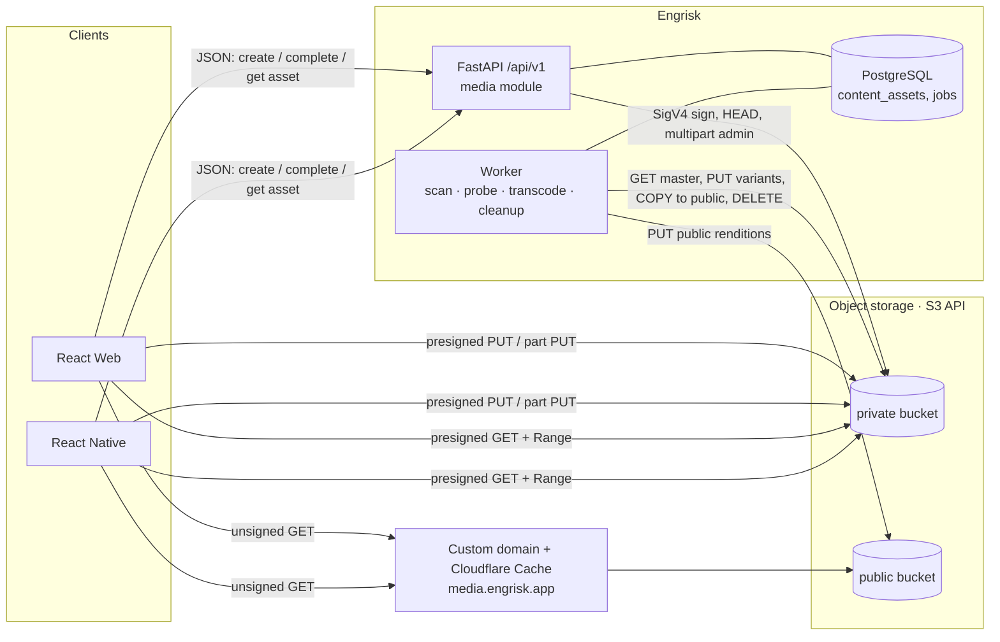
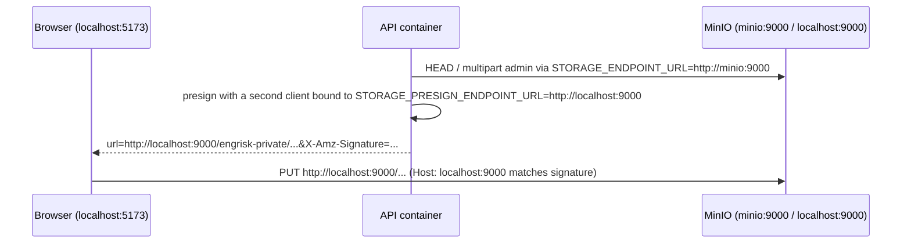
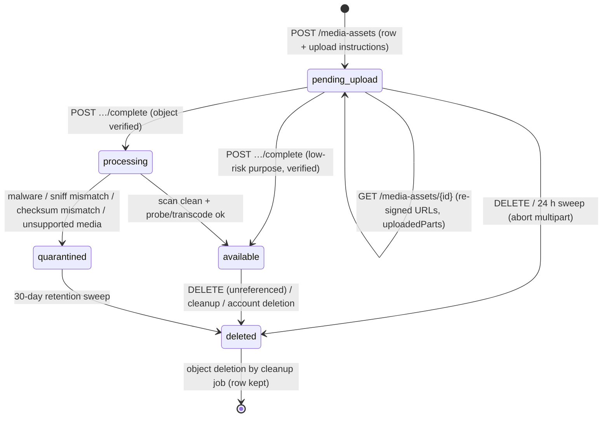
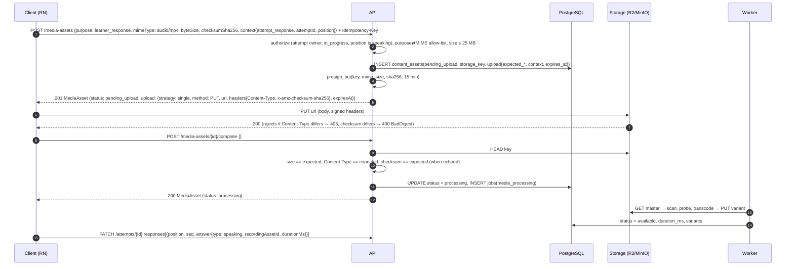
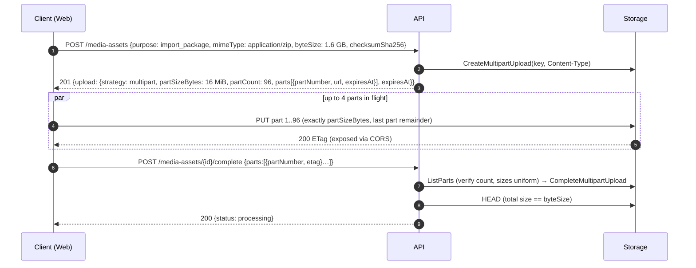
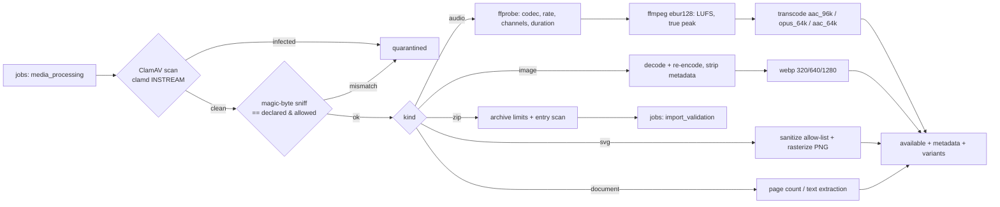
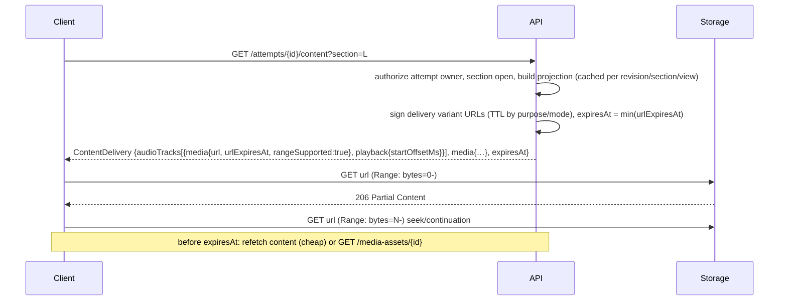

# Engrisk Object Storage Architecture

| | |
|---|---|
| Status | Design (no code, no infrastructure applied) |
| Scope | Binary files of Engrisk: listening audio, images, exam covers, tenant logos, speaking recordings, learner source materials, import packages and reports |
| Production | Cloudflare R2 (S3-compatible API) |
| Local / CI | MinIO (S3-compatible), Docker Compose / Testcontainers |
| Normative design | This document is the normative media & storage design; client-facing media operations are specified in [api_contract.md §7](./api_contract.md#7-media-workflow-contracts) and [openapi.yaml](./openapi.yaml). Integrator rulings: [api_design_review.md — Integrator rulings (A1–A14)](./api_design_review.md#integrator-rulings-a1a14) |
| Companion documents | [`api_architecture.md`](api_architecture.md) · [`api_contract.md`](api_contract.md) · [`openapi.yaml`](openapi.yaml) · [`api_data_mapping.md`](api_data_mapping.md) · [`api_design_review.md`](api_design_review.md) |

**Core principle.** Clients never talk to "R2" or "MinIO"; they talk to the Engrisk API and follow opaque URLs it returns (`UploadInstructions`, `MediaAccess`). The provider, bucket, object key and signing scheme are server-side details. The client-visible contract is **identical** for R2 and MinIO (§15).

Cloudflare facts below were checked against the R2 documentation on 2026-10-28; links are in §16.

---

## 1. Components



| Component | Responsibility |
|---|---|
| `media` module (API) | Validates purpose/MIME/size, creates `content_assets` rows, signs upload and download URLs, completes uploads, authorizes access by purpose + referencing entity ([api_contract.md §7.1](./api_contract.md#71-principles), TTLs in §8.2), never streams file bytes through the API. |
| Worker (`media_processing` job) | Malware scan, type sniffing, ffprobe/loudness, transcoding, thumbnails, SVG sanitizing, checksum verification for multipart, publish copies to the public bucket, cleanup sweeps. |
| `ObjectStorage` adapter | One Protocol, one S3-compatible implementation, provider profiles (§4). |
| Private bucket | Every master and every non-public rendition. No public access, no listing exposed. |
| Public bucket | Only immutable, content-addressed public renditions (published exam covers, tenant logos, sound-check sample). |

---

## 2. Production: Cloudflare R2

### 2.1 Buckets and endpoints

| Environment | Private bucket | Public bucket | S3 API endpoint (signing + presigned URLs) | Public base URL |
|---|---|---|---|---|
| production | `engrisk-prod-private` | `engrisk-prod-public` | `https://<ACCOUNT_ID>.r2.cloudflarestorage.com` | `https://media.engrisk.app` (custom domain on the public bucket) |
| staging | `engrisk-staging-private` | `engrisk-staging-public` | same account endpoint (or separate account) | `https://media.staging.engrisk.app` |

Facts that shape the design:

| R2 fact | Consequence for Engrisk |
|---|---|
| Presigned URLs work only on the S3 API domain `<ACCOUNT_ID>.r2.cloudflarestorage.com`, **not on custom domains**. | Private media is served directly from the S3 API domain; it does not pass through Cloudflare Cache or WAF in P1. |
| Presigned operations: `GET`, `HEAD`, `PUT`, `DELETE`. **`POST` (HTML form upload) is not supported.** | Uploads use presigned `PUT` (single) and presigned `UploadPart` `PUT`s (multipart). No browser form-POST policy documents. |
| Presigned URL expiry 1 second – 7 days. | All TTLs (§8.3) are minutes, far below the cap. |
| Region is `auto` (`us-east-1` and empty alias to `auto`). | `STORAGE_REGION=auto`; SigV4 credential scope uses `auto`. |
| A signed `Content-Type` makes uploads with a different type fail `403 SignatureDoesNotMatch`. | We sign `Content-Type` and `x-amz-checksum-sha256` into single PUT URLs. |
| Multipart: parts 5 MiB – 5 GiB, ≤ 10,000 parts, **all parts except the last must be the same size**. Single PUT ≤ 5 GiB. | Uniform `partSizeBytes` = 16 MiB; multipart above 64 MiB (`createMediaAsset` (op 73), [api_contract.md §7.2](./api_contract.md#72-purposes-and-limits)). 2 GB import package = 120 parts. |
| SHA-256 checksums: `COMPOSITE` type only (no `FULL_OBJECT` for SHA-256). | Single PUT: R2 verifies the whole-object SHA-256 at upload. Multipart: whole-file SHA-256 is verified by the worker (§7.4). |
| Buckets have a **default lifecycle rule that aborts incomplete multipart uploads 7 days** after initiation. | Backstop only; the API/worker abort stale uploads after 24 h (§12). |
| Expired presigned URLs return `403 ExpiredRequest` **without CORS headers**, so browser JS cannot read the body. | Clients treat any upload/playback network failure near `expiresAt` as "refresh URL" (re-GET the asset/content); the API, not the bucket, is the source of error semantics. |
| Multipart ETags differ from single-PUT ETags (MD5 of part MD5s + `-N`). | ETags are only used as opaque part receipts for `CompleteMultipartUpload`, never as content hashes. |
| `r2.dev` public URLs are rate-limited and for development only; production public access must use a custom domain (which also enables Cache, WAF, Bot Management). | Public bucket: custom domain `media.engrisk.app`, `r2.dev` access **disabled**. |
| No egress fees for any storage class; Class A (mutating) and Class B (read) operations are billed. | Delivery cost is driven by request counts, not bytes: prefer Range-friendly single objects (one GET per playback start, Range continuations), long-lived immutable public objects (cache absorbs Class B), and avoid HEAD storms (HEAD only at completion). |

### 2.2 Private bucket

- No custom domain, no `r2.dev`; access only through SigV4 (API/worker credentials) and presigned URLs minted by the API after authorization.
- Holds masters (`…/original`), delivery variants (`aac_96k`, `opus_64k`, thumbnails), learner recordings, source materials, import packages and reports.
- Objects are written with `Content-Type` = verified MIME and, for documents, `Content-Disposition: attachment` (variants written by the worker); downloads can override via `response-content-disposition` on presigned GET.

### 2.3 Public bucket, custom domain and cache

- Custom domain `media.engrisk.app` (zone on Cloudflare), `r2.dev` disabled.
- Only content-addressed, immutable keys are written: `public/{tenantId}/{purpose}/{assetId}-{sha256-12}.{ext}`. Objects are uploaded by the worker with `Cache-Control: public, max-age=31536000, immutable`.
- Cache Rule "Cache Everything" for the hostname with Edge TTL respecting origin headers; Smart Tiered Cache enabled (single upper tier near the bucket).
- Response header Transform Rule: `X-Content-Type-Options: nosniff`, `Content-Security-Policy: default-src 'none'; img-src 'self'; style-src 'unsafe-inline'; sandbox` (defense for any SVG/HTML that slips through).
- Replacing a cover or logo creates a **new key**; there is never a need to purge cache. Unpublishing deletes the object (cache entries expire or are purged by URL if immediate removal is legally required).

### 2.4 Future: private media at the edge (WAF HMAC)

P1 does not CDN-cache private media. If edge caching of private listening audio becomes worthwhile (popular platform mocks, high Class B volume), the documented path is:

1. Attach a custom domain (e.g. `secure-media.engrisk.app`) to the private bucket (or a dedicated "edge" bucket of delivery variants).
2. WAF custom rule with `is_timed_hmac_valid_v0(<secret>, http.request.uri, <ttl>, http.request.timestamp.sec, …)` blocking requests without a valid token (Pro plan or above).
3. The API signs `MediaAccess.url` as `https://secure-media…/key?verify=<ts>-<mac>` instead of an S3 presign.

The client contract does not change (`url` + `urlExpiresAt`). Trade-offs: cached copies survive object deletion until purged (revocation gets weaker), and the HMAC secret becomes a second signing key to rotate. An alternative with the same contract is a Worker that validates our own token and reads R2 via binding.

### 2.5 Lifecycle rules (bucket level)

DB-driven cleanup (§12) is authoritative because rows and objects must change together. Bucket rules are a safety net only.

| Bucket | Rule | Setting | Why |
|---|---|---|---|
| private | Abort incomplete multipart uploads | keep R2 default **7 days** (optionally tighten to 2 days) | Orphaned parts from crashed clients/API after the 24 h DB sweep failed |
| public | Abort incomplete multipart uploads | default 7 days | Worker never uses multipart there; harmless |
| private / public | Object expiration by prefix | **none** | Keys are tenant-first (`{tenantId}/{purpose}/…`), so per-purpose prefixes do not exist; expiry is decided per row by the cleanup job. (See §12.3 for the trade-off.) |

### 2.6 CORS

Browser uploads and Web Audio/`fetch` playback from the app origins need CORS on the **private** bucket (presigned URLs on the S3 domain). `<audio src>`/`` without `crossorigin` do not need CORS, but waveform rendering and `fetch`-based uploads do.

```json
[
  {
    "AllowedOrigins": ["https://app.engrisk.app", "https://*.engrisk.app"],
    "AllowedMethods": ["GET", "HEAD", "PUT"],
    "AllowedHeaders": ["Content-Type", "x-amz-checksum-sha256", "Range"],
    "ExposeHeaders": ["ETag", "Content-Length", "Content-Range", "Accept-Ranges"],
    "MaxAgeSeconds": 3600
  }
]
```

- `ETag` must be exposed: the client returns part ETags in `POST /media-assets/{id}/complete {parts}`.
- No `DELETE` (only the server deletes). No `*` origin in production; staging has its own list. Wildcard subdomains cover P4 tenant subdomains (`{slug}.engrisk.app`) — verify the wildcard form against the bucket CORS validator when applying (otherwise list origins explicitly via IaC).
- React Native is not subject to CORS; the policy only matters for Web.
- Public bucket: `GET`/`HEAD` from app origins (covers drawn on `<canvas>` for share images need CORS).

### 2.7 Credentials

| Principal | R2 token permission | Buckets | Holder |
|---|---|---|---|
| `api-<env>` | Object Read & Write | `<env>-private`, `<env>-public` | API pods (signing presigned URLs requires the secret; HEAD/multipart admin) |
| `worker-<env>` | Object Read & Write | `<env>-private`, `<env>-public` | Worker pods |
| `ops-<env>` | Admin Read & Write | all of env | IaC pipeline only (bucket, CORS, lifecycle, domain); never in app runtime |

R2 "Object Read & Write" tokens also allow listing objects in the scoped buckets; listing therefore cannot be removed by token scope. It is unreachable to clients because credentials never leave the server, presigned URLs grant a single operation on a single key, and the public custom domain serves object GETs only. Tokens are per environment, stored in the secret manager, rotated at least every 90 days (two-key overlap: deploy new key, wait > max presign TTL, revoke old key — revoking a key invalidates all URLs signed with it, which is also the emergency mass-revocation lever).

---

## 3. Local: MinIO

### 3.1 Compose sketch

```yaml
# docker-compose.yml (excerpt; local development only)
services:
  minio:
    image: ${MINIO_IMAGE:-minio/minio@sha256:<pinned-digest>}   # see note on image availability
    command: server /data --console-address ":9001"
    environment:
      MINIO_ROOT_USER: ${MINIO_ROOT_USER:-engrisk}
      MINIO_ROOT_PASSWORD: ${MINIO_ROOT_PASSWORD:-engrisk-local-only}
      MINIO_API_CORS_ALLOW_ORIGIN: "http://localhost:5173,http://localhost:8081"
      MINIO_API_STALE_UPLOADS_EXPIRY: "24h"
    ports: ["9000:9000", "9001:9001"]
    volumes: ["minio-data:/data"]
    healthcheck:
      test: ["CMD", "curl", "-fsS", "http://localhost:9000/minio/health/ready"]
      interval: 5s
      retries: 20

  minio-init:
    image: ${MC_IMAGE:-minio/mc@sha256:<pinned-digest>}
    depends_on: { minio: { condition: service_healthy } }
    entrypoint: ["/bin/sh", "-c"]
    command:
      - |
        mc alias set local http://minio:9000 "$$MINIO_ROOT_USER" "$$MINIO_ROOT_PASSWORD"
        mc mb --ignore-existing local/engrisk-private local/engrisk-public
        mc anonymous set none     local/engrisk-private
        mc anonymous set download local/engrisk-public
        mc admin user add local engrisk-app engrisk-app-secret || true
        mc admin policy create local engrisk-app /policies/engrisk-app.json || true
        mc admin policy attach local engrisk-app --user engrisk-app || true
    environment:
      MINIO_ROOT_USER: ${MINIO_ROOT_USER:-engrisk}
      MINIO_ROOT_PASSWORD: ${MINIO_ROOT_PASSWORD:-engrisk-local-only}
    volumes: ["./infra/minio/policies:/policies:ro"]

  api:
    environment:
      STORAGE_PROVIDER: minio
      STORAGE_ENDPOINT_URL: http://minio:9000            # container network
      STORAGE_PRESIGN_ENDPOINT_URL: http://localhost:9000 # what the browser/simulator can reach
      STORAGE_REGION: us-east-1
      STORAGE_ADDRESSING_STYLE: path
      STORAGE_BUCKET_PRIVATE: engrisk-private
      STORAGE_BUCKET_PUBLIC: engrisk-public
      STORAGE_PUBLIC_BASE_URL: http://localhost:9000/engrisk-public
volumes:
  minio-data: {}
```

`engrisk-app.json` grants `s3:GetObject`, `s3:PutObject`, `s3:DeleteObject`, `s3:AbortMultipartUpload`, `s3:ListMultipartUploadParts` on `engrisk-private/*` and `engrisk-public/*` — the same least-privilege intent as the R2 tokens (the app does not use the root user).

**Image availability (operational risk).** The MinIO community edition moved to source-only distribution in late 2025 (no new official binaries/images) and the `minio/minio` repository was archived in April 2026. Local/CI must therefore pin a **digest** of the last published community image or an internally built image from the final source release, and accept that it receives no security fixes. This is acceptable only because MinIO never runs in production and is not internet-exposed. The adapter design keeps a swap (another S3-compatible server) to a configuration change; the contract test suite (§13) is the acceptance gate for any replacement.

### 3.2 MinIO specifics

| Topic | MinIO behaviour | Design response |
|---|---|---|
| Addressing | Path-style by default (`http://host:9000/bucket/key`); virtual-host style requires `MINIO_DOMAIN` | `STORAGE_ADDRESSING_STYLE=path` |
| Region | `us-east-1` default | `STORAGE_REGION=us-east-1` (R2 aliases `us-east-1` to `auto` too, but we keep `auto` for R2) |
| Public bucket | Anonymous read via `mc anonymous set download` (no listing granted) | Public URLs `http://localhost:9000/engrisk-public/<key>` behave like the R2 custom domain (no signature, no expiry) |
| CORS | Community edition applies a **global** allow-list (`MINIO_API_CORS_ALLOW_ORIGIN`, default `*`); per-bucket `PutBucketCors` is not supported | Set the env var to the local dev origins; contract tests assert preflight behaviour, not the configuration API |
| Stale multipart uploads | Expired after `MINIO_API_STALE_UPLOADS_EXPIRY` (default 24 h), sweep every 6 h | Matches our 24 h DB sweep; no lifecycle config needed locally |
| Checksums | Supports `x-amz-checksum-sha256` on PUT | Verified by contract tests (§13), not assumed |

### 3.3 Presign endpoint vs internal endpoint (Host-signature pitfall)

SigV4 signs the `Host` header. The API container reaches MinIO as `minio:9000`, but the browser or iOS simulator reaches it as `localhost:9000` (Android emulator: `10.0.2.2:9000`; physical device: the LAN IP). A URL signed for `minio:9000` and rewritten to `localhost:9000` fails with `SignatureDoesNotMatch`.



Rule: the adapter holds **two clients** — an operations client (`STORAGE_ENDPOINT_URL`) and a presign client (`STORAGE_PRESIGN_ENDPOINT_URL`, defaults to the former). Never rewrite hosts in signed URLs. In production R2 both are the same public S3 endpoint.

---

## 4. S3-compatible adapter

### 4.1 Protocol

```python
# backend/engrisk/media/storage.py  (design sketch)
from dataclasses import dataclass
from datetime import datetime, timedelta
from typing import Literal, Protocol, Sequence

Bucket = Literal["private", "public"]

@dataclass(frozen=True, slots=True)
class PresignedRequest:
    method: Literal["GET", "PUT", "HEAD"]
    url: str
    headers: dict[str, str]          # headers the client MUST send (signed), e.g. Content-Type, x-amz-checksum-sha256
    expires_at: datetime

@dataclass(frozen=True, slots=True)
class ObjectHead:
    key: str
    byte_size: int
    content_type: str | None
    etag: str
    checksum_sha256: str | None      # base64; present for single PUT with checksum (composite for multipart)
    last_modified: datetime

@dataclass(frozen=True, slots=True)
class UploadedPart:
    part_number: int
    etag: str
    byte_size: int

class ObjectStorage(Protocol):
    def presign_put(self, key: str, mime: str, size: int, checksum_sha256: str, ttl: timedelta,
                    *, bucket: Bucket = "private") -> PresignedRequest: ...
    def create_multipart(self, key: str, mime: str, *, bucket: Bucket = "private") -> str: ...   # upload_id
    def presign_upload_part(self, key: str, upload_id: str, part_number: int, ttl: timedelta,
                            *, bucket: Bucket = "private") -> PresignedRequest: ...
    def list_parts(self, key: str, upload_id: str, *, bucket: Bucket = "private") -> Sequence[UploadedPart]: ...
    def complete_multipart(self, key: str, upload_id: str, parts: Sequence[tuple[int, str]],
                           *, bucket: Bucket = "private") -> ObjectHead: ...
    def abort_multipart(self, key: str, upload_id: str, *, bucket: Bucket = "private") -> None: ...
    def head(self, key: str, *, bucket: Bucket = "private") -> ObjectHead | None: ...
    def presign_get(self, key: str, ttl: timedelta, response_content_type: str | None = None,
                    response_disposition: str | None = None) -> PresignedRequest: ...
    def public_url(self, key: str) -> str: ...
    def copy(self, src: str, dst: str, *, dst_bucket: Bucket = "private",
             content_type: str | None = None, cache_control: str | None = None) -> None: ...
    def delete(self, key: str, *, bucket: Bucket = "private") -> None: ...
```

The method set is the normative `ObjectStorage` interface; keyword-only extras (`bucket`, `cache_control`, `content_type` on copy) are the minimum needed for public renditions. Worker-only streaming (`open_read(key) -> BinaryIO`, `put_file(key, path, mime, …)`) lives on a separate `ObjectStreamer` Protocol used by processing jobs, so the API module cannot accidentally proxy bytes. Methods are synchronous in the sketch; the implementation may expose `async` variants (aioboto3) with identical signatures.

### 4.2 `S3CompatibleStorage`

- boto3/botocore (or aioboto3), `signature_version="s3v4"`, `region_name=STORAGE_REGION`, `s3={"addressing_style": STORAGE_ADDRESSING_STYLE}`.
- Two clients (§3.3): `ops_client(endpoint_url=STORAGE_ENDPOINT_URL)`, `presign_client(endpoint_url=STORAGE_PRESIGN_ENDPOINT_URL or STORAGE_ENDPOINT_URL)`.
- Pin `request_checksum_calculation="when_required"` and `response_checksum_validation="when_required"` (botocore ≥ 1.36 otherwise adds default CRC checksum headers/params that third-party S3 implementations and presigned URLs may not expect); we add SHA-256 explicitly where we want it.
- `presign_put` signs `ContentType`, `ContentLength` is enforced at completion (HEAD) rather than signed (browsers set it automatically), and `ChecksumSHA256` → signed header `x-amz-checksum-sha256`. The returned `headers` map is what the API puts into `SingleUpload.headers`.
- `presign_upload_part` signs `UploadPart` with `PartNumber`/`UploadId`; no per-part checksum (the client cannot know part hashes when the URLs are minted).
- `presign_get` maps `response_content_type`/`response_disposition` to `ResponseContentType`/`ResponseContentDisposition` query overrides (contract-tested on both providers).
- Connection pooling sized for the API worker count; timeouts: connect 2 s, read 10 s (HEAD/complete); retries `standard` mode, max 3.

### 4.3 Provider profiles

Profiles only set defaults and capability flags; every value can be overridden by env.

| Setting | `r2` | `minio` | `s3` (fallback/AWS) |
|---|---|---|---|
| Endpoint | `https://<ACCOUNT_ID>.r2.cloudflarestorage.com` | `http://minio:9000` (ops), `http://localhost:9000` (presign) | AWS regional (unset) |
| Region | `auto` | `us-east-1` | e.g. `ap-southeast-1` |
| Addressing | `virtual` (path also works) | `path` | `virtual` |
| Presigned POST | not supported (never used) | supported (never used) | supported (never used) |
| Presigned URLs on custom domain | no | n/a | no (CloudFront signed URLs instead) |
| SHA-256 checksum | single PUT: object; multipart: composite only | supported | full-object or composite |
| Default incomplete-multipart expiry | 7 days (bucket default rule) | 24 h (`stale_uploads_expiry`) | none unless lifecycle configured |
| Bucket CORS API | `PutBucketCors` supported | global env only (community) | supported |
| Public access | custom domain (no listing) | `anonymous set download` | bucket policy / CloudFront |

### 4.4 Error mapping

| Storage condition (botocore `Error.Code` / HTTP) | Adapter exception | API problem ([api_contract.md §1.7](./api_contract.md#17-error-contract)) |
|---|---|---|
| `NoSuchKey`, 404 on HEAD | `ObjectNotFound` → `head()` returns `None` | `409 media.upload_incomplete` (complete before PUT) |
| `NoSuchUpload` | `UploadNotFound` | `410 media.upload_expired` |
| `InvalidPart`, `InvalidPartOrder`, `EntityTooSmall` | `InvalidMultipart` | `409 media.upload_incomplete` (with `errors[]` pointers to part numbers) |
| `BadDigest`, checksum mismatch on HEAD | `ChecksumMismatch` | `422 media.checksum_mismatch` |
| HEAD size ≠ declared `byteSize` | `SizeMismatch` (raised by service) | `422 media.size_mismatch` |
| `SignatureDoesNotMatch`, `AccessDenied`, `InvalidAccessKeyId` (server-side calls) | `StorageMisconfigured` (alert) | `503 service_unavailable` |
| `SlowDown`, 429, 5xx, timeouts after retries | `StorageUnavailable` | `503 service_unavailable` + `Retry-After` |
| `EntityTooLarge` | `ObjectTooLarge` | `413 media.too_large` (also pre-validated at create) |

Storage errors never leak provider codes or keys to clients; the original code is logged with `traceId`.

### 4.5 Testing fakes

- `InMemoryObjectStorage` implements `ObjectStorage` (dict of key → bytes + metadata; multipart state machine with uniform-size enforcement; SHA-256 verification; TTL-aware URLs `memory://{bucket}/{key}?exp=…&sig=…`). Test helpers `client_put(presigned, body, headers)` and `client_get(presigned, range=…)` simulate the client side including signed-header enforcement and expiry, so service tests cover create → upload → complete → access without network.
- Used by unit tests of the media service, authoring publish (cover copy), cleanup jobs and policies.
- Must pass the same contract test suite as real providers (§13.2) for the subset it emulates, so the fake cannot drift.

---

## 5. Environment configuration

All storage settings of the backend. Secrets come from the secret manager; values below are examples, never real credentials.

| Variable | Meaning | R2 (production) example | MinIO (local) example |
|---|---|---|---|
| `STORAGE_PROVIDER` | Profile: `r2` \| `minio` \| `s3` | `r2` | `minio` |
| `STORAGE_ENDPOINT_URL` | Endpoint used by API/worker for operations | `https://<ACCOUNT_ID>.r2.cloudflarestorage.com` | `http://minio:9000` |
| `STORAGE_PRESIGN_ENDPOINT_URL` | Endpoint embedded in presigned URLs (must be client-reachable); defaults to `STORAGE_ENDPOINT_URL` | *(unset — same as endpoint)* | `http://localhost:9000` |
| `STORAGE_REGION` | SigV4 region | `auto` | `us-east-1` |
| `STORAGE_ACCESS_KEY_ID` | Access key (secret manager) | `<from secret manager>` | `engrisk-app` |
| `STORAGE_SECRET_ACCESS_KEY` | Secret key (secret manager; never in repo) | `<from secret manager>` | `engrisk-app-secret` (local only) |
| `STORAGE_BUCKET_PRIVATE` | Private bucket | `engrisk-prod-private` | `engrisk-private` |
| `STORAGE_BUCKET_PUBLIC` | Public bucket | `engrisk-prod-public` | `engrisk-public` |
| `STORAGE_PUBLIC_BASE_URL` | Base URL for public objects | `https://media.engrisk.app` | `http://localhost:9000/engrisk-public` |
| `STORAGE_ADDRESSING_STYLE` | `path` \| `virtual` \| `auto` | `virtual` | `path` |
| `STORAGE_PRESIGN_TTL_UPLOAD_SECONDS` | Single PUT URL TTL | `900` | `900` |
| `STORAGE_PRESIGN_TTL_UPLOAD_PART_SECONDS` | Multipart part URL TTL (re-issued on resume) | `3600` | `3600` |
| `STORAGE_PRESIGN_TTL_LEARNER_RESPONSE_SECONDS` | Own recording playback | `300` | `300` |
| `STORAGE_PRESIGN_TTL_PRACTICE_CONTENT_SECONDS` | Practice/review content media | `1800` | `1800` |
| `STORAGE_PRESIGN_TTL_MOCK_TRACK_EXTRA_SECONDS` | Added to the section window for mock tracks | `600` | `600` |
| `STORAGE_PRESIGN_TTL_AUTHORING_SECONDS` | Studio/preview media | `900` | `900` |
| `STORAGE_PRESIGN_TTL_IMPORT_SECONDS` | Import package / report download | `600` | `600` |
| `STORAGE_MULTIPART_THRESHOLD_BYTES` | Multipart above this size | `67108864` (64 MiB) | `67108864` |
| `STORAGE_MULTIPART_PART_SIZE_BYTES` | Uniform part size | `16777216` (16 MiB) | `16777216` |
| `STORAGE_CHECKSUM_ALGORITHM` | Integrity algorithm | `sha256` | `sha256` |

`STORAGE_PRESIGN_TTL_*` is a family of variables; the listed members are its concrete instances. Startup validation fails fast if: TTL > 604,800 s, part size < 5 MiB or > 5 GiB, `threshold / part size` could exceed 10,000 parts for the largest purpose limit, or `STORAGE_PRESIGN_ENDPOINT_URL` is a private hostname in a non-local environment.

---

## 6. Asset lifecycle



| Purpose | After `complete` | Processing steps | Delivered rendition |
|---|---|---|---|
| `question_media` audio | `processing` | ClamAV scan → libmagic sniff → ffprobe (codec, sample rate, channels, duration) → EBU R128 loudness/true peak (ffmpeg `ebur128`) → transcode delivery variants | `aac_96k` (AAC-LC in M4A, 44.1/48 kHz, mono) for all clients; optional `opus_64k` (WebM) for Web; master never to learners |
| `question_media` image | `processing` | scan → sniff → decode/re-encode (strips EXIF/ICC payloads) → thumbnails | `webp_1280`, `webp_640`, `webp_320` |
| `learner_response` | `processing` | scan → sniff → ffprobe (≤ 5 min, ≤ 25 MB) → normalize to `aac_64k` mono (transcription input + playback) | `aac_64k` (or original if already AAC/M4A) |
| `source_material` | `processing` | scan → sniff → page count / text extraction (`material_extraction` job) | download of original (owner only) |
| `exam_cover` | `processing` | scan → sniff → re-encode → thumbnails; on exam publish: copy to public bucket | private draft preview; public `variants.public` once published |
| `branding` | `processing` | scan → sniff → PNG/WebP re-encode; SVG sanitized **and** rasterized to PNG | public PNG/WebP (SVG kept as sanitized source) |
| `import_package` | `processing` | scan (archive-aware) → zip safety limits → hand over to `import_validation` | never delivered except to importers |
| `import_report` (system) | `available` | written by worker | CSV download to import staff |

Status reasons are coarse (`failureReason`): `malware_detected`, `type_mismatch`, `checksum_mismatch`, `unsupported_media`, `limits_exceeded`.

---

## 7. Upload flows

### 7.1 Single PUT (≤ 64 MiB): e.g. IELTS Speaking recording (scenario S5)



Notes:
- The answer may reference a `processing` asset; grading/evaluation waits for `available` (evaluation job dependency), and submit does not block on processing.
- Clients must send exactly the returned `headers`; they are part of the signature.
- Completion is idempotent: repeating `complete` on an already `processing`/`available` asset returns the current representation.

### 7.2 Multipart (> 64 MiB): e.g. import package (scenario S7) or long section master



- `partSizeBytes` is uniform (R2 requires all parts but the last to be equal) and ≥ 5 MiB; `partCount = ceil(byteSize / partSizeBytes)`.
- For very large `partCount`, the API returns the first N part URLs (N = 100) and the remainder via `GET /media-assets/{id}` (resume path), keeping the create response small.

### 7.3 Resume (scenario S9)

1. Client restarts (app killed, network change) with the persisted `assetId`.
2. `GET /media-assets/{id}` → `status: pending_upload`, freshly signed `upload` instructions and `uploadedParts[{partNumber, etag, byteSize}]` (from `ListParts`, not from the DB).
3. Client uploads only missing parts, then `complete`.
4. If the multipart upload was aborted (24 h sweep or R2 7-day rule), `complete` returns `410 media.upload_expired`; the client creates a new asset.

Single PUT uploads resume by re-PUTting the whole object with a re-signed URL (≤ 64 MiB by construction).

### 7.4 Completion verification

| Check | Single PUT | Multipart |
|---|---|---|
| Object exists | HEAD | `ListParts` + `CompleteMultipartUpload` result |
| Size | HEAD `Content-Length` == `byteSize` → else `422 media.size_mismatch` | same |
| Content-Type | signed at PUT; HEAD confirms | set at `CreateMultipartUpload` |
| SHA-256 | Enforced by storage at PUT (signed `x-amz-checksum-sha256`); HEAD with checksum mode confirms → `422 media.checksum_mismatch` | Storage only offers a **composite** SHA-256 (hash of part hashes); the whole-file `checksumSha256` is verified by the worker while streaming the object in `processing`. Mismatch → `quarantined`, `failureReason: checksum_mismatch` |
| Real type | — (worker sniffs magic bytes in `processing`) | same |
| Expiry | `upload.expires_at` passed → `410 media.upload_expired` | same |

The asynchronous multipart checksum verification is a deliberate deviation from "complete verifies checksum" in `completeMediaUpload` (op 75, [api_contract.md §2](./api_contract.md#2-endpoint-inventory-103-operations)) for multipart only; it is listed in [`api_data_mapping.md`](api_data_mapping.md) §9 and the design review.

### 7.5 Processing pipeline



- Workers run ffmpeg/ClamAV in a sandboxed container (no network except storage + DB, read-only root FS, CPU/memory/time limits per job).
- Measured audio QC values for section tracks are copied into `revision_audio_tracks` (`loudness_lufs`, `true_peak_dbtp`, `qc`) by `putAudioTrack`, even when they fail thresholds (publish gates are in validation, not in storage).
- `audio_normalization` (job) produces a **new** asset; the original master is kept.

---

## 8. Download and playback

### 8.1 Embedded `MediaAccess`

Clients never request "a playback URL" per context. URLs are embedded where media is referenced (`ContentDelivery.media{assetId}`, `audioTracks[].media`, `ExamCover.image`, `AudioTrackAuthoring.asset`, `soundCheck`) and refreshed via the containing resource or `GET /media-assets/{id}`.



- Range requests are supported by R2 and MinIO on presigned GETs; `MediaAccess.rangeSupported` is always `true`. AAC in M4A is written with the `moov` atom at the front (`-movflags +faststart`) so playback starts after the first Range response.
- `Cache-Control` of the containing JSON is `private, max-age` ≤ the earliest embedded URL TTL ([api_contract.md §1](./api_contract.md#1-conventions)).

### 8.2 TTL policy

| Purpose / context | URL type | TTL | Notes |
|---|---|---|---|
| Learner's own recording (`learner_response`) | presigned GET | 5 min | owner only (+ P4 `evaluation.review`) |
| Practice / review content media (group clips, images, track for practice clips) | presigned GET | 30 min | refetch content after expiry |
| Mock section track | presigned GET | section window + 10 min | issued once per (attempt, section); repeated content fetches during the window return the **same** URL and expiry (not extended) |
| Authoring / reviewer preview (incl. masters) | presigned GET | 15 min | |
| Import package / import report | presigned GET (`Content-Disposition: attachment`) | 10 min | `303` redirect for CSV report |
| Upload single PUT | presigned PUT | 15 min | |
| Upload part | presigned PUT | 60 min | re-issued by `GET /media-assets/{id}` |
| Public (published cover, logo, sound check) | unsigned public URL | none (`urlExpiresAt: null`) | immutable, content-addressed |

### 8.3 Mock audio: what is and is not enforced

There is **no DRM**. A learner holding a signed URL can download the delivery variant while it is valid. Enforcement that matters for exam integrity is server-side:

| Enforced server-side | Client-side only (UX, not security) |
|---|---|
| Section windows (`sections_state`) and deadline; answers to closed sections rejected per change (`attempt.section_closed`) | Disabling seek, replay and speed controls |
| Future sections not delivered (`403 attempt.section_locked`) | Hiding the scrubber |
| Delivery variant only; masters, fine cues, transcripts never delivered in mock | Preventing screen/audio recording |
| Coarse schedule only (group spans), no per-question cue map | |
| URL TTL bounded to the window + 10 min; same URL per section (no fresh URLs to extend access) | |
| `playback.startOffsetMs` computed from server time on resume (no "restart from 0") | |

Residual risk (accepted): re-listening to a downloaded file during the open window. It cannot change answers after the window closes, and mock scores are labelled estimates, not official results.

---

## 9. Object key naming

| Bucket | Pattern | Example |
|---|---|---|
| private | `{tenantId}/{purpose}/{yyyy}/{mm}/{assetId}/{variant}` | `7f3c…/question_media/2026/10/1b9e…/original` · `…/1b9e…/aac_96k` · `…/webp_640` |
| public | `public/{tenantId}/{purpose}/{assetId}-{sha256-12}.{ext}` | `public/7f3c…/exam_cover/52aa…-9f2c1e0b7a44.webp` |

Rules:
- Built only by the server from ids; no user ids, emails, file names or titles in keys. `original_filename` is stored in the DB for display.
- `assetId` (UUIDv4) makes keys unguessable; `yyyy/mm` comes from `created_at` (operational browsing and per-month inventory); `variant` names are from a fixed vocabulary (`original`, `aac_96k`, `aac_64k`, `opus_64k`, `webp_320`, `webp_640`, `webp_1280`, `png`, `csv`).
- The tenant prefix is the first isolation layer for operational tooling and future per-tenant export/deletion; the authoritative tenant check is the DB row (`content_assets.tenant_id`).
- Public keys embed the first 12 hex chars of the SHA-256 so a changed file always gets a new URL (immutable caching).

---

## 10. Security

| Threat / concern | Control |
|---|---|
| Unauthorized access to private files | Private buckets; access only via presigned URLs minted after policy checks by purpose + referencing entity; 404 for non-authorized ids ([api_contract.md §7.1](./api_contract.md#71-principles), scenario S10 in [api_contract.md §10](./api_contract.md#10-end-to-end-scenarios-s1s10)). |
| Enumeration / listing | No public listing on either bucket (R2 custom domain serves object GETs; MinIO anonymous policy is `download` only on the public bucket); keys are UUID-based; credentials never leave the server. |
| Leaked signed URL (bearer token) | Short TTLs by purpose; single-object, single-operation scope; unguessable keys; revocation by deleting/rotating the object key or (mass) rotating the signing key; URLs never logged in full (signature query stripped in logs). |
| Over-privileged credentials | Per-environment tokens, Object Read & Write scoped to the env's buckets; admin token only in IaC; quarterly rotation with overlap. |
| Malware | ClamAV scan of every upload before `available`; archive-aware for zip; quarantined objects are never signed for download (`409 media.quarantined` on access). |
| Content-type confusion / stored XSS | MIME allow-list per purpose at create; signed `Content-Type`; magic-byte sniffing in processing; images re-encoded; documents downloaded with `Content-Disposition: attachment`; private media served from the storage origin (`*.r2.cloudflarestorage.com`), which holds no app cookies; public domain adds `nosniff` + restrictive CSP. |
| SVG (branding) | Sanitized with an allow-list (no `<script>`, `<foreignObject>`, event handlers, external `href`, `data:` except raster images); clients receive the rasterized PNG; the SVG is kept only as source. |
| Zip bombs / path traversal (import) | ≤ 2 GB package, ≤ 5,000 entries, ratio ≤ 100:1 per entry and overall (content_studio_spec §10.2), absolute uncompressed cap 10 GiB, per-entry cap 600 MB (audio limit 500 MB + headroom), ASCII relative paths only, no `..`, no absolute paths, no symlinks; streaming extraction in the sandbox with disk quota. |
| Oversized uploads | Size declared at create (`413 media.too_large`), verified on HEAD (`422 media.size_mismatch`); multipart part count bounded. |
| Tenant isolation | Tenant id in key prefix and in the DB row; every lookup scoped by token `tid`; composite FKs keep referencing entities in the same tenant; learner recordings readable only by the owner (+ P4 audited `evaluation.review`). |
| Integrity | SHA-256 declared at create, enforced on single PUT, verified by worker for multipart; stored in `content_assets.sha256` for dedup/integrity. |
| Privacy of learner data | Recordings and source materials live in the learner's active tenant; account deletion removes them (§12). No PII in keys or object metadata. |

---

## 11. Caching and CDN

| Object class | P1 delivery | CDN | Notes |
|---|---|---|---|
| Public immutable (published covers, logos, sound check) | `https://media.engrisk.app/public/…` | Cloudflare Cache (Cache Everything, Smart Tiered Cache), `max-age=31536000, immutable` | New content → new key; no purges in normal operation |
| Private media (audio, images in content, recordings, documents) | presigned GET on the S3 API domain | **not cached at the edge** in P1 (presigned URLs cannot use custom domains) | Browser cache honours object `Cache-Control: private, max-age=<≤ TTL>` set on variants; each new URL is a new cache key anyway |
| Content JSON (`ContentDelivery`) | API | none (private) | Server caches the immutable projection per (revision, section, view); signing per request |
| Future private edge caching | custom domain + WAF HMAC token or Worker auth (§2.4) | yes | Same `MediaAccess` contract; revisit when Class B volume or latency justify it |

Zero egress makes direct delivery from R2 affordable; the remaining cost lever is request count (Range continuations are Class B operations), which the delivery variants (small AAC files) and long practice TTLs keep low.

---

## 12. Object cleanup

### 12.1 Policies

| Case | Trigger | Action | Retention |
|---|---|---|---|
| Stale pending uploads | `status = pending_upload AND updated_at < now() - 24 h` | abort multipart, delete object if present, status `deleted` | 24 h |
| Unreferenced uploads | `available`, not referenced by any entity (group, track, exam cover, branding, source material, response, import job) | soft delete (`deleted_at`, `deleted`) after grace, then object deletion | 7 days grace after creation for authoring media; learner recordings not attached to a response: 24 h |
| Referenced by published content | — | **never deleted** while referenced by any published/retired revision | indefinite |
| Quarantined | `status = quarantined` | delete object, keep row | 30 days |
| Deleted (soft) | `status = deleted` | delete master + all variants (+ public copy) | within 24 h; row kept for referential history |
| Account deletion (`DELETE /me` → `account_deletion` job) | user deletion | delete `learner_response` and `source_material` assets and objects; anonymize attempts; authored published content stays (credits anonymized per user choice) | job SLA 30 days (target: hours) |
| Unconverted guests | `ix_users_guest_cleanup` policy (product decision) | same as account deletion for the guest user | proposal: 90 days of inactivity |
| Import packages | job `completed`/`failed` | delete package object | 30 days after finish |
| Import reports | job finished | delete report | 30 days after finish |
| Unpublished cover/logo public copies | exam archived / logo replaced | delete public object | immediate (cache: purge by URL if needed) |
| Orphan objects (no DB row) | weekly reconciliation: list bucket prefix vs `content_assets.storage_key`/`variants` | delete objects older than 48 h with no row | report counts |

### 12.2 Mechanics

- One `storage_cleanup` worker sweep every 15 min uses the partial index on `content_assets (status, updated_at)` (gap G26) and reference queries; each object deletion is idempotent (`delete` of a missing key is a no-op).
- Row first, object second: the row moves to `deleted` in a transaction; object deletion follows; the reconciliation job catches crashes between the two.
- Bucket-level lifecycle (R2 default 7-day multipart abort, MinIO 24 h stale uploads) is only the backstop.

### 12.3 Trade-off: tenant-first keys vs lifecycle rules

R2 lifecycle conditions are prefix-based. With the tenant-first `{tenantId}/{purpose}/…` keys (§9) there is no global per-purpose prefix, so rules like "expire `import_package` after 30 days" cannot be expressed in the bucket. We accept DB-driven cleanup (needed anyway to keep rows consistent). If bucket-enforced retention becomes a compliance requirement, the alternative is a purpose-first scheme (`{purpose}/{tenantId}/…`) or a dedicated short-retention bucket for import packages/reports — a design-review item, not a change here.

---

## 13. Local integration testing strategy

### 13.1 Layers

| Layer | Storage | Runs | Purpose |
|---|---|---|---|
| Unit | `InMemoryObjectStorage` | every commit | media service, policies, cleanup selection, URL/TTL rules |
| Integration | MinIO via Testcontainers (Python `testcontainers` MinIO module) or the Compose service in CI | every PR | real SigV4, presign round-trips, multipart, CORS preflight |
| Provider contract | same suite against MinIO **and** an R2 test bucket (`engrisk-ci-private/public`, dedicated token, 1-day lifecycle) | nightly + before release | prove identical client-visible behaviour |
| End-to-end | API + MinIO + Web (Playwright) / RN (Detox, emulator presign host `10.0.2.2`) | release candidates | S5/S7/S9/S10 scenarios |

### 13.2 Contract test suite (parametrized by provider)

| Test | Assertion |
|---|---|
| Presign PUT round-trip | PUT with exact signed headers → 200; HEAD size/type match |
| Signed Content-Type | PUT with a different `Content-Type` → 403 |
| Checksum | PUT with wrong `x-amz-checksum-sha256` → rejected (400 `BadDigest`/`InvalidRequest`); correct → stored and echoed on HEAD (checksum mode) |
| Expiry | URL with 1 s TTL used after 2 s → 403 |
| Multipart uniform parts | 3 × 5 MiB + remainder completes; non-uniform middle part → complete fails |
| Resume | `list_parts` returns uploaded parts with ETags after a simulated client restart |
| Abort | `abort_multipart` → subsequent `complete` maps to `media.upload_expired` |
| Presign GET + Range | `Range: bytes=0-1023` → 206 with `Content-Range`; `Accept-Ranges: bytes` |
| Response overrides | `response-content-disposition=attachment` reflected in GET headers |
| CORS preflight | `OPTIONS` from allowed origin with `Access-Control-Request-Method: PUT`, `Access-Control-Request-Headers: content-type,x-amz-checksum-sha256` → allowed; `ETag` exposed on PUT response; disallowed origin → no ACAO header |
| Public vs private | anonymous GET of public key → 200; anonymous GET of private key → 403; anonymous listing of either bucket → denied |
| Host signing | URL signed with presign endpoint is usable from the test client; URL host-rewritten → 403 (documents the pitfall) |
| Copy to public | `copy` with `Cache-Control` → public GET returns the header |
| Delete idempotency | deleting a missing key succeeds |
| Error mapping | each row of §4.4 produces the mapped adapter exception |

### 13.3 API-level tests

- `POST /media-assets` → client PUT → `complete` → `GET` returns `MediaAccess`; the JSON is compared field-by-field between MinIO and R2 runs after normalizing `url` host/signature (shape identity).
- Policy tests for S10: learner B requesting learner A's recording → 404; signed URLs never appear for quarantined/pending assets.
- Delivery tests: `ContentDelivery` contains no master keys, no fine cues, no transcript (absence asserted by property name).

---

## 14. Operational notes

- Metrics: uploads created/completed/expired by purpose, processing duration and failures by reason, quarantine count, presign rate, cleanup deletions, R2 Class A/B operation counts (Cloudflare analytics) vs active learners.
- Alerts: `StorageMisconfigured` (signature/credential errors), processing backlog > 5 min, quarantine spike, cleanup reconciliation finding orphans > threshold.
- Backups: R2 has strong consistency and durability but no versioning-based undelete in our setup; published content masters are additionally replicated nightly to a second bucket/account (proposal; content is the business asset). Learner recordings are not backed up beyond R2 durability (privacy, deletion guarantees).

---

## 15. Frontend contract parity: R2 and MinIO

**Statement.** The Web and React Native clients use one code path for every environment. Nothing in the API payloads, headers or client behaviour depends on whether the server runs against Cloudflare R2 or MinIO; only URL hosts differ.

Checklist (enforced by §13.2–13.3):

- [ ] `MediaAsset`, `UploadInstructions`, `MediaAccess` JSON shapes and enum values identical; no provider, bucket or key fields.
- [ ] Single uploads always `PUT` with the returned `headers` (`Content-Type`, `x-amz-checksum-sha256`); no presigned POST anywhere.
- [ ] Multipart: same threshold (64 MiB), uniform `partSizeBytes` (16 MiB), same `parts[]`/`uploadedParts[]` semantics and ETag echo in `complete`.
- [ ] Resume via `GET /media-assets/{id}` works identically (fresh URLs + `uploadedParts`).
- [ ] Error semantics come from the API (`media.*` problems), never from storage XML; clients treat storage-level failures (incl. R2's CORS-less 403 on expiry) as "refresh URL and retry".
- [ ] Playback: `url` is directly playable with Range; `urlExpiresAt` honoured; `null` for public URLs.
- [ ] Public URLs are unsigned and immutable in both (`media.engrisk.app` vs `localhost:9000/engrisk-public`).
- [ ] CORS: browser PUT/GET with the same headers succeed from configured origins in both.
- [ ] TTLs come from the same `STORAGE_PRESIGN_TTL_*` defaults in both.
- [ ] Mobile dev builds use a reachable `STORAGE_PRESIGN_ENDPOINT_URL` (emulator/LAN host), never a rewritten URL.

---

## 16. References

- Cloudflare R2 — Presigned URLs (S3 API domain only, no custom domains; GET/HEAD/PUT/DELETE; no POST; 1 s–7 days; WAF HMAC for custom domains): https://developers.cloudflare.com/r2/api/s3/presigned-urls/
- Cloudflare R2 — S3 API compatibility (region `auto`; checksum types: SHA-256 composite only): https://developers.cloudflare.com/r2/api/s3/api/
- Cloudflare R2 — Upload objects (multipart part sizes, equal part sizes, 10,000 parts, 7-day abort, multipart ETags): https://developers.cloudflare.com/r2/objects/upload-objects/
- Cloudflare R2 — Object lifecycles (default rule expires multipart uploads after seven days): https://developers.cloudflare.com/r2/buckets/object-lifecycles/
- Cloudflare R2 — CORS (presigned URLs, `ExposeHeaders: ETag`, expired URLs return 403 without CORS headers): https://developers.cloudflare.com/r2/buckets/cors/
- Cloudflare R2 — Public buckets (custom domains, cache, `r2.dev` not for production): https://developers.cloudflare.com/r2/buckets/public-buckets/
- Cloudflare R2 — Limits (5 GiB single upload, 10,000 parts, `r2.dev` rate limits): https://developers.cloudflare.com/r2/platform/limits/
- Cloudflare R2 — Pricing (no egress fees; Class A/B operations): https://developers.cloudflare.com/r2/pricing/
- Cloudflare R2 — API tokens (Object Read & Write includes list; bucket scoping): https://developers.cloudflare.com/r2/api/tokens/
- Cloudflare Rules language — `is_timed_hmac_valid_v0`: https://developers.cloudflare.com/ruleset-engine/rules-language/functions/#hmac-validation
- MinIO configuration (`MINIO_API_CORS_ALLOW_ORIGIN` default `*`, `MINIO_API_STALE_UPLOADS_EXPIRY` default 24 h): https://raw.githubusercontent.com/minio/minio/master/docs/config/README.md
- MinIO community edition distribution status (source-only; repository archived): https://github.com/minio/minio
